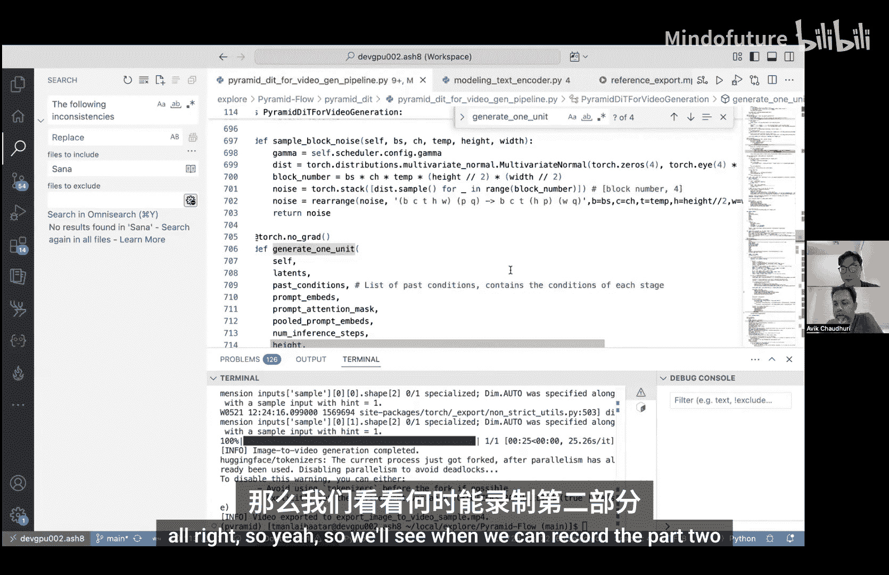
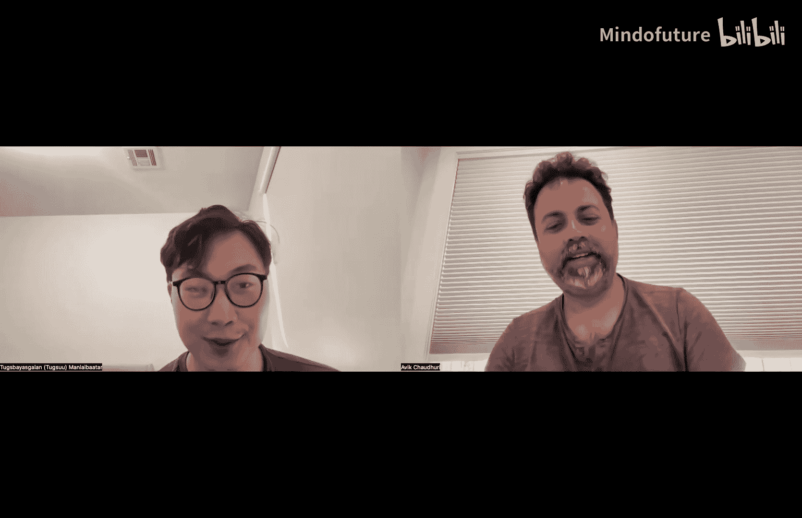

# 【Pytorch】编译器技术 ｜ Pytorch Compiler p05 P05_Exporting_an_Image-to-Video_Model_(Example)__PyTorch_Compiler_Series_Episod -BV1RztQzREs8_p5-

All right， hi everybody。😊，So' been we've been trying to open like export some some open source models and just to show you guys how the typical workflow we're exporting a model might look like So today we have Dku who' is going to show us how to do it on a model he selected Yeah so today we want to look at this model called parameter flow it's been like rising upper lately and I just want to talk about like so this model is basically and you can there's like two mode operation one is like you have a text。

 you give a prompt and you get a video out of it Another option is like we have an image and then you kind of the model can like extend the image to a video and today we will focus on the image to video section because I tell mostly that that's probably like more cool than text to video。

So unfortunately this link is down so you can already see the video on their GitHub page。😊。

But in general， the flow is like they use flow matching algorithm to do training。

 which basically means like instead of trying to create like a full resolution video at every denoicing step。

 they try to like use flow matching so to like not generate full like full the full resolution images at the lower like when there is so much noise so like I guess they create more like full resolution when it gets close to like not very noisy board。

So。I'll skip all the boring stuff at the installation。

 downloading the models from Huging face and all this stuff。

And this is like a simple script I put together based on their app dot pie， which is like。

 so like in their own repo， if you run this appt pie will like launch a， it will launch like。

A web browser link and where you can like put like kind of change the parameters to see the different kind of videos。

 but just to make it simpler， I just kind of copy past this code and like make it。

Not rely on any like web related things， so it's just strictly just exporting a model。

So there's a generate image to video which takes in like an image。

 and then it just creates like a movie out of it。So I can show you like basically how it works。

 So let's say like， so in their own report， there is like a gray ball。

 which you probably guess is just like。😊，you know， just just the image of Great Wall of China in China and then I'm just saying。

 okay， just， can you make a movie out of this？😊，嗯。So you can do like， so this is like。

 I was just playing around with like different steps。 So this kind of indicates like how big。

 how long your video should be。 So let's try like a little longer video will be like 10。And like 384。

 it's like kind of bad。 So like let's try 768， I think 768 is a lot of demand。

 does 10 mean 10 seconds。I don't think it exactly means 10 seconds。

 but it's like 10 frames or something， yeah。😊，So let's just try run there， so。As you can see。

 I'm not really using any。 well， I ignore this part。 So like this， Ill get to this later。

 but I just commented out all the like export related things。

 So that was just strictly running acre code。So'll take some time。

So when time we will get at this video。Maybe 10 was too long I should have done for。

But we should see longer video。Just to demonstrate like how the cool model is yeah。Cool。

 so maybe do you want to take this time to kind of walk us through the model itself a little bit。

 just Yeah So I think the core， So a lot of this inference models have this concept of pipeline。

 which basically means like it takes all like the prompt or like an image all this like hyperpar and it just does the magic to figure out video。

 So I guess we can just start get started with like looking into what this generate I to method does。

 So this method basically takes everything we need and then just create a video out of it。

 So you go here。Think it was here， generate。I to。So。

So I'll skip this CPU uploading stuff just to make it simpler。嗯。So basically。

 we like kind of process the prompt basically saying， okay， like we want to create， you know。

 really good quality video。And there is like this negative prompt。

 which which it the model uses to like avoid creating。

 and there a lot of these models use like this like a positive prompt a negative prompt to， you know。

 like fine tune the model。 So there is this like text encoder， which takes the prompt。

And negative prompt and create some like tensor embeddings that can be supplied to the main chunk of the model。

And then like we， I will skip all these things。 And then you could just do some processing on the。

One the embedding tenser。So if you're using like multiple GPUs， there's like distributed stuff。

Then you create like based on this， you create this another processing step to get embedded。

 And So like right now， we're not really doing anything like a tensor heavy。

 It's just like shuffling tenser around， right， And then we figure out like how many stages we want to do and then。

Then we like for nuome units is basically like this number so like for like so it's kind of doing it in the loop I guess it kind of makes sense right because you create an image and then you create an next frame based on the previous frame so like that's why you have to do it in a for loop fashion。

😊，And then and then you do this all this like processing just to figure out where to like start a tensor and stuff right and then there's this important method called to generate one unit which means like you create one frame based on like all the past frames you seen Okay。

 so this is inside the bigger loop that you yeah。So inside a Gen one unit， there is like。

 so I think the whole point of this is like you create one frame based on the past frames。

So it takes a bunch of inputs and then so theres this like a di so it's like a diffusion based model where like basically what it means is like you start with this like very noisy noisy image image and then like step by step。

 you like denoise it into like something proper。嗯。So they self the IT。

 so this is like the main pyraid model they use to create create the like， you know。

 you or like the generator image。And then so if you so basically the whole chunk here is like you just。

 you know， like based on the input you create an output Tensor output So if you go back to here。

 you we are still in this like big for loop。Where you create a unit？And then in the end。

 you decode the resulting sensorer into something we can understand as an image。

And then you return return this image tensor。 And then there is like。Generate I to export。

So in the end so you basically get this like frames of like images then you take basically you take these images and the video pen and create a video so I think it's done now export image to sample。

嗯。So basically， it's kind of like just extending this。Yeah， cool， some， some。

 some car almost went out of the wheel。Okay， that's cool Okay。

 so basically the model is it's kind of cool that youre like you can set it set this up locally and run it without like。

 you know。😊，Blaying on the server。 So now we can talk about like some strategies where you can use to export。

 So as you can see， like the， So I guess like the the your natural instinct would be like， okay。

 you know， like， I don't want like care about like all this model code。

 So it just wantna like plug in like， like just like Torch compile。

 We just plug in Torch export on this and just figure out。Just get some artifact we can run right。

 But the problem is like export torch unlike Tor compile。 Well， I guess like for Torch export。

 it's like it's only supposed to work on like a dynamic tensor inputs。

 So like if you directly pass like text， it's not gonna work well and I feel like the justification we can see here is like export is mostly for you know like using like custom hardwares to like accelerate the model right So like we should really focus on like mostly exporting like super heavy chunk of the model code instead of like spending a lot of time you know trying to like like basically what I'm saying is like it's probably not that much value and we like try to export like like preprocessing logic。

😊，So as I like briefly mentioned through before there are like kind of three big big chunks and three big chunks in this model right one is like text inter where like you text take the prompt an image to like encode it into like some representation。

And there is another like DIT diffusion based model。

 like this is like the core of this multimod example。

 which takes like a tensor input and then you know create some some kind of like encoded tensor value and then there's like a decoding step where you take this like output of this into this decodder step to get you know image。

So。So I think I feel like the， the reasonable thing we can try to do is like。

For each of these models is separate， we export them separately。And then rely on the， you know。

 like rely on the preproces code， like glue code outside。

 and this is actually what we are planning to do for our like torche native based demos where you like。

 you know how we will showcase how you can export。model into like complete art。

 So like what I'm saying is that basically all this glue code around model processing should be like。

 you know， should be implemented by the user。Or like I said of export。Okay， so。So， we can do like。

So just to make this faster， I'm just gonna lower the。

 So this basically will create like one second video。 and then I'll just lower the resolution。

 So it's， you know， easier to。It trade on so torch export is。Basically， if you look at To export API。

 it requiress example inputs。 Yeah， so I wrote this like a simple。

Like simple glue like simple glue code where you like wrapped the model forward method with。

With a wrapper， which kind of like listens to the model。

Which kind of like listens to the sample inputs and then you use the sample inputs to export。

 So we are currently in the process of like writing new utility methods， which。

Utilizes basically builds on top of this idea whether you like。

Export listen to like example inputs while you run the inference loop and in the end in the end we use export in the end we use like this example inputs to export a model I see so so then let me just like try to like replay to you what I what I understood here so basically you have the eager model and you are going to sort of like wrap it so that we intercept the inputs that past the e model and then you're exporting so。

Presumably you don't want to do it actually at inference time。

 but but if you had like test cases or whatever， could you could potentially use this wrapper right and then automatically get example inputs for free。

Yes， so basically it's not recommended that we just hijack like inference your inference loop export code。

 This is mostly for so since this tool is still under development。

 like I just want to like kind of make what we are like what our general direction is So that's why in this test case we are like hijacking the eager code。

 which is like So in general， you can you can you can imagine something like export like listen to input and then create some artifact and you use that artifact later。

 right So。😊，So let's just do partial like partial export。So。So basically。

 what I'm trying to do here is like。There is like， text encoder。We are using flux Space text encoder。

And then this is like an N module which which has like two encoders inside。

 so this model has like two submods。And the reason we' are not directly trained to export this model。

Is because the forward method。Here takes and input prompts， which is like a list of strings。

's like not really suitable for export。 So， but we can from this code， you can see like。

There is like two like actual models we initialized right so like basically were trying to export them separately and so the inputs to these sub modules would be like processed information so I think these models are coming from hugging face library so all the hugging face library models have therefore is like you know like process in a way that it only takes in tenders it doesn't take like you know because like hugging face usage relies on like a generate method to like create a output。

So we can do we can see how it does。So now you should expect to see like， you know。

 way short video with like kind of low resolution because we kind of lowered it。

And right now we are only exporting like the encoder part。Okay。

So cool so so again just to reiterate this point you basically are using the same script that you used to run the inference right yes but the difference now is that you have sort of hijacked just these sub modules so that when when whenever you're calling it youre first one to export it and then I'm going to run run。

嗯该。So it created。 So it's like way short video。 But I mean。

 you can see still like the image is moving right。 So next step is the IT part where so let's try。

 So now we are like exporting the encoder part。 now were also exporting the main chunk of the model。

So one thing I kind of wanted to highlight here is。If you look at generate one unit。

So this is the step where you're using it's like a diffusion based step where youd start with like this noisy input。

 and then you like。Gradually take it into a proper image。

Note that we're not actually exporting all these things， but we are exporting like this part。

The reason is like diffusion models like this step is inherently weighty data dependent。

very run time tech value dependence， so it's like it's not really suitable for export directly。

And frankly， like this step is like not very expensive。 So I feel like even if you try to export it。

 you won't get that much value out of it。嗯。So that's why we inherentscaping in principle。

 the length the the number of stages is a constant， so。

We might be able to just like unfold the loop a bunch of times or or we have to use a sort of like a control flow up or something to to model the creation So I think this part is fine the main problem is this set so this part is very like data dependent Yeah okay makes sense。

So like for our torch native demos， we were planning to do some like。

 you know diffusion based models and theyre there you can actually see how you can like in production cases。

 how you can use re reuse it in C++ or like any backend so you thought that we。We like。You know。

 basically did the main loop， main model and then。You can still like see like export is working fine and creating a result。

You want。 And then now like the， so this is kind of the easy part。

 So like the main chunk of the work is being done here。 Yeah。

 and then this is just pick decoding into an image， so。

So could you could you explain this dynamic shapes callback that you passed to date？嗯。

It's also just like for experimental purposes。 So the point。So point is like。

 if you look at my script。If you look at my script， we have like。

Basically we like try to cache the exported exported tensor exported tensor of the sort exporter program cache exporter program so that we reuse the value so for days for this like you know if you just create look at the static shape then it won't work right because if the input shape changes then it will work it will fail dynamicmic shapes callback is basically I'm saying like okay。

Like user me specifying the dynamic shapes。 So it's like we don't have the infrra for like。

 I haven't implemented the power you actually like kind of collect all the tensors into one。

 So I think I noticed that you basically take all the as and make them all dim auto or something。

 Yeah so dim dim auto for people who don't know is like a very easy way to just say， okay， I mean。

 I'm not going to force you to use static shapes if if you infer that your shapes must be static。

 then make them static otherwise make them dynamic。Yes， yes。 So in this case。

 like I don't know anything about this model， right， I just looked at it yesterday。 So like， yeah。

 most basic thing I could try is like out of and then yeah， So this is a good tip for。

 for people who are not supremely familiar with the model code。 Yeah。

 so thiss kind of like most general kind of shapes that you can use。 Yes， yes。😊，So you can see like。

You can see like that we are still producing image to video。

So I wanted to make it a longer like longer video， but like if you when it starts like when the when the time steps long gets longer。

 like the export process is like pretty long。 So it takes some like at least like five。

 six minutes to actually run， So I'm gonna just like skip this part and show you what I produce before this video。

Okay， yeah。That's all。 So as a next step in part two of this video， I'm planning to。

Go like more go further steps And then how you can use like Ao T I Ao T inductor to like create like a more single runable binary in the end。

 So that would include like stuff like。Rewriting all these like diffusion times diffusion based time steps into like proper C plus plus code so you can create a one giant banner to run so。

 so an exported program okay after generating the bits of exported programs you you were running them right to get the yes。

 okay， so so those so you have mental model is you have some Python code that is driving these these sub modules which you have just exported and the regular interpreter can can just run an exported program because it's just an F graph and then。

 yes， so when you go to a inductor。You don don't necessarily want to have the Python driver running the generated artifacts。

 which are like call C++ you want everything to be C++ or what。

So I think there are two steps One is that you can just use normal like Aot inductor to like have python there's like a Pthon driver code can still be there and you run like a U inductor specialized code another if you want to go even further。

 yeah yeah， that makes sense Okay so as long as you have that flexibility because iteration you might still want to have some Python driver okay。

Alright， so yeah。 so we'll we'll see when we can record the part two。

 but this should give a nice flavor of。

How it is to explore models so you this you didn't necessarily know everything about this model before right so you basically picked it up maybe studied it for a while and then then started exporting。

Yeah， so like。So my point is like so like hugging face is like， you know。

 like heavily hugging face works with export torch Pythtorch quite a bit。

 So I just want to pick a model that's you know like not really in hugging face。

 It's like some random model I saw online so so over time if you build up sort of more examples of this kind hopefully we'll see that the the workflow kind of converges right So so for for many hugging face models you youll typically follow the same workflow and it should it should work。

😊，Yes， yes。 So like， I think the main takeaway from this video is like。

Compared to torso torch compile has torch compile can graph break so like that way you that's why you can just like slap a torch compile on anything and you can expect some improvements right but for export it's like full graph or nothing So what I'm trying to say is you shouldn't try to export the whole thing directly I said you should focus on like the core parts that you want to optimize further which is usually like know like the submoduleles that that does the heavy that there doing the heavy lifting and all this preprocessing stuff should happen outside of export。

그。Co， thanks， Drxel， thanks， all right。

