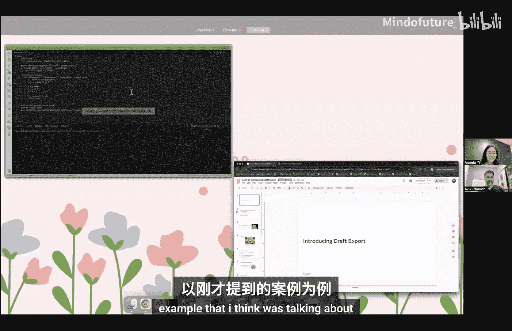
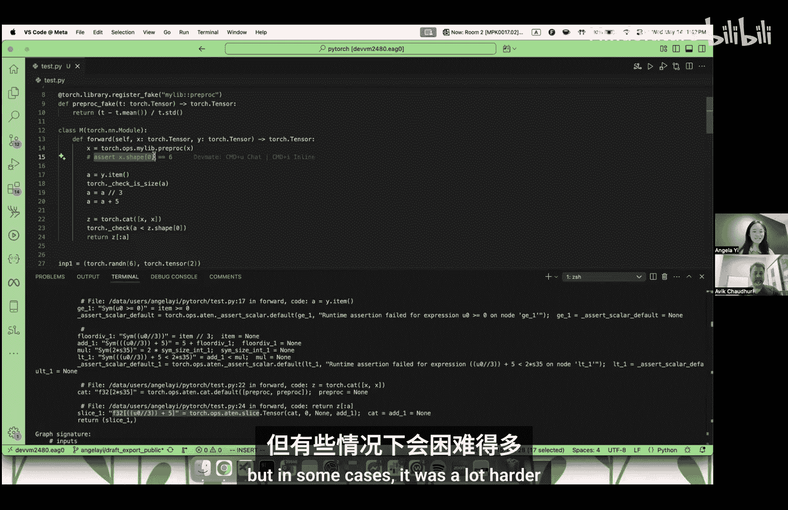
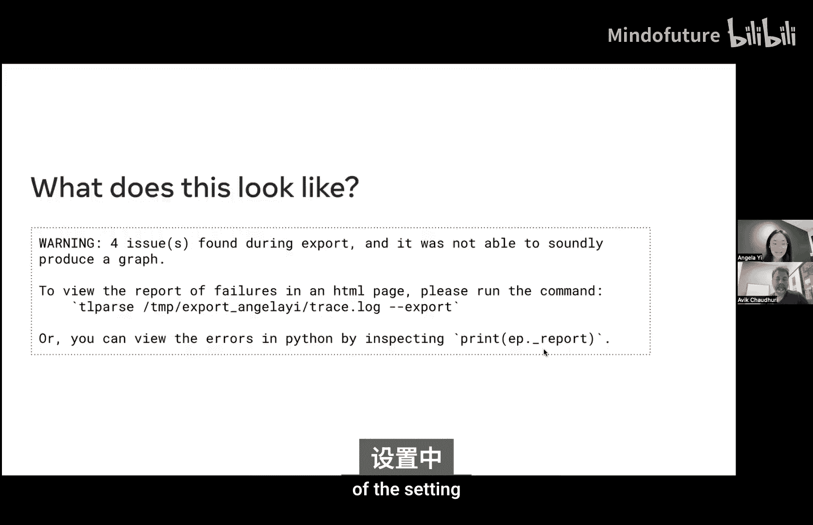
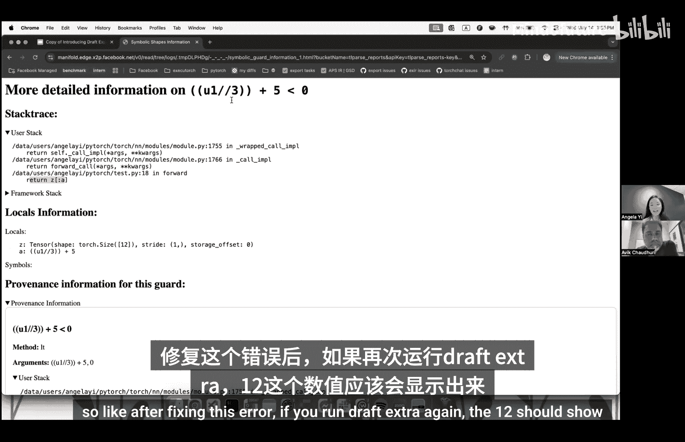
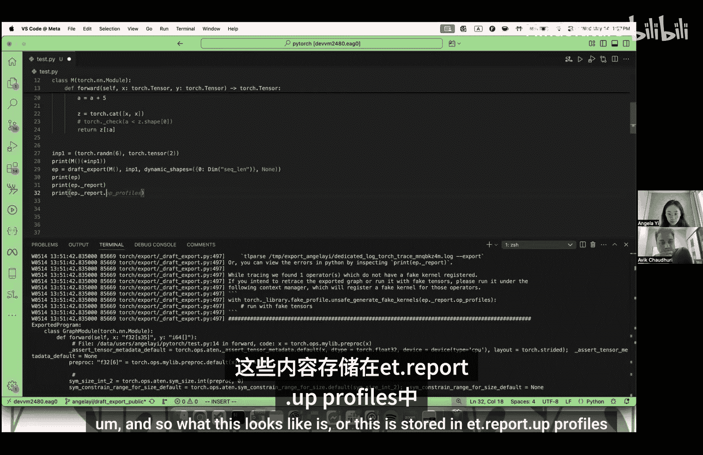
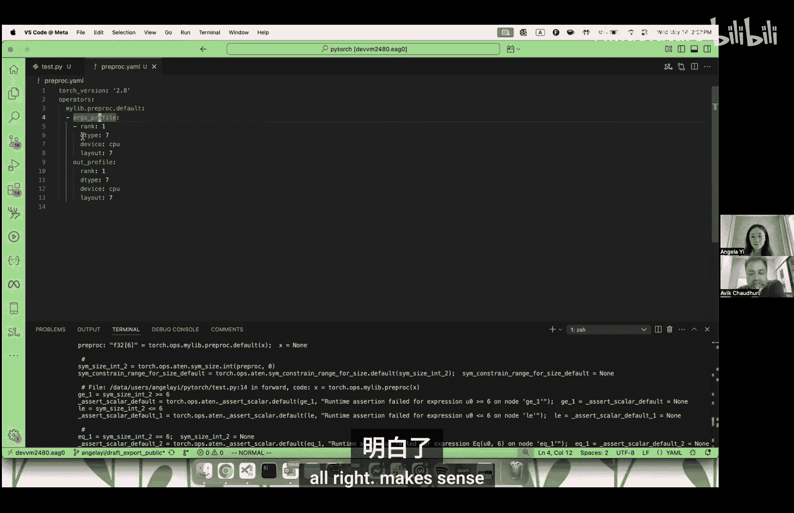
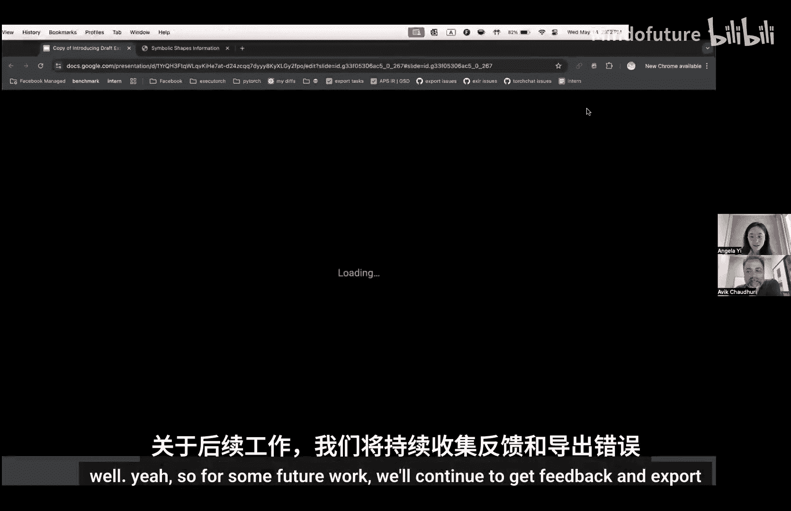
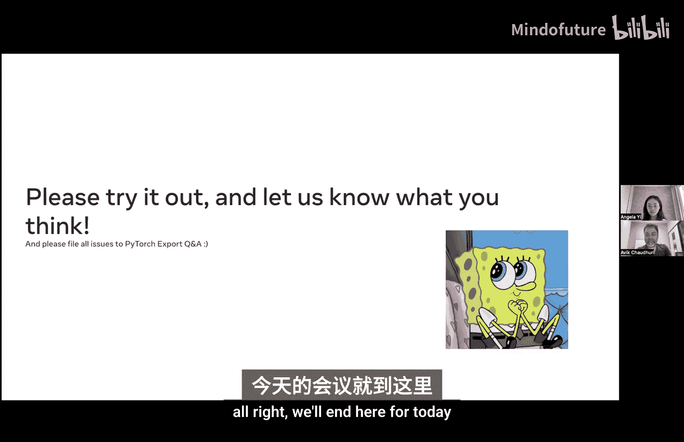

# 【Pytorch】编译器技术 ｜ Pytorch Compiler p06 P06_Draft_Export-PyTorch_Compiler_Series_Episode_3 -BV1RztQzREs8_p6-

Allright， so today we have Angela who works on Torch export and she's going to talk about this new tool that we have called draft export just to give some context export is a tool that gives you graphs from models using the PyTorch compiler however it's an ahead of time graph capturing mechanism and you can get errors so the normal workflow of export works by basically giving you one error at a time。

 but a lot of users asked us whether they can get all errors at once and somehow manage to get a full graph so that's where draft export comes in and thatanga talk all about it。

So yeah， I'm going to be talking about draft export and so。😊，Example， that effect was talking about。

 So here I have this piece of code。

It's just a dummy dummy function， but let's say I have this model and then we have this like custom operator that does like preprocessing on it and some reasons why it might be a custom operator is because it could either contain some like C++ logic or it contain some like other mysterious logic that like you don't want to include inside of the model itself you just want to hide it away in a black box。

😊，And then afterwards， we have some like other random piece of code in the model that I just put together so that it will air correctly so if we run this piece of code it。

😊，ItGives us。You know some tensor values， but if I try to export。

 so this is the API for exporting it takes in the model and then the sample inputs in a dynamic shape specification saying whether or not like we want some shapes to be dynamic and in this case I've marked the zero dimension of the first input to be dynamic so in this case we have size6 but I want to say that in other cases we could all be also passing in values of size like7。

 eight or nine and so this is why I marked it as dynamic but for the second value I don't want it to be dynamic so I just marked it as none。

😊，And so maybe you like can across this model and you want to try to apply export on it and so if we try to run it。

😊，Oh， I didn't say。The first thing that happens is no fake info full registered for preproc。

So what this is so for every custom operator we must have this thing called a fake implementation register for this is because while exporting we use this thing called fake tensors to help us trace through and what it does is just records the shapes and de types that go through the method。

😊，And so in this case， we to tell us how to get through prepc with fake tensors。

 we must have like a fake tensor implementation。😊，So， let's say that we added it。Register fake myli。

 prepc。😔，And。The。So。Our fake tensor implementation can be exactly the same as the original implementation because all it needs is to tell us like how do we propagate the shapes and D types。

 but we could also just return like a dummy tensor with like the same shape but in this case like it works if we just return that the same thing so now that we have the fake oh sorry。

😊，So now that we have the fake implementation， we run it again and we have this new issue。

 which says could now guard on data dependent expression， use0 divided by3 plus5。

 and if we make this error a little bit bigger，😊，We can see that it occurs on test that PY on line 22。

What else does it tell us？And I guess。I guess it doesn't really on oh based on the substrate we can see that it's going into this slice function inside of Pytorch and there's this guard here that checks whether or not endval is less than zero and so we can kind of think about it and see that this is checking to see that if whether or not this value a is greater than or equal to zero because when we slice we can slice with negative numbers or we can slice with positive numbers and it could and the behavior of the slice operation could change depending on this。

😊，And so we just want to tell it that a is actually greater than zero。

 so here I will add a torch check that a so to do this。

 I will actually add a torch check that a is a size value and this will automatically tell it that a is being used as like the value for a size and that this is like greater than greater than an equal to zero。

😊，So if we run it again。😊，嗯。We can see a new one which says U0 it must be whether or not U0 is greater than 12 and so if we look at the stack trace a little more。

 we can see， okay， there's some line here that says like statically knowntru。

 something something 12 comes from the CA operation。😊，Right， yes， yes，'s okay。Yeah。

 so from just looking at this error， it's a little bit complicated and we can't really tell like where this expression is coming from。

 where the 12 is coming from that。😊，Still on the slice again and so it's like a little bit annoying。

 but actually the correct solution here is that we need to add a check to make sure that a is less than the shape of。

😊，Like the shape of Z。嗯。And so after we run that we actually run into this constraints violated error which says that we marked seat length as dynamic but our code specialized it to be a constant stick Yeah I was wondering about that because the moment you said you wanted to do dynamic and then I saw the in there that's sneaky yeah so I was trying to。

😊，Yeah， and China demonstrate that like sometimes inside of a code。 Yeah， Yeah， I mean， I mean， the。

 the real life scenarios modeling is that。😊，You haven't really looked at the source code of the model or you in general。

 the assumptions in the model might be baked in pretty deep and you're just trying out your mental model says that something should be dynamic。

But you don't know whether it's going to work or not。Yeah。

 so if we comment this out because maybe like this assumption isn't true or like we don't actually want this assumption。

 then we can export the model and yeah it gives us an exporter program and so we see the call to prepro we see like the ad the mu or sorry the divide and we see the cat and the slice so yeah it worked but that was like a pretty tired experience right like we had to write a fake kerneldle we had to add these we had to understand all of the guards and then add these checks and then like also like delete the assert so in this case like the assert was like pretty easy to figure out but in some cases it was like a lot harder and so in some cases users really just want the graph itself。

😊。

Like what if we're just trying this out we just want the graph to play around with to see like to bring it to the rest of our workflow and we don't really care about all of these correctness like whether or not like x of that shape is like actually equal to six or something like that and so what if like we just really wanted a graph。

😊，And so this is where draft expert comes in。😊，So draft export is a version of export which will always successfully export a graph and it will bypass any of like the previous export errors。

 and instead these errors will be compiled into a report for clear visualization。

 which you can then later address maybe after you're done like bringing the graph through your pipeline。

😊，So what are the types of errors that it catches here is a chart of like an estimate of torch export errors this is not like an actual like representation of everything but sort of like a compilation after like running through a bunch of internal models and looking at a bunch of Github issues this is sort of like the estimate of what most people run into and so a lot of it is like missing a fake kernel guard on datadepend errors or like constraint violation errors there are also some other errors such as like missing a P tree registration missing like having an attribute assignment or some other random things but draft expert will be able to catch these set of errors which are actually like 90% of most of the errors that expert users will run into and for the other ones we are looking into how to fix them but sometimes like we're not actually able to automatically fix them for you so they might result in some yeah yeah so just to be clear so if if you do get some of these other random errors what will happen so draft export will fail to。

😊，Prouce a graph in that case Yes， and it will error the same way that normal expert would error。

And it might require you to like actually fix the model or file an issue on GiHub。😊。

So how does this work so this is how a normal tracing looks like in in normal export so we have that eager code here it calls like preproc item all of this stuff and every time we call an operation the tracer will record this operator inside the graph so when we call preproc this corresponds to like the myli preproc call calling item will go into item and then。

😊，Haulling cat will return like a a10 do cat into the graph and like sing will have a slice in the graph。

 but at the same time as a tracer run。 we run it using fake tensors to help us record all of these notes and the fake tensor just stores like the shape and D type of what this operator returns So in the prepro case we' returning something of shape S0 this means like S0 is just like a symbolic size and in the case where we have this y do item。

 we return this u0 U0 means this is unbacked meaning we don't actually know what the value behind it is sorry So S0 was the shape of the input but but you mentioned it' dynamic and therefore therefore we create a symbol for it except that we know that the backing value for that is6。

 but for U0 you don't know that so fake tensors are just tensors that do not have any values behind it。

 So when we do。😊，t item is trying to inspect like a value inside of the tensor。

 but because we're running with fake tensors which don't have actual values。

 we don't actually know what the value is there， so we have this user which doesn't have a backing behind it。

😊，Um， and when we do like a divide by three in like we just stored this entire expression of user divided by three and this plus five creates like this even longer expression。

😊，And then once we get to this slicing call， what happens is we see a check for whether or not this value is greater than0 and whether or not this value is less than the shape of z。

 and so this will have these this will then turn into checks for whether or not u0 is greater than zero or if this expression is like less than this other expression。

😊，And in this case， since we don't know how to evaluate this expression。

 we will throw a guard on data dependent error， so I guess by the name it says there's this data dependent behavior of this U0 because it's dependent on the data we've provided and we couldn't figure out how to resolve this and so we've errored。

😊，And so in the case of draft export， what we do is this thing called real tensor tracing。

 where every time if we run the values with fake tensors。

 we also run it with real tensors that we took from the sample inputs。😊。

So now U0 will be evaluated we'll have now a fake backing behind it which is the sample inputs we pass in which is two and then we will be able to evaluate like all the other expressions and so when we get to this whether or not U zero is greater than equal to zero check we will just plug in that two that we had from our sample inputs and then evaluate this to be true and then evaluate this other expression to be true so in this case S0 already already has a backing which is six and so this expression can also be evaluated and then we can continue running and actually get the graph。

😊，Cool， so so from what I understand here is that the the graph would still be generalized with respect to as0。

 but now you're like specializing the graph to the like the the case where Y dot item was exactly2。

Yeah， so if in our sample input we passed in negative one。

 then this expression would evaluate to false and then we would take a different branch down the graph。

😊，So in the where so in the case where we reach a guard that we cannot evaluate。

 we just use the fake tensors behind it to help us evaluate it and that helps us bypass all the guard on data dependent errors。

 but for the missing fake tensor errors what happens is if we have an operator that doesn't have a fake implementation then we will just run that operator with the real tensors yet the output tensor from that and then return in our fake tensor implementation another tensor that has the same rank but with unbacked shapes so we just say like we know that this tensor will be a rank to but we don't actually know what the shape is because it could be dependent on what your inputs are so we just return unbacked shapes again。

😊，So the graph that gets created by draft export is guaranteed to work on the given sample inputs that you've passed in and it' specialized on that sample input。

 so depending on which branch it takes based on those sample inputs and so it might not necessarily work on any other inputs and to show that we also add in asserts into the graph so that if you do run it with other inputs。

 it will error and tell you that this graph has not been made to work for these types of input。😊。

But if you were lucky， the searchs would still pass， even if the data was a little bit different。

 if you were not depending on the exact values， then it would still be fine。Yeah， yeah。

so then how does what does draft export look like well what happens is we can just replace the export call with draft export and they have the same signature。

😊，And so in the case where draft export succeeds， we will return an exported program or I guess most of the time draft export should succeed and then we will return an exported program and in the case where there are no errors then the behavior will be exactly like export。

 but in the case where there are errors that draft export has a bypass we will see this terminal output that says like hey four issues were found and then please you can view the report of all the errors with this TL parse command or by printing it out if you're in like a Python setting so let's go back to our example here。

😊。

And let me comment out all of these fixes that we did。So if we run this again。

 it should air with the first error that we encounter， which is the no fake impulse。😊。

And it we replace this with draft export。😊，We now get we now get a graph and we can see in the output like three hours were found here please run this command or we can directly print it out with this and there was another issue that we found which was that an operator doesn't have a fake kernel but we'll get to that later so if we print out EP。

t report， this will contain a report of all of the issues that we encountered。😊。

So the first thing is we were missing the fake kernel which we bypassed and then we had a data dependent error for this assert x is equal to shape six so in this case it's considered a data dependent error because we replaced this fake implementation with another implementation that just returned tensors of unbacked shapes and so when it checked the shape it was unable to determine whether or not this value is equal to six。

😊，So it's labeled as a data dependent error because of the fake implementation that was used to bypass the first fake implementation。

And then later we have another data dependent error for the slicing operation here。😊。

So the alternative is we can use Tl parse。 So while we're running just but this is already like for the for the less than equal to 0 or that error is already better。

 the message， error message is already better because it tells you。😊，Yeah， the locals and so on。 and。

 and what actual value。 So it tells you that a was that same that that expression， right， Yes， yeah。

 yeah。 So the error here also like shows a little bit more information。

 Like it clears up all of the errors like logs that we saw before to just extract out this。

 this slicing to show that this was actually within the framework code。 This is where it errored。

 And then heres some of like the locals information。

 So this expression corresponds to what A is here。😊，Yeah。

So while we're draft exporting draft export also returns this log file of everything that has occurred and so if we use TL parse by just doing TL parse here like that。

😊，Actually。It。So if you run TL parse， this will generate an HTML report for us to view all of the errors in this nice HTML file and in our case internally we can actually get a nice HTML file like website for us。

 but in open source， you'll have to like load it up onto your Chrome page。😊。

So what the TL parso part looks like is something like this。😊。

Which lists out all the errors that occurred and for errors like this data dependent error。

 we can then click more into it and it'll show us a little bit more information than what the print of the report did specifically it'll show us this provenance information which tells us where each value came from so this u0 it shows that it came from the dot item call and the use0 divided by three came from this divide by three operation and this five came from here and then finally this like less than check came from the sing code here so hopefully they should give you like a better sense of how。

😊，嗯。The guard was created so that you can help add checks for this。 Yeah。

 this is cool because you know， most of the time when， when you， when you see guards。

 internal guards being dumped into the terminal， you have no idea how they were created。

 So this basically breaks it down。 Hey， I added a quick question。 So what。

 what happened to the grade than 12。 or less than equal to 12 thing。😊，Yeah。

 so all of that is within this one slice operation。

 and so there's like multiple guards that are occurring inside of the slice and to， you know， not。😊。

Clump off the terminal with like too many things， we just merged all of the guards that occurred on the same line Okay。

 I see， I see， I see。😊，So like after fixing this error， if you run draft Ex again。

 the 12 should show up。😊。

I see， okay。O。So， so。嗯。Whats nexts。Oh yeah， so so another thing that we generate if we look at。Oh。

 going back to the graph， we do see a bunch of asserts checking that this value must be greater than or equal to some value and。

😊，Less than or equal。Some other value and those are the redtimeesters that we put into the graph show to show the assumptions that we made while draft exporting。

😊，Okay， so now going to the second part which is with custom operators， while we're exporting。

 draft exporting， we will also record a profile。😊，I'm getting kicked out of my room。Bye。

I'll go find another room， Okay， okay， all right。So at this while we are draft exporting。

 we also record a bundle of profiles for all of the operators that do not contain metariminnals and so what this looks like is or this is stored in Ep。

report。op profiles。😊。

But。S。So what this looks like is it's a mapping of the custom operator that that does not contain a meta kernel and a set of profiles for what are the types of inputs and outputs that can occur and so we can actually save this to a file。

😊，都佢下。It啊。And then load it up later， but we can load it up later even。It's。

So we can save this profile to a YaAml file。😊，And it looks something like this。

 so it says for the for the inputs to this pre productc we found。😊，Yeah。

 we found a tensor of rank one with D type。😊，Seven，7 I think corresponds to like float 32。

 and for this type of input， which is one tensor of rank one with a type of float 32。

 we will return it returns an output tensor of rank one and also D type of float 32。😊。

And so with this profile， we can then use it to generate a fake tensor profile for a fake kernel for us so that every time we see a tensor input of this profile。

 we will also return an output of this profile。😊，And this will allow us to generate fake cancer kernels for you so that you don't have to write it yourself。

😊，What this looks like is we can do load this YaO file and then with this unsafe fake kernel generator。

 we can then call export again。😊，And it should。Run successfully。Oh wait， actually first。

 we should probably fix those errors。So let's fix these data dependent areas and。😊，In the case。

 if we run this code again。Iman。 sorry。All， so if we run expert again。

 we without this registration here， we see that there is no fake input registration。

 but if we load up the profile and then add this context。

 this will based on this YamML file that we stored， it will load up。😊。

A bunch of profiles and then with this decorator it will temporarily register fake kernels with this profile。

So if we。Do this， then it will register a fake profile。 Well I didn't print the exported program。

And then we now get a graph with export so in this case。

 if you are too lazy to write your own fake tensor implementation with draft export you can just save the profile that it returns and then load it。

😊，And。Intinue running and continue like exporting。 So this profile is specific to what is encountered。

 So if we pass in a tensor of rank2 now， this profile will error because it has never seen the kernel output of type 2。

 So to fix that， we can either like manually append to this gal file or we can call draft export again with a new profile and it will generate you a new profile here。

😊，So if， if it encounters different shapes then what happens， Does it。

 Does it try to make a kernel that has dynamic shapes in it or ill error Okay。

 but draft expert will make try to make you a new current。

So what will happen will you generate multiple kernels that are all specialized to their own？

Inputs are。It it will generate one kernel that contains like multiple of these profiles。

And then it'll just like case match based on the programs。

But so this pro this way of like generating fake kernels is not entirely accurate because if you have data dependent behavior。

 like， oh， if my， if my input of rank one， then return something of like rank one times five。😊，Like。

And then or sorry， like if you have a value inside of the tensor and then you return a tensor of that shape。

 that specific shape， like or that rank， like that could not work in this case because it like hard codes based on like what rank you've seen and what rank。

 what rank you see in the input and what rank you see in the output。😊，All right， makes sense。

不。On。

Yeah so for some future work we'll continue to get feedback and export errors and try to improve the report with more information also to support more errors and we will also work on improving the slowness of Drought export because it is running the real tensors at the same time there is some slowness so that is something we'll continue to work on so please try it out and let us know what you think in file issues to GiHub。

😊，Nice。All right， so thanks Angela and yeah please I echo Angela。

 please try it out this is pretty cool and a bunch of our internal users is already getting a lot of joy out of it。

All right， we'll end here for today， thanks， bye bye， thank you。😊。

