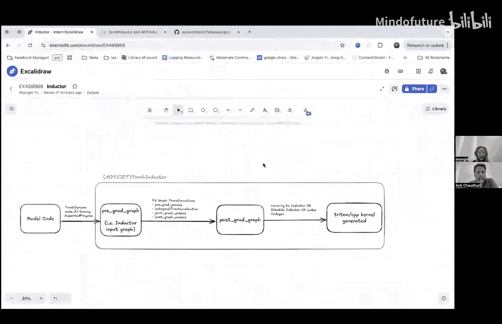
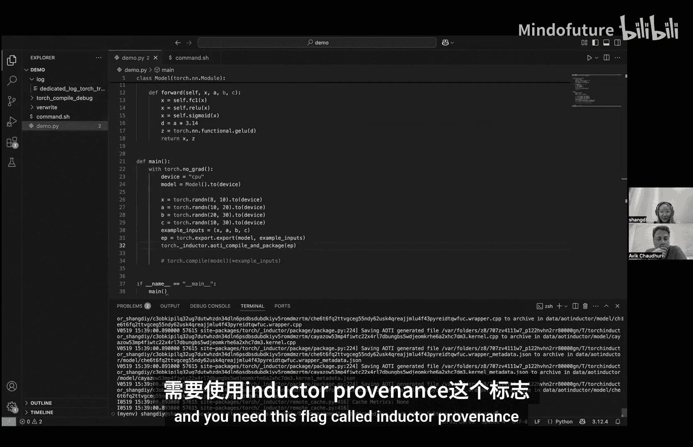
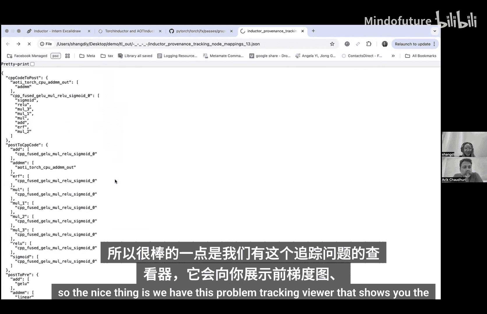
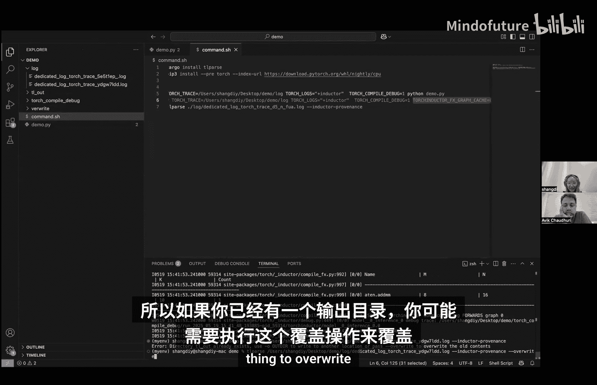
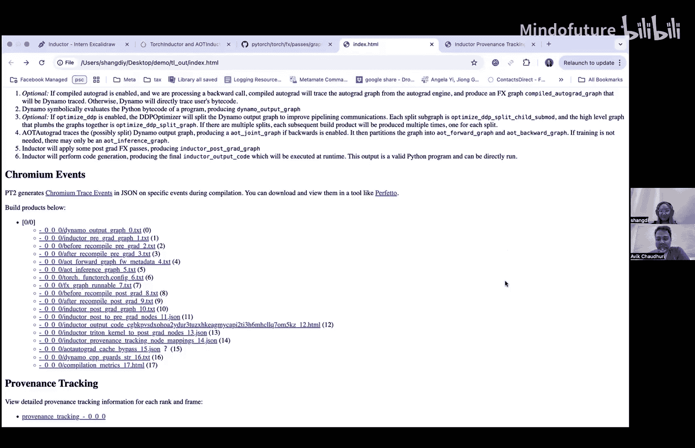

# 【Pytorch】编译器技术 ｜ Pytorch Compiler p07 P07_Provenance_Tracking_for_Inductor-PyTorch_Compiler_Series_Episode_2 -BV1RztQzREs8_p7-

All right， today we have shndi who is going to talk about Pro tracking and inductor one of the problems that we have is that the torch compile。

Workflow and export workflows。 they they create a bunch of graphs in some sequence。

 and it's not very clear for users。Where some node came from and so on。

 So this is a very cool debugging tool that Shanggi has been working on。 Take it away， Shanggi。

Very coolol。 Yes。 So as week said。From time to time， you know。

 we get questions about where does the kernel come from and what kind of fusion happened。

 So here we are trying to create this problem trying to that sort of help users to answer that question。

 So what I'm gonna be talking about is gonna be all in this mostly in this as well。

 So feel free to check this out。 So before， you know， I go into the details of how to use this tool。

 just some background knowledge。So in inductor， you know， both the O T and Gductor。

 the general workflow is you have a model code and you do some graph tracing to get an input graph。

 So this graph is what we call pre graph graph in this tutorial。

 and it's also like the input graph to the inductor。

 and then we do some sort of Fx graph transformations on this input graph to get a post graph graph。

 And then we do some lower incogen。 And this part is not like Fx graph manipulation anymore。

 we're gonna lower to the inductor I andgen， you know either tri and code or you CPP kernel code。😊。

To be more specific here's a more detailed version of the same graph。

 you know your graph tracing could be either To dynamo or makeF graph or just a loaded exporting program and in the FX graph transformation there are know different sets of graph passes and more importantly an autograph such functionalization path that's why the second graph is called post graph graph。

😊，And then the lowering and and self scheduling and cogen part。

 So the tool is gonna show you three panels。The pre graph。

 the post graph graph and the generated code。 and， and。

 and you know how the problem tracking happens， you know， among the three of them。Yeah。

 and so between the preGd graph and the post grad graph some ops can also get decomposed to multiple ops and so on right Yes。

 yes。Okay。Alright， so now let's see a quick demo here。 Okay， we should edit that part out。 Okay。

 so let's see a quick demo here。 So here we have， you know， very simple model and we're， you know。

 doing an export and an L O T compile。 So yeah and some pre。😊。

Commend that you need to do before this demo is move around this。I still have a banner Okay， okay。

 so the first thing you need to do is you need to install this tool called T L parts。 It's。

 it's a R library。 I already installed it here。 But if you， if you don't have it。

 you can install it besides problem tracking to the TL parts to is also a really good debuing to which I guess maybe you can make another video for more index index depth to turn on that。

 But here you' just gonna use it for the index problem tracking And also you also need to install a version of torch。

 which you know， I already installed。Alright， so now to use to get the problem tracking will。

 you need to set some environmental variables。 The first one just says， you know。

 where my logs is gonna go。And these two are just these torch logs means I want my inductor logs in my log。

 And this just says I want the debugging level of the logs。All right， so let's just run this。

which is the stem model PY。And you can see that there are some logs。As specifically。

 you can see a log is produced in this log directory。And then let's just do KL parse。嗯。

Copy the pass here， the pass。 and you need this flag called inductor Proance。

Providence， Pro， can， okay。Great， so now you get this wheel。 So this is what Qo parts gives you。

 And there's like a lot there。 And more importantly， if for like our tutorial purposes。

 you get a pre graph graph。 that's， you know， the pre graph I'm talking about。😊。

Like you can click into it。 You can see this， right。And you get a postgra graph。

 induct post graph graph。 You get a generated code。

 this the both the wrapper code and the kernel code。 And also you get a mapping， you know。

 between the different node and suggestion file that kind of looks like this。 But， you know。

 this is a little bit hard to read。 So the nice thing is we have this problem tracking。😊。

We were that kind of shows you the pre， the postg graph and the generated code here。

 And you can see that， oh， you know， all of those nodes are decomposed from the Glu in the pre。

 And also， you can see that。😊，They can get merged into the CPPfuse Jlu Ma Red my node， which。

 you know， if you hover over this can also see that， oh， this is a， you know。

 fued from all of those four nodes in the graph here。😊。

The other thing is there's also like a comment in the pre and post graph that shows where the model code that the line below is coming from。

 Like， for example， like here， you can see that this Je comes from。 you know。

 the line 17 in our demo P， which is the torture function Je code。😊，呃。Yeah。

 hopefully this is Delphvicplanatory。Now let's see， you know， another example from the Jt compile。

 So now one note here is if you are running Todo compile there's， you know。

 some chance that the compilation will be skipped because the F x graph is cached。

 So if you don't see the post graph graph or saying in your log。

 just try adding this F Fx graph cache， you could do0。

 So they got compiled again and the log gets generated。诶。

So let's do this and we should see right another log。Gets generated I this one。

And let's do the same thing， killL parse， the log。Als。Okay。

 so if you already have a output directory， you might have to do this like overwrite saying to overwrite or like provide another directory。

😊。

Okay， same thing here。 Everything you needed is also here。 The only difference is now， you know。

 your output code is not the CPP code anymore。 It's the triangle code。

 but the two is gonna look the same where like you still have。

Basically the same saying that we just shown before。ok。U， that's pretty much it。

We have you know some improvements we're trying to do for it so if you have any know suggestions let us know and you know we'll consider adding them as new features。

😊，That's pretty cool So yeah in export we often hear that in particular because we run decompositions after export and those decompositions are written in in some table that is inside by torch。

 of course you can opt you can you can customize it but。

Often people do not know how absurd you composed， so this is already the first two panels are pretty useful。

So in general， I had a question about like runtime so it looks like it's this is integrated with your inductor and and normal inductor。

 So in the future would it be possible to integrate this with other runtime is there some kind of interface that runtime can implement。

That can sort of give this level of information。Yeah， so I think for the first two panels。

 you sort of get them for free Yeah， because they're just F X graph transformations。

 And and if you want your own graph transformation to be captured as well， basically。

 what we did here to capture this is we use this thing called graph transform observer。

 And if you just。😊，Add this， you know， context manager to whatever graph transformation that you do。

 you should be able to get your problems track as well。

 And the tracking information is gonna be stored in the no do meta field called from node。

 I don't know if you can get， just like here in terms of the second panel in the current setup。

 Unfortunately， you'd have to do some menu tracking。

To produce your note mapping between the post gra graph and the kernel in like J format。Like。

Like the one that we have here。 right， Like we have the CPUU code to post like Json format。

 So the the， the front end basically just， you know， raising this Json file。

 So if your backend has somehow like also produced a Json file like this。

 the front end can render that as well。You know， if there's like a。

And a lot of interest in also extending this to other backends。 that we could try to。

Modulize this to make it easier for， you know， other backend authors to add their problems tracking。

Maybe something like a hookax。Yeah。All right， cool， anything else you want to share。😊，Yeah， I think。

 I think that's it。 Okay， thank you。 Alright， let's send the video。 Yeah， yeah， please。

 please use this tool。 A lot of people internally at at Mata。 they're pretty excited about this。

 So thanks， Shangdi。😊，All right， thank you bye。

