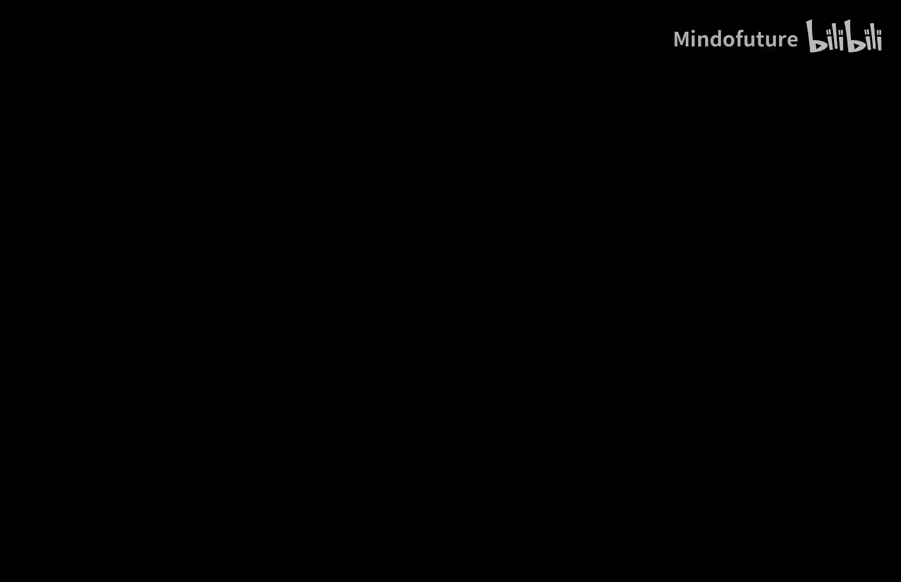
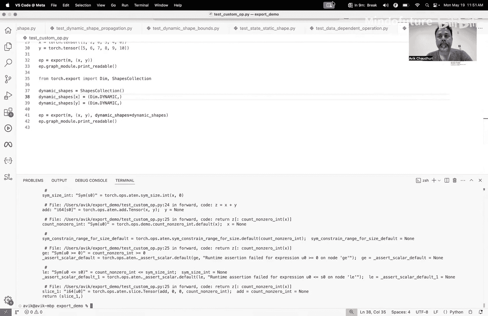

# 【Pytorch】编译器技术 ｜ Pytorch Compiler p08 P08_Programming_Model_for_Export-PyTorch_Compiler_Series_Episode_1 -BV1RztQzREs8_p8-

All right， today we are going to talk about the Torch export program model。

So before we go into what a program model is， let's give some background on what Torch exportport is trying to do。

 essentially it's trying to take a model and create a graph representation of the model and exactly how it does it and what kind of guarantees that it's intending to get out of this process will inform what the program model is right like so let's look at like the most general picture of what's happening with a model you have a space of inputs and if you take some inputs and running them through your model you're supposed to get some outputs right so this is what we are taking as a baseline which is eager execution of your model。

Allright， so。So for export， what you do is you take an example input which is supposed to be representative of a subset of your inputs and you export your model with this example input。

And what you get is a graph。 So， so you conceptually， you can think of it as as some。

Subet of your model or some subset of the past three model。Which this example input exercises， right。

 But again， it's supposed to be representative of of various other inputs that that would go down the same path through a model。

So。Essentially so so then the graph that you get should work exactly like your original model on on a large subset of your inputs。

 right so that's that's what the the last picture shows is that now you have extracted a sub a subspace of inputs kind of that that is determined by the graph itself and。

And if you take the same inputs that you wanted to run your original model through。

 you will get the same outputs right so that that is the high level intent behind export and frankly it should be the model that any other such graphic capturing mechanism should follow。

So what are the basic principles of graph capture， really it's about balancing safety versus coverage。

Safety essentially boils down to MI behaviorally kind of similar to the original model and coverage means that you are able to run this process through a large set of models right so so you dont you don't have to sort of be very pedantic about how you write your models in order to go through this process right so。

So now one of the key observations is that any such graph capturing mechanism ultimately how you design it comes down to an important decision on what can change after youre exporting versus what is fixed at export time so colloquially would say you know what is dynamic and what is static you need to sort of this is a design decision that you need to make when when you're designing graph capture mechanism so so if safety and coverage are2 axes you can plot how various technologies that try to do this that came before torch export where they lie in the spectrum so if you look at gi tracece it had high coverage by which we mean it will successfully produce a graph for a large set of models but it is low on safety as in。

It doesn't really define what subset of inputs would give you valid outputs after you get your graph so if if you for example。

 give inputs that did not actually go through that path three original model， you might still。

Execute the graph as if it did， and you would get incorrect results。Jitscript was in some sense。

 the opposite in the opposite side of the spectrum where its coverage is pretty low。

 you have to work really hard to sort of be constrained by the parameters of what jascript is happy with when you're writing a model but once you do that and it passes jascript and you get a graph。

It's it's likely to be safe right so Fx trace is another intermediate thing that the Pyto team developed which uses symbolic tracing instead of sort of tracing with exactly the inputs that you gave so it generalizes the inputs a bit more so it covers more modern than Jscript because it's easier to use but it also sort of is not as safe as Jscript it's safer than J trace though。

嗯。So where is export on this spectrum， where export tries to have a design that gives you high levels of safety as well as high levels of coverage。

And it comes down to again being very careful about what can change versus not change at export time after export time。

 so the the principles are are shown on the slide basically the first principle is that the graph must not depend on tensor data because we assume that the tensor data will change across runs。

 so there's no way that you will run with exactly the same tensors that you provided。

When when you provided these example inputs， on the other hand。

We found that it is useful to specialize based on tensor shapes。

 so tensor shapes would be an abstraction over your tensors that says， okay。

 the data might change but the shapes will not change across runs so we can specialize and the more we specialize in some sense it is correlated with how easy it is to export your program and also you can do optimizations based on these specializations。

Another decision that export makes is that anything that is unrelated to tensilors。

 they can be fixed。So this includes constants in your program。

 which are sort of burnt into the graph， this also covers any containers that you use Python level containers that you use in your program。

Their structure is fixed， so anything that is not tensor is essentially specialized。All right。

Rather than explain to you。What the program model sort of rules are in some sense it's easier to just show you a series of examples that help you have some mental model of what the program model is like like and the benefit of a program model is that you can use this understanding to predict what would export to on your program right so that that ultimately that's our goal to this video。

All right， so let's look at some examples now。The first example we will look at is this constant specialization idea？

So if there are any constants in your program they will be in line and folded in and so this example shows you what will happen。

 let's say if you if your model has a tensor， which as we said its assumed to be dynamic。

 but you also take an in。And here we pass in the constant three at export tank。

And what will happen is that it will go through a and then B is a plus 7。

 so it will actually get evaluated at export time to 10 and if you look at the graph that is produced in this case。

You would see that。10 as a constant appears。 so that's 3 plus 7。Alright。

 so so here we are taking what does export expect， it takes the model instance and any inputs and it produces some graph that x is kept as x。

 but a whatever the value that you gave at export time it sort of。

Used constant evaluation to to figure out what。What should go into the graph？

Alright so yeah I also talked about Python level containers that you can use and how their structure is also specialized right so here we have another example of a model that takes a list of tensors and a list of ends and basically does a very similar thing as a previous example it it sums over the list of constants and then it adds that to this to a sum of tensors that you also provided as a list right so。

At export time， you decide to provide。A list of two tensors and and a list of three constants and if you look at the graph that was produced。

In this case。嗯。You will see that it Okay， so， so you will see that it created a graph with。

Five inputs， two of them are tensors and three of them are constants。

And it did the sum over the list basically the sum over the two tensors and it added the list of constants。

 but it actually constantly evaluated the constants right so so you provided3， four， five。

 they got summed to 12 and you see the see the number 12 in the graph right。

So this gives you an idea of what at export time gets gets bonded to the graph and what doesn't right？

So the structure of containers gets burnt and constants get burnt and the tensors themselves do not get burnt。

All right， so this is a good place to maybe maybe sort of have a regression and say that。Okay。

 maybe I don't want to use just vanilla primitive built in types。

 I want to have a data class that represents my inputs and so this this example is exactly like the previous example。

 but I am packaging up my inputs in a data class。And my model takes data in the form of that data class and then it does exactly what we did before So what happens here well if you just try to run this as is。

This will not。Succeed export because export does not know what your data class is and in particular it cannot flatten it into that kind of list of inputs that we saw right in the previous example we had five inputs so we knew how to kind of sort of flatten the lists out into into individual things here we't don't know that but it's a one line change to your to your model or to your exporting workflow use a registration mechanism that we provide for data classes there's a more generic registration mechanism for arbitrary classes as well so if you if you do this。

 then we know how to inspect into a data class and sort of flatten it out so so now you see that you get exactly the same graph as in the previous example where you have five inputs to of them 1 servers and so on so so it just basically opened up the data class and。

でるですね。And it's still specialized， it still evaluated the constants。Okay， so。

What else is is specialized lets let's look at that so I mentioned in the in the principles that while we do not specialize on tensor data。

 we do specialize in tensor shapes。So in this case。

What you're doing is instead of taking a list of constants， you're taking a list of tensors。

 but we are extracting。The the shapes out of those tensors and doing some evaluation on those shapes in particular we taking the sum of the shapes and then we are doing exactly what we were doing before so here instead of passing3。

4，5 we are passing in tensors of shapes 3，4，5。And what will happen in this case is， I mean。

 it should be obvious if you're following what I'm seeing。

 which is the shapes would be treated as constants。And you would get。

Get the same graph that you were getting in previous examples， right？Also。

 I printed out the graph that we produce in some more detail。So if you use EP。

 the exporter program has a graph module inside so if you use print readable on it。

 you will get some more information what what the shapes the expected shapes of the inputs are so in this case we used shapes two and2 for the list of tensors and then for the constants that were for the shapes that for the list of tensors for which we were extracting the shapes you can see that we are expecting tensors of shapes 3 four five here so you can get that extra information you can also get some metadata on which line user code line produced some snippet of code。

All right， so so that's that's what we do for shapes。 we specialize them。

 but we also do some more on shapes。 So so just like you can you can do manipulations and constants and we would follow along there is a mechanism to to propagate shapes through through your other operators as well。

 So here we are using。Tjdot cat instead of summing the ships。

 we are concatenating the given list of tensors and taking their shapes。So， so if you， you。

 if you see what， what happens here。You will see that again we we found out that the sum of the shapes was 12。

 but now we are getting to the sum in an indirect way。 So how are we doing that。

 So torch dot cat would basically concatenate the given tensor。 So if you pass in shapes 3，4。

5 it will get a new tensor of shape 12 And you can see that as an intermediate like the shape of an intermediate value。

 which is the output of the the torch cat operator。And then the rest of it follows along so。

So this is very， very nice because you know that inside the Pytch compiler is actually tracking the shapes of individual operators。

 not just the inputs， but it can sort of continue the reasoning through your model。All right。

 so next example is something else you can do which is also quite common。

 which is you can have control flow on shapes and because we are we understand shapes at compile time。

 we can actually understand which branch to go to go and produce continue to produce a graph， right？

So export is a cr based compiler， so we are actually going through certain paths in your program and we are capturing them。

So so in this particular example， you passed in shapes 3，4，5 and we con them to a tensor of shape。Oh。

 sorry sorry。 so， so here I was going to hide these inputs。 So， so let me run this program again。

Okay， so initially we are passing in shapes 3，4，5。 Yeah so they are。

The concatenation of them will have shape 12， so it will actually go down the else branch in this case and trace this and you can see that happening here。

So it basically output the code for the else branch and this is the code that that is equal into that line 15。

And if you want your。Graph to capture a different path， you could give different inputs。

 so for example， here you're giving shapes 6，7，8。And now the concarnation of these stensors will have shape 21。

 and so it will go through the true branch now because the condition was that should be the shape should be more than 20 and in this case is 21。

So yeah， if you rerun the export， now you're seeing that the congratation indeed has 21 and so now it has traced the true branch。

 which is this line， right？And so。You get an idea that the graph would be specialized to the shapes that you provide at input time so again your example input is supposed to be representative of the set of inputs you care about for inference and so depending on what that subset is you might get different graphs and so this just kind of sets expectations on that。

All right， so so this immediately makes you think of like okay。

 what if I want to capture the graph in a more generic way and not really specialize that much on shapes and this is where dynamic shapes come in so。

To illustrate that let's look at let's pop back and remove the complexity from the model and think of a very generic kind of operation like add MMM right so you take three tensors x Y z and I'm going to matrix multiply the y and the z and add x to it so that's that's what this forward method does right？

And。I'm going to give example inputs that fit this so so ultimately I'm going to multiply a three cross 4 and a four cross 5 getting a three cross 5 and so that when I add it to add the result of the matrix multiply to x I'm going to get correct shapes right so so you could export this program without using dynamic shapes of course and then then the graph would be specialized to the shapes 3 and4 and 5 but here we want to do something more generic。

So how do you specify dynamic shapes to export well there are many different ways。

 one convenient ways that you can create a shapes collection and just add shapes of your input tensors to that so you're going to use xY Z as your example inputs you can specify that each of them are two dimensional tensors that have dynamic shapes and the way you do that is by saying they dim or dynamic。

嗯。So if you， if you try to。Export this program。The the exporter like the oh so I'm sorry。

 so this is another example where I want to show more things later。

 so let's let's not get ahead of ourselves so let's let's just take try to export the thing that we we said。

Okay， and then in。In the input shapes you will see some symbols coming up now so instead of 3，4。

5 you are getting these symbols that represent the generality of this of this model right so let's say y has shape as 0 cross S3 and z has S3 cross S1 then the result will be of type S0 cross S1。

And then you can add it to another as0 cross as one， which which x is now constrained to to be right。

 so so the Macm， as I said， will be as a0 cross as 1 and then x is of the right shape。

 So the addition will also be as0 cross as1 and everything succeeds okay so。

So now if you think about what happened behind the scenes， right？

While we are tracing we as said we are propagating shapes now but now we are propating shapes in this symbolic form and we know that certain shapes have to be equal for some operations to succeed so the symbolic reasoning that is going behind the scenes is kind of constraining the system so that you get the right right shapes out so this is kind of like type checking but except that it's happening in the level of tensor shapes。

Alright， so。So yeah initially the errors that we were seeing was because I wanted to show some more variations of this program so so one of the things you can use to test whether the graph is to a truly kind of generic and dynamic shapes or whether it was overly specialized to to the shapes that you provided which was at the end of the day still concrete shapes like 345 right so you can you can try to do this run this program with different shapes right so you can say that okay we are going to。

Everything is going to be six cross6 tensors now z would be some random tensor and we are going to multiply it with entity matrix and so we are going to get back the same tensor and if we add the negative of the tensor we are expecting all zeros so if you run this program it should still run fine the assertion should should succeed。

On the other hand， if you change one of the inputs to be of different shape。

But you did not change the other inputs right so now you have sort of shape mismatch the entity matrix is now 7 plus 7。

 this shouldn't work and you would expect that this will obviously fail at runtime。

But what you get is yeah also a runtime failure but it's a very early error so even before your model was run your export program was run we have some checks going on that you know ultimately the subset of inputs that you had in mind they were constrained to be of those dynamic shapes and in this case you just cannot find good assignments of a0 S1 and S3 that work and so that is what causes this equivalent of a sort of like a runtime type error。

Whi is that we expected some shape to be6 but we got7 right what is as 1 as 1 well the graph has forgotten the names of the original kind of inputs so args 1 is basically y and y dot shape is expected to be 6 because x was given to be 6 and and z is still 6 so the7 is is a one that is a problem here and you get get error message very early on when you are trying to execute this graph。

All right， so dynamic shapes also get propagated， this is shouldn't be a surprise at this point。

 but we just want to show that as an example， instead of passing in 1z。

 if you passed in sort of a list of tensors and you concatenate them and continued with thatMM operation you can。

 of course the example inputs have to now。Be arranged as that you know you don't get any obvious mistakes。

 so here we are still expecting the the concatenation to to have shape for class 5 so one way you can you can do that is by having two tensors。

嗯。Each each of shape to classify right so so this should work you specify the dynamic shapes for all the tensors in your inputs。

 everything let's say is dynamic to begin with。Here you're not really saying which shapes should be equal。

 you're letting the system figure it out and so this should work so let's see what happens here。嗯。

All right， so just as before we we kind of flattened out the list of tensors to two inputs here。

 the shapes are a little bit more complicated now。 so so you have。In general。

Two tensors S4 cross S1 and S6 cross S1， and the concatenation has a shape S4 plus S6。

Coma as 1 right that's what you expect your y to satisfy in the second dimension。And then yeah。

 so all of the shapes getting propagated， you can inspect the intermediate nodes in your graph and you can check that this works。

And again， everything is dynamic here， so if you constructed some other inputs。

 as long as they satisfy this pattern of shapes that you expected in your generated graph。

 it should be fine。So， so here we are。Concatenating two tensors whose first dimensions are2 and4。

 So they will produce a six plus 6 matrix and everything will be fine。 So。

 so this means that the assertion should also succeed。

 And actually yeah I I didn't I I ran the assertion as well as part of the initial run。

 So so the fact that it passed tells you that yeah， it worked。ok。

What else can happen here so this is a more even more interesting example here we have more or less the same program。

 but now we are sort of taking a slice of one of the input tensors。We are taking the first three。

 you know we are slicing the original extensor and taking the first three rows。

So what do we expect to happen here， let's see I don't want to run things too much。

I just want to do the export。 So so we pass in。A tensor that has a lot of rows。

 but we know that only the first three will be relevant。

And and if you choose to add that to the rest of the matrix multiplication。

 we expect y to also have the first dimension B3 so that's why we are doing we are passing in this this value this this the shape of tensor。

And Zs again will be concatenated， so it should match up with the6， so2 plus 4 is 6。

 so this just should work。We made one small change in a dynamic shape speck。

W has no choice other than being being three here because of this hardcoing of the index value 3 right so if you passed in dynamic we would actually error here because if you if you expect a dynamic shape and it turns out to be like specialized to a constant then we would say okay you expected your shape to be dynamic but it's not right it actually got specialized to the value2 so I'm not going to show you the error that that happens here but the the suggested fix that will pop out is that you need to make the static right or you can pass in literally three as a shape here。

So I made that change to make the export go through and you see that it works now I'm also printing out a bunch of other information that we'll explain in a moment so yeah the shape the names changed but the same thing is happening right so you have S3 cross S1 and S5 cross S1 and you have S3 plus S5 here showing up there's an initial slice operation and you can see that the first dimension has to be3 and that that shape is actually specialized and burned into the graph。

And one other way you can， you can get to this information is that here is a little snippet of code I wrote where you are going through the nodes in your graph。

And matching on nodes that have name X here， I know that only the input node will have name X。

Each node carries some metadata that will give you the shape and this is how we actually print out these shapes when we are printing out the graph。

And then there is another part of the export program that records some range constraints。

Just pop back here and think about this right so we passed in a7 cross5 and we were successfully able to index into into that。

What if we passed something where whose first dimension was less than three then the index operation would not succeed so actually when we are exporting we are not only propagating the shapes but we are keeping track of the bounds on those shapes as well so if I print out what is the lower bound of this symbol as zero we will see that it is at minimum it has to be three。

So that that makes sense right because no matter what other values you provide to x。

 the first dimension has to be at least three for the dimensions for the slice to work so our example inputs match that。

嗯。If we。If we try to run this code。Then we would get an error because we said that the first dimension of y has to be3。

 So that's one kind of error we are used to where we burned in the value3 into the graph and you provided a six so that's not good。

 So we will get an earlier error on that。诶。Likewise。

 if you passed in an x where the first dimension was too little it's not a minimum of three then the early check will also tell you that right so here we are saying that okay I expected a0 a0 is x that shape to be greater than equal to 3 but we got two right so you get these kinds of early checks and these are a result of the shape propagation that we have。

All right， another thing to keep in mind is that your model can have state。

And state will always be assumed to have static shapes。嗯。

There's no way you can make them dynamic and if they interact with the rest of your model。

 then they can force other shapes to become static as well。

This this makes sense because your your model can sort of mutate state and do other funny things with it and it's impossible to track all of that through one run of your program necessarily so so we do not allow your states to have dynamic shapes and so the effect of this on this particular program is that。

You will。嗯。Yeah， you will you will get some static shapes， so so your state had shape for cross 4。

 so you will see that four 4 appears somewhere。嗯。But note that some other shapes are still dynamic what we did here was we instead of deciding which shapes should be dynamic or static we use some other thing called dimmed dot auto which allows your shapes to be either static or dynamic right and it just figures out which one is which by itself so that's that's a bit more convenient of course if you want more control there are other ways of specifying dynamic shapes where you can name them and give them bounds and so on I'm just showing you some kind of very very quick ways of of doing this while letting the system figure out most of it。

So the fact that we provided some sixes here as first dimension that was not so important to this program so that can still be dynamic right and so in principle you can you can pass in you can change these shapes to be 785。

 whatever you want， but the second dimension has to be four to line up with the state right that's what you would expect。

Alright， so let's switch gears to something else that is comes back to this idea that your。

Your graph should not depend on data because data is expected to change over time， right。

So this is an example of a model where you take two tensors， but now you are you are doing this。Okay。

 first you are adding the the two tensors。 This is just a device I'm using to。

To basically make the shapes of x and y the same。And you'll see why in a moment。

 so I want to kind of make a point and so this is a convenient way of doing it。

 but maybe a program actually did it anyway。The important bit is here that you're using an operation。

 let's say count non zero。That。What it does is it counts the number of non zero items in your input tensor x。

 and this is inherently a data dependent operation。

So if you passed in another tensor be of the same shape。

 but it could have a different number of zero items right so the count non0 is a data dependent operation。

It returns to you a zero dimensional tensor， so you do have to do an item to actually get an in out and then we are doing the indexing on using that int right so you're basically extracting the first C values out of c rows out of z the sum of x and y。

嗯。For exporting， I've stripped out all the dynamic shapes here。

 So so you you are passing into tensors each of， you know。

 the there six rows in it or six values in it。And so let's see what happens if youre trying to export this。

This is not。This is not， we don't expect this to work because we have no idea。

What is going to happen when we are doing this indexing， right？嗯。Actually， we do。 but。

 but that that we we'll get to that a little bit later。

 So what's happening here is that we are getting an error。

 which is the the much fewer data dependent error that we get from export。

And it is saying something about like some some expression could not be resolved。

 like we don't know what what， whether it's less than zero or not。And。

What this U0 is it's a different kind of symbol than the S zeros and the S one So the that we saw in previous examples because。

Anytime you have a U that means that something data dependent happened and we cannot really track it or propagate it during export because we erase the data when we are exporting so so that we are never dependent on it。

But there are some suggested fixes， so it says the error is in the indexing。

 so now you can understand why it was worried whether the index could be negative or or non negative。

Because Pytch actually allows you to negative index tensors and so but but it has no idea of what what can happen here so it does suggest that you you should you should either assume that c is non negative or it's negative we know in this case that it must be non negative right because it's counting the number of zeros in your tensor so。

So we can add that something called To check， which basically adds an assumption to Py toch and then it turns into a runtime assertion。

嗯。So if you run your program， if you run your export again now you get a different error。

 now it is still related to the indexing， but now it's saying is it less than equal to6 is it less than the bounds of z because z was inferred to be a6 cross6 cross1 as well right because your example inputs said that so it's another thought check that you have to add。

And an nowO program should work。So now you get a successful export， the values6 have been burned in。

Because we did not use dynamic shapes using dynamic shapes would be orthogonal to this example。

 the important bit is that。嗯。The result of non zero， right。

 its a zero dimensional tensor if you take the item if you take an item out of it。

We do not know what what value it will have， so it is a symbolic int that's what symbol means。

 and it's named by the symbol u0。We do not know anything in about about this symbol。

 whether it's negative， positive less than what or whatever so but because we added a bunch of thought checks。

 there are two runtime assertions that we added that it needs to be non negative and it is less than equal to6 and then we do the slice right。

So。So this is what happened here， but but now zoom out a little bit now you're not happy with with this situation why because you had to add a bunch of to checks。

 well it would be okay if you needed to add the to checks if they were really justified if if really the Pytch compiler could not figure out。

Ever what was going on。 But in this particular case， you know。

You know that your mental model says that you should know that x has shape6 and if you are counting the number of non zero values。

In X， it better be between 0 and 6。 So why do we need to add these checks， right？ Well。

 it has to do with。What we specify。The behavior of count non0 as during during export。

 so that is driven by these so called fake ops， which for every actual op we have another implementation of the op。

Which tells you how to calculate the output shapes given the inputs。 So we used touchch cat before。

 So it knows that the output shape has to be the sum of the the input shapes。

 And that's how you got the the。I don't know S3 plus S5 or whatever in a previous example for count non0ro it says well the output is I don't know what it is right and actually you're doing an item on it and it has lost all track of what the input tensor was at that point。

So we can potentially do something useful here， we can introduce something called custom ops。

To fix this problem， so。What were going to do here is write our own version of count  non0。

And we are going to make it cleverer and one way to do it is to write a customer。

And so we are writing a custom app here， which is， let's say we call it count non zero int。And。嗯。

And we we are going to redirect to the original count non0 here。

 we are also going to do a dot item on it so that the result is actual an end instead of a zero dimensional tensor on which you have to do a dot item。

But true to form， whenever you have a op you have to register a fake implementation of that that is actually used during export so remember that export actually it doesn't run your program with real tensors it erases the data part of the tensor so that it's not dependent on the data but but now it cannot actually run count na zero on it。

 it will run this fake implementation to realize what the shape of the output should be so that it can continue to trace。

So here we are going to say that， okay， the output。

Of this count non0 endt is going to be some int right。

 So the way you create an unknown int is by using newdynamic size from from Pytoch。

And now we have special knowledge that the output has to be between zero and the number of elements of the input right so so we can ahead of time add these dot checks to satisfy the compiler。

So this can be done once。And now in your in your actual program， you are free to slice with this。

With this new operation right and so what what will happen here is that it will know that the number of non zero items in x has to be between0 and 6。

 right？But， but the Z tensor。A period is unrelated to X。

 and this is why we we actually added x and y so that we can infer that z has the same shape as x。

 So really we in some sense， we have given the Pytch compiler all the information it needs that that this slicing should be safe because z will have the same shape as x。

 we know that the output of count down0 and must be between 0 and 6， which is the shape of x。

 So this should not。Produce an error， right。And so that's what should happen so。

Let's see if this happens。Yes。Okay， so。So yeah， so this this passes and in fact。

 now we can go ahead and say there was nothing inherently special about the value6 here。

NowNot that in the implementation we used extra number of elements so we we can generalize this to whatever we want right so in particular。

 we can say that。X and y can be of dynamic shape and this code should still work right so in this particular iteration we specializedize the value 6。

 but now if we rerun this program and I uncommented the dynamic shapes back。

We should get a program where it's more generic so in this case we will get another export program and now the input ships can be dynamic。

 right。So yeah， that's that's all I had for today。 So hopefully this gives you a good idea of。😊。

What export。Program model is like it basically boils down to very simple choices at the design level of what is dynamic and what is static and much of the rest of the behavior of export follows from there。

嗯。So yeah， that's wrap for today， hope you enjoy the video。Thank you。

