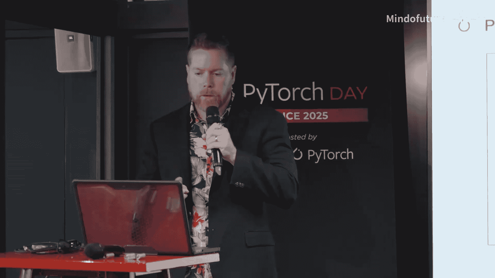
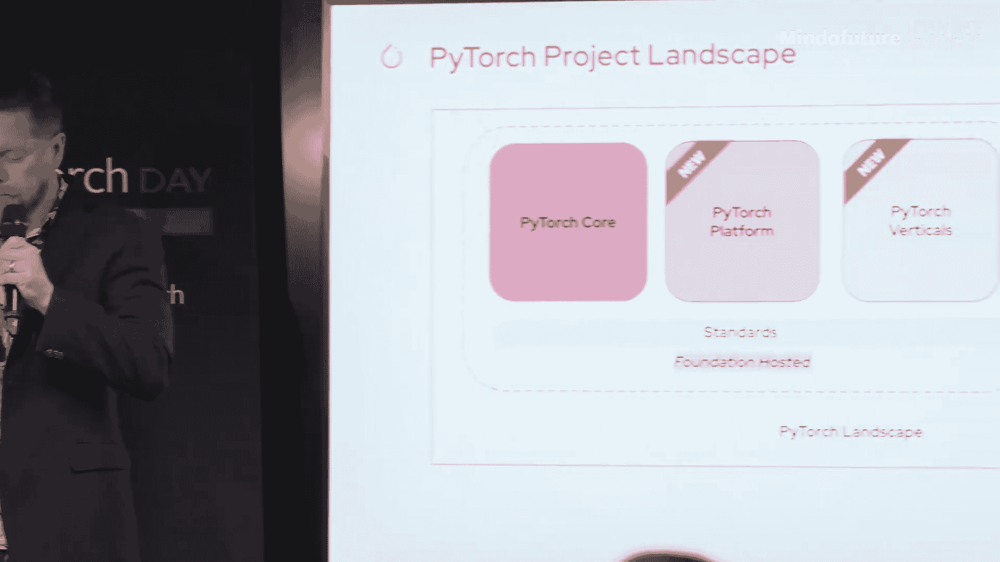
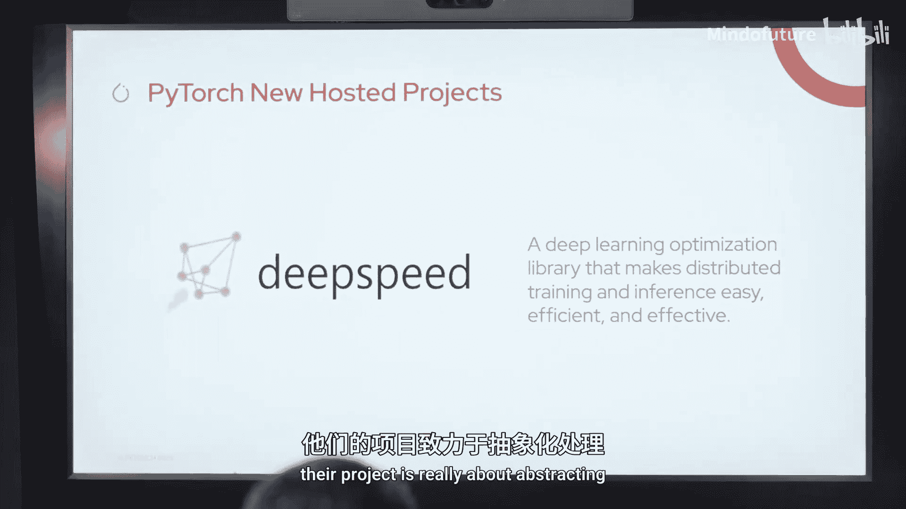
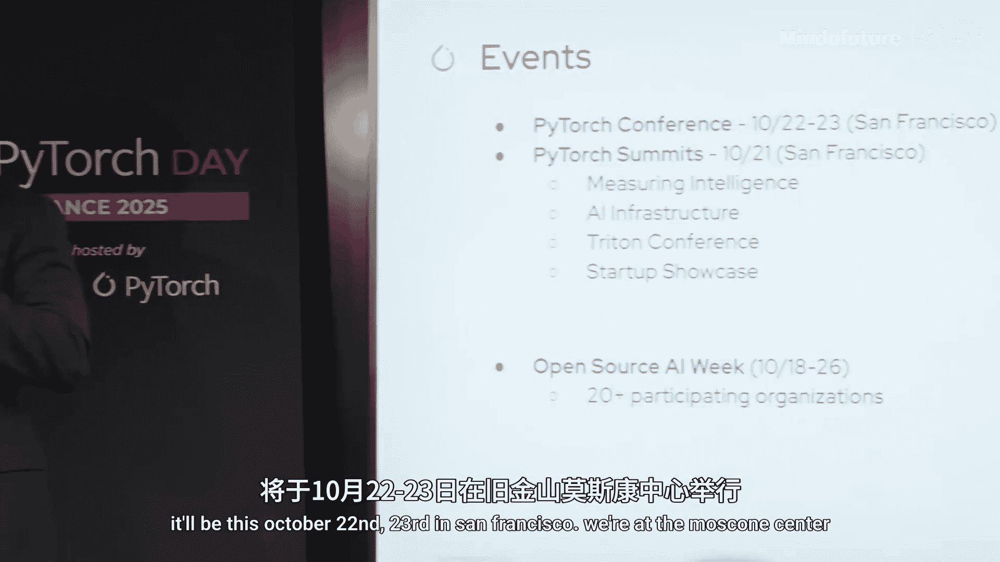
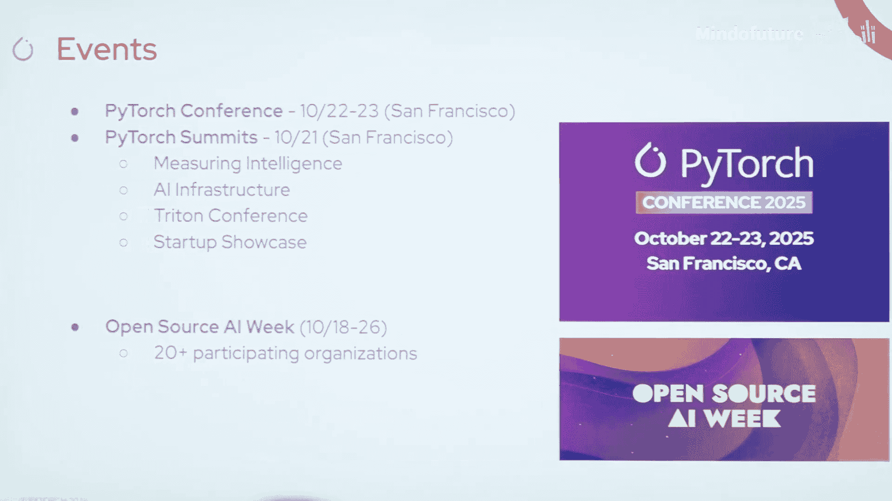

# Pytorch Day France 2025 ｜ vllm ｜ LLAMA ｜ GPU ｜ NVIDIA ｜ GPT ｜ 开源 p01 P01_Welcome__Opening_Remarks-Matt_White__Linux_Foundation -BV1bQtQz2EFL_p1-

Good morning， everyone， thank you for joining us。 We're going to get started here today。

So before we get started I would like to say thank you to CSDN and GoS for hosting this event。

 this is the very first by Toch Day and we're happy to have this in Paris as our kickoff to this event。

SoI'm going to quickly just hover over the Pytor mission。

 and I know this is probably the most boring slide to kick off a presentation with。

 but it does reflect some of the changes that have happened in the foundation recently。

Originally the vision was okay， we were really focused around the Pch framework and I'm getting ahead of a few announcements。

 but if you're online right now you've probably seen them and。

We are now shifting towards being a more encompassing， a more broader foundation。

 which we call an umbrella foundation， which encompasses projects。

 open source projects that are out there that solve problems in the entire AI life cycle and。

I do want to quickly say thank you to all of our premier members。

 our general members and associate members， we are now at over 30 members in the Pirdge Foundation and we recently welcomed Qcom and Snowflake to the family。

And not everybody knows this， but we do have this thriving ecosystem and Ptor that。

Currently consists of over 70 projects and it's continuing to grow。

 youll probably recognize a few of the logos on this slide， but if you have a project。

 please talk to us， we are still accepting and we willll accept ecosystem projects。

So I've got a lot of announcements， I'm going to try and keep this fairly brief。

 but Pytorch is now an umbrella foundation， as I mentioned， do not ask why their umbrella is on fire。

This is just my master design。And what does that mean an umbrella Foundation right。

 what does that word mean， so it basically means that the Pytororch Foundation can host multiple projects now。

 not just Py Georgeorch corere， but now we're extending to additional new projects in the AI lifecycl we want to build this ecosystem of trusted。

 interoperable projects that fundamentally reduce friction for downstream users and for developers and engineers as well as researchers。

So what it helps us do is align governance， get to a vendor neutral space with projects。

 align roadmaps where needed， and really increase the collaboration amongst different projects that work together。

It also support diverse innovation。From all of the different domains that we'll be working on right。

 and that's from tooling and inference to beyond infrastructure and to benchmarks and agent frameworks and other areas。

And this really will help the community rely on projects in this ecosystem to have longevity， right。

 to be reliable that there're going to be support over the long term。

So here's a quick look at what the Pych landscape looks like。

 We have a lot of different terms right the landscape ecosystem can be a little bit confusing。

 but the landscape encompasses everything so Pythroch core is still here today obviously and then we've added two new foundation hosted domains which are the platform projects and our verticals and so platform projects are。

More generalized， they are things like inference and surveying and fine tuning and training that can be used more as general purpose tools。

And then we have verticals， so verticals is very domain specific。

 like protein folding and very like industry specific or application specific use cases。

And then we still have the ecosystem， and so the ecosystem our self- hostsed project。

 these are projects that are not hosted with the PT Foundation。

 they don't have the same benefits and guarantees， but they are projects that are wonderful that help complete the entire open source AI ecosystem。

And so what does it mean to be foundation hosted， so I mentioned that foundation hosted versus self hosted。

 projects that moved into this vendor neutral governance benefit from the Pythro  Tumbrella。

 there's things like trademarks and domains which are held by the foundation so that no other company can sort of monopolize use of trademarks。

And then CI infrastructure， you may rely on our CI infrastructure and integrate with it。

 you may manage your own， but that's an option。 And then we offer like marketing。

 events and a lot of other benefits here。So。We do have two new projects that we've announced。

 our first two new projects in addition to the Pytor ecosystem or so the Pytor Corps， so BLLM。

 I'm sure many of you are familiar with BLLM， it is an inference and serving engine and it's a fantastic project and it solves a real area in the lifecycle which is on the downstream side right on inference。

And then we're also happy to welcome Deeppe， so Deeppe will be joining us their project is really about abstracting and addressing the entire sort of AI life cycle from training through to inference and so this is also an exceptional project and we're happy to have it join our family。

So here's some benefits of hosting projects， I'm not going to go too deep into this。

 we are running way behind time， but we do provide a lot of infrastructure support。

 a lot of the support orthotagonal support that folks that are developing software don't really want to deal with and so we're happy to take that on we help grow projects and so our intent is to help amplify and grow projects in the ecosystem and get broader adoption and really create this very frictionless experience for users。

And then we have a lot of operational support too right so security audits， technical best practices。

 a lot of other things that and even like governance building right。

 which is not something that a lot of folks are really accustomed to。

 and so this is the areas that we can really help out。

So'm also pleased to announce that we've launched our PyTtororch Ambassador program。

 so this program is a global initiative， it's launched today that will allow us to extend the community globally。

 find folks in the community that are going to amplify Pytorch and the projects。

 host regional events， maintain or possibly their own socials and other things to help amplify Pytorch。

We're aiming to host about 20 different community events globally this year。

 and we really want to showcase local innovations， see what's up and coming and projects。You know。

 really get。Really amplified the of the open source AI ecosystem。And if you want to apply。

 the link is here。And we also have a new website， some small changes。

 but obviously now we're an umbrella Foundation， we to we have multiple projects。

 and so we've made some minor adjustments， but this is a more responsive website。

It workss a little quicker and we're happy that we can get something out here that will allow us to be a little more agile and get。

Our projects into the public domain。Yeah。All right， so events。

 so you're obviously here at Pytorch Day， France， we have Pytorch Day China coming up on June 7 in Beijing and we'll also be announcing Pytor Day in India as well this year。

And obviously we have the PyTch conference it will be this October 22。

 23rd in San Francisco we are at the Muscony Center it's a very it's an amazing venue。

 you know please join us we are actually creating another day this year so at day zero events which will be our summits and so we'll have the measuring In sumummit we'll have an AI infrastructure sumummit and then we're col in the Triton Conference and then we have a half day event for startups we'll be doing the startup showcase again this year but with a larger assembly OVCs and folks that will be able to help grow your projects and funding。

And then that same week we are organizing open source AI Week。

 so this will be the first year for open source AI Week and we're working with a lot of different partners in the open source space to make this event happen it's actually nine days of open source goodness。

什么 times？Quly going to stop on this， but not spend too much time in my keynote I talked about the four domains that we're looking at at ELF。

 these are the four domains that we're looking at within Pytorch。

 where we really want to build a very strong and cohesive AI ecosystem。

 and so all of these domains and the categories of projects are what we're really exploring right now。

And we have some upcoming program launches so Pytororch Foundation continues to grow。

 we're going to be launching the Speas Bureau in June and this is the basically Get speakers into events geographical around the world sorry。

 high qualityality speakers that can present on their materials and talk to what we're doing at the Pytorch Foundation those may be ambassadors。

 they may not be ambassadors but we're looking to amplify that program。

 we also have an alsosp and academic outreach program which will be going on in starting the summer and that program is fundamentally connecting us with AI research labs and getting PyTtorch in the hands of developers and researchers and engineers。

And then training and certification will launch at theI Toch Conference and folks will have an opportunity to do training and searchs on site。

And so with that， I'm going to close out to you know， if you aren't a part of the Hy community。

 please join scan this QR code， join on one of our socials and we'd be happy to have you。All right。

 thank you very much。