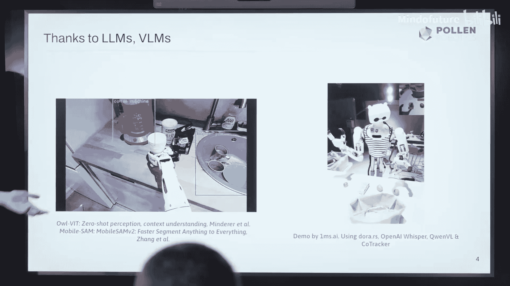
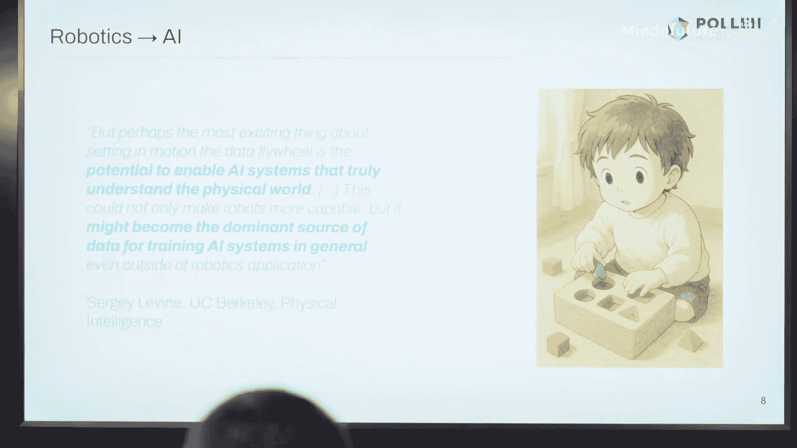

# Pytorch Day France 2025 ｜ vllm ｜ LLAMA ｜ GPU ｜ NVIDIA ｜ GPT ｜ 开源 p02 P02_Real-World_Robotics_as_the_Next_Frontier_for_AI-Pierre_Rouanet__Pollen_Robo -BV1bQtQz2EFL_p2-

诶 protect for your诶。So I'm showing name as a you just mentioned， I'm one of the fun of flame robots。

 we have been recently acquired by and I was。This is quite interesting to mention because I think its quite related to what I want to talk about today。

 which is really quite happening at the intersection between those two worlds which are robots and AI。

And so my background is really on the robotic side。 so I will give mostly the robotics point of view。

 but think this is interesting because Im guessing in the room there is much more of the AI side。

 And so I spent the last10 years or so building this kind of robots human robots， many。

 many different kind of robots working on the effectss， etc ce。And as many of the my col in robotics。

 we've really seen how much AI made a huge impact and what we can do with robotics。

 but they can perform where where they can go， etc ceter。

 but also I want to mention also kind of the other way around。

 which is we've seen more and more people from AI from the AI community using robotics to try to test and evaluate their system into the real world。

And so if I'm zooming back a bit on the history of robotics。

 you can see that in the last 10 years or so we've really seen like this big trend of robotics coming from the factories。

 but there is like really everything is really constrained， Everything is really set up。

 you know exactly where everything is located， you know perfectly the position of your robot。

 you know what's going to be around， you know that that。

 you know pretty much everything right and as basically the only like can kind of。

Interaction that you can have is if something goes out of the band you just freeze and stop and basically call an engineer so you can fix the program and you can go back to your routine so it's much more better automation and but more recently we've seen like this change I can mention this kind of action robot to music where we kind of shift forward to more like un environments but I mean the robot that's still our way to make those environments much more predictable so this is kind of a trend and nowadays we see like many of the big players。

 big research lab， big companies really wanted to move towards like having more robot product to a home product to ourselves and much more reactive and interaction things going on。

And I think most of these path that we made and most of the progress that we made on those robot side。

 there is some huge progress that we made thanks to otherLs and VLs， and especially。

I mentioned here like two two two big domains like the first one being like the visual perception。

 which is obviously something extremely important when you're talking about robotics and when you're talking about adapt to the environment。

 you need to be able to detect what's run you you need to have context to understand it so you can analyze the situation act and react to it and once again。

 like this kind of they are really shining because for instance。

 if you just want to let's say glass of water there is not a very specific shape or glass。

 you have many different shape have many different texture。

 it can be located a very different locations you need this kind of really zero short approach where you can really adapt and adapt to what's front。

And the other obviously big improvement that we've seen is through interaction。I mean， nowadays。

 we can have like LLM directly plug to the robot and you can use some very natural prompts when in this case。

 as you prompt is something like grab me your wrench and put it into the brown bag and you can add like the LLM like fingerry art all the other context details that you need。

 all the basic subduk that's needed to really perform this。This like andがいいんで and。

Another big domain that I wanted to mention where we've seen tremendous progress on the robotics thanks to AI is really like the locommotion I mean back when I was still a PhD like about 10 years ago。

 locommotion was still considered as an extremely complex I think it really is correct but we've seen some huge progress nowadays you have many different companies。

 many different things of stuff but managed who have like human aid robots doing crazy。

 not only working but running Japanese doing Kung Fu for Koued it's even more creative what they can do and most of the progress in my opinion that was made on those things is really thanks to the use of pre standout。

 actually a big reinforcement learning algorithm。But with really powerful simulation tool that can really closely mimic what's going on inside the robots。

 whats the physics of the motor， how they actually behaving， etc cetera。

 so we really closelyning the sensory gap in this field。

And also something that I want to mention because it could be important for the rest of our presentation is even if this seems like completely crazy and extremely hard to do。

 this is also a program where you can have like a really well defined and really well understood really well function for your robot if I'm being a bit too simplistic but for the sake of understanding。

 you can imagine that basically your robot function is something like I want the robot for this specific trajectory and that's some kind of constraint like I want to get to keep my head straight or not to follow or to keep my balance or this concept。

And actually where we're still really swimming and this could seems like a bit disoienting because I mean most of you can clean your kitchen and I'm not sure that all of you can do kung fu。

 but for robotics it's really the opposite， cleaning your kitchen is actually way harder tasks in a sense。

And once again， what I'm trying to tell you here is that this kind of task is much more un controlledrolled。

 much more general in a sense， first you have to deal with like load of engineerization once again。

You have many different plate， they can shape different texture。

 different weight different physical interaction， same for all the objects you will have around our kitchen are configure bit differently and actually what you've seen this video is a state of the art made by the physical intelligence company which is like one of the big name in the manipulation in robotics and what they've done is they use a robots and put it in many different apartments in San Francisco to training it on different configuration but still you see that this is like a reallylic in kitchen really kind of formatted already。

 but still this is where where we're trying to go and where we still swimming another important thing that that。

Trying to explain why this is more difficult。It's that this scanning task is not so well if I'm asking I another five person in the room to claim detection that will probably come to slightly different solution。

 slightly different phase and the parel along the way will be slightly different。

And probably also an explanation for that that' you need like longer planning for the lomotion。

 basically what you need is like to plan basically in the next step also。

 so better plan like a few seconds in front of Uba that it for this kind of task you need to plan like 30 seconds。

1 minutes ahead and that's where we are still really struggling with the existing model。

And probably one of the big reasons， I mean， that's how it has been in AI for the many of the big brands that we have is that we like data。

 so I'm not saying this is the only issue we have， maybe there are some other issues。

 but at least we have certain that we need more of this kind of data。And actually。

 I think this is kind of a different data at what we have at the moment and it's not as easy as just scrapping the whole internet and getting a lot of videos because what we probably need is more like some kind of embedded firstpe ego point of view where you really the subject of the task you're trying to solve those kind of videos should be way more interactive。

 way more reactive to what more the static， kind of data set that we're using at the moment。

So we need to encapulate this kind of physicality， this kind of re of the world that we want to try to understand better and。

と技です。So what you can see on the top of my slide is like examples of people trying to use robot and deliberation that around to collect data directly on the field。

 so once again you can imagine that most of the big names in research or even companies at the moment are buying their own fleet or building out fleet of robots and are having your pair are running on the truck just performing this kind of task and recalling a lot for that。

But obviously this doesn't scale that well and especially if we need a we don't really know how much of this kind of video we need。

 but probably in terms of millions also， so it will probably take times and it will be hard to do so there is also a lot of work on simulation also directly working with more human performing entire videos。

 but then again you have this kind of simulation or simulation to the real world or the human to the real to the robot gap which is not that easy to cross and it's not that certain that we can go that way and actually there is lot of decision at the moment in this field。

 I mean this is also a decision that's happening in many other AI field as well but about the data basically you have research paper just telling okay I'm using 10% on my whole database I'm using 10% of real worldd data from robots that should I use。

should I use more than exercise twice one。And I think on the other around and that's actually a quote I put from Sage Levin。

 which is one of the big resource na in manipulation in robotics and the idea is that if we manage to this kind of useful robots in a real way doing some useful tasks。

 but obviously that's good because they can can from the task。

 but it will probably also becomes kind of the primary way that we acquire a new kind of data is kind of really interactive data that kind of encapsulate the physicality and the way that we deal with the world and so I think this is really interesting and I wanted to put it there because I think this is also probably well the AI and robotics。

F cross We cross more in the future。诶。And actually， well I mean。

 I'm not going to explain more a lot more when we need open solution。

 I mean Matthew did a and did just before， but I think this is particularly important that we still mention it。

 especially when we're talking about robotics。Because there is still this hardware that we need to get in order get started and it could be costly。

 it could be out to build or to maintain， it could even be threatening。

 so there is really a lot of effort that we need to make in this direction in order to have like a really many different communities。

 many different people from different fields working on those of it and not just only being robotics labs or companies。

And so actually， that' that's how I want to kind of complete my talk by presenting you like three main projects that in my opinion。

 are kind of a good way of starting this kind of process and going into that direction。

So first one is is a really locus manulator are made by the menu by the local team。

 So maybe you've seen they are just building a hackath just in a hallway so you have like I don't know2 or people like building the robot for the last couple of days And the idea is really that anyone can can buy。

Like the by all build itself the the this kind of robot you have like the plants。

 you can actually print it yourself your access to a screen printer or you can order the pieces online。

 You you have the be of materials with all the motors and electronic that you need。

And you directly compatible with your libraries and you directly have access to libraries that of the art and learning algorithm so for instance。

 they are a Fu tutorial， but I show you how you can train your own robots to fully your T friends。

And they already have like thousands of500 that I should update my studies per video over 1。

000 now of people around the world like they build on robots and predicting their data settings。

Another project in the same general parallel way， but this one is much more better locomotion and it's actually projected by one one which is in the room and the idea was really I mentioned before like locomotion but you can imagine that really the big human it are a be quite a bit are still quite expensive they can quite complex。

 I can break the even dangerouss， they are really powerful so the idea was really to build something like really low cost that anyone can can access and build and so he came up with these robots。

 which is really inspired by the Disney one if some of you may have in it。嗯。And once again。

 the idea was really to let anyone start training its own robots and start replicating discount pressure to better understand how we can train robots for the commercial。

And they also spent quite a lot of time working on this kind of S wheel program which is especially critical when you're talking about like really locals robots which have modules that can behave quite randomly。

 let's say it that way or at least it's less it's harder to predict how they're going behave。

 its evolving over the time extra so spent a lot of time better understanding this and having like a simulation that's close to the real one and actually what you see on the left of the side。

 it like the server policy and simulation running directly on the wheel robots。

And actually they want to go even further than that and the idea was really okay so we have these robot and we can train it out to work but what about if she wants to build the own robot how your own design and how we can make this pipeline to go from your very basic ID to the design then to the simulator and then to the real robot and how can we make this process as simple as possible and as quick as possible so you can reerate and try new things and yet have a lot of variety of robots trying to turn on this up。

So thanks a lot for your attention， so I really wanted to give you like an overviewography what's happening between those two fields and if you're interested in those projects actually the W on T twinine just can be seen across the whole and Charlotte is also going to make a talk this afternoon about this robot and how we can use LLM to make it more expressive through emotions。

And you can， yeah， find all those projects on on the Disc detail， etc cetera。 and yeah。

Then if you have any questions。