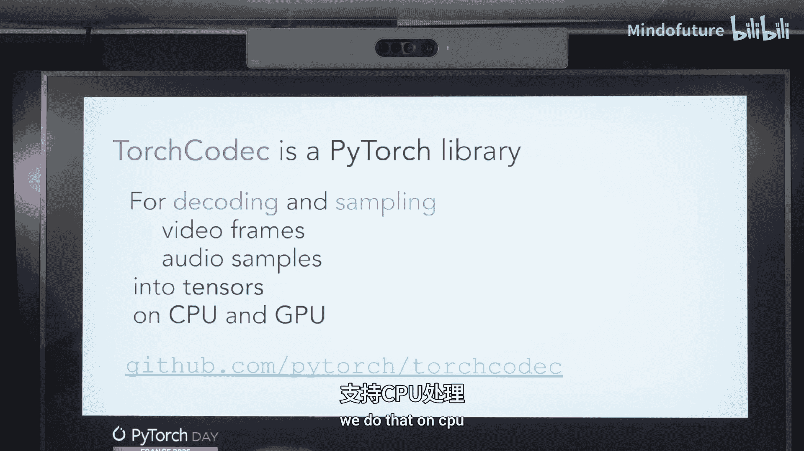
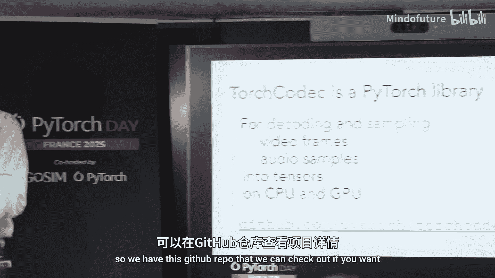
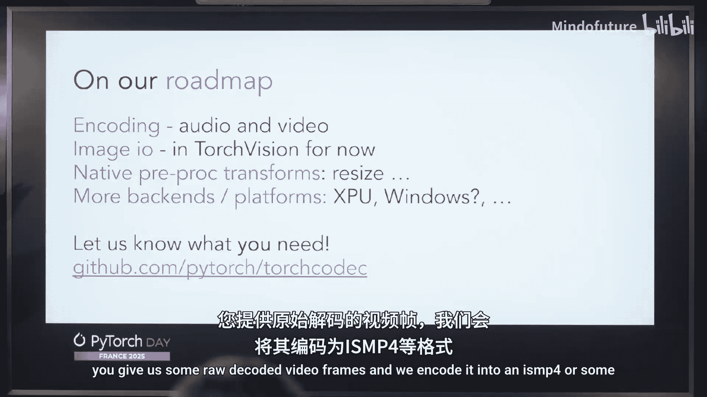
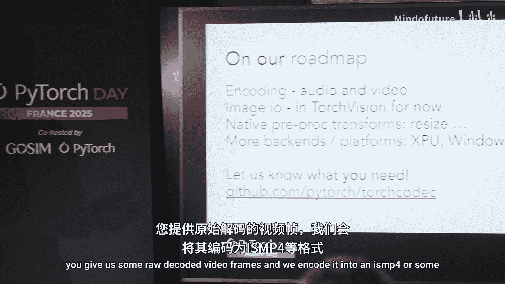

# Pytorch Day France 2025 ｜ vllm ｜ LLAMA ｜ GPU ｜ NVIDIA ｜ GPT ｜ 开源 p03 P03_TorchCodec-The_Media_Decoding_Library_for_PyTorch-Nicolas_Hug__Meta -BV1bQtQz2EFL_p3-

H hi everyone， I'm Nicholas， I'm a software engineer at NA in the PO team in London。

 I usually work on Toch Vision， I've been maintaining and developing Toch visionion for the past few years and these days I've been working on Toch Codeak which is the new media coding library for Pyth I'll be talking about that。

So Toch creditre is a Pythch library， it's about decoding and encoding for now we only support decoding but thencoding is in the works。

 it's about decoding video and audio data so you feel ToC video file or some audio from the web a URL or anything and you get a nice decoded Pythth sensorors。

We do that on CPUU， we also support GPU as well so you have this Gith we can check out。

We want to be easy to use。 We target machine learning engineers。

 We don't want our users to know anything about how decoding works。

 We just want you to get the data that you want as easy as possible。 We want to be easy to install。

 which is a very important requirement for us you might know that there are some video decoders in Torch vision。

 for example， that are not necessarily easy to install because you have to build from source and things like that。

 So we avoid that in Toch codeect。 You can just give install Toch codeect it's going to work with an epi binary that you have on your。

And we want it to be fast and we want it to be integrated with the ecosystem as well。

 and that means that the output that you get from Toch Koek is the input that you can feed to other libraries like Toch Vivis or Toch audioo to transform theseP。

As soon as you get the good frame from To Kek， you can transform them with close vision without having to do any kind of preprocesing or anything。

So we wrap around， FFMB is this low level library for VU decoding。

 it's very hard to use it very complex we abstract that complexity from it that you can just have nice hyphenonic interface to deal with when you're building your box。

So we'll be looking at some code， I'll basically just show you a few snippets of code to explain the different features in what you can do with To Korea everything we'll see is also on our tutorials online so feel free to check them out as well。

Okay so I hope you can see that the main thing you will be interacting with when you're using torch codingding for video decocoding is this video decor object here that you can just instantiate by passing the video file。

 it can be a URL。 it can be raw by the raw encoded by so the video and it can also be more complex but will get into you can ask for the decoding to happen on CPUU or on couda as well we can pass the torch device coa or zero that can it's going to work on LGB So here I'm just giving an example of instantiating such object and we're getting the minute data from it。

 the minuteada is but information that is contained in the header of the video for example。

 but it can also be some information that we torch code compute ourselvesse and give you a more accurate representation So the headers in the video sometimes are not always accurate。

 they can be line it can be wrong or they can be missing or curtail or any kind of stuff。

Sometimes the header will tell you hey， you have 400 frame in that video and you actually have 399。

 so we do some kind of food processing in the video to show you exactly the accurate information I'll talk more about this。

Once you're having instantiateated U encodecodeder。

 you can get the frames by just indexing the actual decoder objects so it works just as if where this。

 you can use simple indexing or like slices and that kind of stuff what you get as output when you index the decoder and when you eaterate over it right at the bottom is a pure tensor so you get a pure tensor of U in a values which are just the pixel values in and the shape is just number of channel and then height template you can get the channels at the end if you want to。

 that's just a parameter that you pass。If you know absolutely channels us。So you can index the deco。

 like I just。Thisscribe。 but if you want more information about the frames。

 you can use the methods that we provide。 So here the first method we're using is get frame add get frame at index is zero。

 so get the first frame。 and what you get is not a pure tensor。

 It's a frame object which is just the data class has the data field。

 The data is the actual tensor data and then it also tells you the PTS。

 the PTS is the presentation time span It's where the frame is first displayed here is zero because it's the first frame It's not a second0 and the duration of the frame。

So yeah you get a little bit more information when doing that if you need to decocode multiple frames the performance step。

 do not call this function on different indices。 we have a method specifically meant for decoding multiple indices at once。

 which is get frames at what you get as output is a frame batch so it's basically the same as the frame object。

 but it's the batched version of that So instead of， for example。

 PTS it to be a single float it's going to be a tensor of as many frames as there are。

The reason this method is faster than calling the individual frames is that we are pre alllocating the data if we can and we are also sorting the indice so that you never have to do any kind of backward seats。

 because backward seat need to be pretty slow。ごめまちょっと。

So here I'm presenting index based API where we are asking for the first frame or the second frame or the last frame。

 sometimes you want time based APIs， you want like the frames are displayed between the first seconds and the。

F second or stuff like that， so we also provide these time based APII they were exactly the same as the index based。

 I'm not going to detail them， but they we have that same to the Ds that we offer。

Clip happening so when you're building or trying a machine learning model。

 sometimes you don't want to pass a single frame to the model。

 you want to pass a sequence of frames that are ordered in time and here I'm just going going to be calling that a clip so a clip is just the sequence of frames they're not necessarily conuous。

 but they are they are。Order隐藏。And so。So this you can think of it as just for short video and sometimes you want the frames to be spaced by a given amount of time or a given amount of indices and you want to specify that you have like x frames per clip So you can do that very easily we've touched it here I'm just asking for eclips at random time steps so the time steps are going start randomly I'm asking for three clips two frames perlet and three seconds between each frames of each clip and what I guess is a frame batch as well the dimensions are like the first dimension is three That's the number of clips we ask for two is the number of frames perlet and then the last few dimensions are just the dimension。

And then you get the same information。The start of every frame and the duration of every frame for every frame the。

And we have different samplers here I presented the clips at random timestamp。

 you can also have clips at regular timet or regularly spaced and just like I said we always have time based API and index based API so you can also have the same clip samplers。

ThatR in的。Okay， so a little tip about performance by default when you use post credit and you when you instantiate a video object。

 what happens is what here on the left， we do a scan of the。This can doesn't decode the entire video。

 we just read the entire thing， we read the packets that FFMB sends us and these packets contain enough information for us to provide you with the accurate metadata that I just saw earlier。

 so that's how we correct the metadata that from the head of that can potentially be and it also allows us to view the index of keyframes。

 which allows us to see precisely where you asked Pochekoect to see。

I'm not going to go into too much details， but that is this scan is。那。It's not super expensive。

 it's not like we have to decode everything， but its T can still be expensive and it scales linearly with the size of the video。

 so the longer the video， the longer the scan is going to take。

You can't avoid doing this scan if you explicitly ask for avoiding it and sometimes you can really speed up the video Twitter in sensationation。

 you might be losing a little bit of accuracy into the seeking and you might be losing a little bit of accuracy in the metadata as well most of the time that's actually okay。

 especially if you're doing random sampling anyway。

 you don't actually care that you're not something exactly where you ask for。

 so we recommend using the approximate board in general that will avoid this scan。

And that potentially things。Streaming so I said that you can pass as input local files。

 URLs or anything， and you can also pass Python objects as long as the object has a read and a see method it looks like a file so it's a file like you can implement the logic inside of it as you want and you can pass it into Torch Que and Torchque is just going to do what you're asking to。

That's very useful because we can implement the logic we want to， for example， in the read function。

 we can download stuff from the web from S3 from the heavy fixedbook for anywhere and we can just have a custom logic to download only the chance that we want to download Sos instead of having to download an entire5 gigabtes video we can just download only the this that we are interested in that's very useful and some libraries actually do that logic for you already like F provides a bunch of file like subjects to download stuff from anywhere S3 or whatever here I'm just a normal URL and this is how it just pass the file like object instead of the and this is actually a lot faster doing this with FS spec and to pass the URL the raw URL because if you pass the raw URL you'll basically be downloading the entire video。

Audio decocoding so we just released audio decoding as well so far I've only should be have to video decocoding but we do audio as well it works exactly the same as video decocoding。

 you instantiate an audio decoder object you can get the metadata there's no sky involved in here because we don't need to and you can get all the samples or just samples we're going to do in language but really it's exactly the same I'm just going gloss very quickly。

Yeah， heada， the P toch is mirating， so we have already started deprecating the video recorders of torch patient。

 they will be removed by the end of 2025。You are already seeing some warnings if you started using them。

And we have raised warning in the box。 And the same is happening for Toch powder in Tosh earlier。

 we have video decoderers and audio decoers as well。

 We are deprecating these and they will be removed。 so you need to migrate as soon as possible。

We will be doing the same with encoders， but before we remove the encoders， we will of course。

 provide you with that。The same features seems switch。

The image decoders of To vision for now they stay in To vision。

 they are safe in there so you can keep using them， they are not ned。

 but eventually in the future I don't have any on this but they will be moving to To credit as well eventually so that we can consolidate everything else。

I road map， so we want to be doing encoding。 So it's still in reverse process。

 right you give us some raw decod video frames and we encode it into an nice empty。

Stuff like that like I said we want to move the image I as well into To vision but that's for later a bit feature request that's a lot harder than it sounds like is to allow you to run some prepro within the decoder so every bank or any decoder is capable of doing some preprocess within the decoder like you can do resize you can do cropping and things like that and doing those transformation inside the decoder is potentially faster than doing them after the。

By calling nu of transform。The thing is it's very easy to get discrepancies between the training stage and your inference stage。

 So if you were， for example， training with a resized strategy that involves billion mode and bike and NLEs。

 you actually have to do the same thing during inference。 if you don't， you get some wrong results。

 So we are trying to expose this functionality in a way that doesn't allow you to shift yourself in the foot and having silently wrong results。

 So it's coming but we are trying to do it properly。

And we're also trying to implement more backgrounds as well atUs in the works with some inter。

 Windows is probably going to come and yeah that's it， let us also know what you need。

 feel free to open an issue on the GitHub tracker we would love to hear whatever you need and that's it。

 thank you。Do you have any questions， Franks。