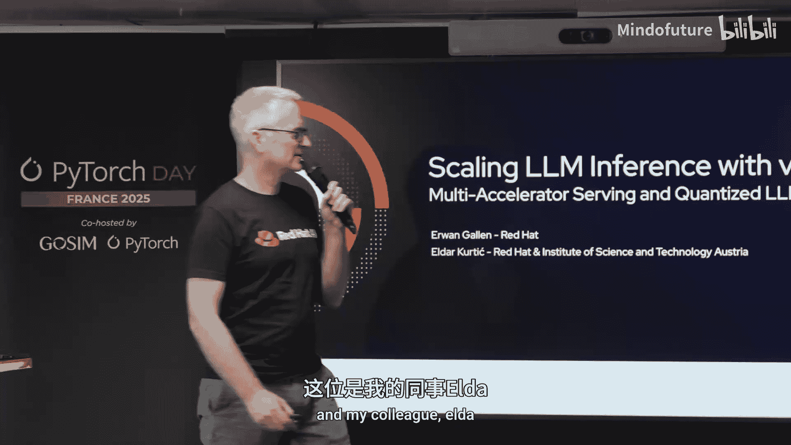
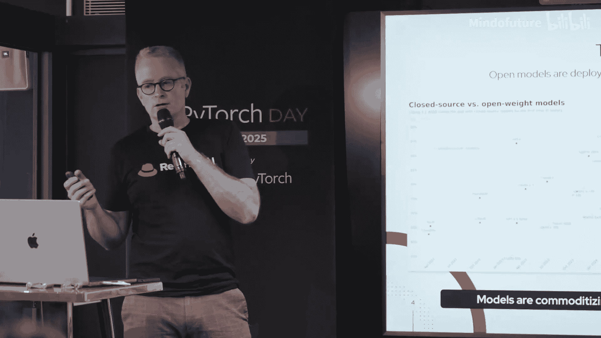
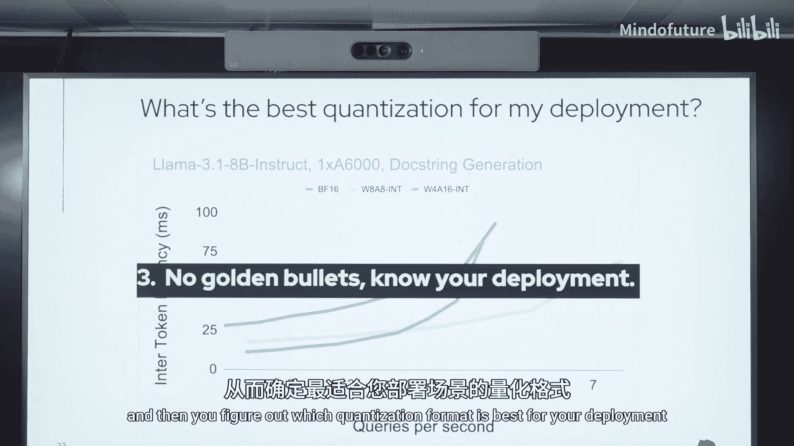

# Pytorch Day France 2025 ｜ vllm ｜ LLAMA ｜ GPU ｜ NVIDIA ｜ GPT ｜ 开源 p04 P04_Scaling_LLM_Inference_with_vLLM-Erwan_Gallen__Eldar_Kurtic__Red_Hat -BV1bQtQz2EFL_p4-

对。Hello all， so today we discuss on how to scale LLM in neurons with VLLM。

So discuss on how to scale with multiple acceleros and how you can extend how you can how you can scale in France on large platforms。

 So first set quick introduction So I'm your end product manager and Red。

I'm following everythings on in for the red products So we are following developed platforms。

 We are also called opportunity or also platform for other we are working a lot withs So its why we are today on the micro。

Hello everyone， my name is Alda， I worked as a researcher at Redhub and the Institute of Sciences the of Austriaus。

 and I mostly deal with quantization inside the field。

Good your must be idea because the world had changed in 2022。

 so Mike was picking up open source in the increasing keynote when open AI has launchedGT or the world that has focused on GenI on aesthetic on what is GI。

 but also for the company on all the open source communities， this model of Open AI。

 this with extending the data set size expandinging the number of parameters。

 it was like a huge world on the pop A system， the software system more likely possible to compete with open source。

But with the power of open plan on the soil or the community or the good， so in 2022。

 we had no open source models， so impossible to compete with any creative models。

But Me in Yma has started to introduce or also the team in various of meta is contributing to launching launching open source and also we were lot French team from this trial all the models have started to to be to be better in the benchmark。

On today， if we look as on this accounts we talked about by deeppsse。

 now regarding the next version of capabilities for open source on now。

The product is to use open pencils。In this mode， so meta Yama can beat with the best with close fort on Dig。

We also a huge use of， of platforms， open platforms。 So Pyto is the foundation for this platform。

But also VLLM has emerged， so againF has created TGI that was used a lot at the beginning on VLLM is starting to emerge as a de facto standard up for income platform so it provides advanced algorithm for IQPS you can start from a single server for a large scale environment for data center so it can fit any use case and thiss at the beginning of at the beginning of LLM tens of TLLM engine was limiting the performance of all open source as it was for the models and now it it can compete with a tens of TLLM sos either a comparison point for any alternative methods。

So it's easy to use so with PLM you can just download on it's crazy the number of downloads so we have reached average of 100000 download per day on some days actually last month us 300000 download per day with a Python libraries too so it's the Pan used by everybody so the place where the company can contribute can collabo together I should look at the launch of La day one La4 was supported。

 so it's why in the community we work and we receive some time from 10 days before any new model。

And what that cannot we in and provide open openI comp API so resource。

It's so easy to integrate with an agent or inte also with existing platform。

And a good contributor of GLM， so we your magic was one of early contributor of GLM on the project was created by UC B and now we are the first contributor of GLM。

So one of the key strengths of VLLM is integration with a vertical accelator。

 so it's also aing for the scale， not limited to one specific technology。

 so with VLLM you can on any model but also any accelatorator。

 so we have different level of mat for this accelators but really it's the openness on the contribution a lot of company。

 a lot of accelator or Windowss， so we a key integration of NDHQ on recently with aid integration of MD GPQ。

Recently at Google next， on stage， one of our colleagues has announced on contribution of Red。

 the who of Google TPU integrated in， many of us are coming。

 the project as they were with a plugin mechanism to easily integrate UXerator。

 you have some Kerators on multiple Xerators。So how to scale with VLLM。

 so as a user you can play with your laptop， you can use cloud， you can add your own seller。

 but with a recent model it's really difficult on one model does not fit in in one GP use。

 so it's why which case of the techniques conization。

 but also how to scale from single device moving to single OS with which device to OS with device。

 so it a device but it's many GP use or now。On the for each of the scenario。

 VLLM can scale and can providers who increase the compute the viaM on their solar capacity。

 but so when you will scale with multiple device， multiple parts you will have also more hardware requirements。

Spakking of the gap internet connect between the GPU or lDM A across lot So scanning is requiring additional additional capabilities on your platform。

So first， moving from one simple GPU to multiple GPU。

 one of the I techniques integrated in VRLM is tensor algorithm。

So yellow allows to show the weight or is own。And instead of loading all the weight。So in oneシ。

You can shout on I also the la C， because VLLM does not have to load the full date。

When the volume is bigger， it cannot one the rise on terms of algorithm is allowing。ちょど。

To scale and to load this large model。So you provide optimize or use implementation with a with a data with input shell horizontal on or use for the output。

 So it worked well when you have less than any devices， which is like the classic edge X server from。

Fromア。But when you want to scale after to multiplebi to multiple node you need also to inver over parallel techniques。

 it's why you can also in addition to transfer parallel because you will still use multiple nodes you will use also pipeline parallelism。

 so here you will do point point communication instead of an expanding or we use。

 so in this situation we will use multiplebi each GPU could take care on a certain number of layers。

Meaning that will connect this player on it will allow the Mer GPU。So to implement this with VLM。

 you need to use RA or where we share the communication and you can use pipeism to share on to run on which so just pipe paralleltic size and you can mix rich parameters。

the latest py technique I'm presenting is the expert item。

 So we are using a lot of mixture of experts。 So instead of shing or on or shing per copying the layers we have a mechanism or so in VLM to allocate on specific expert models per device device per GPU so with this technique too can hold specific specific compute to specific the right。

 So this also can get some problem to im balance between the expert because the balancing could be complex。

 but you can mix you can mix on a lot of recent models already mix of。是道。Okay。

So this second part of the presentation will be mostly about consideration。So。好。

This is how a standard， like a quantizational life cycle should look like in practice。 So basically。

 you can take two pathways when you want to deploy a upon as one。

 The first one is you take a model from Ha health。You pulled it through our L compressor which is a library which implements state of the art quantization algorithms that you can get from research A days and it supports different quantization schemes and this should be ideally very iterative process so you quantize the model。

 you evaluate your net satisfied with the accuracy。

 you do it again and so on and so forth or you can go to， for example。

 having face health like redhead AS health which contains more than 400 state of the quantize models and we are actively releasing all of these new models that are coming out every single day。

 and then once you're satisfied with the accuracy of the quantize model。

You need to benchmark the inference performance of the model so you understand the gains that you're getting from quantization for this specific case。

 I'm showcaing here the KLLF， which is our library for simulating the real work quotes on top of your deployment。

 it's compatible VLM TGI and the other open I。And then here you can see how the latency looks like。

 how the troer looks like under different loads， and once you're satisfy with that。

 you can go and deploy your model， for example， in VLA。So basically today regarding quantization。

 I' would like to get to give you like main three main takeaways related to quantization。

 so basically quantization became a very popular topic during the last year or so and there has been a ton of models appearing on hack physical and one unfortunate thing is that quantization got to lots of the bad reputationet because most of these models are coming out without proper evaluations and this creates like the situations like this one here where the user is seeing a model with。

For example， FDA quant model having like a five points lower accuracy than the unantized baseline。

 and this creates a lot of skepticism in the community about the adoption of the quantized models in the actual actual like real world deployments。

 So the first message here is that not all quant models are created equal。

 And what I mean by this is the fact that when we are applying a specific quantization format。

 there is literally like a million different choices that we can make going from which format to use。

 how to apply， which algorithm to use to apply specific quantization。

Whether it's a static or dynamic quantetization， whether we're using calibration data or we're not using calibration data。

 which observers we're using how fine grain scales are we using are we using one scale per tensor per block per channel and so on and so forth there's a number of different ways to do this and this kind of inspired us to kick off a project which we called give me BF16 or give me that where we literally took all of the popular models in the community going from decoder only models to meE models。

 so in the model size we look at like anywhere from one one to three put size up to the MOs like the DC which are like 671 billion inside size and basically we quantize all of them into three different formats。

 FB8 intake and then4 and then we tuned collib properly to get like the the satisfiable accuracy recovery and then we took all of the popular e that exist in the community like openL。

But B1 B2， all the popular reasoning devices， long context device are in a heart， multimodal。

 and so on and so forth。In total， this was around more than a million evaluation that we did。

 and basically we found the same message across all of these。

And that intake and F8 quantized models are when collaboration is tuned properly。

 they get to the accuracy recovery of 98 to 99%， so very， very easily whereas for in4 models。

 this range goes anywhere from 95 to 99 percent accuracy recovery which usually depends on the size of the model。

 very， very small models are usually in this range of 95 96% recovery。

 and then once we go to the higher models this becomes much easier and here Im showcase in just simple one example of the many that we have。

 which covers the reasoning performance like the most recent the MCR1 still models across three popular reasoning tasks and the entire like co and quantum family。

 and basically the message is the same blue and the yellow blue and green bars here。

 which represent FP8 and intake respectively， are almost indistinguishable from the gray bars which are like the anti quantized baseline。

And then the yellow bar stands which represents the in models that usually has like a smaller drop on a smaller model like 1。

5 equaln and Lama 8。So this was the first message so not all quantized models are created equal there is a way to tune the quantization to get the recovery second message is the fact that quantization opens up additional and pathway for us to improve the quality of our LM deployments and what I mean by this is that in the academic setup usually we are working in an environment where we are designing new quantization algorithms and we are always looking at the accuracy recovery relative to the anquize model and that's like a perfect fair setup to compare different algorithms。

However， in the real world， the main question that we are asking ourselves is what is the best model that I can deploy。

 given my constraints， deployment constraints， and usually the main deployment constraints that we have is the amount of the GPP memory that we can allocate for that application。

And basically here I'm kind of try picking a specific example because it lends itself up self perfectly for this illustration like these is a qua 7b and qua 14 B models。

 so basically let's say the target deployment for our deployment weal 14 gigs of the GPK memory。

 the best model without quantization that we can serve is the quant 7b a quantize model which gives us the seven score of 65。

On these reasoning evolve， however， and that's the best we can do without quantization however。

 quantization enables us to go to the higher model， like a larger model， like a quant 14 B。

 which originally like in antiantized for takes up like 28 piece of the GP memory we quantize it down to 8 bit。

 and then we get back to this like a 14 gigit of the memory GPU constraint。

 But now we can enjoy much much better accuracy， depending on which which quant format we use。

 So we kind of get to leverage the accuracy of the higher of the larger model。

 but then with quantization， even if we lose one or two percentage points relative to the unized model。

 we are still way better than the smallerantized unized。And yeah。

 larger quantize is always better than smaller equiized。

 I least in terms of the accuracy and the last message here is now when we are satisfied with the accuracy of our quantized model。

 the next question that your phase it is what is the best quantization format for my specific deployment and for the specific purpose and herere showing the interdken latency。

 how interdken latency changes with respect to the number of queries per second that we are sending to our Lama8p model on a single A6000 under some specific use which we call here like a doing generation and we are looking at three different quantization formats B of 16。

 so this is the unquantized like a baseline model in date weight and that quantize model and in weight on quantize model and basically they are like three main things to observe here。

 the first one is that when you are in the range of four queries per second and less the best quantization format for the specific deployment would be in4 quantize model because it gives us the lowest latency rate。

However， once we reach the fourqui per second and more。

 we are going from the memory bandwidth boundary dream to a compute boundary dream。

 and in this specific case， in weight only quantization is not the optimal choice for our employment as you can see intake weight and activation quantization becomes much better choice for this。

 and it has like a consistent to grow in the latency。The final piece， which probably not many。

 many of you are not probably expecting this is the fact that once we push even more like more queries per second at some point。

 we will reach a regime where in quantized model is performing worse than the un quantized baseline。

 And this is mostly because in this regime， we are heavily bounded by compute。

 And and weight quantization doesn't improve that market at all because it's just going to do like loading of the quantized rates doing the deco quantization in order to produce the outputs。

 And then well be paying a very large cost for this quantization。

So the last message here is that there are no golden bullets。

 you should know your deployment and the way kind of to get to know your deployment is for example。

 taking guideLM or any other library which allows you to allows you to completely automate this process so you take your model。

 you deploy it， you run automated benchmarking part and then you get a graph like this。

 and then you figure out which quantization format is best for your deployment。

And yeah here are the links on where to go next， Lm Proor， yeah。

 this is maybe like a good thing to highlight here。

LM compressor has been adopted by a metateam as well。

 so we collaborated with a metateme on the La of four memory colleagues where they produce like F model with LM compressor and then here the links were Gu LLM。

 RaSU and VLM。对对。there any questions？