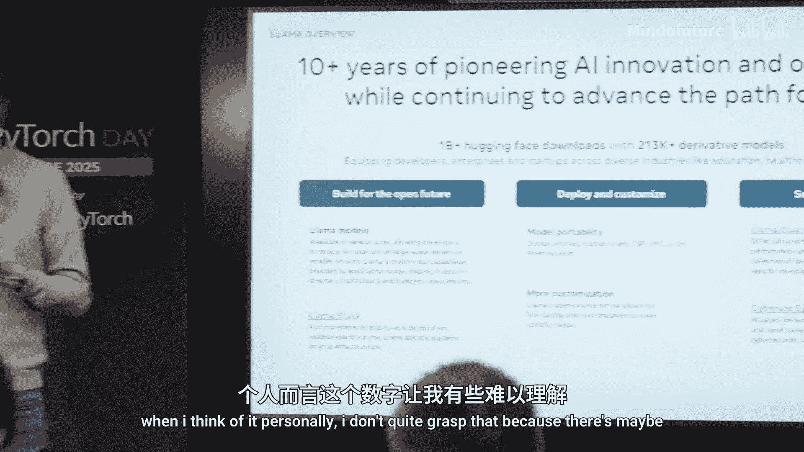
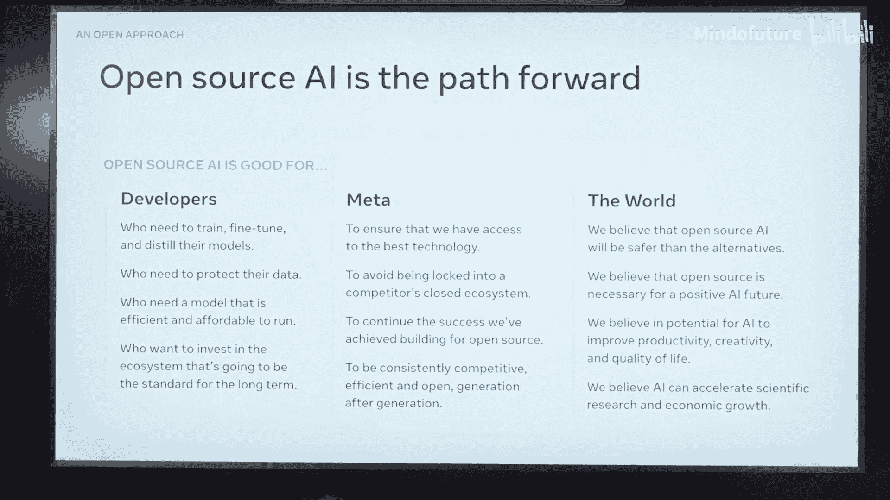
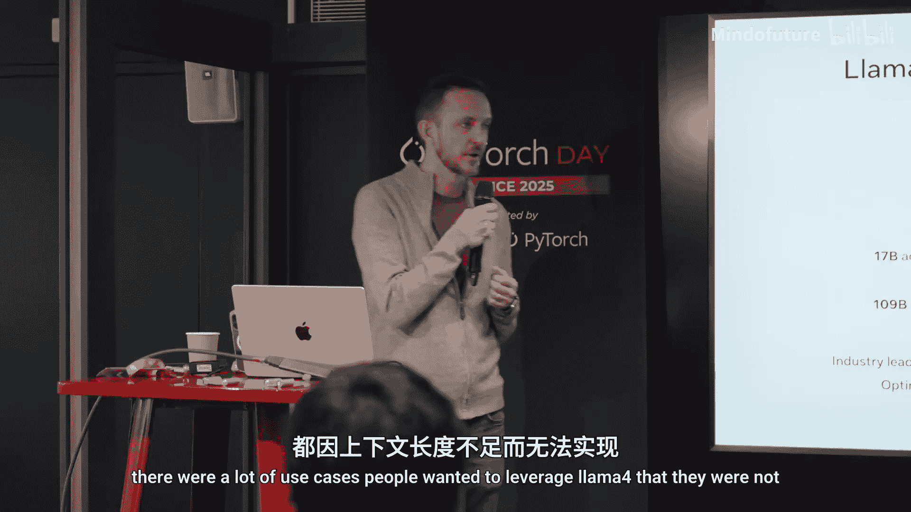
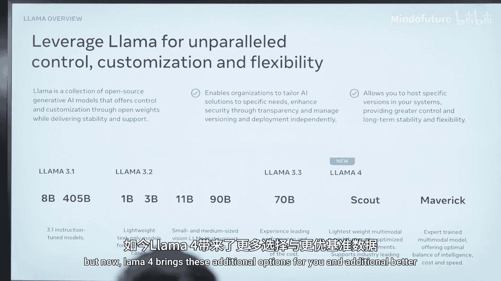
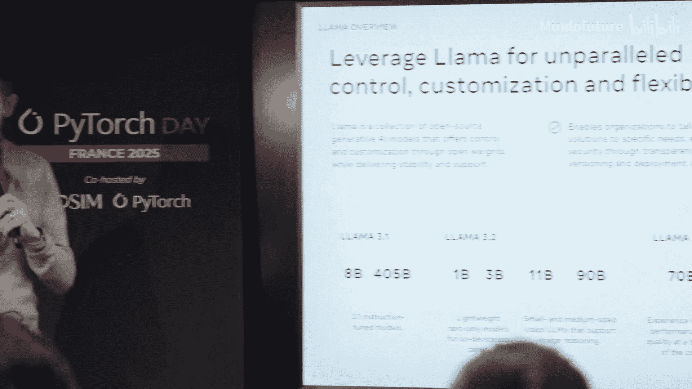
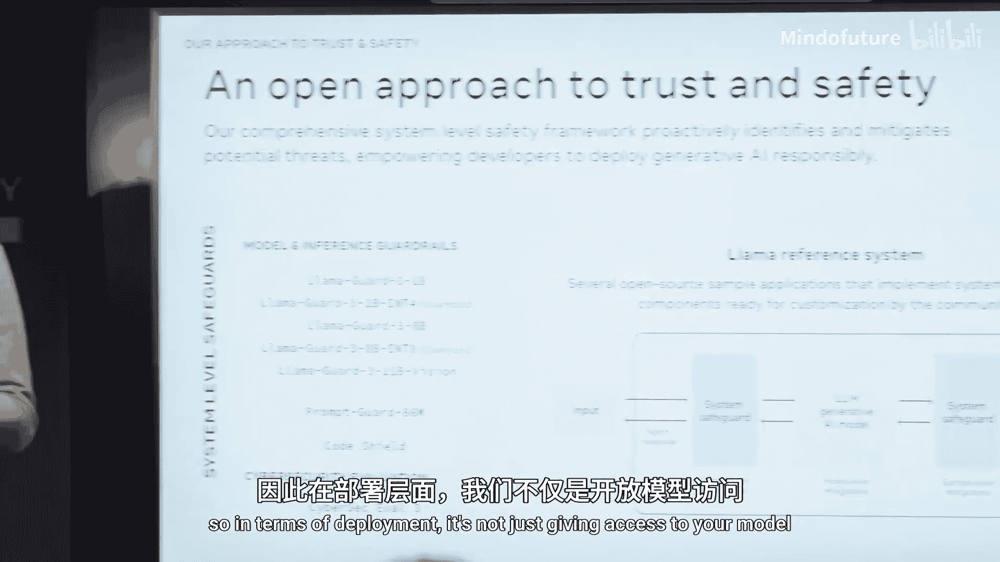

# Pytorch Day France 2025 ｜ vllm ｜ LLAMA ｜ GPU ｜ NVIDIA ｜ GPT ｜ 开源 p05 P05_Llama_4-Christian_Keller__Meta -BV1bQtQz2EFL_p5-

you。Everyone。N。All right， do you think somebody what tech you prefer about product measure but you have it so my name is Christian。

 I've been working at that for the last six years。I was based in the US previously but I'm in Paris now I was four years as the hydro Pi watch。

 so it was this full circle for me and it's quite great to see。community growing。

I would pay you towards our work on。On device and privacy and then to Co P Torch and led the Tu launch After that I moved to Paris to work on Lama in Ja of the eye research at Me up and today I'm a product manager at there which is our foundational AI research lab working on world models what we think is going to come back but today it's about Lama。

So I won't to tell anyone anything new here that LLMs are taking over the world。

 everybody's talking about it， that itself is integrating in a lot of its products from creative tools to ads。

 whether it's for image generation or。Or text and engagement。And。

AI isn't just about generative models， it's also about initially classification of images。

Recommended a system， it was used in many， many different ways and some of my friends are like。

 oh I'm starting to use AI my this is great have you not been using Google for the last 20 years athu but。

That's so you had it now Gene I is taken over the world what's coming next beyond these LLMs and what we're going to try to do with lani here is get these models to think better and go towards artificial general intelligence Now Lama4 is not that but。

It's a step towards it， hope so。So yeah都 sure havela。

Well I think a lot of people don't know and you're here in Paris is that Lama1 and Lama2 were built here in Paris。

 like at the offices in your opera by a set of researchers that were here working at Fair。

 and I worked personally in Alma three。And so the launch Alma3 was our way to catch up to say， look。

 there's these great models out there， there's STTPT， there's Geminize， we want to play this game。

 we want to be serious about it and so when we launched Lama3 was our way to do that we Loma 3。

1 in particular。There was a 45 billion parameter model。

 so pretty big hard to use every day in most cases。But late last year， we launched saw at 3。3。

And with Lama 3。3， we're able to compress pretty much a lot of the quality of the Lama 3。

1 model into a 70 billion parameter model that's used and deployed in a lot of our products at Me。

One thing about innovation， I think in this space is that the way I frame it is that it comes in two different flavors。

 one is around improving the capabilities a given model has to be able to do more things。

 unlock new types of applications， but the other one is around efficiency and around making more bang for buck in the models that you have so that theyve got lower costs and then new use cases can also be deployed because they're essentially they makes sense from an RI perspective。

And in April， we just launched Lana 4， at these the first two models of our part Lana 4 Sc and Maverick。

 Now I'll tell you a little bit more about those， but。First at a high level。

Thank you for the hiking face people here that I see Lama has been downloaded over a billion times on hiking field。

Like when I think of it personally， I don't quite grasp that because。

There's maybe I don't know，5070，000 researchers or juniors working in LLMs like in the world but they've downloaded a billion times like did they just fail on these downloads No。

 but because each time you launch a new model， we're able to kind of test new things different versions of the model that they try out and it just shows that I think that people are really engaged I think this community there's a community around Lama it's being built and that's shown with the derivative models that are built on top of it so there's over 200。

000 models that have been built on top of Lama， the people have been able to take and customize and make their own for their own applications that's one of the powers I think of public open source sollma isn't just the modelss not just also the community it's a group of things that involve the stack that's how you're going to deploy and I'll tell you more about this an ability to run it in many different places whether it's on your premises or cloud service providers and customize it。

And then you have a set of tools around it to make the model safer。

 and I'll have a whole section on responsible AI and how to build it with。

So I think everybody knows what you can do with LLM0， but very quickly， it's used for translation。

 it's used for content creation， it's used for education。

My thesis on this is that I don't think we yet have the hero use cases that are going to be deployed that are going to make these things big very big。

 like I use it to edit documents， my spouse is are in French right now。

 I wrote a little program for her to correct her essays and there' some prepromping on it so it would be rated like the。

Deellf be one level which is right thing and so you can do a lot of these things or stuff the models are very powerful they're very。

Flexible。完了。Can be deployed anywhere。So whether it's on your premises or on the cloud。

 that allows you also for a second point， to have more control around your data and around privacy because you're not sending your data into API calls。

 you' have connecting your own tools elsewhere， you're able to control like how you choose to deploy these things or。

There's a whole ecosystem， not just a derivative Mo I talked about。

 but a lot of people build around Lamma tools and ways to connect and improve like agentN Tiktk behavior or tools that can easily be connected。

If you can customize it， I've tried myself to find who a model turns out。

You and product managers can do it so it's not so hard and I'll have a little slides so Pytorch and torch2 you can use to do so。

And then finally allows you to take control of your future because you're able to build a whole stack around it and evolve with the model as it's changing as we're updating it。

The open approach image is always gets me。So open AI Open sourceRCI is a path forward like plan on the Open AI。

So。Why do we do open ad metic you might as know we've got ficiary responsibilities。

 we try to make money in we try to make our users happy to。

 but overall I think it aligns very much with what we want to do。At metta to do open source work。

One is it's good for developers， it's good for developers because it gives them tools that they can use there are top not that allows them to innovate outside these developers we recruit a lot of them so when they come to work for us at MeA they already know these tools there's a benefit to do that。

It also helps accelerate innovation in this space。And for us we're not making like our main revenue stream isn't like API calls on our models。

 it's like advertising， it's these other things， so what we want is people to have the best tool possible to build。

 create on our platforms create the best ads possible where the tools we built or the tools others have built and so if the space advances us fast。

 if it improves fast， it benefits us in the long term。And we think it will help the world。

 and I have a few examples of use cases where  Lama has been used also in。

Outside of managing positive words。So the manmas back。Keeping track of。

So dilemma stack ink of it as an abstraction to make your life easier as a developer。

It connects with different ways you can deploy your model with its different hardware backends or different cloud service providers。

 your own， and different interfaces in how you connect different tools on top of Lama to make it a useful product for。

There's ways you can use it to help with inference to build agents to manage memory。

There's also ways where you can use it to customize the model， whether it's creating your own eVs。

 to fine tuning on those and try to improve it with reinforcement learning model。

And our community has adopted， so whether you're deploying it on Amazon or agingF that you were playing on UgingF。

 whether you have N hardware， like theyre all adopted Lama stacks so you can use it。

This is a couple of Pytorrch shop。S so Torch if you haven't tried it out way this is an example here with Lana 3。

1 where you can use it to fine tune a Lama， so I haven't tried it with Lama for Al be honest。

 but with Lana 3。1 was working quite well and there's ways and tutorials where it shows you watch you through it。

The second one I'll call out and。This was my pet project， let's say Regio and I former。

Htorrch engineer worked on that and executive torch is a way you can deploy Lama on device and deploy any model in effect on device。

 but we have optimized versions of Lama that work on executive torch to allow you with a very low overhead to deploy any type of device that they you want to target。

So that our models。I'm only going to talk today about Lama4， but if you have questions。

I've worked a on a three so I can tell you more about this one。So。

Two first models we launched for Lama4 Lama4 Sc， Ama4 neighbor。So。

a few of the innovations I think we're bringing in here is that compared to the previous  samas。

They're a mixture of experts。They've got 17 billion active parameters being used at any given time。

 for discount at 16 experts on put number that's 128。

With the number of parameters growing for one and the other。

 there are differences though in how you might want to use it so for example。

 Lama4 Sc has a lot more context length， 10 million context length。

 so this is one of the feedback we on Lama3 which is people wanted more context slide。

 there were a lot of use cases people wanted to to leverage Lama4 that they were not able to because they lack context length if you're working with like the code base you want it all loaded you know for example in in your model。

 you couldn't do that before now you cant you can have your entire code base loaded and work on it and ask questions about it。

And then they're negatively multimodal， so be're able to ask them any questions about images and other modalities that we're going to keep adding on over time。

That makes a different all on a three。So。One point I'll say in this one is that the N4 Sc fits on the one NVG H100 GPU。

 so you can run on just one GPU rich。You know they're not cheap yet。

 but they're getting there before you and so you don't need like crazy infrastructure to manage it。

 like one GP will handle your workload and you can handle like a very long contact sign just for that。

So this is just a quick summary of。The models that being already said most of the points on this one。

做。When you think of what model to use it's not a one size fit all。

 the other thing most use cases that I pretty much deploy and play with models with right now is Lama 3。

370 it's a dense model， it's easy to deploy， I've already done in a bunch and it's been great but now Lama 4 brings these additional options for you and additional benchmark numbers I'll talk about。

All right， this is just the summary study if people some people take pictures of this phone journal market because they have。

Pretty much the best use cases for each of them that I tend throughout。车代饭。All right， so number 4。

 Sc and Naverick。I'll repeat our natively multimonal extended context window。

 they've got image grounding where they understand images， end text。

 and they were trained like that at the same time。Mulilingual。

 which is 12 languages now a lot better than what we had better and superior performance at lower cost。

So on the Eval front。I don't know how you pick your model in general but for people that deploy models what I tend to recommend is like don't look at every benchmark。

 try to understand what benchmark works best for you and what you want to do initially is find what's your proxy benchmark for any deployment that you're looking at and then from there with Lama you can fine tune and improve on these benchmarks so for example for this one like Doc VQA 94。

5 really high on that life coach bench 32。8 I know there's a lot of other models are better at this but Lama can be fine to and improved model of these。

ISorry， thanks for a question that。It's with questions。Okay。

 so I'll go to the responsible AI element， so one thing that's difficult for us of that is because we do open source。

 the model's really going to open， we don't control at the API call level any type of way to protect people。

 like people use it， they deploy them and so what we want to do is want to think like an entire development flow like how safety impacts the model。

What we do also is we provide Lama guard and so I'll talk a little bit here about how Lani got works Lamagar is a lama model that we've turned into a classifier。

 so a lot of these lenss can be used as classifiers where you teach them to understand whether this type of content is risk about x Y and z or if it's safe。

And so the where systems are built even at Ve is that for every input that comes in。

 we filter this input through a Lamargar， we classify to see if there's a any risk。

 then depending on how that's classified， we send it to the LLM itself。

Then there's a whole backend system for access to tools where LamaA can also be used to figure out if the model should or not be able to request things from tools like databases or the likes。

 and then the same thing this is what the model comes up with。

We make sure that its content is appropriate to show and then we only then show it to the user so in terms of deployment。

 it's not just giving access to your model， it's building this entire system around safety and we provide the tools to do that with Lada stackack and Lanagar in particular。

So there's different versions of it on your use case。

 whether it's for vision models or purely text or focus on thoseality。

So we've built AI responsibly for years， over 10 years building open research at fair。

 we started the AI Alliance of companies like IBM that look at understanding and creating frameworks around what safety is about and for every model we have we put system cards out there on how to do that so you to learn more about building AI responsibly。

 we've also got education online how on how to do that。And if you want to learn more about Lama。

 you can scan the QR code and that's it for me。等下。