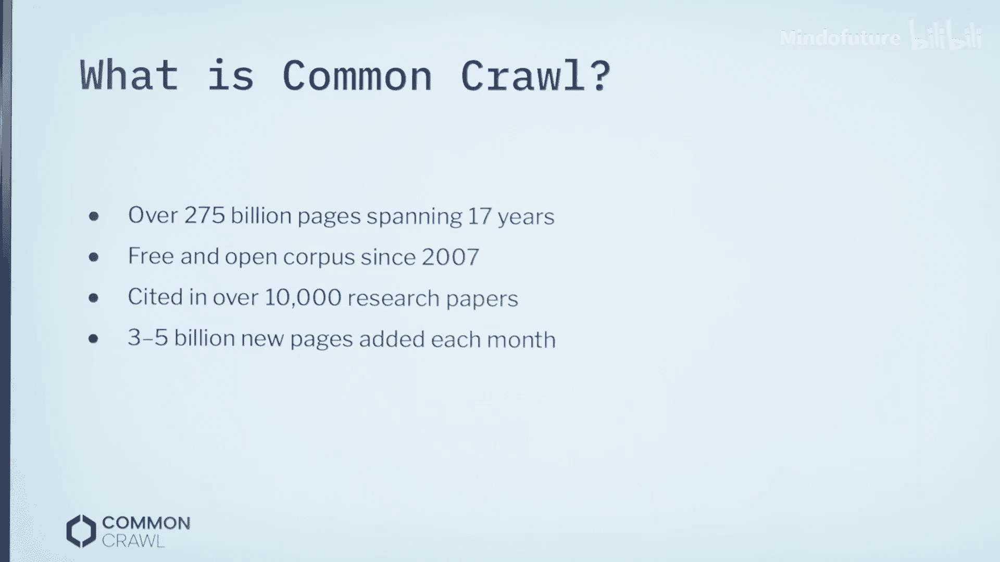
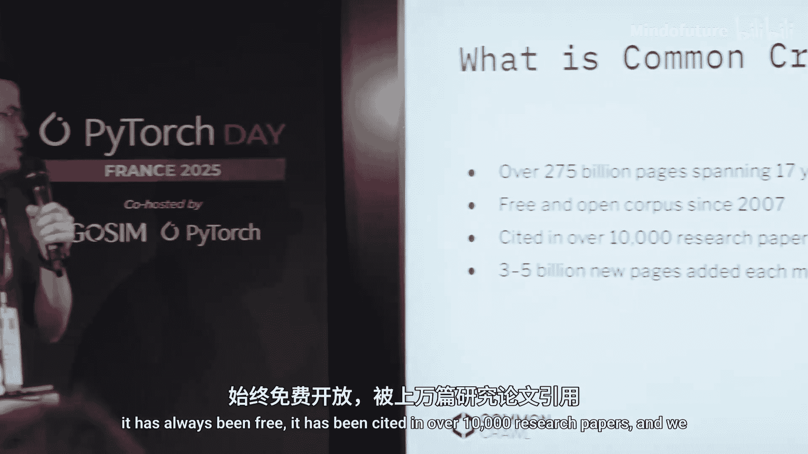
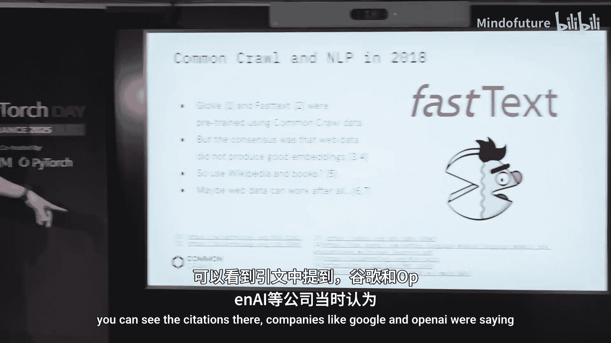
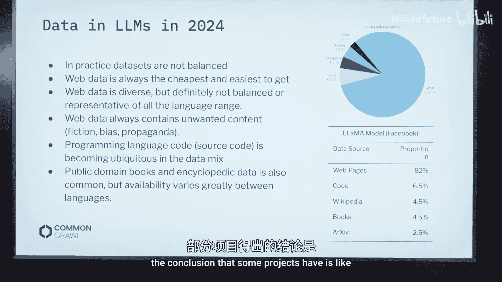
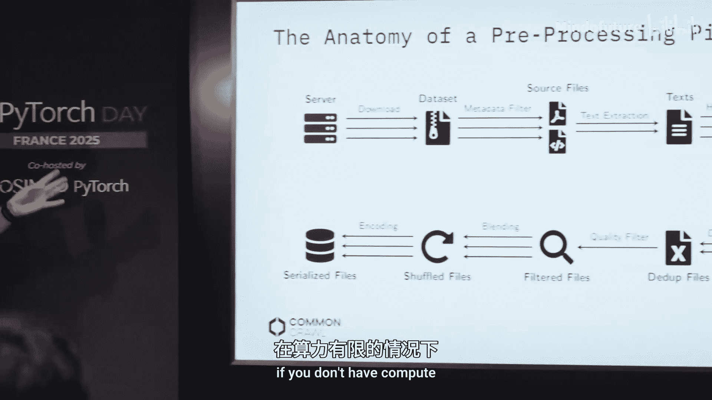
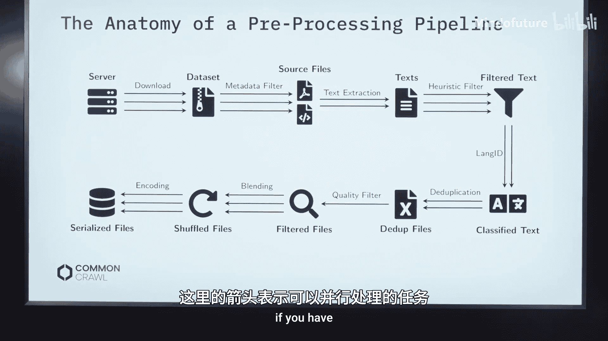
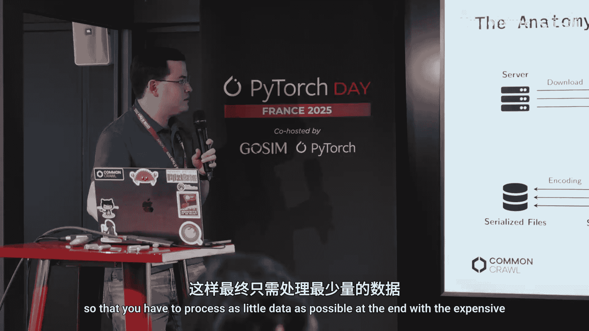
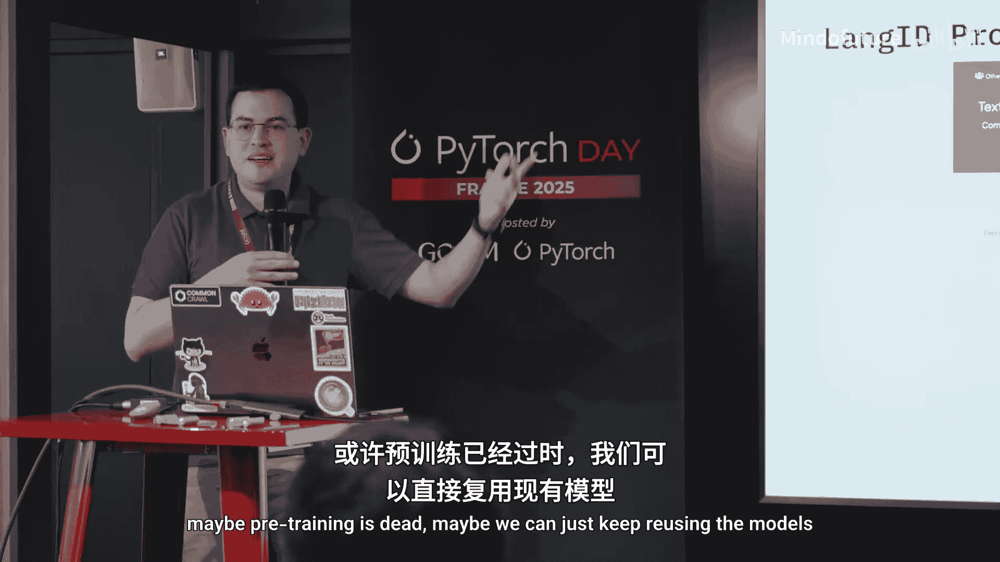
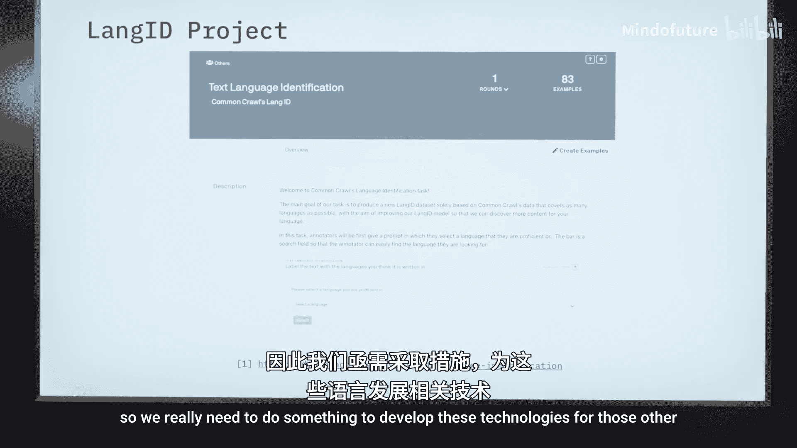

# Pytorch Day France 2025 ｜ vllm ｜ LLAMA ｜ GPU ｜ NVIDIA ｜ GPT ｜ 开源 p06 P06_Harnessing_Common_Crawl_for_AI_and_ML_Applications-Pedro_Ortiz_Suarez__Comm -BV1bQtQz2EFL_p6-

嗯。So hello， thank you so much for the invitationm sorry the delays a little。

Move that across and backward or something。Yeah， so today， I'll be talking about。

Not so much about Pyth directly， but about a data set that。

Hopefully some of you know that you can use with I。So。

For those of you that don't know what common C is， so let's do a little introduction so Common C it's a common C that we do。

 so Common Crow is actually a foundation that has been doing a generalistic C for over 17 years now we have around 275 billion pages。

it has always been free， it has been cited in over 10。

000 research papers and we data every single month， so we do a batch scroll every month。

At some point during the pandemic it was fivemon that now we are back to one every single month。

 it was started in 2007 by the EPA so if you want to know more about it is the person that invented accent that is used today for running ads at Google。

 so Common C is intended or at the beginning it was intended for research and also search index because in 2007 nobody was talking about LLMSs yet。

 and now that we have LLMs today it has become one of the if not the main data set for pretraining LLM。

We have over 100 crawl release today， and that amounts to over nine paykgaytes of data。

At the end of 2024， so if you want to download the data it's free， it's available in the S bucketet。

 we're part of well the S bucketet called Common Crow。

 we are part of the open data project or program sorry from AWS you can access it via AWS or via HTPS from outside。

We release the data in three different formats， so it's W。

 which are the actual HTML files that we grow， the web files， which are the text extracts that we do。

 and the W files which are the metada and link information。

 that is very useful for doing image data sets for instance or multimodal dataset sets。

 because on the work files you will only find HTML so if you want to get multimedia you will have to get the W files and grow the images or the multimedia content yourself。

We preserve all the robot exclusion protocol data， so it's robot tag， HtTP headers and Metro tag。

 which we hope our users follow when they are doing derivatives of Common Cth and then we generate a graph a web graph each month that yeah that you can use。

 we have a client because people we' complaining about it' difficult to download the data because we have too much traffic so we have a client now that you can use to to download the data。

So how does it work， we have iron crawler that is based on a patchache notch。

 it's open source on our GitHub repository。It has a user agency Cbo。

We run everything from US is one in AWS we always perform a Cpro so if you don't know how Chrorow works first you do aIpro so you have a starting URL list and then from this URL list just our following links and you discover more content so we always do a Cfpro。

 we do a ranking with the web graphs using this thing called harmonic centrality and then we take samples of websites that we discover we always request a robust test and we always respect robust test。

So this is probably one of the most important slides because a lot of people right now want to go and do their own crawl。

Trosic crawling is not as easy as it seems。So we think that we crawl responsibly。Because we respect。

 as I said， that the robust that tax data， we respond to takedown and legal requests。We cross slowly。

 which is something that right now， we see our colleagues at the。

AI companies are not doing that much， so what we are trying to tell people is don't try to do your ownChrome。

 use our data instead and help us improve Common Chrome。

We have years of experience and we are also trying to work in a preference signal for AI。

 so this is a work that we're doing in collaboration with the ITF to extend rows that text to actually let content creators and write holders express preferences about AI。

So we consider ourselves probably the most responsible web crowd that is available for training data。

就。Okay， apart from that， like before all theIS stuff， Common Co was used for sish indexes。

 socialpoliical research in linguistics， in economics， people doing marketing。

 even and even governments doing security research on what's happening on the web。Okay。

 so let's talk a little bit about this is very， I'm not doing in that。

 but like if you want to know more about this specifically。

 we can talk to us during the coffee break。But yeah。

 so how is it used in AI so if you look back it's kind of complicated so before LLMs you had like warden beddings and for warden beddings projects like Global and fastex use CommonC。

 but then something that people don't quite remember is that back in 2018 companies and you can see the citations there。

 companies like Google and Open AI were saying that you shouldn't use。

Web data for training LLMs because the data was too noisy and it wouldn't generate good models。

 so if you look at the first for instance bird model it was using Wikipedian books。But then we。

 I mean， that changed probably the first two models that take。Big also there's small today。

 but let's say big models that train with common cr are actually Prota by Meta， and Ka remember。

 which I was part of that was also by Meta and we here in France。诶。So one of the things。

 actually on that member project， one of the things that we found is that。

It's actually good to string with web data， mostly because it has very good coverage of like the registers。

 like the different registers and uses of the language。

So the conclusion that some projects have is like it's good to have diverse data for pretraining LLMs The only program is that well this is not really 2024。

 but if you look at like big LLMs now this is Lama。

 sadly not a lot of projects right now reporting what data they use to pretrain。

 but there are other projects like Almo or Dma Almo and the data that use Alma Dlma sorry that you report on。

 and you can see that most people are using around 80% web data to pre-train LLMs。

So the problem with that is that what I always try to say about data。

 infr training is that web should be the base and it's a good base， but you need more。

 you need like linguistically diverse content coming from books or literature coming from well。

 scientific research。I'm coming from things like that。

 which are not necessarily that common on just random web websites。So how do you process Common C。

 and here are some pipeline you can take photo if you want， but there are many， many more。

And I wanted just to give like a。Skeletton of what you would do with commonrow data if you wanted to do your own reprocessing pipeline and probably the idea is that if you don't have like because some people have lots and lots of computes but if you don't have computes what you want to do is first try to optimize it as much as possible and to try to parallelize as much as possible So here therearrows what I wanted to do say like all things that you can parallelize and if you have if you don't have infinite resources。

 you will quickly get that you cannot parallelize everything like for instance at the end I put something called quality filters So if you look at projects like find where they are now using educational filters and these things are quite expensive so these are things that you cannot paraize So the way that are organize it here is very important because you。

You want to try to do first， since you are filtering。

 you want to try to do first the things that are cheaper to get rid of as much data as possible and at the end you do the things that are most expensive so that you have to process as little data as possible at the end with the expensive。

呃。Okay， maybe something about。Ranking， which is。I have never- well。

 I have seen one project using it but not many projects uses and well at Common Crow and in Web search in particular we do something called ranking of the URLs that we crawl and at Common Crow we do both patron that you might know and harmonic centrality that not many people know and harmonic centrality is just like when you have a graph like this。

 it's just the meanverse the instance to all the other vertices。

 and then if you have an ritual vertex like its harmonic centrality is consider to be zero。

And it's just a measure of how well connector or how important something is in a network。

 here is the equation is' very simple。The thing that nobody uses about Common C that I want to tell you。

 hey， why don't you use this is that we have for every single C we publish a web graph and in that this web graph we compute for you all of the rankings of the domain so what I am telling people is that hey。

 well maybe not use it directly for filter but you can use it at the end of the pipeline that I show you to try to rank the documents that you might want to make like。

That you might want to prioritize for that pre training or for constructing whatever dataset you want to do。

Maybe one last thing that I like to talk about because we are trying to engage with the community on this one is that people think that。

 well， language is already language coverage are really good。

 one of the things that we are trying to do is work on language identification。

 because while everybody's used in some flavor of pasts or CLD2 CLD3。

 if you're trying to be evaluated on like very clean data like European Parliament or Wikipedia or whatever。

 it's actually very good， but as soon as you go to things that are more noisy which are the things that we crawl like Twitter for instance。

 well I mean we don't grow Twitter， but Twitter resembles things that we crawl like forum。

 you can see that the performance of these very simple models drops quite like suddenly okay。

We have two initiatives that we want to promote with the community。

 one is this Web languages project in which we do a CthCrome。

 so we don't have complete coverage of the web， but we want to improve that and what we are asking people is that if you speak a language that is not well covered by Common Chrome。

 submit to us the language is that sorry the website is that you normally visit in your language and then we will add it to our Cpro and try to get more content。

For your language and the second one is the long project in which we show you snippets of common Chrome and like they are preannotated and you just select the sp and say it like。

 okay， this is in my language or this is not in my language。

And this is very important because this is a signal that we can use to actually like get more content for those languages that are misrepresented。

 which we think is important because okay， some people say maybe pretraining is that maybe we can just keep using the like he reusing the models。

 but I would say like okay for English maybe although one day there might be another architecture that you will have to pretrain。

But for the other languages， we are nowhere near the coverage that we have for English。

 so we really need to do something to develop these technologies for those other languages。

So anyway does it。 Thank you。