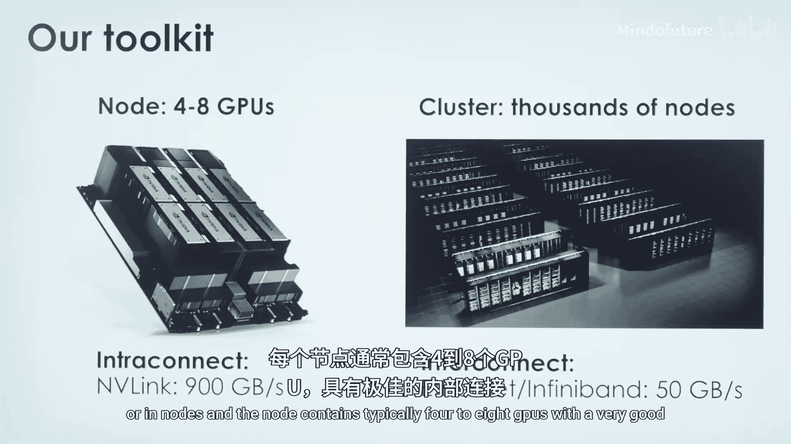
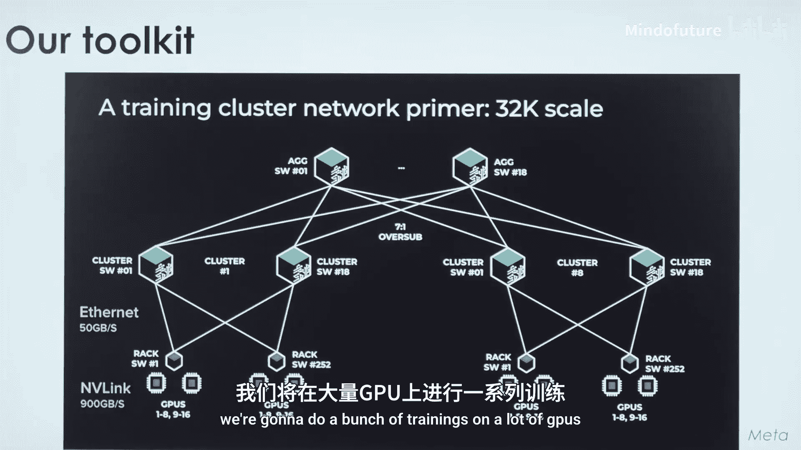
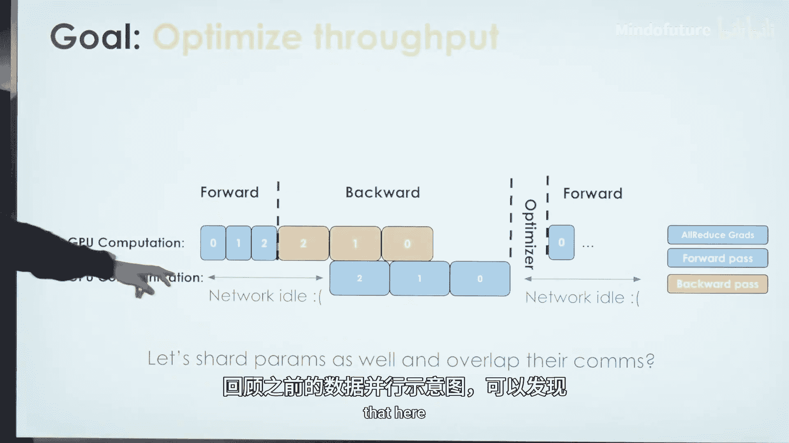
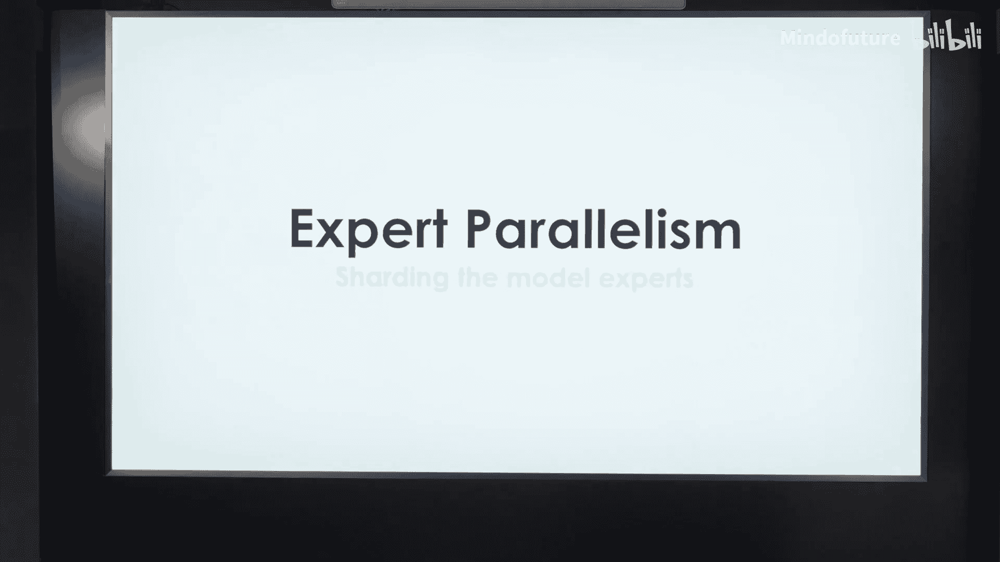
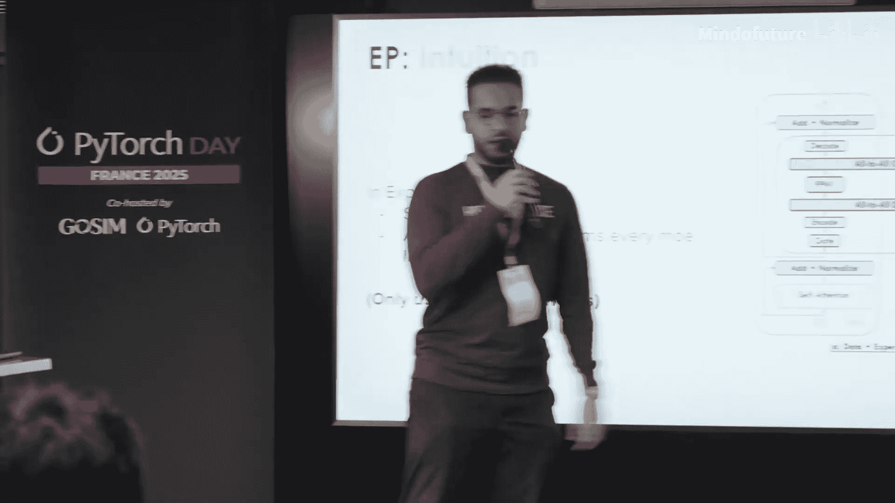
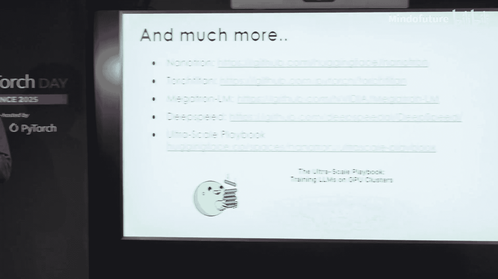

# Pytorch Day France 2025 ｜ vllm ｜ LLAMA ｜ GPU ｜ NVIDIA ｜ GPT ｜ 开源 p07 P07_The_Ultra-Scale_Talk-Scaling_Training_to_Thousands_of_GPUs-Nouamane_Tazi__H -BV1bQtQz2EFL_p7-

你做乜。So thank you。 My name is Nohamma Tai， I'm a machine learning engineer at Hayface。

I work at the distributed training team currently in the nanouttro library。

 the library that we use for training like star order， small&M etctera。

 and today I'm going to be presenting to you or demomystifying。The5キバ。

So today we're going to try to see data， denseor context， pipeline and expert partisan in 20 minutes。

 so good luck。Yeah， so some small introduction， people are training large models。

 they train them for longer one more data， and they have longer and longer contexts。

What's our toolkit so in our clusters。对。In our clusters。

 we're going to work with GPUs or actually any kind of hardware but they mostly come in like racks or in nodes and the node contains typically four to eight GPUs with a very good intraconnect and a cluster combining a lot of these nodes with a lower interconnect and this is important that you can notice how the interconnect is almost 20 times faster so we need to use the inveing or the interconnect efficiently when we're going to do the communications on the。

Howない。Test okay， I just celebrate up answer please。Okay。嗯。And。To see that so we have， as we said。

 nodes of A GPUs and everything is interconnected and the high interconnect is within one node and then once you go past that node。

 then you're going to go through the slow Ethernet so we need to take that into account when we're going to do a bunch of trainings on a lot of GPUs。

So let's talk with what you do。So training on want you to do is pretty simple。

 you have a forward pass， backward pass， you compute the gradients。

 and then you do the optimizer step to update the model。Then when you have a lot of data。

 a big lower batch size， you would like to do the， of course you can't fit the whole batch in a single forward。

 so you're going to do it in steps what we call gradient accumulation。

So you're going to do a bunch of foreign records， sequential4。Now comes that aboutで。

Since we have independent batchs of data， why not do this in parallel and this is where data parallelism come。

 so we're going to give each GPU a different batch of data。

 so we're going to do the forward backwards in parallel and the then we're going to sync them so we're going to need to run a communication between the GPUs。

To think the gradient， to have the same exact training。

So the compute communication diagram is going to look like this。

 you're going to do the forward backward， this is for each of you。

 and then you have this communication step which isn an already used。

Now what we can see here is that for that amount of time， this。The GPU stays idle。

 but that's not why we have GPUs， if we have GPUs， they must work all the time and luckily we can use our network while doing computation。

 so let's try to open up them。This is where Pytoch GDP comes to the rescue and it tries to overlap the synchronization with the backward very nicely thanks to the bucketing system。

啊。So yeah， so the question is since BP works so well。

 why can't we just always set BP to the amount of GPUs we have and then last trainings？

Comes the first constraint。 We need to satisfy global batch size。 There's some paper that say。

 so if you train with a bigger global batch size， which is the。

The batch size that you're training on in one iteration step， in one optimizer update step。

 so the fewer updates， you're going to affect performance basically。

 so people usually try and train with a lower batch size of like 10 onions of tokens。

And so once you set a D size of 32K， they say you have 32。

000 GPUs and you use all of them within data parallel。

 you're quickly going to overshoot that global batch size。

 and so you're going to affect your performance。And thus， we can not only use one form of parallel。

 which is data。So。The other constraint is that that parallelel assumes that you can fit the model in one GPU。

 but if you take the La13。370 model， it cannot be loaded on a single GPU because it takes like 40140 gigs of memory。

And of course， you're limited by the number of GPs you own。

So the goal is let's use the availability GP use efficiently to try and train as fast as possible。

And thus， were going need to optimize our through。If we go back to our diagram from before。

 this is using that parallel， we notice that here the network is id and we say that we kind of compute and network。

 So how can we do that One idea is that。

What idea is that。Why not chart the parameters here and try to overlap the communication so we try to communicate to the parameters while doing it forward。

And this is what 03 or5 of it's called FSDP this is what FSDP does so FSDP shards the model。

 so let's say you have a big model going shard its parameters and then every time you want to do the forward on the that part of the model。

 you're going fetch it which must be called prefech it so for example。

 we're going to pre fetchtch0 they into the forward if fetch one to the forward etc。And with this。

 we can have a nice overlap between compute and communication， even in the forward and backward。

And the cluster is happy because it does the work all the time。

 but we still have the constraint is that it scales with data so we can't just use SSSDP all the time if you have a lot of GPUs。

哦。嗯。So the other issue is that whenever we use one form of parallelism， let's say BPP or SDDP。

 we're going to go through FNe， and so we're not going to use the enlink connection efficiently。

But for example， let's say we have TP8， then the TP are going to use in efficiently and the rest of the bio is going to use Ethernet。

And it does come this I pay for the whole cluster， so I'm going to use every bit of it。

Here comes the second form of parallel TB， and the intuition behind TB is that if we take a matrix multiplication。

 it can be part of the light。And it holds even true for two matrix multiplications。

 so each GPU is going to hold half of the weights。And each GPU is only going to do a half of the computes keeping the same data。

 this is why TP is cool， so for data parallel we were like sharding the data for TP we can use the same data and still split the compute to distribute the compute but we have a very big scary communication here that is inside the forward and backward and and it's inside the critical path like you can't continue the forward if you don't do the the synchronization and thus TP requires very high inter so TP it's good to showard the model。

 distribute the compute and do a compute that count a lot of time it's actually four times each take layer。

So it helps to overcome the global max constraints， but needs high interconn。The third form of par C。

CP is used when you want to scale up sequence length。 Obviously， the memory is going to load。And CP。

 what it does is that it's going to sha the data along the sequence dimension。

 so if you' train it with 128k， it's going to she sharpard along that。

Wch model in the transformer needs the full sequence is the attention。

 so obviously we're going to need to adapt the attention。

 which means we're going to do the cons every attention layer。

And we're going to need to think the gradient because every view is going to see a different data。

 and you have a nice diagram of bringing attention。For the Con compute。

 they can be nicely overlap thanks to the prefet chain as well。

 so while you're doing online suspect or online computation of the attention with KI VI。

 you can already fetch the next PN button。And thus it can work highly。

 but it requires high interconnectction similar to T because you cannot continue the forward unless you get these results。

And let's take a small digestion brain。For P， the intu behind it is that so you have transformer a lot of layers and you can shot across the number of layers。

 so let's say we have a model which has four layers， we're going to put each layer in a GPU， right？

We have， of course our batches， like let's say gains batches， then we start the first batch。

 we're going to do the forward， send the activation to the second you， do the forward， etc cetera。

 simply for the backward， and we do that for all the batches。

The problem with PP is that you have a big pipeline bubble。

 which keep the GPUus idle and we don't want that。Unless。

De tick have came up with this very nice fancy pipeline scheduler called3ion pipe。

 And as you can see here， there's almost no。So each works very nicely。

That's it for EP EP works with MOs， so for MOs， you're going to have multiple experts。

And the router is going to try to dispatch the token to the correct expert。

 so obviously if you have the experts that are sharded。

 then the router will need to send the correct token to the correct device so we're going to need an all to all。

Here。

And after after the copys of the effect。So this is an expert polyism。

 we're just going to chart the experts and we're going to adapt to the MOE layers。

 which means we're going to add communications every MOE layer and that's only used for MOE trainings。

And of course， DC has also granted us a very cool implementation， E EB。

Which overlaps computes and communication very efficiently。By being a nutshell。

 we made a very nice diagram to summarize all of this where you can find communication at which point C affects only attention。

 EP affects only MLLP， then you have communications that affect parameters。

 some of them affects activations。This helps summarize it， we also made a cheat sheet。

Which is the recommendations we use for our trainings。And you can find much more ni torchtytan。

 they get on your speed， and of course， the traffic。Of Facebookbook。

Finally， as we scale up to thousands of GPUs。Let's be mindful of their energy impacts and try to use them responsibly and so try to train or use all of them for the few I train as fast as possible。

 basically to not waste energy。Thank you。