# Pytorch Day France 2025 ｜ vllm ｜ LLAMA ｜ GPU ｜ NVIDIA ｜ GPT ｜ 开源 p08 P08_Teaching_Mistral_to_Reason-Post-Training_with_PyTorch_and_NVIDIA-Meriem_Ben -BV1bQtQz2EFL_p8-

All right， thank you very much for the invitation， so my name is Mary Vens。

 I'm a conversational AI solution architect and mainly focus on conversational AI applications at NVDA。

 maybe helping NVDA customers and partners develop their own solutions based on NVDA software and hardware that。

嗯。And yeah， today I'm happy to be here to talk about how we post train large language models to add reasonable capabilities and we'll be giving some examples like Lahanni Muron and instrument modelss to do that。

So I guess now everyone is familiar with these type of models that we call having reasoning capabilities。

 but basically in terms of architecture perspective。

 basically a reasoning models are exactly the same models than the nonresoning models in terms of architecture。

 So they are most likely be transformer based models。

 The difference is that these type of models are capable of taking advantage。

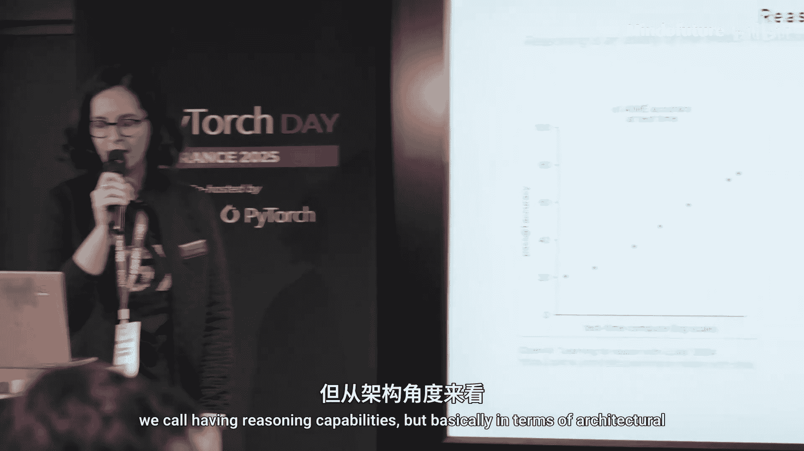

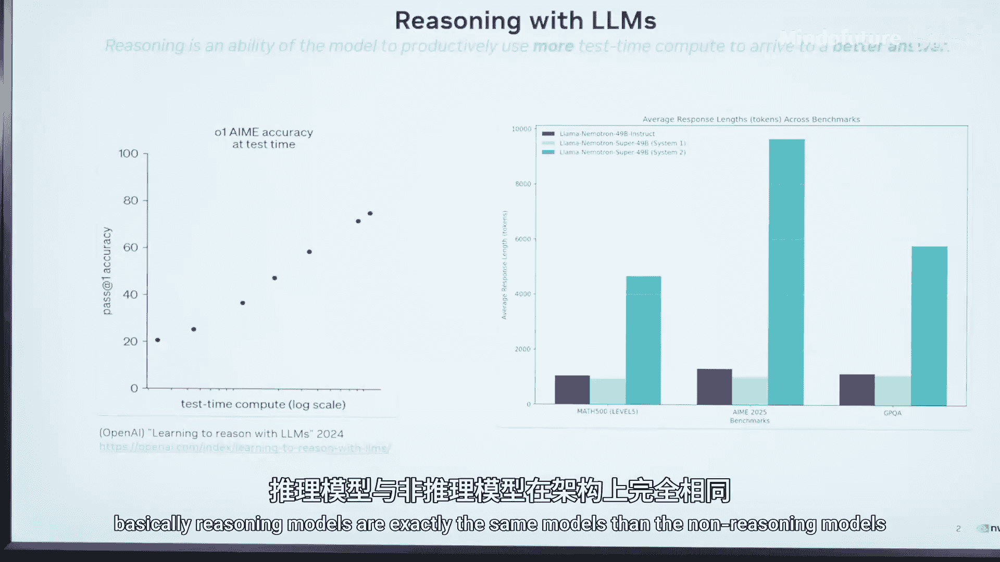

are capable of taking advantage of what we call the test time compute in order to think before sending the answer to your question and here what you can see in this diagram is the model from openAI01 on several tasks like more like difficult tasks like math problems for example。

 it's exactly the same model and you could see the performance but that model in terms of accuracy。

 while we are giving it more time to think before giving us the solution So that's basically what we call those reasoning NM models this comes with kind of challenges so while they are very good and like giving us better performance in terms of accuracy basically in terms of inference it comes with some challenges and that's what basically you see here in the second diagram where basically are showsing inference time different type of models and the average responses length。

 so the number of tokens that are。

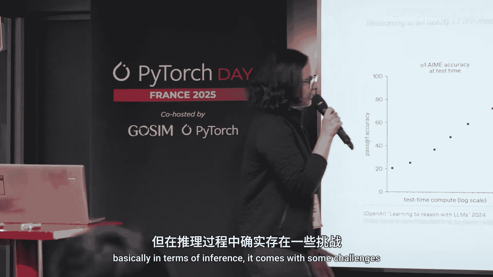

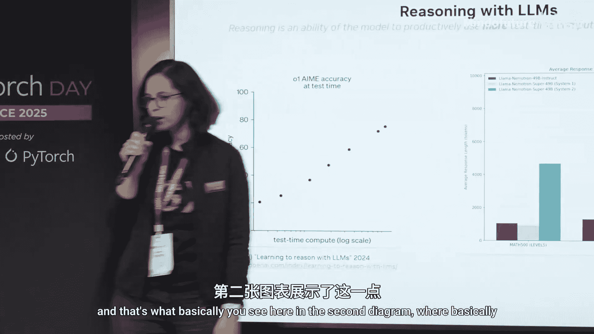

Grated to give you the answer and here we are comparing three models actually we are comparing two models we are comparing the Lama Imo149 billion in and we'll be explaining what is this model about compared to one model that was posturing to integrate reasoning capabilities and we are doing the inference in two regimes。

 the system one and system two so system one is with reasoning off and system two with reasoning on and what you can see here is the amount of tokens that are generated before giving you the answer so basically this type of models you have to think about why you are incorporating them into your applications that they are going to have a cost in terms of inference。

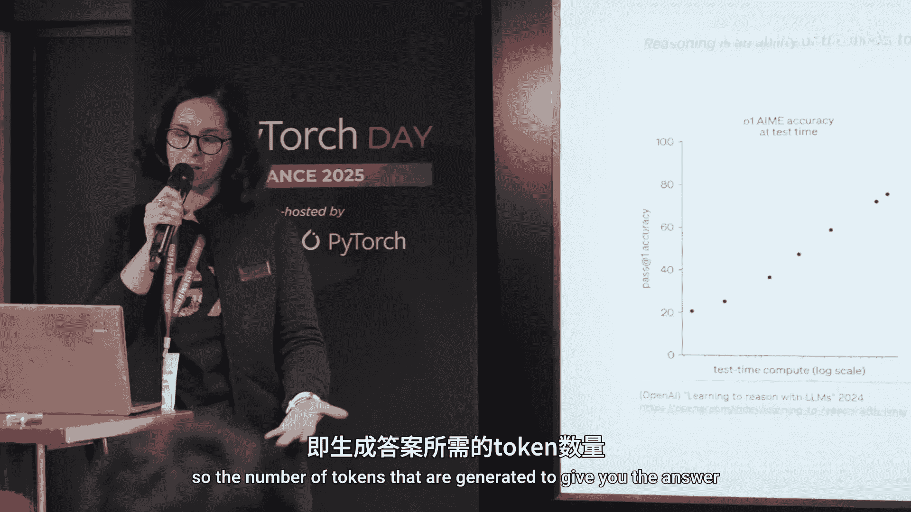

And one of the things that basically and media made a contribution for these type of models。

 for example， are two of them， one of them is they optimize the model so basically in terms of inference by applying some pruning techniques but also they made that type of models actually with the reasoning on and on possibility at the inference time so exactly the same model that was fine to do reasoning and non-reasoning can be used and I inference time you can request it to say like I want for this specific task to use reasoning on and for this specific task to use reasoning on so basically if you have an application where somebody is asking like very simple questions you might want to use reasoning while keep the reasoning capabilities only for a very specific。

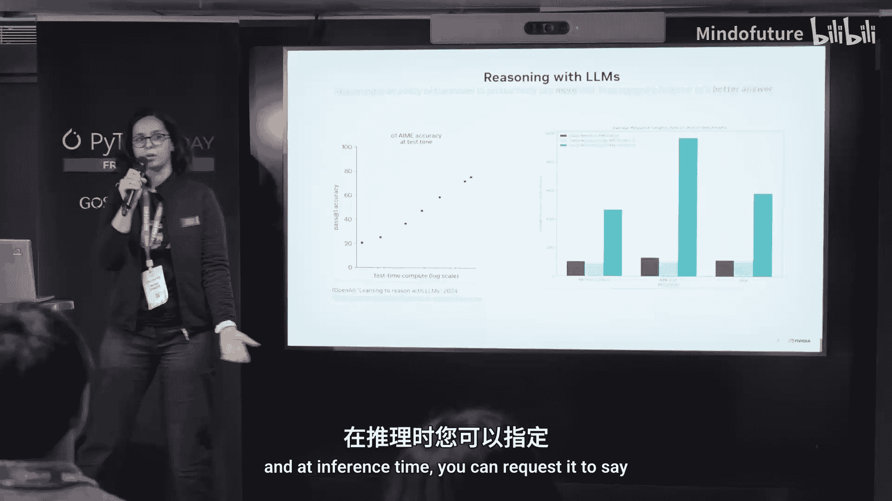

So this is an example basically of what we mean by a model that is capable of doing reasoning so basically let's take by the way this is the Laman image which from 43 Vian parameter model for the9 sorry Vian parameter model and we are asking it like a question to writing an efficient python function to check if the number is both prime and the visible by5 and what you can see here is both the same model with reasoning on and with reasoning of so basically if we think as a human being actually if we take time to think about this request basically we will end up by understanding that there is only one actually remember that it' satisfy both conditions which is the number five basically having a look at the generation of the model without reasoning without reasoning by putting reasoning off here we will see that the model basically will start writing some functions to。

the press condition here is prime and then the second condition is divisible by P and then write in the last action function that is verifying the both condition。

You can see actually on the other side when we use reasoning on you will see this typical tracing that we have with these models where it is thinking first sure you say like okay I need to write the python function that checks if the number is both prime and the visible blah。

 blah blah and we start actually tracing reasoning on how to solve that problem and what I'm highlighting here is at some point in the reasoning a process it ended up by saying like okay maybe basically so the only number that satisfies both conditions is by and therefore it changes slightly actually the task to say like oh therefore the function should written true only when the input is fine and that's basically what you can see here at the end that's the python code that is generating basically checking if the number is fine and if we have a look actually at the tracing we will also see that it come up with other ideas。

That it needs to check if the number is integral， for example， before。

So that's basically the type of tracing that we can see when we put reason on。

So I work very closely with customers who are developing advanced agent AI and we believe that reasoning actually can help into improving and into the development of agent AI。

 so when we talk about those agent advanced agent AI。

 we usually talk about those systems that are capable of taking tasks。

Planning on how to solve those tasks that will have access to tools like calculator， search。

 generation with elementsN， and so on， so act， and then act also as a critique or evaluate the solutions that are generated before coming back and doing that loop。

 so that's basically what we call today those agent systems。

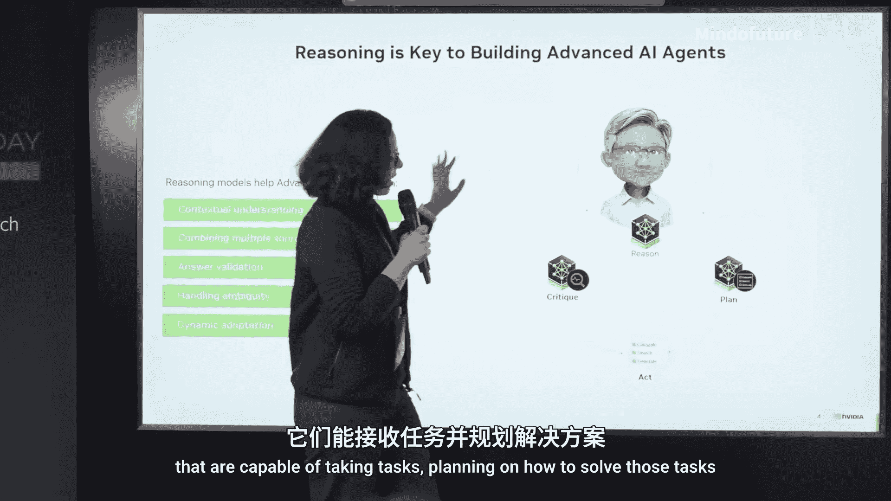

And we believe that reasoning models can help in different aspects in the development of agent AI。

And here you have some examples， for example， it helps in combining rigid sources of data。

 it has also for answer validation， it has some handling ambiguity。

 that's actually the most common thing that we are using， it helps some dynamic adaptation。

 let's say during the this loop for example we receive a new information and this type of reason model we'll be able to adapt to what is happening。

So when we talk about LLM post training， usually we are using three type of three families of algorithms in order to post train an LLM so that's what you can see here so we have what we call continual pretraining。

 supervised fine tu and reinforcement then and there are plenty of flavors for each of those candidates and for continuallytin pretraining for instance it means that basically we take a foundation model that was trained to predict the next token for example。

 and what we are doing is like we are continually pretraining that model within and supervised data for the same type of loss function so continually training it to predict the next token。

We use this type of techniques， usually when we want to add some domain specific knowledge within the model itself。

 so if you are curious about this type of techniques so at an video we experimented with。

we took Laama models， for example， that was a Lamatu。

And we continually pretrain it to inject some information of like domain knowledge for cheap design。

 and that's what we call the chinemo。 So if you are curious。

 you know like I would encourage you to go and check out the chinemo paper。On the other side。

 so basically when we talk about other post training techniques。

 we can talk about supervised fine tuning， so supervised fine tu techniques is most commonly used basically once we finish pre-training our models or continually pretraining our models we usually use some like steps of supervised fine tuning in order to inject some capabilities and what are the capabilities like it's the ability to follow instructions。

 the ability to understand check for example and so on and today we are also using these type of techniques in order to incorporate reasoning capabilities in our models。

And lastly， reinforcement learning techniques are those techniques that will allow you to align the models with some human preferences or like some specific preferences and usually we kind of function that would translate that preference。

And when we talk about adding reasoning capabilities。

 so we see people using two types of families or exercises in order to add reasoning capabilities to LLA models。

 especially small models so one way of doing that is to do knowledge distill from a stronger reasoning model so let's say for example。

 you have access to models like DC1 or Laman fromS for example， which has by the way。

 very permissive license for generating data for example。

 and use this type of models in order to generate high quality reasoning data set。

 so synthetic data set and train smaller models in a supervised way， sorry。

In order to teach on a large number model， those small models with this synthetically generated data。

And if you don't want to use this type of models， so people tend to use reinforcement learning with virtual rewards。

And actually at Nvidia， we experimented taking the phase models and we're training them or injecting reasoning capabilities on top of that and this is what we call the family of Lama andneotron models that we recently released so we released three type of models actually over three scales of this model。

 so there is the nano which is an8B， the super which is a 43 49B sorry and the Utra which is the 253 billion parameter model so if we have a nanoto can be deployed on edge or PCC。

 so the super can be actually is optimized to fit into 18 100 inference and the Lamaneotron Ultra needs to multiple GPS to be deployed and I will not be talking about the accuracy I will show one graph。

 but I would invite you to go to the paper that we published like few days ago。

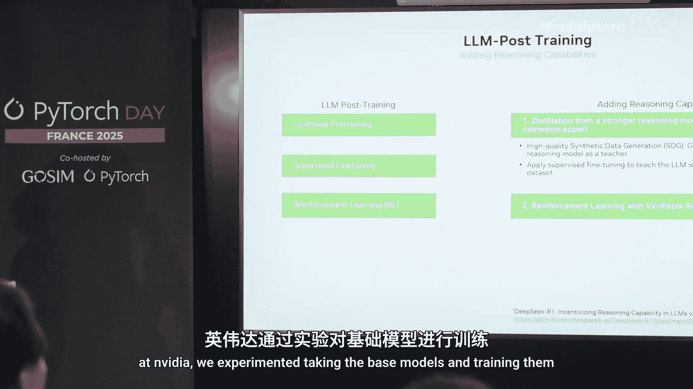

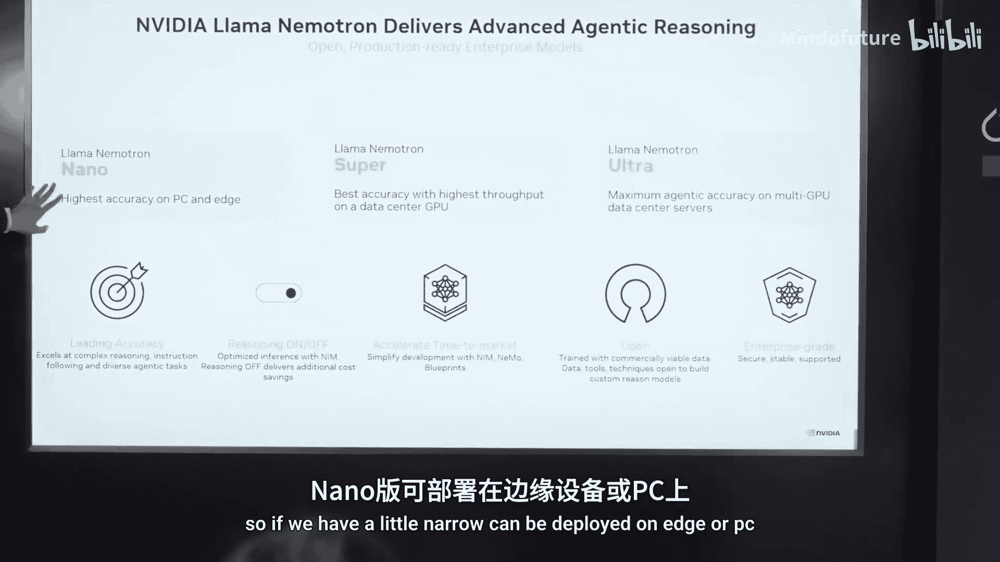

That gives you more details about the accuracy of that model and how it was built。

 but I wanted to highlight the fact that at inference time， actually。

 the way we train those models is that at inference time。

 you can specify the same model that you want to use it in with reasoning on and with the reasoning of。

and obviously at NVIA， we are optimizing those models for production using NVDdia In microservices software。

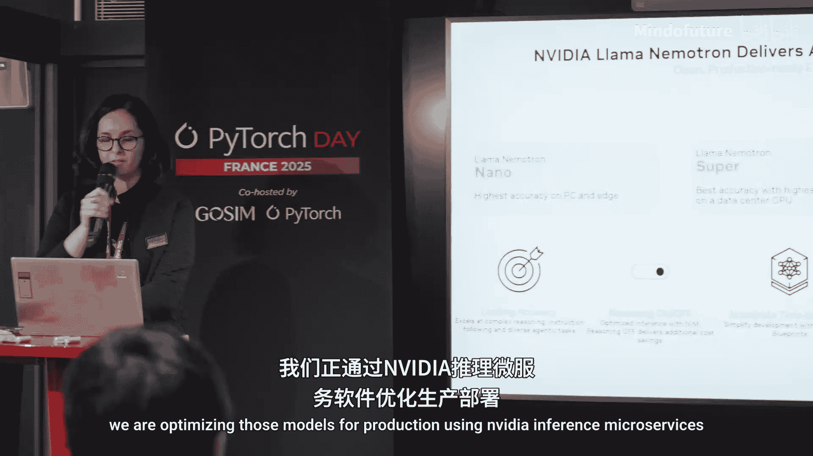

And lastly， we actually opened everything。 so we opened the code that we used to train the model。

 We opened the techniques that we used to generate the data， and we opened also the data。

So this basically chart shows a comparison of the results for the Lama image43 billion parameter model in different type of benchmarks。

 reasoning benchmarks， chat and tool calling benchmarks here。

 and what you can see here is the comparison between the stock point for this one which is the Lama 3。

370B， compared to dipy K1 compared to Laman imageron super 49 billion parameter model。

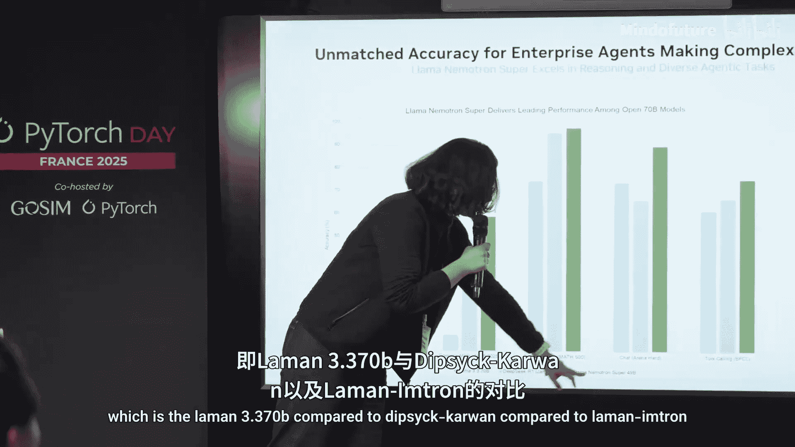

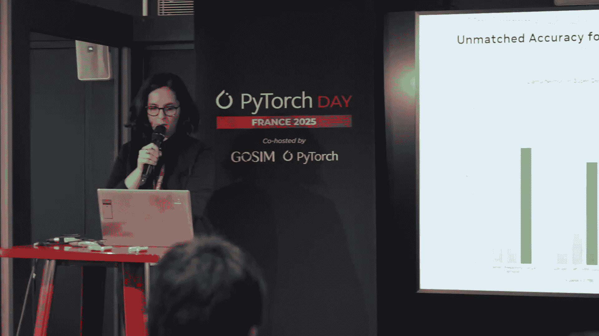

So how it was built。Okay， so to build Lamaimotron so the。

I gave all the credits to the research team in the US who did that。

 but to build the land on Iron models， so there were three stages The first stage is what we call distillation。

 basically this stage consist to taking a model and in this case we took the la 3。

370B that's 43 billion parameter or image。

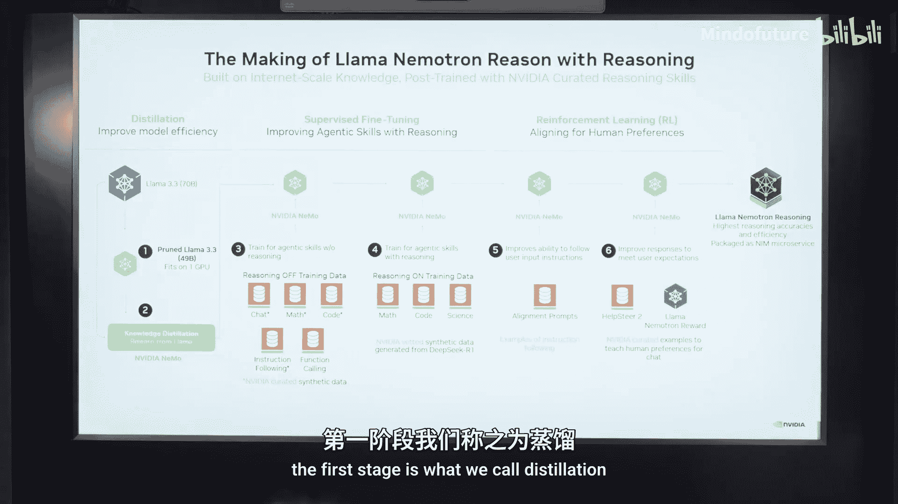

And what we did is we applied some what we call mass for like a nerve architecture search in order to prune that model into 43 billion parameter model after that pruning basically there was some continual pretraining in order to just like make sure that we recovered anything that we lost in terms of capabilities of the。

The original welcome。Once we did that， basically we obtain a model that has exactly or like similar capabilities than the original model。

 but it doesn't have reasoning capabilities， right？这 move板。Allright。

 so then after that we actually did a massive step of supervised fine tuning on synthetic the generated data sets those data sets。

 some of them were with reasoning off some of them we reasoning on and we used actually different types of models that willll be showcasing some examples in the next slide to generate synthetic data for math for chat for code for function calling for instruction following with reasoning on and for reason so off and with reasoning on for math code and science and once we did that massive supervised fine tuning。

 we also use reinforcement learning in two stages the first stage here is to make sure that this model will align following instructions so just like to boost a little instruction following capability and at the end using ver functions in this reward function here and for this one。

We use the Lama Diron reward function in order to just boost some check capabilities and safety capabilities of the model。

And once we get that model， basically we optimize that model for inference app production with AviDA In Miservice。

So going to move very fast， but this is basically the steps that we used in order to generate synthetically the data that we used for E。

By the way this data is available， so basically one thing that I wanted to say before we move forward here is that you have to really pay attention to the type of domain that you care about when you do this step what I mean about that is like it's very easy if you take a data like let's say for code and you want to improve the capabilities of your model to generate or to like to reason on codes。

 for example， but it's most likely if you don't pay attention， basically you're gonna。

reeduce the capability for other type of domains， so you had to take care of the type of dataset set that you are using for collecting for SFT and in this case we took different domains that we care right and we use different models。

 some of the models with reasoning on and some of the models with the reason on in order to generate synthetic data。

 the synthetic responses once we had those responses we used domainspecific verifiers in some cases we used also some reward models to spark the responses。

 we filtered the responses we used the data duplication test decontamination after that and we obtained the synthetic data here that we used with our software called Nemo that is based on Pyth to find you in the model。

The data is available so under a permissive license so you can see here like there is like 30 million examples with reasoning on and off so we will have a look so you will see this type of tracing here when you have reasoning on。

Moving very fast so reinforcement learning so here in this slide I tried to show you a very。

 very high level of reinforcement learning techniques that we use when we want to add reasoning capabilities it could be GPPO that could be also GRPU and so on but basically for GRPU and this type of models or regime for training。

 we have three different models so we have our policy here which is basically our model。

 the SF model previously we take some prompts we generate different options for the solutions and we have a reward model or a fire model here that will give us some rewards or some scores here。

 you have an example here for prompt that says like solve this for example function。

 you have some generations and you have some rewards here and you use those rewards in your algorithms。

 reinforcement learning algorithms in order to update your policy or your neural network。

We usually also keep a reference or a copy of that model and calculate the KL dirgence just to make sure that we don't diver too much from the original model and what I tried to say here in this slide is that what you see here as a reference or the real world model or the policy here。

 the blue means like we are running a lot of inference and the green it means like we are training the model but also running it at inference slide so reinforcement learning is also heading in terms of inference during the training group。

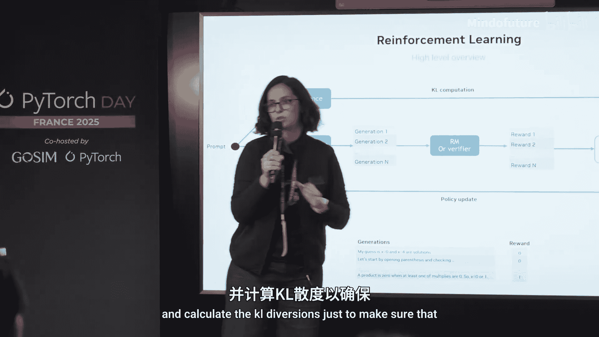

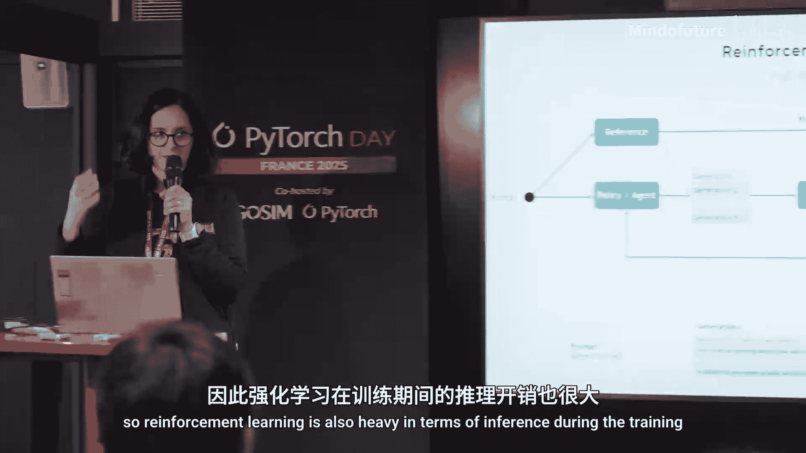

Okay， moving very fast。 this short demonstration be looking at how so this is basically to showcase that after we train this model。

 so this model is already available， you can already。Download it。

 you can also start experimenting with this model on our API catalog and here it shows you how it works。

It be an effective reasoning on and off model that you can use in your eject workflows。

We notice in the top left corner。So we've enabled reasoning。下にします。I hope you can hear。But basically。

 detailed thinking。Basically what I wanted to show you here is that on the platform itself。

 you can see that you have a button here that says enable reasoning and for some specific task or queries。

 for example， you can disable the reasoning in this case。Okay， so I'm moving very fast。

 but basically as it was mentioned earlier， so we use the NeEmo framework to train this model。

So NeO is actually like a big framework， it stands for neurourn module。

 and basically it has different type of libraries， so NO curator for creating the data and megatron core。

 I have heard about Nigatronode then， for example， that provides all the implementations for tonsor Pa Piyon pilotlet that we like the previous session was discussing about and the alignment and customization where we have the implementation of several alignment techniques like supervised fine tu。

 but also reinforcero diamond NASA。Okay I wanted just to move very fast because I think we are running out of time to show you basically what we did with the Mron so here you have a snippet of the deepepsig R1 paper where basically what some experiments on distilling the reasoning capabilities of dippssig R1 into smaller models like the Quen model for example。

 so with Neu so basically we implemented that as a tutorial you can go and have a look at that where basically we take GpsyigR1 data synthetically generated data set for reasoning from the deepepsig R1 and we find tune with supervised fine tu in the Qn2 model and what we did here in this Dmo is basically to show you an example on how you can。

Basically change this tutorial to any other type of models that we do support with Nemo and in this case。

 we are doing that with the Mial model。 So what we showcase here in the demobo is that basically we are going to take。

Download first of all， the Mial model with Ne convert it to NeMmo to quite O format。

 or are going to prepare the fine triming data sets。

 or are going to fine tune the Miral 7B model with NeO， evaluate。

 and we can also convert the model to hide。So we've moved very fast。

 but basically if you want to replicate this， the code is available。

 so here we are just downloading the model。Yeah， showcasing the type of data where you can see here that we we are having some tracing here。

 beginning of thought， the end of thought and the beginning and the end of the solutions。

And then I'm sorry moving class。啊。They can go very。Aent can go to the end。Okay。

 so it's just like at the end， it shows you some tracing。

Startrry about that It shows you basically at the end that we are doing some inferences with the vanilla model that was not trained with the reasoning capabilities。

 ask it some questions like how many Rs are in strawberry for example or like who is bigger， is it 1。

 19 or 1。11 and you will see that the vanilla model is not able to solve this type of problems while after fine tunening the model or with reasoning capabilities it will be able to reason first and give you the answer at the end？

All right， so the takeaway。So first of all， so reasoning with teachers。

 so basically the experiments that we have been seeing withama and immunootron post training is that supervised fine training on high quality synthetic data is quite accurate in order to inject the reasoning capabilities to smaller models。

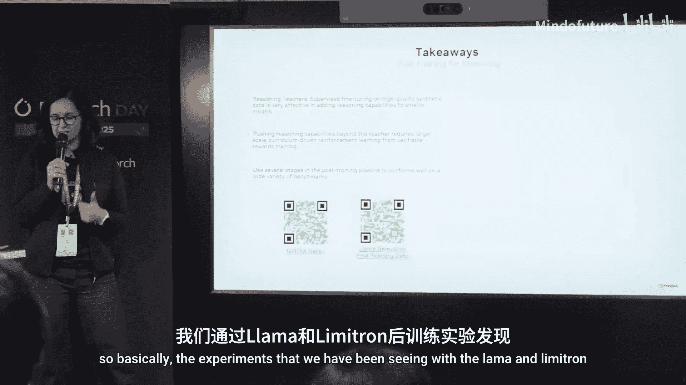

Now， if you want to push the reasoning capability beyond the teacher model。

 you have to use reinforcement learning。And basically。

 one of also the findings is like you need to use several stages in your post training in order to boost actually the reasoning capabilities。

 but not all the reasoning capabilities for different domains， like following instruction and so on。

Any questions？