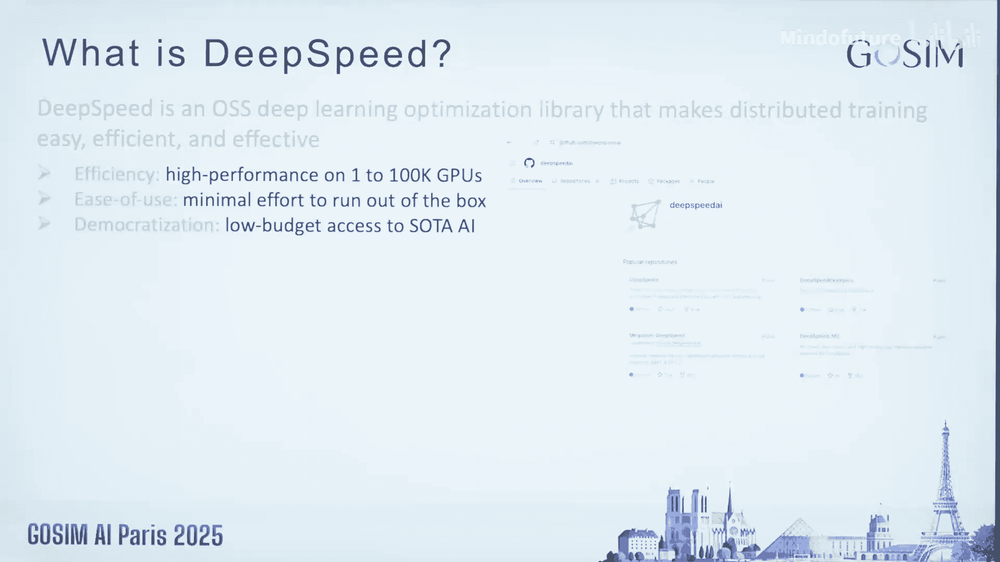
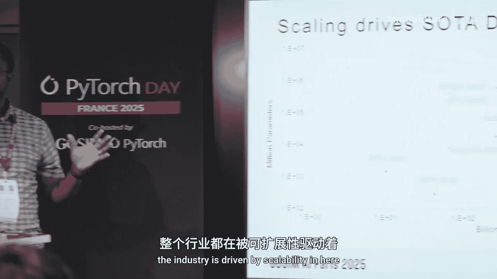
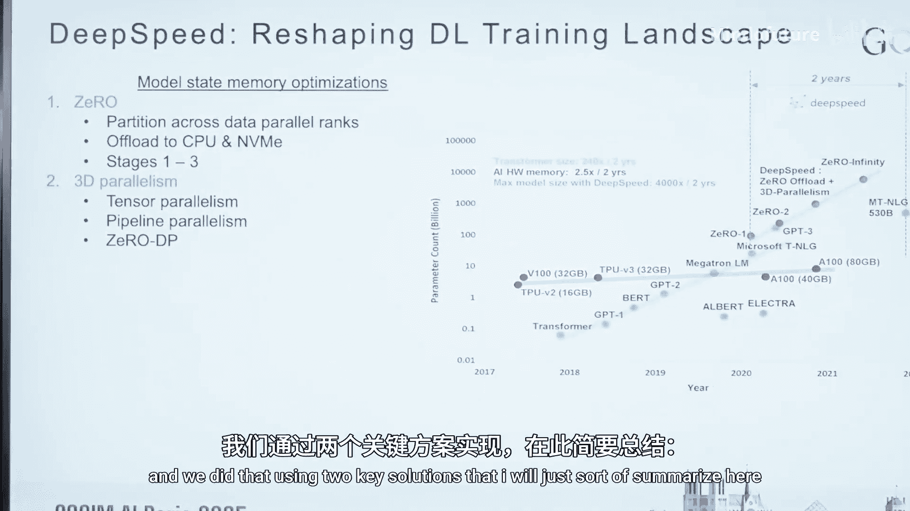
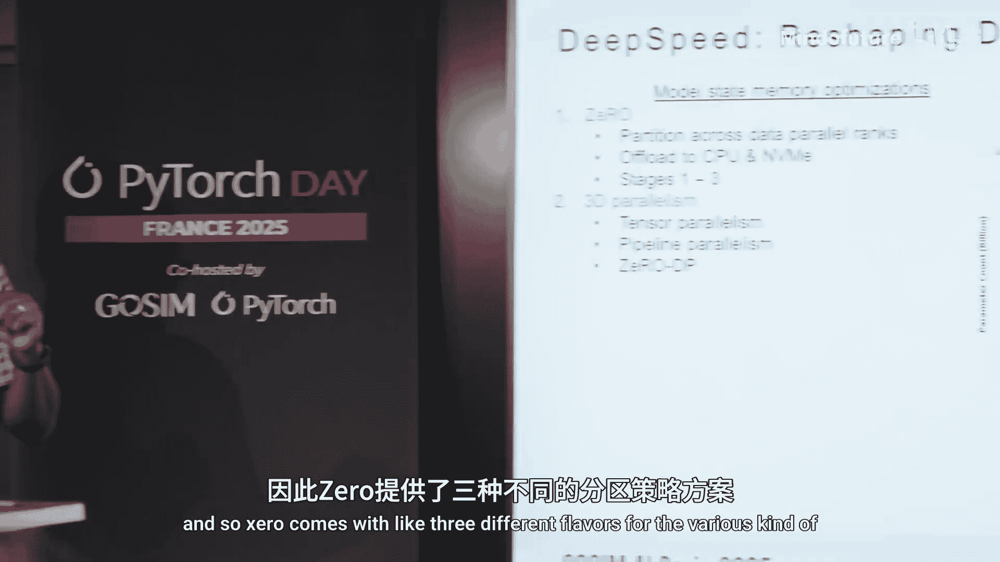
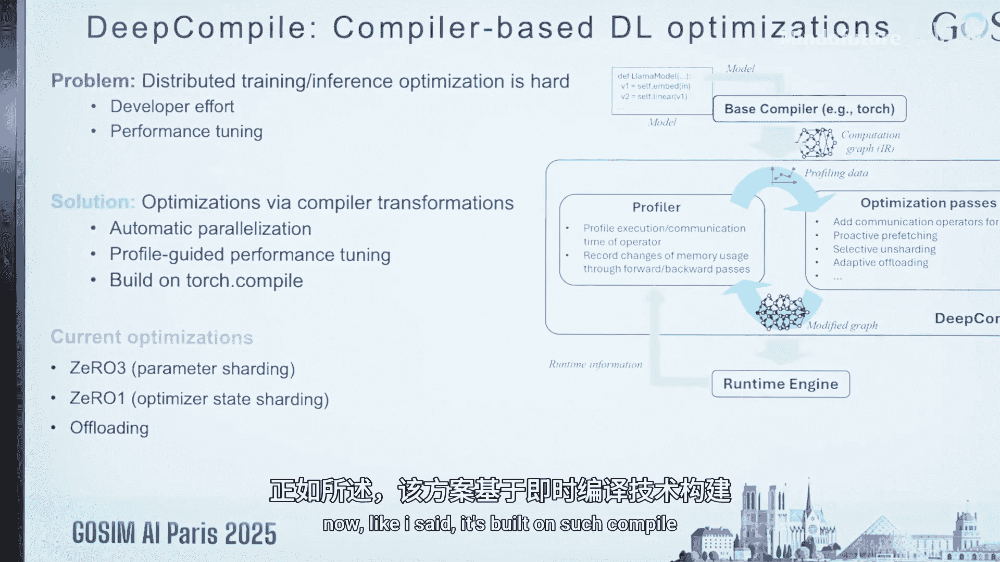
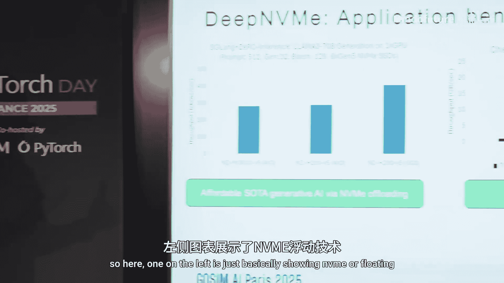
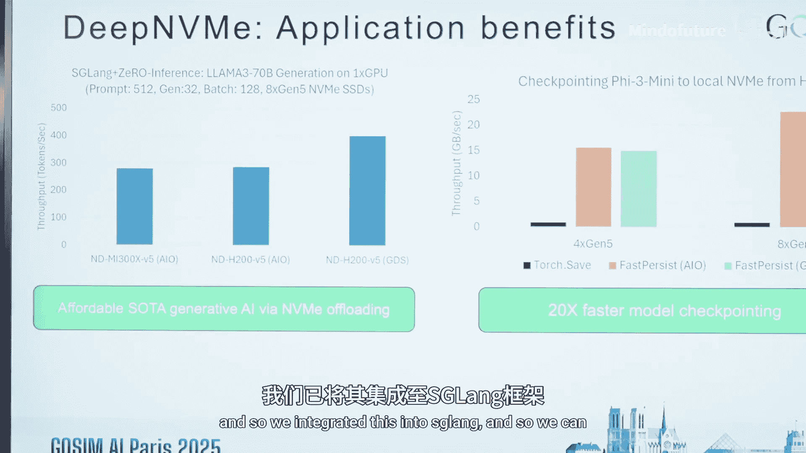

# Pytorch Day France 2025 ｜ vllm ｜ LLAMA ｜ GPU ｜ NVIDIA ｜ GPT ｜ 开源 p09 P09_DeepSpeed_–_Efficient_Training_Scalability_for_Deep_Learning_Models-Olatunj -BV1bQtQz2EFL_p9-

Thanks Matt， hi everyone， so I'm going to talk about the speed。

A library for efficient obience scalability。This is a score。多わ country。So yeah。

 it deep when we created it， the goal was to create this open source library for distributed training because we recognized early on that。

This would be important and the goals that we had then was basically to make this retrain easy because model scientists the ones who are merely be doing this wanted to make it efficient so as you scale it's very expensive from a compute resource perspective so we wanted to ensure that the workloads we' running as efficiently as possible so you can the biggest band for your investments and wanted to make it effective as well so this is more from a data efficiency perspective and on those points so like from efficiency perspective。

 we've seen that you speak can run with high performance whether you're run a single GPU or you're running over 100000 GPUs。

 we think the adoption really has been driven by the fact that it's easy and easy to sort of get running out of the box once you install it and democratization was also something that we also kind of highly valid which is basically the cost of state of the art models can be quite quite bit because of the。

Invest so we also work on techniques that help to lower the budget requirements for you to be able to use state of the AI so it's on Github and that's just a screenshot of our page so why did we create each speed it's based on the observation that scalability is what drives each learn the industry is driven by scalability in here on this spot I'm highlighting two dimensions and there are others but I think the two primary dimensions of scalability on the Y axis you have the model size which is basically in the billions of parameters going up and on the X axis we have the tokens that you use to train your model in billion of tokens and so if you can sort of point your attention to burn down there on the lower lens that's we could think of that as being the ground a0 for the current wave of peak where right the model then was just about 300 million parameters trained on。

So hundreds of billions of tokens at that time and if you can then point you to the top right hand corner which is sort of where we are today。

 La of four which just talked about earlier， you know there we're basically at hundreds of billions of parameters model training and then you trillions of tokens tens of crews of tokens of training so that's basically hows of scale。

And so because of all of this scalability challenges basically they create a lot of systems to put a lot of pressure on the system resources。

 so on the compute side on the memory side on the communication side on IO side on data and so in other words。

 what I'm showing here is that the advancements we've had in deep learning have really been held up by innovations along these four pillars that I've shown in and in particular deeppe and deep speed we've been working on all of these areas and creating solutions along the way and looking at the models up there I'm sure you recognize mostly if not all of them。

 the ones I've highlighted are the models that have been trained using deeppe and so even though the projects started out at Microsoft。

 some of these models which external models essentially in Microsoft only and this is because Gipe has been open source from day Ze so we've had this opportunity to collaborate with the community and together we've been able to build the solutions and they've been able to build the models。

So I'll talk about the real key challenge that we tackled in the early days and sort of what kind of I think put you speed on the map is like the GPU memory wall problem and this is shown here where here on the Y axis is showing scaling in terms of the model size this plot is very popular from you Bkeley and X axis is showing time and it's basically comparing the size of the model to what the a HBM memory that's available at that time and you can see there there's that point where it just crosses over and your model can not fit on a single GPU bounce roughly around the 2020 megaron Ln time because the models we're growing at about 100 x every year。

 the HBM is kind of like just growing to X every two years even if we project forward so today and the predictions I show up there the B300 is're still just going to end up is about 2080 gigabytes of HM so it's still。

You know， not not sufficiently large enough and so we sort of this is the first problem that we tackled and we did that using two key solutions I would just sort of summarize here the first one is zero and zero is this optimization that we design for the data parallel training where data parallel training paradigm where traditionally data parallelism has the models states replicated on all the ranks and with zero we came up with this idea of instead of replicating why don't we partition and you know you duplicate across and so then that helps us to reduce the memory footprint per GPU and allows us to fit in much larger models then the other direction we went in was like well you know your servers come with other intergenous memory like your DRA and local andmeE we could also leverage that memory as well and just typically like orders of magnitude bigger than your HM and so zero comes in like three different flavors for the various kind of part。

schemes that are in there， and that helps to feel extremely like models onto to open continue GP 3D parallelism。

 kind of like a subset of what previous speakers spoke about where you're able to use auto parallelism strategies to sort of petition your model states with sense of parallel pipeline parallel and then zero in a parallel。

The main takeaway here is that plot over there where it's sort of building on that GPU memory wall plot I showed earlier。

 but now it's showing what deeppe when you bring in deeppe systems capabilities like if you see that there and that deeppeed actually is scaling even faster than the models are growing so roughly like just look at the impact。

 we provided system capabilities to train truly and some models as far back as 2021 so this is well ahead of the model scientistss and the techniques which I've listed here inspired by the frameworks like FSDP and closely at Miron La we've all sort of adopted zero optimizations。

So I want to spend the rest of the time to just talk about some of the new things we've been looking at indy speed and under basically four things that I like today。

SoThe first one is universal to a checkpoint and the motivation for this is that now distributed training states are distributed whether you're doing pipeline parallel tensor parallel or zero and the problem that comes from that is that when you create your model checkpoints theyre basically coupleled with your that you created them all so in other words。

 you cannot resume training unless you have exactly the same number of GPUs and that's just because the distributed checkpoint is tightly couple with your hardware configuration and so this creates a lot of like inflexibility challenges with resource capacity management and so the solution here is that we decouple those two things your checkpoint and your hardware parallelism or you even your parallel and strategies like tensor parallel pipeline parallel we decouple those two things and that brings some practical benefits One is for fault tolerance right so if you have a failure you can continue training with the healthy node you don't have to wait until you get get a replacement or you can continue。

And so that's really great and the other is that faster training so basically if you have elastic resources become available。

 you can take advantage of them to speed up your training just opportunistically once you to sort of give them up。

And this work will actually appear at ATC later on this year and so the overview here。

 I'm going to just touch on then very high level lots to chat later on。

 so the first thing is we recognize that the different parallelism strategies exist and we provide a way for you to reconfigure that so you study it out with some kind of TP PP。

 whatever we provide a mechanism that allows you to reshape your parallelism strategy so you can go from any source strategy to any target strategy。

And then this reconfiguration is patent based， which means that it makes it portable so we provide a language where you can express your parallelism strategy and so you can rewrite you know with that you can rewrite what you want to target strategy to be so it makes it easy to adapt and apply to in in various scenarios and then we've also provided optimizations for this reconfiguration。

So here just highlight some high level results one is the reshaping and this is just to show that you know when you do reshape your strategy your training is not affect your convergence kind of remains the same and so the plot up on the left hand side is showing that you started our training with one particular strategy and now you want to reshape to multiple different strategies and that's kind of just showing that the loss curve is the same the next plot it is kind of showing the inverse where you started out with different strategies and we're showing that you can go into a new strategy without suffering in your convergence and then the lower plot the specific showing end to end results an actual training look for dance and sparks draw your attention to the middle one。

 the GPT176B this is the big science model training that happened a few years ago and we actually used this because at that time the project was going to lose half of its GPU somewhere。

Through the training and that's when we actually build this technology to enable it to continue training on how of the committee then started with。

Y， and so you know technique has been adopted in many different places。

 like be science like I mentioned was sort of like you know， the first one and so yeah。

Now'll move on to the next work which is more of a communication domino communication of free training so a lot of the parallelism strategies like tensor and a pipeline parallel。

 they do the partition but the end of your pay the price of some communication and so here the goal of this project is to see how can we reduce that communication cost hopefully to light zero and we set it out by looking at tensor parallelism so the plot up there the top left is showing when you do tensor parallel training of a GPT that's in the size model and it's sort of breaking out of time between computation and communication and you can expect as you go across nodes。

 your communication time starts to dominate to like 40% of your antel end time and so the solution here is we introduce some fine grain overlapping of your compute and your communication and we can do that either within your transformer layers or cross transformable layers and the plot over there showing up there is showing like a megaron lamb if you do tensor parallelism。

Transform computation getss split into computation which is sort of you can think of it as the upper side and then communication at the lower side if you use domino you can see down there we are now sort of doing some fine grain overlapping so you don't have those gaps where your GPU is idle or your computation is idle and that helps you improve performance。

So eye level results here， we're showing here that on the for the forward pass and backward pass is just the profiler shots showing that we actually on H 2100。

 we are able to completely tie the communication and sensor of parallels completely on a single node。

And then we have results comparing against megaron lamb， just you know。

 put a single node and multi node and we get you know。

 at that' about a 16% speed up compared to like Nigaron LA。Okay， and then ongoing work。

 we are integrating with Hogan F Meotron， we have some good results there。

 we're achieving 75% communication hiding at this point。

 the goal is to get to like 100% communication hiding。

 we're extending this work to MOE and inference and law sequence training and some quantizations for the communication as well。

The next work is big compileile and so the goal here really is that distributedtri training and optimization is hard it required developer work but in particular teaming them to get peak performance with different models in different hardware is really difficult and so the idea here is we want to automate this by using a compiler technology。

And so last year， know the PTo released a To the compile awesome some technology that allows you to basically rewrite your computational graph in a flexible way and so we kind of leverage that and so the two key ideas there is that we' will be doing optimization using compiler transformations and so the first part is we will automatically apply the distributed techniques。

 whether it's TPP， whatever we will use the compiler to actually do that to the graph and then we will do something which is kind of classic compiler tricks of profile guided optimizations。

 we'll allow the training to run for a while， well profile it in the frontrontime environment and then we'll tune the parallelism techniques to get the peak performance out from that scenario like I said it builds on touch compile the plot over there is just kind of a high level view we take a model we run it through touch compile。

 we get the graph from the graph， we apply the the transformations for optimization and parallelism。

 we run for a while， we profile。

While we're running to figure out what are the optimal settings for the various parallels and techniques and then we recompile and we do this over and over again。

 since training takes a really long time you know within a few un readyits will'll be able to get this done and then the rest of your time can be spent during a peak performance we've implemented three different optimizations at this point and we're working on more collaboration with the community and I'll just show some let me sort of drill into the031 to sort of give you a bit more flavor here so there are two aspects to it like I said is so here on the left hand side assuming you have like a single GPU implementation of your model or parameter and some operators 03 basically involves shot in the parameter。

嗯。And so here we can see with the compiler we're able to automatically apply the sharding instead of having the users have to writeite it and then the profile guided part when you shard parameters you get a price of communication That's the price。

 but then prefection is sort of like the standard trait to sort of hide that But then the problem is how much you prefetch when should you prefetch the profile guidance showing there is showing the memory profile of your training so you see that at the beginning of the forward password now so you do have a lot of memory so you can very aggressive with prefection。

 we' not so much in the back path so but with the profile guided optimization we're able to detect this patterns and then recompile the model to sort of take advantage of that。

So in terms of results， yeah， we're seeing great results speed ups for 03 here。

 but on the dance model and on the sparse of the mixture model， we' seen up like 50% speed up。

Another optimization we did was 03 with offloading。

 so basically here we're able to also just compare to like baseline0 or zero using just pure such compile。

 we're seeing over5 x speed up for the  zero3 offloading for zero stage one。

 which is just optimizer sharding， were seeing over 30% speed up as well。

And I'll go to the this is the last project deepN BmeE。

 the motivation here is that we recognize that IO is becoming a key bottleneck as we continue deep learning scaling and it shows up in a few ways in a few ways because where you know。

Persistence storage is becoming important so your data sets of data loading data preprocessing all involve interaction which just persistent storage model checkpoints in is sort of a natural one too you have say checkpoints in persistent storage and then sensor off loading is kind of becoming sort of important。

 And so the key idea here is that we note that there are a lot of innovations in the storage space and we want to build optimizations on top of that So things like local Mme SSDs synchronous ios stack that like Linux now provides and things like invi datata give you direct story that allows direct communication between storage and HM and so there we build different kinds of optimizations and so the results on there is just showing that on a PC gen like sort of the latest greatest hydrozure VMs we can hit almost 0abyte per second discrete there about 25 gigytes rights importantly I showing there that as we scale the number of Mme is your。

It's a scale in so it's kind of cheap to the scale here is some just application highlights and I'll to wrap up so here the one on the left this was basically showing you know NVME or floating which allows you to inference a very large model on a single GPBU that you once't have been able to do because it's not big enough and so we integrated this into SGlan and so we can you can at least use this for like tro based double flying inference France and over there we're showing about a 20x faster model checkpointing compared to P same。

YeahD speed is a community project it's been there from the Getco， we have over 400 contributors。

 a number of organizations supporting us and breaking news today it's now part of the Pyr Foundation。

 which is super exciting so just invite you to join us and let's make of state of the RAI available to everyone。

 Thank you。