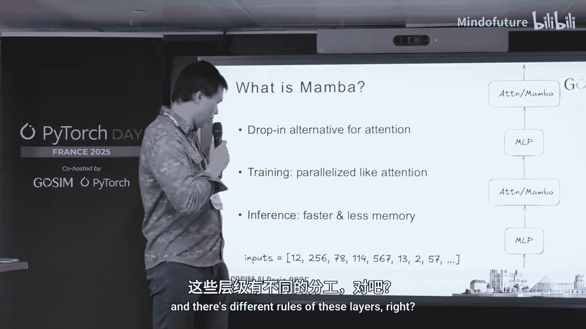
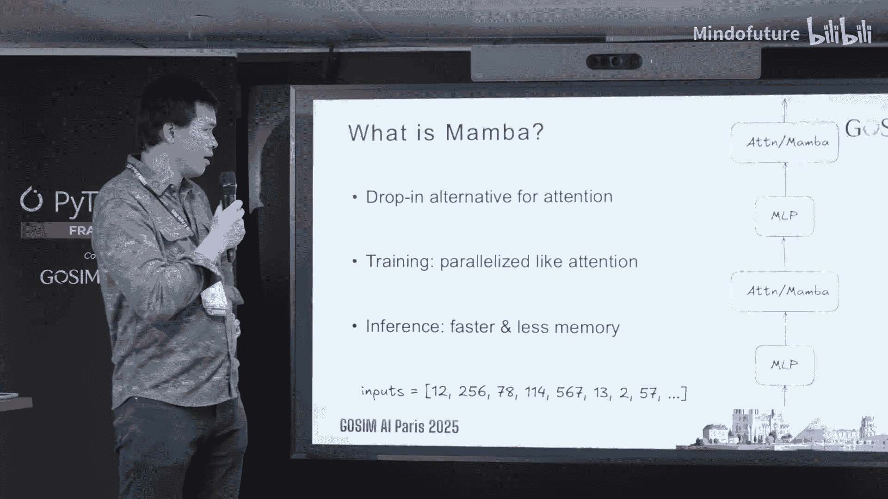

# Pytorch Day France 2025 ｜ vllm ｜ LLAMA ｜ GPU ｜ NVIDIA ｜ GPT ｜ 开源 p10 P10_Advancing_Mamba_in_PyTorch-Garrett_Goon__IBM -BV1bQtQz2EFL_p10-

哦。All right， first of all， thank you for the opportunity to speak very much enjoying the conference so far。

 everyone can hear me okay。 great so yeah， I'll be talking about advancing UomMba models。My search。

And just a few topics to cover here， so first what is Maba all explain at the high level what they are。

 next the why， know why which introduce do something new to the ecosystem and finally I'll talk about IBM's work in advancing the state of MaMba plus P search。

So we've heard a lot about this， I know people are familiar， but just to recap。

This is the typical model structure here， so we have some sequence of inputs and there's repeating blocks of MLP deep forward layers followed usually by attention back and forth and there's different rules of these layers right so the MLP layers they just focus on each element in the sequence is processed and parallel there's no cross sequence of formation being。

Passter around。

It's the role of the attention layer to pass information in the sequence dimension。

 that's how you make like causal， that's the causal nature of these models。

What MA is is it's essentially a drop in alternative for the standard attention layer。

 it has two features that are nice， they're really prerequisites。

 one is that the training is super parallellyzable。

 you can parallellyze in the sequence dimension just like transformers。

Then the second reason the reason why people。Our interested in moment is that imprints is much better。

 it's faster and that's memory intensive。And they're essentially a modern recurrent layer。

 so people might remember RNs， the recurrent neural networks of the past。

 they're a better version of that， they're introduced by Albreak View。

Carnegie Meln and T Doo now at Princeton oflash attentionten fame， I'm going to keep saying MaMba。

 I'm really talking about MomMba too， but that's just a comment from experts here。

 and essentially what you do is you scan and summary over the inputs and you build up some internal state as you go a fixed size you use that internal state to make your prediction。

And the reason why this is good and nice is that it avoids what's in this block here so at inference time for standard transformers in order to avoid recompetation。

 you build up a KV cache and you can easily get into this situation here where say for 8 billion for am model on the three type。

 you have like 16 gigs of memory for the weights。And easily get get cash。

It can be much bigger it's a huge cost， it also grows with the sequence length。

 these are all not good properties that we would like to avoid and Maba that's this guy having the cash。

 there's also the cash she can use at entrance time but it doesn't grow a sequence length。

And it's also， you're not spending the time at inference shoveling this cash。

 to state cash back and forth from HM onship memory， so you have better arithmetic intensity。

 better GPU utilization better across the board。Also at inference time。

 it's constant time to generate the next token， you only have to reference like this last state that you just generated。

 you don't have to scan back in time and，Computation that grows at the bank as you would and transformers。

And so as we've heard， long context， more and more important。

 you want to have the context of whole codeb， you want to process video， audio time series。

 all these things are super blowing up the context length that we're interested in。

 also but the reasoning models， they're generating longer and longer context。

 so this is all positives。At training time there's similar advantages。

 one trivial but important point is that you know these days inference is a subgroup of training。

 anything that's reinforcement learning， you're going to do generation。

 all the benefits of the previous slide carry over to training so it's kind a free win there again that they're parallelzed in the sequence dimension that's the main technical innovation wide mom is better than new RNNs of old。

During training you just have a scan once， and that means that during training the computational complexity is linear in the sequence length。

 again， it's different from attention， which is quadratic。Again， really good for long context。

So for all the previous reasons， there has been。The very popular trend of incorporating these MAMba layers into models。

 and again from IBM， so I'll highlight the bombMba model which。The one up here。

 but there's a whole zoo models of this form， these are all hybrid models usually don't use MMba layers only it's like a combination of the two。

 maybe for every seven MMba layers you'll have one full attention layer。

T typical bomb in particular is a collaborative model built from IBM collaborators at Urbanna。

 Champaign， Princeton， CMU， and we see a lot of the promises of the previous slide realized。

So at inference time， it's like two and a half times faster than a comparable  3 model。

The latency is improved by a vector of two also。Theoretically。

 we could get this up to five with perfect engineering for the throughput。

 but already it's quite quite a bit better。The training also very efficient。

 it's not quite as optimize as Islamma three which has had more community work to optimize it。

 but it's within 20 to 30% through， and the model quality is quite good as well。

This I was talking about MomMba Eric Bamba V1 here， just last week， a V2 version was released。

 just advertises quickly， it's just a further training version of the BaMba model and it works very well by some metrics it outperforms LoMba LaMA a billionian while using much less training data。

So for the rest of the talk， I'll discuss the state of affairs of MaMA support and the Pwork world and what IBM is doing。

Extend it and add advanced capabilities。You know， if mom' is a new kid on the block。

 it doesn't have as much。As much time to get us from sure as full attention。

 but now we're getting there， so I'll talk about again， long contact support。

Our bond again and again， padding free training， which is a method for making supervised fine tuing more efficient。

I'll talk a bit about core porchr ops， adding support for the things that Mommba needs that Mommba still done't。

And like many other people have discussed， make experts。Reair all support。

 and finally I'll touch briefly on inference。So once again， long sequence is super important。

 and we want to be able to train our models on really long sequences in aable， scalable way。

And the bottom up when you do this is activation memory。

So these are the pencilcers that you hold that you generate that you need to save。

 to do the backwards pass to update your model， these grow with the sequence length。

And the scalal way to do this is what's known as context parallelism。

 we heard this discussed nicely earlier today， but essentially you have this long sequence and you want to split it up in that sequence dimension。

 so now GPU gets the first chunk but inputs GPU on the next and so on and so forth。嗯。

A lot of things in the Maba world live in this Maba Ripo， this is by Albertque Trido and Fris。

 the originators of the Maba Ma， and building on top of that we have a quite performanceant context parallel implementation。

 that's what's in this plot here。So this shows the scaling。

 this is a log plot on the axis training from 128k sequence length up to 2 million。

With a pretty good。put profile and there's no particular reason why soft at 2 million I had the spot last week。

 that's the number of GPPUs I could get but you can scale up。

 add more GPQUs more contact s there's no like growing memory limit to this。

This plot is just by stacking manda layers， one nice thing about Monda layers is that。In principle。

 with perfect engineering， this would be a perfectly flat v， so perhaps longer context。

 you have a constant tokens per second for GPU。That's not the case for a peer for attention。

 a model with a full attention。So because attention grows quadraically。

 the best you could do in that case will be like a curve that goes down like this that gets worse as like one over this sequence length。

 so just another。Manifestation of the advantage of its momba models or long sequences。

Also true of any linear attention mechanism。So next I'll talk about padding free supervised fine tuning。

We heard a bit about this in the NviA talk so this is where you use really high quality data to teach your model to to be more useful to follow instructions。

 you know this is where you can introduce the tags for system user assistant， this kind of thing and。

This is really high quality data， you want to use it as well as you possibly can one thing you want to do is not have。

Different examples like lead into each other。So during pre traininging the step before this。

 examples are less well separated， but here you really want to use it the data as best as you can。

So the deive way to do so is to just batchsh things together。

 so you have three different sequences combined in different batches so that they're treated independentlyly。

To do this， though you'd have to add padding and padding， it's not great。 it's wasted compute。

 wasted memory， even though you're。Expectively ignoring you， circuit it up bits in some ways。

 they still are at cost。And so what's better to do is what's known as padding free training。

 padding free concatebination， where instead you just concatenate them together。

Have a little more information telling you where the boundaries are and write essentially specialized kernels so that you don't attend to different examples。

The kernels are really most of the hardware， fortunately。

 I tree down friends already that capability in this Mon Laripo， what IBM has been doing is。

Essentially connecting the pipes and maintenance available in the hugging face。

 so its very easy to use。And the improvements they depend on a few things。

y particular training setup， your data distribution， how the variance in the sequence length。

 because the advantage is from cutting out the padding， what we see typically like a2X improvement。

First supervised hunting team， so it's really quite a good。That return on。And again， this。

Streed to hugging bay。So at the Py T level， the core Pi To level。

 we have a few efforts going on there to have better support for MaMba operations。One is。

 I've talked about the scan a few times， mathematically it's something called an associative scan。

But like today， the way it's implemented in。And the mama reos say， it's a bunch of tri kernels。

They're great， super high performing， but they're not like easy to hack on。

 they're not easy to change， they don't have the nice benefits of say high to eager mode and so one line of work is。

诶。Producing a associative scan op native operation in Pytor that will let you reimment MaMba。

 try your own thing， hack on these kinds of models， and experiment。

The dream is to have us be primitive that's similar to your scale product attention。

 so this would be the scanned version of that。Another area of highTch that we are contributing to is the detensor。

APpiI so for those of you are not familiar， D Tensor is Pytorrchches native sharding API。

 so give your model and say you want to do。Tenssor parallel on it。

 you can do this with just a few API calls and torch convert tensors， sharp tensors， see tensors。

And it'll just run， it's quite nice。But。It required some special planning。

 so like the operations that you perform on these detensors。

 they're same not the same logic as when you perform on a notchararded tensor。

 it has different dispatching。So you need more work there。

 and so some work on progress is to have support for the kind of operations we're giving in these maMA models。

So not only is there a scan， there's also like some convolutions in the sequence dimension and just making sure that this has first class support。

Is a so what。We've also heard a few times now about mixture of experts。

I won't go into too much detail about this I set to say that there。Now instead of one MLP layer。

 you have like a punch。Effectively and in order to train these models to have these layers well。

You want to， well one way to do it is to put like different experts on different ranks。

 so you have GPU0 gets like some chunk of the experts， GPU1， the next chunk， so on and so forth。

That just lets you have enough memory on HP to actually train these things and then you have like communication between these ranks to do the right computation。

 and so we are working on providing first class support in the Maba Rico for this kind of。

This kind of charting setup。Make it easy to train MOE models。On this note， just this last week。

 a little less than a week ago now， I then also announced a preview of their next generation granite models。

 granite 4。0 tiny tiny version。And these are hybrid MOE models， so they involve some on layers。

 some attention layers。MOE additional this one's again， as the name suggests。

 it's a pretty small model that' about eight billion parameters or so。

It's still being trained as we speak， but the results of far are quite good prompt that IBM to release an early checkpoint already。

 clearly we're quite excited about this work， if you're interested you can check out the checkpoints on Hing face。

And last， this could be the whole talk in itself， I'll cover the in Prince Park。

 so we heard from the VLL team earlier today， I tend to focus on the training myself so'm。

Only it one slide on inferenceprints。But there's a huge effort at IBM supporting theLLM and to give first class support to the BA model and BMba models in general。

 so my excellent colleague Fabian added the BoonA model in February。And so right now。

 Tensor Pa isn in the supportive for Bba and there's more advanced work in supporting advanced features。

 so like one， the mom theache like we talked about it's quite different from KV cache of transformers models。

And we're working on like a general solution that can。

Qu flexibly accommodate all kinds of cachees that we want now in the future。

There's also Ch's prefill， which is a technique for having better GPU utilization saving money。

Well while serving your models， and then as always working on faster kernels， trying to get that 2。

5 x speed up and throughput up to as close as we can to the 5X we think we can get to。

That is most of what I wanted to say， I'll leave you a few links here to the various blog posts about the models。

 there are announcements， there's another Cogate blog post about the padding free work。

 the data data correlations to make it easy to do that padding free training。

 and you're also just welcome to contact me。代表。Thank you， Garrett， do we have any questions？

