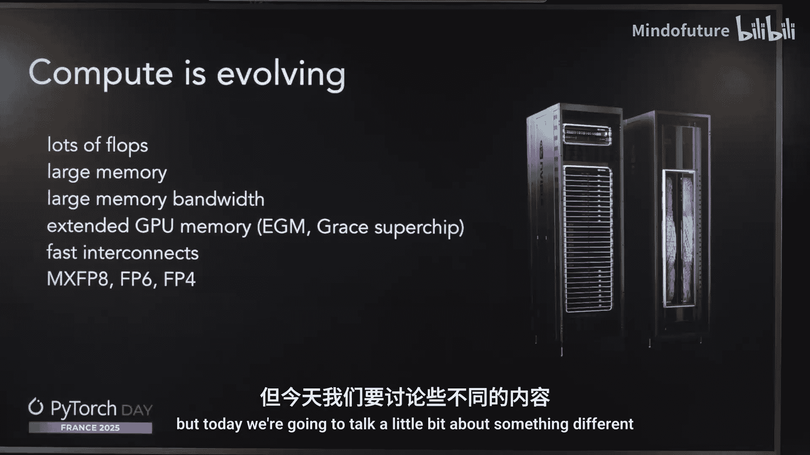
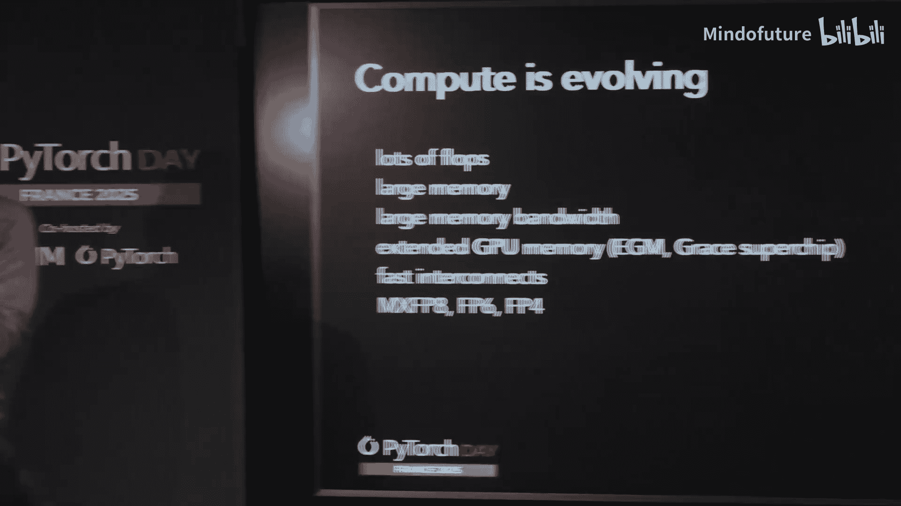
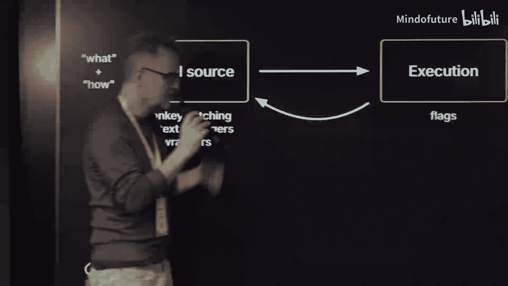
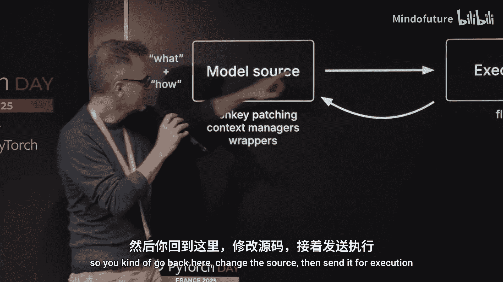
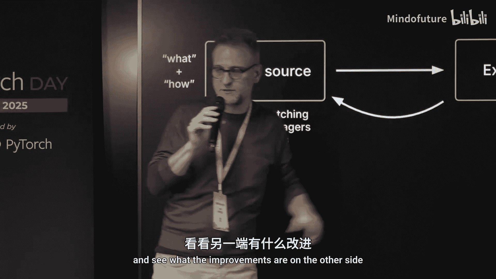
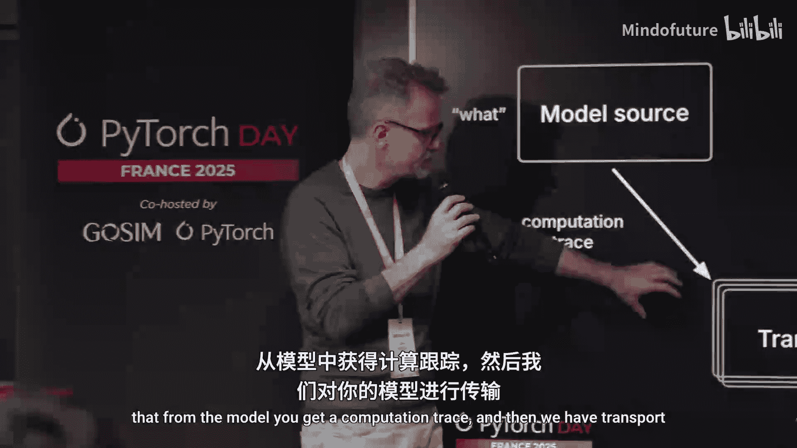
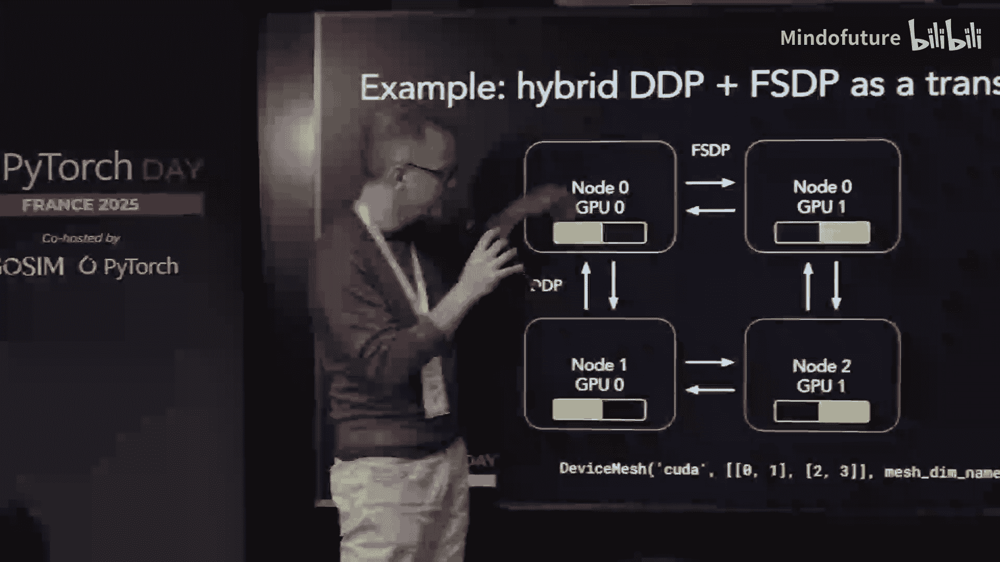

# Pytorch Day France 2025 ｜ vllm ｜ LLAMA ｜ GPU ｜ NVIDIA ｜ GPT ｜ 开源 p11 P11_Lightning_Thunder-Supercharged_PyTorch_for_Modern_Hardware-Luca_Antiga__Lig -BV1bQtQz2EFL_p11-

All right。So thanks for speakinging until the late stages of the day。

 yep Antitiga and Im a CTO at lightingning， lighting， you may know likely because of P lighting。

 they' popular we had over $10 million。Or 12 it helped popularize a lot of also data parallel kind of techniques。

 like each speed， there was an integration very early on and so on。

Today our product is lightingI， you can go to the website， create a free account。

 you got frequent view， and it's a development and deployment platform， pretty easy to use。

做只博士邦。And today we're going to talk a little bit of something different。

Which is like in thunderra， it's our moonshot project that we are conducting together with a lot of help from media actually。

Computers evolving here。 I have an ML 72 system that's basically made of。72。

 actually 144 GPUs all super connectedected together。

 so things are evolving really a lot and today we learned that if your interconnect is different。

 your strategies need to be different。And so everything is very topology specific and writing one code that fits everything is getting very good power。

Loss of plugs， like memory bandwidth of different kinds。

 pipe exposing APIs to exchange data using different memory pools through different paths and you need to know all this。

 especially as you land on new hardware because next generation hardware requires you to know about those things if you want to squeeze。

The performance that you paid for。So， that's kind of a。

The thing you need to consider when you move to new hardware and then fasting Tcons。

 different data types now we listen to a great talk about quantization and we have new data types that are supported by the hardware。

 so there will actually be a lot faster if you run of quantize。

And so in the end performance come from your level of control so how much you can control all different things。

 and here I mentioned a few things like you start from your NN module。

 and you need to be sure that in doing fusions and adding mixed precisions scattered around your model。

 adopting kernels and running different kinds of distributed like 5D， your sleep computing the same。

So as a researcher， you need to apply all these things within your model somewhere because you cannot just wrap things。

All these optimizations kind of enter your models somehow。And idea B。

 although researchers would like to say， okay， I have a model。

 you run break on one GPU and now just slap some optimizations on Im done， and this happened in 2019。

 2020， with some of the techniques that people were using back then。

 right now it's a lot harder to just call a function and do it。Because again。

 not only these optimizations enter your model， but the kind of optimization you want to do are task specific train arrangement plans。

 model specific is it an ME implementation specific。

 am I running on a hydrogen phase transformer or nanoron things change。

 you need to enter it and then what harder I'm running on and what is the top。

So our answer to this is a project that we're building， again， that's called L Tunder。So source。

 you can just go to the repository up there and look at the state of it。Is it ready ready。

 it's not ready ready？But we're getting there， we're making a lot of progress。

And here you can see the speedups that we presented back in GTC this year and it's interesting to see that。

 well， you get some speedups on H100s， so this is eager。

 this is with T this is a pretraining workload and different sizes and we have a huge amount of models we're tracking。

 but the interesting thing is that as you move to B200， eager becomes faster。

 but the gap that you get from unopimized to optimized and can be optimized with not just thunder you you can optimize it manually with other framework。

 the point is that the gap wides as you go to。Next generation harder。

 this kind of confirms what I was telling you before， you get new tos， new architecture。

 you need to know how to squeeze that performance up。Otherwise。啊。

You're not making the most of the money， Okay， so why is T， we call it a compiler。

 but compiler is kind of a broad term， let's try to specify what T wants to be。嗯。

It's not too far from what。The deep speed control wants to be。It's an optimization delivery system。

 meaning I have a model that I wrote research style and want to deliver optimizations into it。

for performance， I had to replace kernels， do fusion is when I take many operations one after the other that will require me to go back and forth between the cancer courses and the HBM and I just create one kernel that execute them all together so I don't have to shtel numbers around。

And then reducing memory and scaling up doing different kinds of para。

And this is how you use it at a very high level， so we're kind of trying to get to what desire state was before。

 so you undercomple a model， which is an NM module from Ptorch。

And then you have a set of plugins that you can compose together。So that's the desiresous state。

And so this is what usually you find yourself， this is without under what you find yourself doing。

 you have some model source that kind of has the what， So is it a mamba model。

Vision model or whatever。And then using a combination of using hoops， multipatching wrapping。

 people kind of optimize it so make it distributed or make it with context managerss mixed precision。

 and then they send it to execution execution can be I don't know。

 Pyth eager or different torsch compile and so on， and you have some flags here or passes that you can add to torsch compile and so you can。

Go back here， change the source， then send it for execution and see what the improvements are on the other side。

What we want to do our desired state with thunderhunder and what it is today is that from the model you've got a competition trace。

And then we have transforms as python code as a first class citizen。 So we focus on this。

 So how do you get。Some internal representation of your model re transformed in a way that is developer friendly so that I can then get to execution with a model that is not what I started from。

 but it's what I started from with。More stuff， and I'll I'll。A' showing example。

Wwhich can be infusions or using high performance libraries， for example， of black one。

 there's all these new data types of the of the6 before。

 and there is a library called transform Engine that not like，でで。It's okay。 you can use it。

 but you need to know how to use it right， So how do I know now how to apply that library optimal to my my moms。

That's a young very deep to shape every time you want to walk。Okay。

 so let's look at what happens behind the scenes。Say we have a very complicated model。

 a linear red linear in a sequential that's not very exciting， but at least it gives you a short IR。

And we compile using Tlunder and I'll tell you a little bit what happens here。

 and then we take an example input and we run through whatever was returned by compile。

 not unlike torsch compile， and by the way， we're not competing against to compile we're positioning a different way。

 as a matter of that， we are using torsch compile early for certain things。Right。

 so what do we produce Here you see a function computation。

 We actually have three functions Every time we acquire。 it's a prologue that goes from。

And then module La to purely functionalal， we have a purely functionalal trace and then an epi that goes back to objectiented and then module stuff。

 and this is the function that actually computes the competition right there's a linear radio a linear。

 some information has been kind of。Frozen in the IR。

 which is like the shape and the type of the parameter， we're introducing dynamic shapes。

But essentially， this is an equivalent committee。And then if you want， for example。

 to add aP zero from deep speed as a transform， what do you do。

 you have to act at like want to apply here， you need to act at different places One is well you want to move the module to your device。

But you don't want to do it too otherwise you go out of memory so you first want to shard your model so that you want view only holds in the right parameters for that shard。

 and then you want to move it to GPU fromcur。 So that means that the capturing of the model and the AR needs to happen on the met device。

 so not on the actual device， but symbolic representation of whatever are the metadata for those sensors。

So we inject ourselves at this stage， at that stage， and then also at this stage forward and。

And we have transforms that allow you like a transform architecture that allows you to write composable transformations also in the loading and saving。

Because whatever， however you transform the computation also reflects on the way you save and load the graph。

Okay， so this is at SDP as a， how a transform in our land of transport first class it look like。

 we can iterate over the symbols in the competition that we saw that were leader regular leader。

There's a lowering to primitives that I didn't show you， and then there's some logic like if I。

If I encounter shed parameters， I can put some synchronization primitives here so that for the computation。

 I gather all the parameters from my peers and then I do the computation and then I yellow things properly。

So I have to full anded barmeter to do competition with。And so basically， Ill go from here。

To something that looks like this where you see that the sizes in the meta that have changed in the graph so one of the nice things about Fl is that I can take the IR and as I apply the transforms and there are many of them I can follow the transformation a bit by bit so it become very deable。

This IR is' actually not a natural it is an I， but it's also a python function。

 so I can copy paste chunks of it and just run it。Which is very useful。

And then you can go one step further and say， okay now I want to compose two transformations。

 one that makes something a SDP， so Charlotte data parallel。

 we heard about that today and DP pure data parallel。

 why would you want to do that because maybe your model fits2 GPs？

But you have more than two GP viewsUs， likelyily you have four in this case， or you have two node。

 for example， each with two GP viewsU， this is a fictional system， luckily。

And say I have my model can in a sharded form can fake two GPs。

 but then I don't want to shard it across four because it would be wasteful right why should I shard it across four I can just shard it across two and so across the I can shard it once here and once in this direction and in this direction I can just synchronize the gradient right so I want to be able to express this as a composition of transforms again。

And here we were reusing the device mesh that was recently introduced an white ver。

And this is exactly what we're going to be。 So we're planning our system that there's a device mesh with two dimensions。

 One is the FSDP dimension and the other one is the GDPP dimension。 and now we can compose it。

And here are the sharding of it can be parameter， like the waste， the activation， optimizer state。

 whatever you want to shard。

And so this is how it looks like ThunderJ is not Tunder compiled。

 it's kind of a lower level API that we have I will build the plugins for。

 but usually you typically operate at this level if you develop with T and then you have two transforms and the order matters。

 so first is the FSDP transform and the GDPP transform and these are two independent passes that don't know about each other。

 but they can know how to not step up each other's tools。And。We pass the process group。

 so the world of one dimension， the SD you wanted。All right， so this is more or less I had。呃。

If you are curious。This is the IR the trace that comes out of what I just showed you。

 you have a lot of all gathers here， some weight。嗯。

Primitives and then I have a functional linear and then a fusion that is the basically the value here we have different fusion executs。

So one thing I didn't tell you is that under not just but distributed but can also do transformations tofuse days。

 like for example， you can use Torch Comp tofuse conductor， or in this case we use MD user from IPDA。

To provide automatically just in time generated kernels for fusions。

 and then you have the other leader down here after。

The primitive and here is the backward One nice thing is that Auto di is also a transform I think so you can generate explicitly generate the backward graph。

 the backward trace for something and you can also apply a transformation to it and it's also very explicit like this。

And you confuse it to what so on， so the goal is to yeah do what I just told you。

 so create a system that we can then acquire our model with and reason about program transformations program。

So that we can automate going from something unopimized to something optimized because the way we do that is context dependent。

やてが好て。The model coverage is good， it's improving， we're working on transformers right now。

To make sure you can run transformers without issues we have a few composable transforms and we'll add more now we're gotten to the point where we are actually productive and driving transform so that's great we support a bunch of exes like heavyuser torch compile and transformer ranging coDNN custom driving kernels and if you try out your mileage may vary it might as well be that it doesn't work for you。

Please open issues， we are very receptive we're working on the paragraph。ex个。

