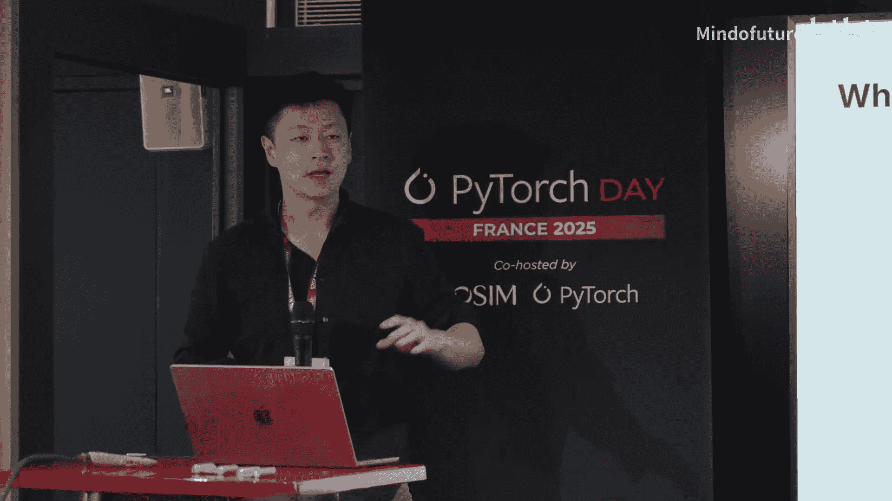
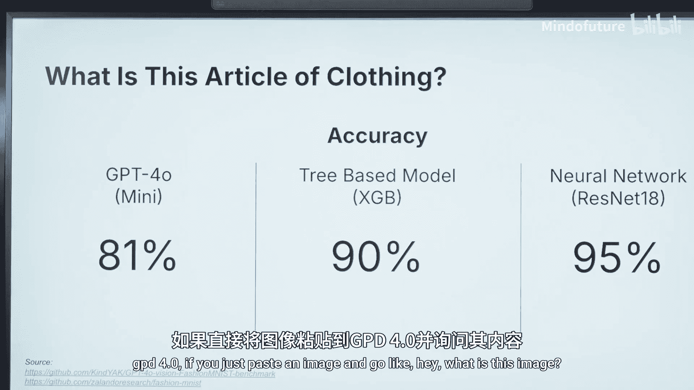
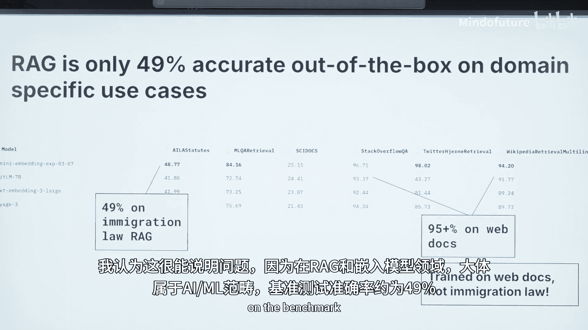
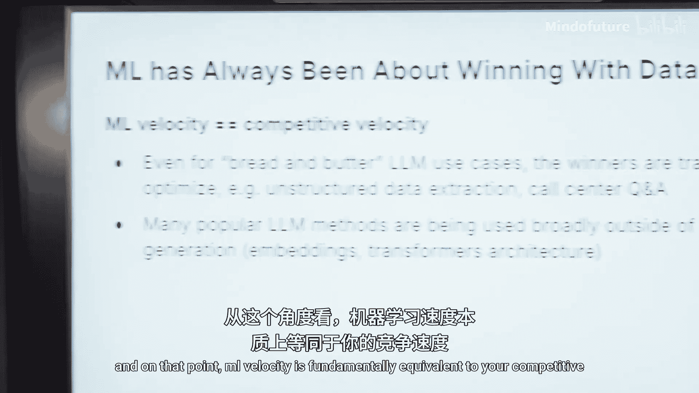
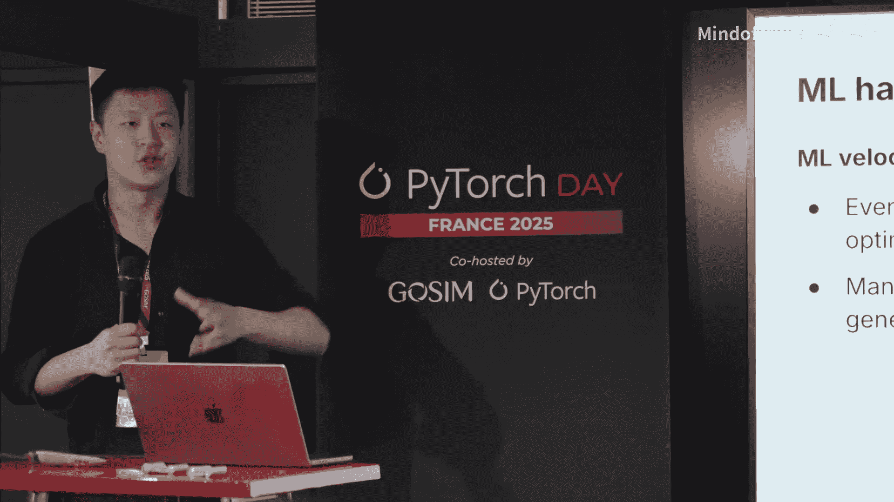
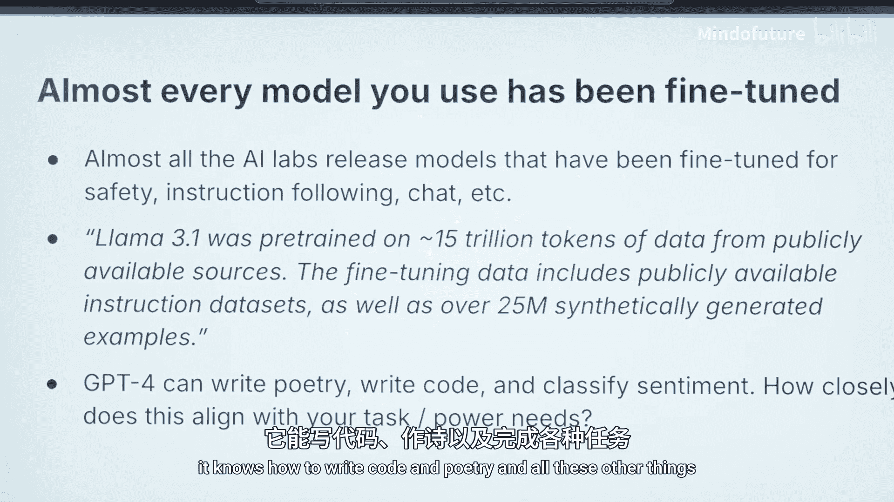
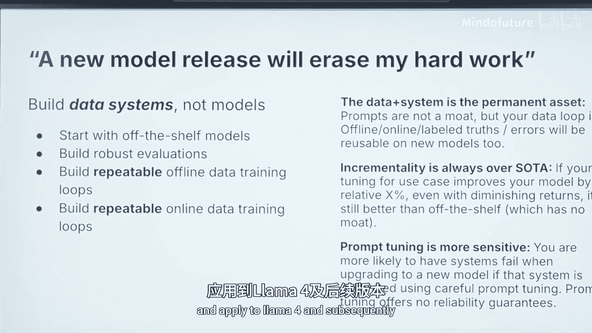
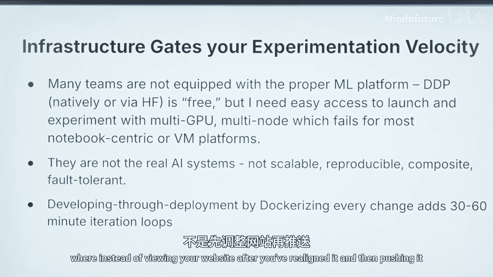

# Pytorch Day France 2025 ｜ vllm ｜ LLAMA ｜ GPU ｜ NVIDIA ｜ GPT ｜ 开源 p12 P12_Beat_GPT_4__Build_the_Best_AI_For_You-_Paul_Yang__Runhouse -BV1bQtQz2EFL_p12-

。So。嗯。Hi everyone， this talk is to kind of motivate fine tuning as something that you should all be doing just by like show of hands how many people have like seriously in like a production setting deployed a fine tune model just to like gauge the。

Like a moderate amount of people I mean like the headline like BGP for is obviously like whatever it's like a titlet B but I think the more like core concept is that you need to mobilize your first party data for AI solutions and to really motivate this problem I start with this question What is this article of clothing This is the fashion MNIS data set it's you know a successor to the MNist handwriting data set but really it's just like it's a shoe it's a t-shirt and you're pretty good at recognizing it but I don't actually know what the thing in the middle。

GPD 40， if you just paste an image and go like， hey。

 what is this image and you use the language model with multimodal capabilities and just say like。

 hey， what is the result of this， you got 81%。

If you use a tree based model that you can run on the first day of ML 101。You got 90%。

 which is obviously significantly better。 And then finally， you can get to like a resnet。

 which like without a lot of tuning， you get to 95% and。

Models which are state of the art in like 2015 and run on like a tiny fraction of the compute or run basically on a single CPU for inference can exceed the capabilities of GPD 40 and I think this is a motivating point because。

You know if you think in the domain of like Rag right an embedding models as broadly in this like AIMl space。

 you got about 49% accuracy on like the benchmarks that you can see on hugging face for immigration law rag。

 which is the AIA statutes ragG benchmark it gets 95% on a web doox why because the little trained embedding model once upon a time to go find the accurate web doox right so it was the mobilization of data for Bt embedding was to find web docs and it does great at that and it was not to find immigration law and so it works not so well it's somewhat of like obvious outcome and you know there's a lot of money in this too like Voya AI sold for $220 million to Mongo TV for。

Discloed amount of revenue because their whole thing was that we make fine tune embedding models and as a company。

 Mon felt like that was really valuable。There's like a couple different broad benefits that I won't go into too much detail because I think presuming some level of knowledge。

 but you know domain specific knowledge tasks specific success and just speed。

 you can do things better or you can do things faster and cheaper and these are kind of adjustments that you can have depending on the kind of fine tuning technique and approach that you take。

I'll just reference one example by Databricks， whatever the founder of the last company I worked at was one of the authors here。

 so great job guys， they took a Lama 8 billion parameter model and they trained it to generate code dis to fix code snippets。

In this particular case， when compared to GPP 40。They were which is 100%。

 they were about 40% more likely to fix errors and the latency of the model was over2x the time that it took to generate tokens from GT40 which is kind of like you can tune between better and faster in that maybe if they use a larger model。

 they would get even better relative performance but maybe with a less latency benefit right and for this codefi model if you're in a data breakricks environment and they want to be able to fix the code really quickly。

 you know speed was actually something they wanted to prioritize so they take the smallest reasonable language model who can achieve better results but at speed and so this is just really to motivate the idea that it works like it's been proven to work and increasingly the state of the art solutions and deploy deploy software are based on fine tune models。

But ML has always been about winning with data and without being too negative about the AI labs。

 there's some kind of motivated reasoning when someone tells you that you can just use bedrock or you can use open AI endpoints and call one model endpoint for everything and I think ads is a great ecosystem to analogize this by Imagine if Facebook went out and said we don't need to build an MLbased ads platform Google Ad looks pretty good。

 we're just going to plug Google ads into Facebook and serve all of our ads through their ML platform。

That obviously doesn't work to make Meta a huge company and that not that would have make Google a much bigger company so really like。

The last piece of motivation is like how many use cases have moved from Adal to LLMs a few。

 but if you look at all the companies that are like telling you that you should call their endpoints。

 they're also all the ones spending billions on Capex and model training。

 which kind of motivates the point that you should probably also be building these capabilities。

 especially if you work at a reasonable scale organization who is going to make a product off your fine tuning。

And on that point， like ML velocity is fundamentally equivalent to your competitive velocity because ML research is a research discipline。

 there will be a lot of things you do that will make your model worse。

 right like these are pretty good models which I've had a lot of work put into them already。

 but if you can kind of make the line go up， make your loss go down。

 your velocity to do that is your competitive velocity。

And you know when you think about it actually， I think most people are aware of this。

 but all the models that you' have been fine- tuned in some way and sometimes you're calling it posttraining like there's all this popularity around eVs。

 but the AI labs don't just give you the data set raw right like there's the instruct data set and there's a non instruct data set the Nvi presentation earlier allows you to train reasoning into the models。

 and basically if you think about the ratio， Lama 3。1 was trained on 15 trillion tokens。

 but it was post-trained on about 25 million synthetically generated tokens it's kind of saying that the level of effort is how many magnitudes。

 it's like three or four orders of magnitude lower to do that。

 so yes pretraining a model is like dumb and you shouldn't do that in 2025 but the order of magnitude to actually like go and produce a reasonable change of behavior on the model does not actually require that much data and since it's already been fine tune for behavioral and instruction following。

 it takes one or two orders of magnitude as low as a few hundred labeled example。

To produce novel behavior that is well tailored to your use case。😡，And maybe like more abstractly。

 I don't like it when people analog matrices to the brain。

 but like GBD4 knows too much right like it knows how to write code and poetry and all these other things。

 but like you don't need it to be good at any of these things you just need to be good at really one thing and that's where your ability。

 your domain knowledge and your first party data is very influential for this。

So just like briefly taxonomized for the sake of structure right there's offline and online data that you can feed back into the system the offline traces and the online success failure tracking are both actually traditional product exercises。

 traditional engineering exercises， but it does require you to be a little bit creative to think about like what you actually want to collect from the end user character AI for instance early on would generate four low resolution images and have you select one of them in order to upscale and upsample。

 but that's a data collection exercise， there's the obvious like stars in a code correction pace you can take it and see what the code completion the codeDF generated and then you can compare that against what was actually successfully run next and that creates a pair of examples which you can then use to further tune your codeDF model。

There's a range of techniques and I think speakers have touched on some。

 if not all of those at this point， I think there's a wide array of you techniques at this point and I think two things。

 one like cursor is your friend right like or like whatever windsurf， your choice copilot。

 use whatever code generation tool， whatever kind of GitHub library that you find and that goes back to the competitive velocity it comes from your experiment velocity。

 there is heterogeneity in the approaches and the techniques that are available to you。

 and so it's really important that you have the ability to kind of experiment against all of these techniques and kind of combine your various data traces that are collected and thoughtfully assembled with the state of our techniques to drive the feedback into the system。

Finally， like prompt engineering like kind of doesn't scale like maybe this is too controversial a statement。

 but you can like lightly branch your prompts at a small scale of results。

 but unless you have a system right like when you think about like traditional ML like if you think about recommender systems that like Instagram right that is a self-lening system that propagates at scale feedback automatically back into the system。

 it's not one in which like failure cases are manually logged one by one and you collect them and you like branch your problems prompt engineering is like somewhat helpful for like early things but at some point like the prompt engineering will kind of be fragile and then the last part of prompt engineering is like it's extremely tied to the version of model that you have right like it's extremely fragile in the way that unlike。

When you build a data system to propagate feedback to your model。

 the prompt engineering path is a manual one that does not actually allow you to take it and apply to Lama4 subsequently。

Like you start with off the shelf models， you build robust evaluations。

 I don't want to be so dogmatic about training that I ignore the fact that evaluations is like the P0 for building a self- learning system。

 but then you build repeat offline data training loops and then you build repeatable online data training loops。

😡，And the data and the system that you have is your permanent asset， not like the model checkpoint。

 this is generically true for all other like ML systems as well right like back to like the recommender systems。

 the model checkpoint is not the value of the M metaM team。

 the metaML team's value is in their ability to collect your likes and your shares and your views and train that model every 15 minutes over a cluster of GPUs。

😡，And there's always incrementality over the state of the art when you have this firstparty data set。

 because no matter what comes out， as long as you're using an open source model。

 you can always retrain into these， you have the EvalS and if someday a model comes out and it's GPT9 and it really solves your use case completely and you never have any errors again。

 you can then throw out your data system， but until then you have an evaluation to understand the relative performance。

 you have the categories that you have underperformed and overperformed on and you have that data system to kind of tune it so then you kind of have the ability to always improve over the state of the art with your data system。

This has been covered amply I think today， but like fine tuning is basically just torch training right like people have been training SG boost models。

 people have been training torch models， fine tuning is not that hard and like hugging face which is giving a lot of great talks and also later on they have this trainer class that like wraps it and makes it even easier and then the various people who have spoken have other rappers around various subsets of the torch ecosystem。

If you can train a torch model， you can build a better LOM than GP for your use case。

But there is a cl here which is like LLMs feel different and like LLM feel different in kind of the same way that ML has felt different than software and I work at runhouse。

 we're actually like an ML Infrraar company where like not solely religiously focused on fine tuning。

 but LLMs feel different for kind of the same reason that ML has departed from traditional software model weights。

 the models themselves are order of magnitude larger than other deep learning models。

The size of data sets and the number of trainable tokens is also very large。

 There is no local iteration path for training large ML models。

 there's no iteration path for training LLMs right so some of the traditional requirements of training a model break free from what the pattern of software engineering is where it's like hey。

 like you do have some code I align my website header differently I view it locally and I say like that looks great and then I push this code and it builds in CI and then goes to production There is not an ability to do that and so these two things are the reason why the traditional development SDLC loops feel much harder to do in LM。

There's also like sometimes not really a target metric and this is like kind of a product engineering question as well like for a lot of organizations when we talk to their definition of done is having a RA app having some kind of AI agent in production but that's not targeting some kind of improvement metric I keep analogizing to these traditional ML systems like recommender systems at meta because there's billions of dollars being earned on these systems and like for that product owner and meta who owns the recommender system moving that accuracy on some model by like 10 basis points is going to translate to a promotion in hundreds of millions of dollars for meta but you have to have a target metric for that improvement gradient to exist and if your organization's definition of done is having a model in place to like have an AI agent。

 that's like a little bit of an anti-pattern to like success。

And then like you know it's actually not costs， like I kind of want to make that point as like an objection handling。

 like LMs are not different biggest costs， you can kind of like fine tune a Laura a model with $13 billion parameters or a few hundred dollars and it gets cheaper all the time。

 and there's all these service providers who will also sell you compute at below  zero% margin to do that with。

It's actually like to the point on the first two that the model， the data size， the weights。

 the requirement for accelerated compute exceeds the bounds of your local development loop。

 it has created a problem where infrastructure is with Gs or experiment velocity this is where like we start to enter a little bit into the territory of like our opinion nation as people who like work in Infrra all day。

 but many teams are not equipped with a proper ML platform right like DEP or with Hogingface trainer with accelerate with lightning all of these things are free insofar as the code required to like the code to write the program is extremely trivial to access。

However， how do you experiment with that， multi GPU， multinode fails for notebook centric。

 VM centric， Devbox centric development iteration loops。

 but you do need the fast iteration loop still to experiment with all these methods。

The problem is that we have no dogma against notebooks。

 but these are not real AI systems because they're not reproducible。

 they're not composite and they lack fault tolerance in production。

When you developed through deployment by contrast， which is what we also see a lot of。

 where instead of having these like not fall tolerant and not scalable， not reproducible systems。

 you said， okay， like I'll use doize everything and I'll load my containers up and it will be perfectly reproducible。

 unfortunately you get this developed through deployment process。

 where instead of viewing your website after you' realigned it and then pushing it in order to add a print statement into your program。

 whether it's an inference application or it's a training loop。

You need to actually deploy the whole container through CI 30 minutes to three hours later。

 it's finally live on your Kubernetes cluster and you can see the results and like you need to go the full loop on a fine tuning right you have some data iteration so you write the distributed data program to do the data preprocessing。

 then you do the distributed training which requires a couple loops of iteration。

 then when you're done training， you need to deploy this as an inference application as well and do a couple loops of iteration there to make sure that your B version even runs as a B version before your experiment even starts if all of those iteration loops require you to rebuild a doctor image for every single change then you don't have a self-service path and itgates your experimentation velocity。

And so like this concept that like we didn't coin like we don't sell anything off of is like experiment escape velocity The reason why so many exercises don't get off the ground is that the perceived difficulty is so heavy that you actually don't feel like you have the agency to go and launch those experiments right I think it holds teams back at large companies and it holds teams back at small companies because the perceived value is there right like I think most people would say yeah like at this point we believe that like fine tuning our models will produce better results the main problem is that if you can't believe that it's pretty lightweight to launch the incremental experiment then the expected value is always going to be a little bit negative relative to doing something else。

And like the test of whether or not you have like a good ML platform is essentially if you see an interesting repo。

 like I don't know， lightning thunder， can you like go and just clone that。

 make some small edits and run it regardless of like what your platform is right like is that possible or are you missing something that allows you to kind of take an arbitrary repo and run it？

And so like kind of like moving into this broader conceptual space。

 I think Snowflake is a great example of doing this in the data space。

 SQL work great for single node queries and then you had Hadoop right for multi nodeode and you have map reduces and you have this fragmented data ecosystem。

After Snowflake， whether you were running over 10 rows of data or a billion rows of data。

 you could do selectcountstar from my table and Snowflake would go figure out how to do the distributed compute and create the abstraction for you such that you could be two weeks from school and write the same program and get the result and so briefly we're building a system called Cubetorch we gave a talk earlier which some of you were at Thank you and so we are designed to make iteration really fast on Kubernetes this is just my brief like this is also what we do so I think there's a couple takeaways here。

 there's some Apis but you can just check us out because I'm running out of time you can try a few things I just want to flash to this slide run continued pretraining generate responses distilled the model to a smaller one which is kind of what NviIDdia also did create a high quality labeled data set of a few hundred examples use an LM a judge to bootsrap the process of getting the data。

 use your feedback responses thoughtfully and like takeaways always start with evaluation there is no。

If there's no test optimize， there is no magic to mobilizing data is the magic3。

 you need a platform and like whether you use Cubetorrch or some other platform。

 you need to figure out a way to do interactive experimentation really quickly in order to get past this prompt engineering wall and like at the end like AIMl platform velocity is the same as platform velocity right if you're in a DevOs world where you need some guide to help you unblock Jenkins jobs all the time。

 that's not super good。 And so like you kind of want to build the same thing fundamental thely across your AIMl applications to do fine tuning so email me if there's more questions and I'm happy to tell you more about Cubetorrch。

 but thank you。