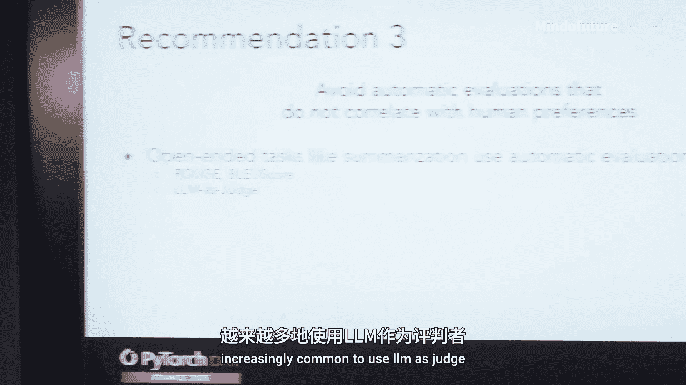

# Pytorch Day France 2025 ｜ vllm ｜ LLAMA ｜ GPU ｜ NVIDIA ｜ GPT ｜ 开源 p13 P13_Best_Practices_for_Open_Multilingual_LLM_Evaluation-Catherine_Arnett__Eleut -BV1bQtQz2EFL_p13-

嗯。Hi everyone， my name is Catherine， so I kept thinking about。😊，Tax。这れ go outline。

So the kind of like scenario I'm envisioning is you're asking what's the best model for my target language or？

You're trying to evaluate whether the method that you employed performed。

And improved performance for your target language。And actually the best practices I'm going to be talking about are the same for all languages。

 high low resource， everything is just that in a low resource scenario or multilingual scenario。

 it's even more important to adhere to these best practices because you're often operating with fewer benchmarks and so each one of these benchmarks holds more weight and you're answering these questions。

So first I'm going to talk about some best practices for selecting benchmarks。

 then I'm going to talk about how to actually run them to evaluate multilingual models fairly。

 and then I'm going to just have some brief thoughts about creating some new multilingual benchmarks。

So yeah， just before I go into the best practices， a note about benchmark availability which is the problem that I run into the most actually。

 for English and Chinese other pretty high resource languages。

 you generally have benchmarks that exist for the task that you're interested in。

 but there's a pretty steep dropoff in availability as you go into lower resource languages。

 so this is a nice figure from a recent paper that shows so for English and Chinese。

 I mean there's even still pretty sharp drop off from English to Chinese。

 and then once you go down there's a very long tail of languages for which there exists very few benchmarks。

And so yeah， just to note that depending on what language or languages you're working on。

 some of these best practices are actually very hard to adhere to because you just don't have a lot of options in terms of benchmark selection。

So the first one is just choose tasks with appropriate difficulty level yeah as I said this I mean this may seem trivial but sometimes this is actually a very hard criteria to meet。

So especially many benchmarks that exist。That cover a lot of languages are too easy for our kind of like current models。

 so some examples are SIF 200， which is a topic classification task covers 200 languages。

 but it's really not going to evaluate our sort of like more recent very large models。

One that was released just last month is multilimp。

 which evaluates her ability for moment to generate。

It covers 100 languages I'll talk a little bit about。And。This is largely due to the。

Between when benchmark are created and when they're actually used to evaluate。

So by the time a benchmark has come out and maybe like a year later。

 our models have really moved on in terms of what they can do。

 but we're still using the same benchmarks， especially for。な。かしゃ？And so as a result。

 these benchmarks can't really help us distinguish like between two models or。啊，是谢。Multilimed。

 so this task basically evaluates whether a model assigns higher probability to a grammatically correct sentence than a grammatically incorrect sentence。

And this is predictive of grammatical text generation。Which is not a salt task for many them。

And so looking at the results for English， we're pretty much as healing all theselum models we're getting 99% basically or the high resource languages。

lumma models are getting 95， 96， 97%， so this was just released and alreadys kind of saturated for even like an8PA model can pretty much do this。

So yeah， here's an example of multipl kind of hazard language coverage。

 but it doesn't meet this first。Priterio。The second sort of recommendation is to avoid machine translated benchmarks。

 especially ones that haven't been verified by experts or names with。Language。

Machine translation introduces noise into benchmarks with basically getting in the way of our ultimate goal of estimating more quality using these benchmarks。

 and this is even worse for low resource languages。So to walk through an example。

 this is the EU 21 benchmark， which is。Covers 21 European languages。

 there are several tasks of MLLU and some other like quite widely used tasks。

And they machine translated all of them from English into the various languages and so you can see performance on the right of basically descending order like just like lower performance as you go down。

 and this is very tightly correlated with the amount of training data that we have from these languages。

 what proportion of common call， these languages make。

And so we might attribute like this particular model performance difference to training data。

 but it's confounded between also the resource level of the machine translation system that's being used。

 so are we saying lower performance in Estonian because the model is worse than Estonian or because the translation systems worse for Estonian。

 probably both with them， but this is really a problem especially when we're trying to compare performance between two languages within a single model？

Yeah so the EU21 MMmLU。The big thing is covers several languages， it is challenging。

 but it does kind of not meet this chain translation recommendation。

Next is avoiding automatic evaluations that don't correlate with human preferences。

So thinking about tasks like submarization， which have open ended generations。

 it's pretty common to use things like rouge or B score。

 increasingly common to use LLM as judge to evaluate summaries。

But these automatic metrics and LLM judges need to be extensively evaluated and aligned for each language。

 so it might be quite difficult to expand this to different languages so people don't always do at you found that LLM judges were' able to produce like correct fluent text and Korean。

 but we're not able to actually distinguish between like cases of cultural misrepresentation。

 exactly kind of where。Want these models to work。And this study done in collaboration with some people at Luther found that across three different languages。

 so English， Chinese and Indonesian across various features。

 Rouge of B scorere and GP4 as Judge all showed pretty poor correlation between human preferences。

 so we're really not doing a good job at successfully evaluating。

Open ended talks was like summarization。And we're currently working on expanding this study to more languages to better understand how to like successfully。

Yeah， so for example， an evaluation like ExcelS， which uses Rouge as an evaluation。

 it covers 44 languages， it is challenging， it's not shame translated。

 but it uses these automated evaluations， which can be problematic。

Fourth is benchmark should be culturally appropriate and adapted to the target language。

 so localized benchmarks show higher correlation with human judgment and this means they're not just translated。

 but they're culturally adapted to say if it's like a legal benchmark。

 then it's adapted to specific laws like in that countries。

Some examples are CMmLU and KMmLU for Chinese and Korean。And recently Cohere released global MMLU。

 which has two different sections， but one of them has a cultural specific。Subset。

 so all of these are good examples of how to successfully adapt MMLU to localize MMLU to other languages。

Yes， so the little FMLU does。A pretty good job on all these recommendationslams。

And the last one in this section used tasks and metrics that correlate with human judgments。

 so some tasks in general might better be predictive of like sort of general like chatbot arena kinds of scores so they might be more useful to us。

 so this study found that multilingual grade school math benchmark more closely correlates with MMLU more correlates with human judgments than MMMLU I think they also they found in general that like reasoning in math benchmarks were better predictive of human preferences。

And in the absence of that data， which we don't have。Many languages。

 it's good to just pick benchmarks that match whatever your desired use case is。

 especially got there limited benchmarks available。Yeah。

 so multilingual grade school math kind of meets all of these criteria。

 although it has the worst language coverage of all of them， so might we have this balancing action。

Like meeting sort of these best practices and then actually having good language coverage。

So there aren't any perfect benchmarks I haven't really ever seen one and certainly not one that covers a very large number of languages。

So yeah， depending on what language you're working with or languages you're working with。

 sort of what you're doing， all sorts of things， I think it's good to just keep these best practices in mind。

 try to adhere to all of them， but I often fail to meet many of these due to constraints。

And yet they apply to all languages， including English but， as I said， they're more important。

 the fewer benchmarks you have。So I'll just speak briefly about evaluating multilingual models fairly。

 so an important thing is to use either confidence intervals or standard error depending on your evaluation setup up so this is some a result for a GPQA or a few models with just one run and then this is the confidence interval setup for over 10 runs and these later have a very different impressions of which model you should use。

 I think， and so。

You know this might lead you to choose GPP4 Trbo， which is going to be cheaper for you。

 so that's like this is really going to have big consequences for whatever your application is。

 so I think yeah， confidence interval ruless in standard error help you make more informed decisions once you've chosen your benchmarks use。

Also， make sure to use a consistent and replicable implementation。

 we found that like even just changing white spaces in the prompt can drastically change benchmark scores。

So these small implementation details matter a lot the good news is you can get both of these things and many other things from the LM evaluation harness which has been around for a little while and supports many。

 many benchmarks so it automatically will compute standard error for all of your benchmarks that uses a replicable evaluation strategy and you just rub a single line of code and it runs your evaluation for you this is like really like changing if you havent。

If you want to learn more about sort of these like implementation details。

 this is a paper where releasing an updated preprint pretty soon didn't quite get it ready in time。

 but this is a really great paper if you sort of want to learn more。About these things。

And then in terms of reporting benchmark scores in a multilingual setting。

 it's important to disaggregate your benchmark results across different languages because aggregating them by just meaning the accuracy across all of your languages is really going to hide some important information about。

 especially like where your model is not doing well of which languages your model is not doing well along。

So these are some multib scores for two sets of models sollma 70B8 these goldfish models。

 the mean accuracy is pretty similar， but if you look at the distribution of scores across the different languages。

 the goldfish models have sort of more consistent scores across languages andllma has much more languages for which there are lower scores。

 sollma has some languages it's not doing very well at。

 but you can't really see that just from the mean score。So it's important to look at these。

 understand the full distribution of the forms across all languages and report that as well。Yeah。

 and so I'll just briefly speak about our ideas about creating new multilingual benchmarks。

So of course we're going to keep all these best practices in mind that I've mentioned。

 so when we're considering which tasks are we going to sort of focus on。

 if we're going to do any translation， using expert translation， localizing if relevant。

 we're going to try to get validation from community preferences，That kind of thing。Yeah。

 and the main goal is to improve language representation and sort of focus on this long tail and try to yeah have more benchmarks available for。

P which is one of the critical problems。And we intend to do this through large international collaboration。

 I think that we need experts from。various different language communities。

 we also just want perspectives from people who have like many different use cases and we're currently developing a multilingual naturalistic open ended question answering benchmark in the Outhther community we are looking for collaborators。

So this is something that you're interested in， get in touch with me after or I'll hoddleling at the end to join the discor。

啊。So just wrapping up all the recommendations and best practices that I talked about are in this blog post that I just published。

 and here's the link to the Discord if you want to get involved or just keep up to date with what Aluther is doing either multilingual benchmarks or about other topics。

That's everything that secure。