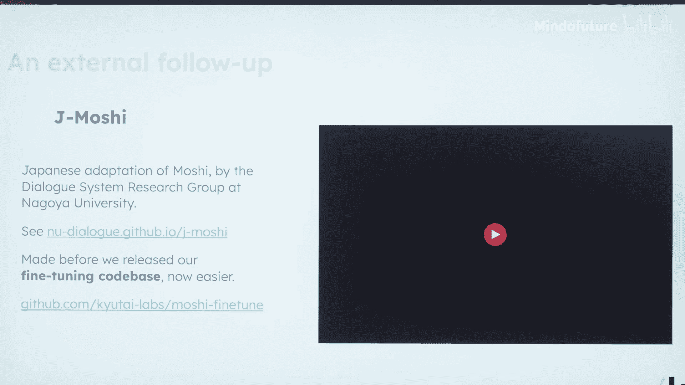
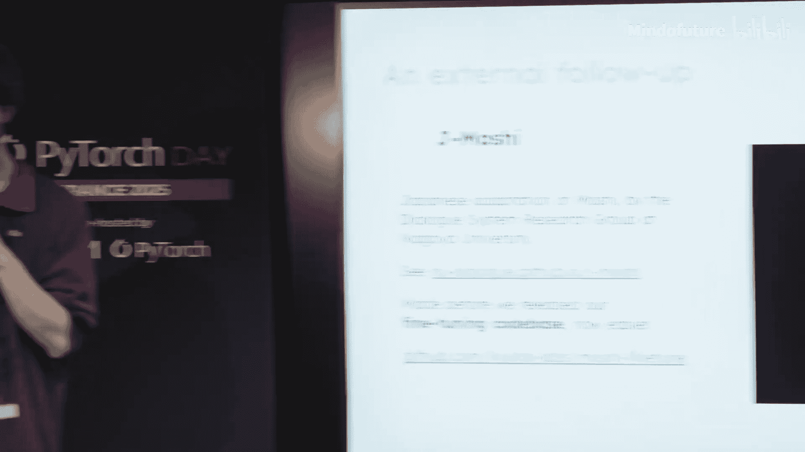
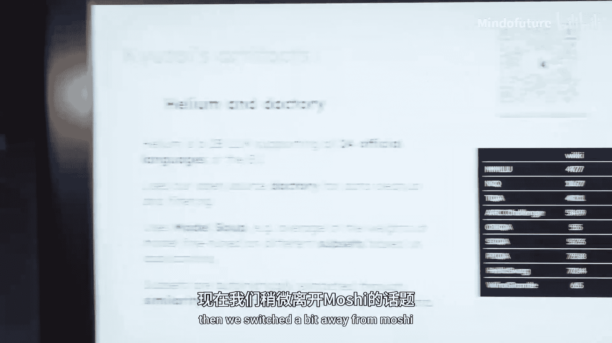
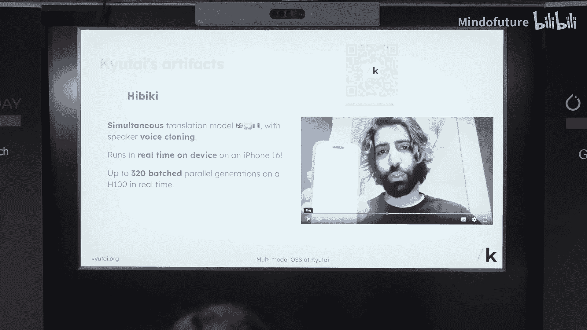
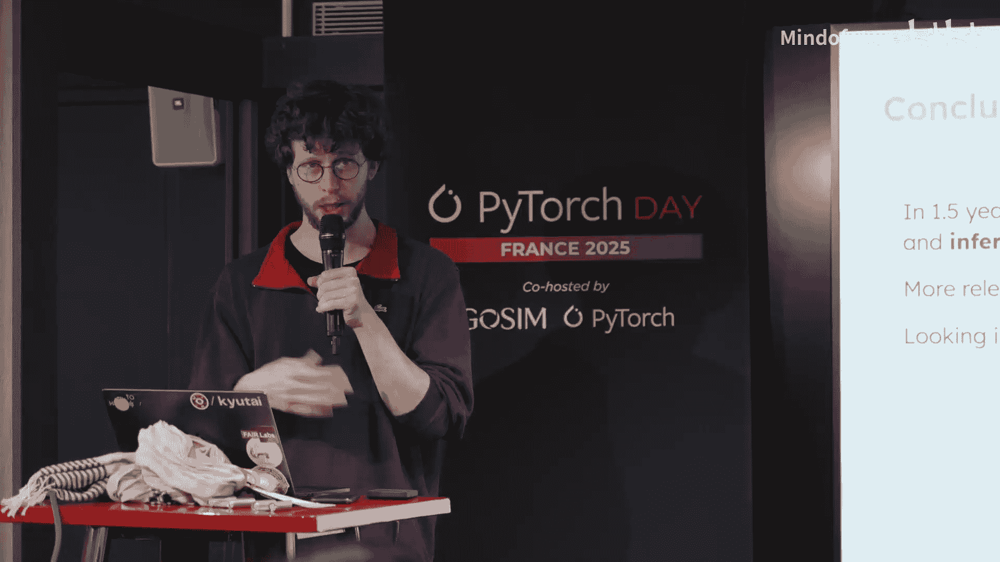
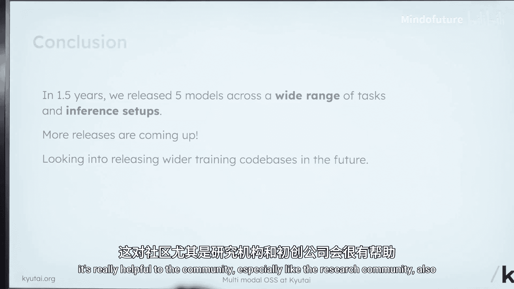
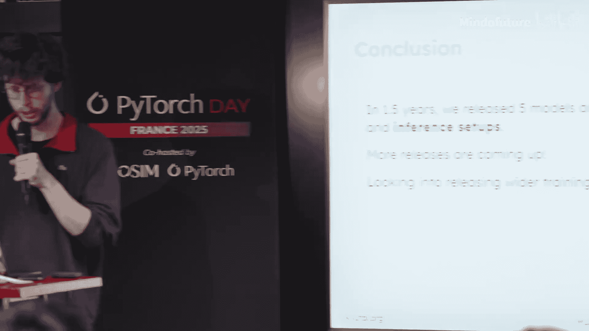

# Pytorch Day France 2025 ｜ vllm ｜ LLAMA ｜ GPU ｜ NVIDIA ｜ GPT ｜ 开源 p14 P14_Multimodal_Open_Source_at_Kyutai__From_Online_Demos_to_On-Device-Alexandre_ -BV1bQtQz2EFL_p14-

嗯。Hello， everyone。 Thank you very much for the invitation to present。For the backs Day。

Today I'm going to talk a bit about the open sourcing， we've been doing it QubD。

So first word about this， so we are a nonprofit lab based in Paris。

 we open about a year and a half ago， and so our goal is to do open science and open research。

 open source research。嗯。We have an initial focus that has been quite around multimod large language model。

 but in general we're interested in anything that could be useful for core machine learning with a large potential for downstream applications。

So we started， we were just six people and now were about。More than 2020 people。

 we have a few more coming so I'm not going to present the whole team。

 but basically we have both permanent researcher， engineers and post doctorate and resident PhD students。

 which is something that's very important in our mission as well to kind of train the next generation of scientists。

 and we think that this is most efficient if like the next generation as access。

Let your hand off a little bit。as access like to kind of industry like training capabilities as early as possible。

 and of course I would like to thank our donors， so Z O E。

 who permits us to do this work for the community。So first， why do we value open source。

 So I think there's three motivations。 The first one is for science。

 and one of the pillar of science is reproducibility。

And you want to be able to do like fair comparisons to existing methods and that can be hard if all you can do is to trust numbers that have been obtained in conditions that you don't necessarily entirely So by having open source model。

 it's possible to really understand or produce work。

 achieve a given performance to test it for new applications and that allows to measure meaningful progress the model we open source can also serve as a foundation for your research project either directly as retrain model or for fine tuning or even just inspiration。

And of course， the IDO case is to do like full data and training code open sourcing。

 which I've done a few times so far in my career， but it's very hard to hit this kind of IDO goal with every single project and it's of course a bit consuming。

Time consuming then the second reason is basically for every AI practitioners。

 and I think personally， I learned program by myself in my room， just connecting to the internet。

 installing Linuxux on my laptop， installing GCC， going on forum。

 And what's really great with AI is that this really works like that as well like anyone who knows a little bit about computers can really get bootstrapped and it's probably even easier today。

So yes， we want to like be part of the open source community。

 help it grow and allow people to build cool stuff。And finally， obviously for startups and companies。

 so as we are a nonprofits， when we understand that training foundation model is extremely expensive and basically top funded startups can afford to train foundation models。

 but they're not going to cover all the possible applications， and so the more open source we have。

 the more likely it is that we're going to have some cool downstream applications for extensive accessibility education。

 mental physical health and many more。So let's discuss a bit about the artifacts that we've released so far。

 so the first one that we worked on for the first six months was Mii and Moshi。

 so Mi it's a general use sorry neural audiokoak I forgot the audio is important but is for me。

Basically it encodes any kind of speech from any speaker in English or French into a stream of tokens that can be then used to train an audio language mode。

 which allows many application like text to speech conversational modes translation mode so we just put it to the test with mohi which was full duplex which is a full duplex 7 billion parameter mode。

 so full duplex means the model can speak at any time and I can speak at any time and there's no explicit change of terms which avoid a lot of issues of like you're talking to some voice mode but there's some noise around because you're crossing the fridge door and then it's been I think it's an interruption that it goes back into train to transcribe what you're saying and so that allows for very frequent conversation one of the downside though that at the moment those Mos are not as smart as like purely textbased modes but that's something will look to improve in the future。

So I can give a video from when we learn in aspace and now we have five months。

 I want to learn to know you a bit better。 Why did you decide to join Starlet I wanted to make a difference to make a difference in the world Okay。

 how long have you been in Star I've been in Starkle for about six years Okay。

 that's a long time I guess you've done a lot of other missions which one was the most exciting the most exciting mission was when we discovered the new planet with intelligent life Oh my god。

So you can notice here some of the advantage of this full device approach is really the speed of the interaction。

 you have literally no down tie。So this， the video you've just seen。

 we were hosting the model on an L4 GPU in the cloud。

 we also have a version that can run on a Mac Pro like latest generation。

Quantized and all those modes are open source。Okay。

 and one cool thing is that when once we open source the model。

 actually there was a team in the University of Nagoya in Japan that made a Japanese version and what was really impressive that they did that even before we release any function input base and the whole pipeline is a bit of a mess。

 so it's pretty cool that they managed to figure it out but now there is a function input base so it's a little bit easier。

確かね。よろしくお願いします。あの早速なんですけど。今日はどういっ研さて。Then a second model we released earlier this year is Moshi Vi。

 so we hear the point was to add vision as an extra sense to our model while keeping some of the core characteristics of Moshi in particular the fact that the model is real time and it's extremely low latency and you can still have general conversations with it so it's not just going to do like image descriptions。

And another objective was to try to do that in a kind of a lightweight manner。

 so we add only 200 million extra parameters， we train with a large amount of text image theres。

 but we needed only， well still not， but could have been worse like I guess there's only maybe 10% of the data that we synthesized to actual audio。

It's about 20000 hours ofthesized conversation。So same thing。 This one， we have a demo online。

 and we have also open source media that can run on a diverse set of inference setup up。

 Let's see a demo。Hello how can I help you He I'm at the beach right now and I found this sign that I'm not really sure what should do can you help me out what is the sign saying where did you find it at the beach and I send you a picture of the sign just now Okay I'll take a look do you see I see a yellow sign with a black triangle on it It has an illustration of a wave crashing onto a beach the text zone at the tsunami de in Spanish and tunami zone in English。

And where do you think this one can be found This sign is likely located at the beach。

Then we switched a bit away from Mohi。 We also released。

To be large language model， supporting the 24 languages from the European Union and watching the produce talk。

 I felt a little bit bad because I don't think we abied by all the top。

Requirements for good good evaluations。 We did， We did some evaluations actually。

 with the translated data， which wasn't necessarily the worst， but not the best。

 So we will improve on that。 Another cool thing that。That did要我 that really呃。

Discovered is so there's been this concept of model soup which was actually developed in Alex Lami with Nova Huer。

 so the idea is you're going to take the average of different fine of your models so it needs to be a common pretraining and then you're going to fine on different subset of data and then you're going to average the weights and some of this is going to give you at least a good combination of the different capabilities that you add on domain specific subset of your training data and sometimes it can really give you at the end a better model than if you would have trained just on all the data together。

Fune on all the data together and in order to have some complability where pay well developed is a da to so it's a full pipeline for like HTML to text starting for instance。

 from Common C doing like quality filtering data application and at the end the capability to like let's say you have the high quality copies。

 for instance， Wikipedia or technical books and you won to identify in your huge kind of pretraining data data that's very similar to that well thanks to some fast text based text classifiers you can identify the data that is the closest。

Asemble it into a subset and then you can fine tune on that and here so for instance we can see that we can get a huge so books here shows the scientifically judger so by extracting things that looks like scientifically ju from the pretraining set。

 training only on that， you can get pretty good bumps in NMLU。

 but depending on basically what you want to use or。

 it might be worse to do the fine tuning on one of those subsets or do a model soup and average weight to share the benefits。

And then a final one EBK， so it's a live translation。

 whether simous translation with speaker voice clo。

So it speech to speech at the moment it's only English， sorry， Ta gotte brand。

 it's French to English， not English and French， and with this one we wanted to be able to run real time on an iPhone so it still needs to be a recent iPhone。

And。Thanks to the effort we put into these capabilities。

 it also means that it can actually do more than 300 batch product generation in a time in a single H100。

 which we think is also exciting in the future for deploying such models on API at limited cost。

 so let's see S demomo。everyone I'm delighted to be able to speak to you today。

 for instance my phone will translate what I am telling you into English as you can see it is an airplane mode it doesn't have an internet connection because and at this point I'm going to try to give you the real soul because I phone here。

呃我。我笼子。Hello， everybody。 Thank you for following my presentation on。

The publication of our results in an open manner， the results have been developed within our。

Artificial In laboratory that is located in Paris， we have always emphasized。

Being able to frame models of reasonable size that can run。Once on the phone or a computer。

Inly local。Thank you very much， and I will resume the presentation。嗯。Okay。

 so that's it for the project and now I want to quickly cover a few of the challenges we have so for most of our modelss we actually are at least three implementations of them when not considering for the first one is a training implementation。

 the training code base we have a lot of legacy code。

 it's very dangerous to judge anything because you don't want to break like past checkpoints or things like that。

And okay， so that' the first one and that's the right reference one。

 usually is that the one that works。Then we have a Kendle rust implementation because our C loves rust。

But there's also some advantage to that which I'm going to discuss after。

 but typically Python in an inference use case tends to be too slow to schedule the kernel so in training it's perfectly fine。

 but at inference， especially in some cases you're running locally， you have a batchche of one。

 the time that it takes for Python to schedule the whole thing versus the time that it takes to run on GPU are of the same order or even larger。

 which means you're gonna to get huge lags， so you don't have this disadvantage in rust。

 that's why a lot of the demo we run on the web， for instance they are actually oted through rust back end on a GPU。

Okay， then we have the analytics version which allows us to run on iPhones and Macs。

 obviously we also need a swift analytics for iPhones， that's another version。

We obviously need a decent byy version because that's the one that's going to be the easiest to hike around and we actually manage through some preing to discuss after to get it pretty close to the rest version。

And finally， for some of our mothers， we might have some transformers。

Based like in the library transformers by a Infacease which is definitely going to increase our reach。

 a lot of people don't want to try to understand what is our particular library or to install it and its dependency it's much easier to install transformers but at the same time for us we cannot just have this implementation because we need an implementation we have controller if you want to like use some LEDO or whatever and also it's easier just to do maintenance on our own implementation so that's already quite a few implementation and we have to make sure they all do the same thing and they kind of have the same features。

And that's the part that's a bit hard， there's many features like whether we support quantized。

 whether we support ondev， whether we support Dutch or streaming， whether it's actually up to date。

 and usually we are only going to get a few of those for each of the backend， I know in quantization。

 for instance， I think things are still a huge mess like。

I know there is a page on a game phase that tries to explain which quantization I should use。

 but there's already maybe like8 different seconds between F8 bits and biass， there are starss AO。

 most of them are。Incompatible representation for the checkpoints， for instance。

 I think on the VLLL page are still an open issue for using the latest GIma Quad model and it's been like that for two weeks so yeah overall it's complicated but we're trying our best to offer like did everywhere our models。

And then finally one trick， I'm going to tell you that my favorite two for inference codes。

 sadly it a bit hard to use at train time， but for inference it's kagraph。As I said。

 if you're doing Python scheduling CanS is way too slow so you could use toch compile or some of the other tools that were presented before。

 the main thing that I see to that is that doch compile doesn't necessarily you got all the Ks I know at some point that was pretty good users of exp mail and the exp scanX couldn't be put into toch compile it's going be slow as stuff。

 especially if you compile your over model， the behavior might change over versions which is a bit scary and if you do get an the trace bagss are often cryptic and not that informative。

So in contrast， Cgraph is like the simplest thing to reason about。

Super fast to run and it basically removes all scheduling over it what it doesn't do is scan fu and one thing is you do need to be a little bit careful basically any tensor that is allocated so let's say you have your model。

 you have your fileout， you're going to quitgraph it。

 anything that's allocated within the fileout and is going to disappear at the end of the filewell you don't need to worry about but if you have any external state which could be a gate cache or even the input to the model。

The input to the better and even the output， those ten cells needs to stay the same。So yes。

 once you respect that， basically what's very easy is you're going to feedgraph so it's going to run your code。

 remember or can your code in a row， it's going to keep your input channel your input tensor allocated and then the next time you want to run your model you have to do is cook your inputs into the input tensor that you have allocated previously and schedule the telegraph and then in the produce output tensor whether it used to have like the produce results now you're going to get the new result。

And I can show an example， so here I have a fairly complex transformer on top of that with a second depth ontware which is theoretically a small transformer but because it's small in terms of weights。

 but it's pretty big in terms of number of operations。

 so this is a CPU trace of Tythson trying to schedule all individual channelss。

 we have a GPU traces where we see that the planets are the GPU is mostly be id because the CPU is not being fast enough。

And then。If we just add those two lines， which is taken from one of our inference database because it's not that easy to use out of byytor。

 So I just made a small rubber where you can just grab your thought function and。

Assuming that you don't have any use external state that you're not going to pass to the the graph function。

 then you will have something that is correct and also look much nicer。

 So now you can see all the previous cas， which all that。They're replaced by a single pgraph lung。

And。Basically， that means your GPU is getting work as fast as possible。

 and now we have a much nicer GPU trace。So， yeah， I recommended。It always works。

Give gives huge status。So as a conclusion， so it's been one and a half years that we exist we released so far like five models across a wide range of tasks and also inference setups。

 we're going to keep more coming pretty soon and also maybe one regret that I have that I mentioned is at the moment we have released time training codes but not full training cut bases so I hope over the next year I'm going to have more time to do that because I think it's really helpful to the community especially like the research community also other startups。

So yeah。 And that is it for me。 If you want more information， you can check our Gi。

 but you can check。

Our hugging face， and our load。