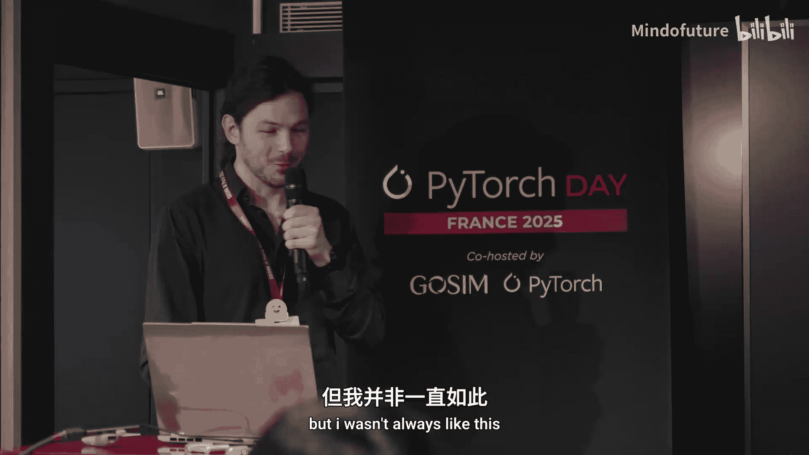
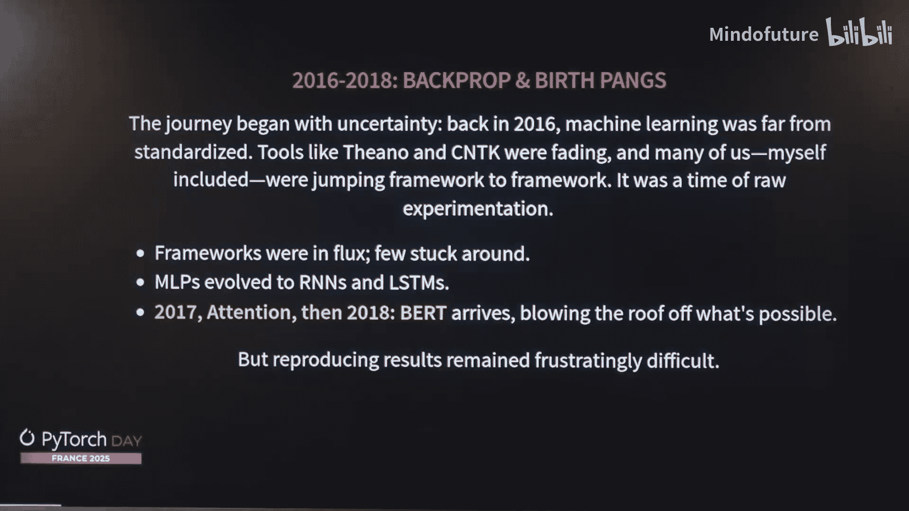
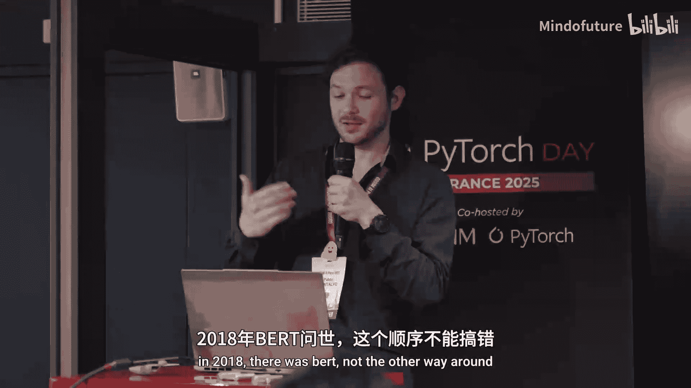
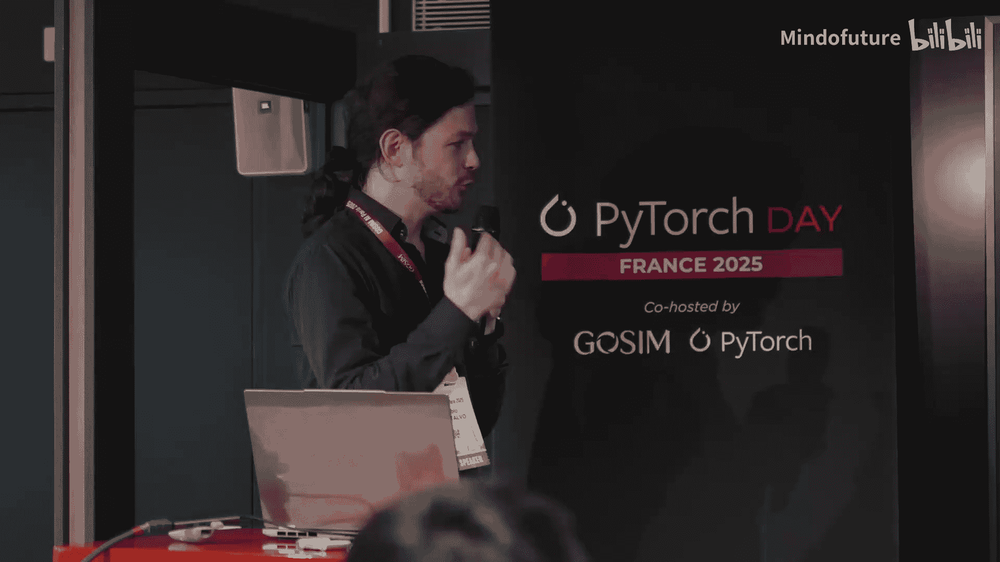
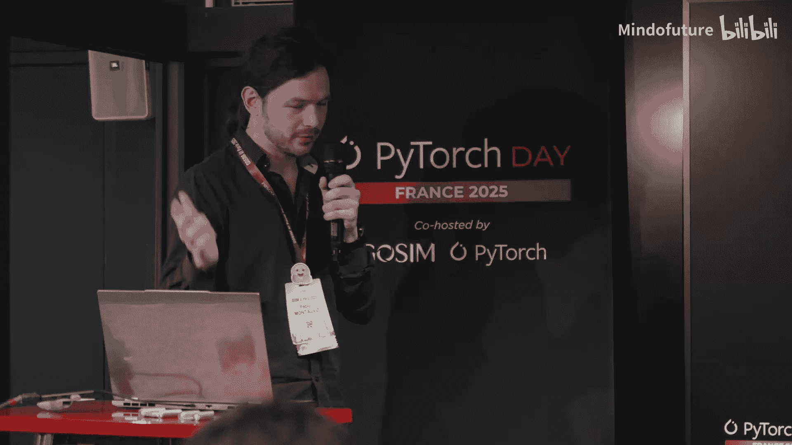
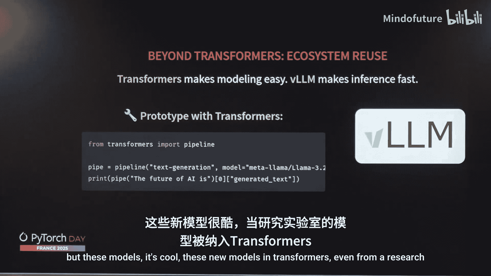
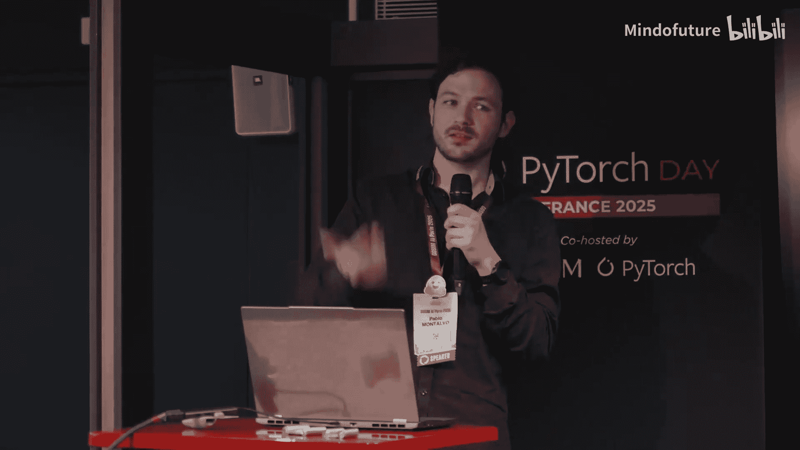

# Pytorch Day France 2025 ｜ vllm ｜ LLAMA ｜ GPU ｜ NVIDIA ｜ GPT ｜ 开源 p15 P15_PyTorch_x_Transformers_Journey-Pablo_Montalvo__Hugging_Face -BV1bQtQz2EFL_p15-

Can everyone hear me well？So last talk of the day， right， I have a super long talk。

Even longer introduction， so out of compassion， I will compress what I can。I'm Pablo。

 I work at taking face in the Trans team and。I'm an another， but I wasn't always like this。

I used to be a physicist， by training and I switched to ML around 201520 C I would like to stop there back in the Prairie story times where there were many frameworks。

Many kinds of ML， many kinds of things that people were calling AI at the time。

AndFras were being born and died， I work with piano， I work on Ca day。

 Cafe too this world might mean something to do if you will have grayer hair and myself。

Many people were driping from a framework and taught reach to a lot。

Here in 2017 it was atgen limit in 2018 it was birds， not the other way around。

And。When birth came out in the industry became something that was a no brainer。

 we need to have these in our stack somewhere because the emending of our products are going to be amazingly well for criminal systems and so on and so forth。

 but that wasn't that easy to remember that worked in the industry back then。

Disability， which was mentioned before was incredibly hard and one of the thing that made a change here was Pyth pretrained B。

 which selfexplanatory name， which is the previous name of the transplant library。

The initial name of transformment was a simple interface。

 it wasing torch was relying on dynamic graphs， not study graphs。

P and this library filled by many amazing people。wa designed with opinionated paradigms and one of them was hackability。

 you need to be able to take apart a model by defining components and make itself your own and redefine it and be able to train it how you want and well。

So let's skip a bit here。On dynamic graphs and the rest。

 but that was the idea you want to have a new paper that comes out because after bird。Like oh。

 so encodeder models were un， but what about encoder decoder model。

 what about just decoder models and now we are here。呃。Other kind of model。

 So we could you could like people you have to recombine a model and then hope that it works。

 and you can just relaunch it add a P somewhere and look at what is the model doing。

 That was insane because before it wasn't like this So the iteration cycle in development teams shortened。

Massively from next two hours I not exagger I not even exaggerating but that is only possible when you have opinionated decisions made on library。

 I love paradigms and transform that is based on many， I'll go over to one all one file。

White matters， you have everything defined in one place， all the components of the mobile。

 the forward pass， how the loading of the parameters is defined。

 you don't have any profile inheritance may， everything is just there。

 the attention of this model is here， the MLP of that model is there and so on。

It means that when you want to integrate in new model。

 the reviewers have reference implementations and they just have to look at what's different there。

And decide if it's meable or not， which makes it， which makes it most faster。

 Your7 point second paradigm of。Critical importance was backwards compatibility。

 if you want results to。Be referciable okay at time t but what about time t plus1， p plus 10。

 can you rerun this model in 10 years， can you rerun this model in 20 years， can you be sure of that？

In order to be at least confident in that， you need to make everything backwards compatible。

 So once you find an APII， you are not allowed to change it ever。喂。Of course。

 that's a really hard decision， but it allows you to just build up and stack models on top of each other。

 right？嗯。So that allowed transformers to grow massively and hold and define。More and more models。

 the scientific community was able to build and contribute to our lab and companies have a great new model we several today。

 they were able to just add it to transformers and then it becomes the definition there。

And it also fed back into P Josh， which we lean on extremely heavily， of course。

 and the evolution set back into both ecosystem， of course there's two issues there because you have strong paradigms and strong opinions on that what should be in the library or not。

 it means that you have a lot of pressures on maintenance because you have suddenly a lot of difficulty。

Lma， because I said everything is in one place， but it means you don't want to cross high inheritance。

 so everything now is superd。And you have less pythonic mod。

 having these constraints harm kind of the pythononicity of what you want to achieve with your library。

And so I'll go over a few things that we achieved recently to upgrade these paradigms to modern times and to。

Be able to sustain the acceleration of mobile development and development。Okay。

So one thing that I'd like to promote is the modular transformers。

 it's an API where you define a modular file which is not Chable。 And this is a real life example。

 the GLM model。When it came out， we looked at it and models are defined not only by the architecture they are defined by their training limits by how they were trained。

 how they are evaluated in and so on， but the architecture is should be。

Region once and for all somewhere。 and it time once for all somewhere。

 And is the scope of that because here is okay G the MLP of this is actually53 mP。

So you can write it like this。 The attention is Lama attention， but theres a slight change。 Okay。

 right is slight change and the general thing GM of focusola lamb mimics Lama for。

So means the forward bus everything should be compound in the same way。

 so then you'll apply view right exactly that。Re man。comes。Thecomp code， which is runable。

 so it becomes the modeling code， which is automatic mean that reviewers can only look at the previous only to look at the previous slide。

 which is defined by the difference of the terms with existing models but redefined what what I do I just redefinine the inheritance actually couldn't be using inheritance because the paradigm that we were using before So now currently this is mostly used to refactor models and define them more clearly。

 but the research community can also use that if they if they have like a great new idea all they are known this kind of genome should be amazing so I want to define a new model will be Lama for what I'm just going to change that then just do that and will automatically make it。

Make it supported iners。And I will go over a a couple other few features recently。

 since everything relies on NN resolution is fine everything relies on Ptoch。

 everything relies on NN dot module， one thing we can do is trace every single activation that goes through a model。

Maybe your question is why would you do such a thing because when you implement a model I mentioned reprofiibility in the beginning of the talk。

 you want to make sure you're not messing around with theon often or the activation function。

 maybe not Ro is Joe and what I do oru or something。Yeah， you know what you know what I'm meeting。

 So when you do that， you can put， this is also a very simple bitator。

 you add the model forward pass。And it will output all the logicits twos and type。

 a very simple text type， which you can put side by side so you have your turn two editions。

 you put the two of them and you just look。And you will find if you jump out in the if where G its bound to differ it's just just a simple tool but having everything that is defined like this with an end modules allows you to do such。

Small， health deggs， and this was really a lifes for me dinner in Glaco Springs。So you know。

 and another thing is detensor was mentioned， distributed tensor recently， and by recently， I mean。

2 years ago and a little bit more than that。So it's distributed tensor。

 it's a way to a Court that allows you to do tensor parallelism。One of the things。

 the thing is when you want to define operations such as col linear predictions here。

 when you want to speed them across ranks， you would have to change the modelgling code before for Col robot for projection。

And instead of doing that now we have something that relies heavily on the tensor where you just include to in your configuration regular expression here that defines what kind of TP plan。

 kind of tensorcle and you want all each layer， so we just write that the modeling encode once again。

 the architecture， the core skeleton of the model does not change。

 what changes is just the configuration type you just do that and it will map automatically and do the initialialization。

 the dispatching everything automatically within transform in the backend， thanks to things you that。

Just just one small chance on Jason， the 100 V。Scpe， for example。

 can be distributed on with 1990 million transformers。So， that's pretty cool。嗯。1， yeah， okay。

 that was also in the Lama false print。Again， reducing a duration cycle。

 now what we need to have is a smart cache allocator when you load a big model。

 we now it minimizes the number of ks。Before I was doing one ago。

 couldn't a lot four every basically。Pie of the model。 And now we pre allocate a lot in what we can。

 So 50 sh 100 be on but none of the test them is very like very much like running locally。

Doing it in one in1 than one minute now。 and before this that if you tried like before April 3。

 we have taken you maybe eight minutes。 So it a pretty improvement。 And if you have fast high system。

 it's it's even longer。在歌子。Yeah， and。Theres。Why it works。

 why adoption rule is also because Python has a low entry value， I know because I'm prohibit Python。

 so it's hard to master， but you can enter it with and understand it。

 It's readable and high levell se express low level。W啊 something。

And you have vital should rely on At and you have rest extension button so you can still think， okay。

 I can't do everything in By and then rely on。Some stuff under the hood that will accelerate everything for me。

thinghing is there's many things that we have to consider Python is still a bit slow。

 as the global law is still thin， might change， but for now we don to know and the code that comes from laboratories is not production code。

 it's research code and just that change the difference of culture between research labs and production labs。

Just can lead to under optimizations that。全気やって。诶 one诶。

Most of these can be largely indicated one initiative we have in transs around transs。

Is Canal community operational so basically the idea is and this is already existing the Canals Library and the Canals community on the hub。

You can because kernels are what made the difference in of making az conversions faster， right？

And the idea is， for example， here， this activation function can get it from kernels slash activation for s something's J activation。

 and just load it， drop it in a decorator in your running code and the modeling still does not change。

 but you leverage optimized kernels and this allows you if you want to build kernels to build them。

 upload them on the hub and make them usable，你就 on from some model。So yeah， just just。Somes died。呃。

Yeah and。All of what I mentioned， it's a bit invisible， but it's。Mostusky dense models， that's where。

There was machine。But of course， there's image， by image， I mean， there's images， but also deals。

 there's audio。Re nice just just before。And the idea is that transformers has the same API always for every modality。

And there's more and more models that come in。Really mind vulnerables with each with specific processing going into uniformate。

 then again， thanks。Tch and Torch visions and Uniolas also because as you see。

 this is processing speed of single image， just a very simple benchmark。

 old and flatly wrong and so useful this is useful for me and now torch vision based hubs and torch bath ups。

Replacing fuel and anti transmission control into mostly because it's faster and faster。

It is much faster I didn't compute the ratio here，With a simple capital。

 you can do it and consider that the rates are better。And this is very voluntary。

 we have now faster mutual because of that。This is a past graph of contributions to transformers per modality。

 Currently theres more than 300 architectures that are supported in transformers。

The total and the text is overlap left， and this is as of April with more than 300。 actually。

 I'm probably missing Singapore couple I did by。horrible beat passing script image models are in red they are growing and growing as we go you can see there was an acceleration here here' is just a deplicationcusion cycle with couple models that were both initially that were not as important for the community they were not downloaded and they have been reduced a but still you can see that these curves not slowing down at there's more models being added every week every release so we have new models and the audio and video mod are slowly but surely timing as well。

There's not action mod。I mentioned what you said there， that's also there。So but these models。

 it's cool okay， these new models in transformomers even from research labs。

Like okay my goal is in transformers， I won， I won the game， no， the game just starts。

 it starts there because once it's in transformers。

 the list can be reused by other members of the ecosystem and very easily。

For example， operate friends at the otherM， they make inference extremely fast。

 they are known for that。 So you can prototype with transforms， for example， here。

 ask to some La Google， what's the future of AI。And do something that is extremely similar with the otherM by just specifying the model implementation transformers。

Because froms is now a backend。Of theM。 So in theory。

 all models that are out in transforms can be basically supported in theM。

But it's not just true for the land， it's also true for SCL and how little of library。So。

I talked about all of these cool features around transformers。Going forward。

 what we're aim for is centralizing the model definitions across all of the ecosystem。The idea there。

 as I mentioned， we have more than 300， I think if we count correctly around 34。

350 definitions of models in transformers。嗯。And all and if you means that if you use transform backhand。

You can use any of these architectures as books， don't have anything more to do。そ呀。

And we grew and we are powered by Josh among all other things。

 but we are very happy that our friends at VietnamM Bank and others rely on us for that and that as soon as the model is supported。

On Thomas， which is usually day 0， maybe we0， sometimes sometimes our0 or minute 0。The styles design。

Buts what we need。As soon as its there it can be reus la in GI in VL and。And so。So that's it。

 I think I'm on time。 but on that slide on that side and most important is the bottom right part that we aim to become these sort of truth formal definitions。

Thank you very much。