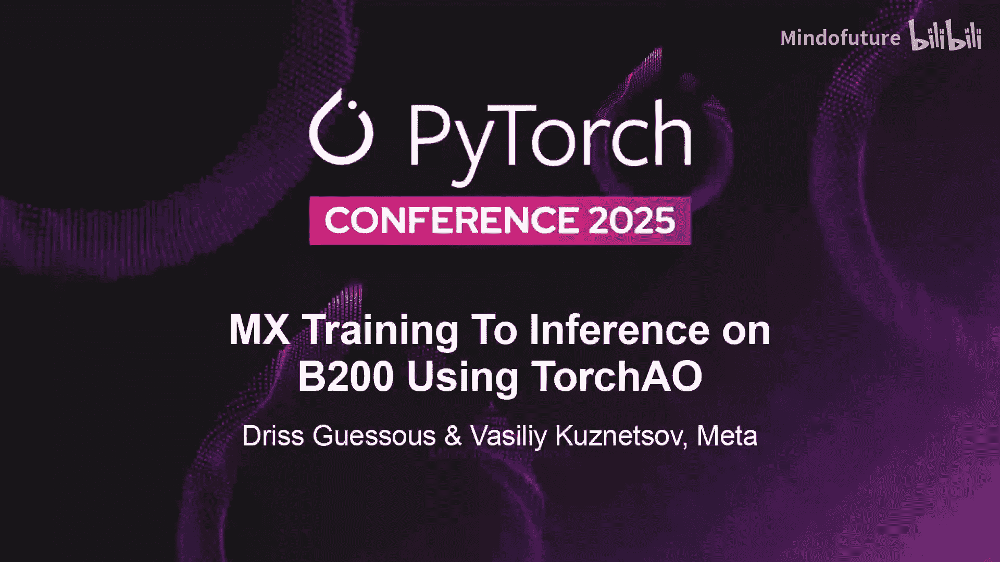
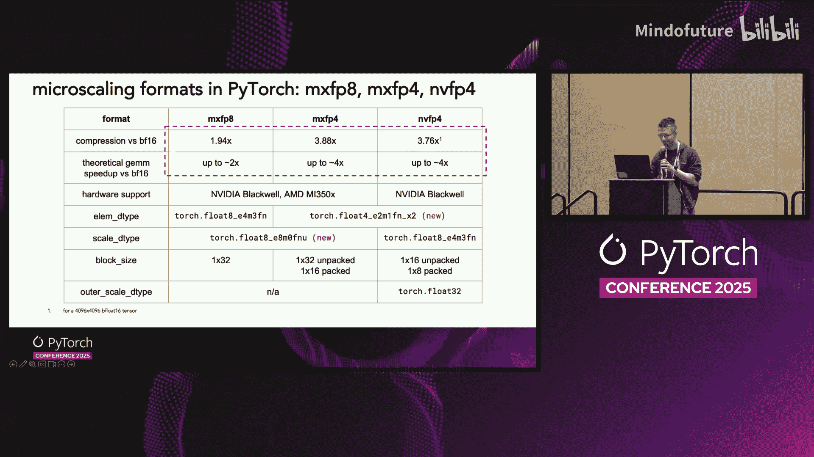
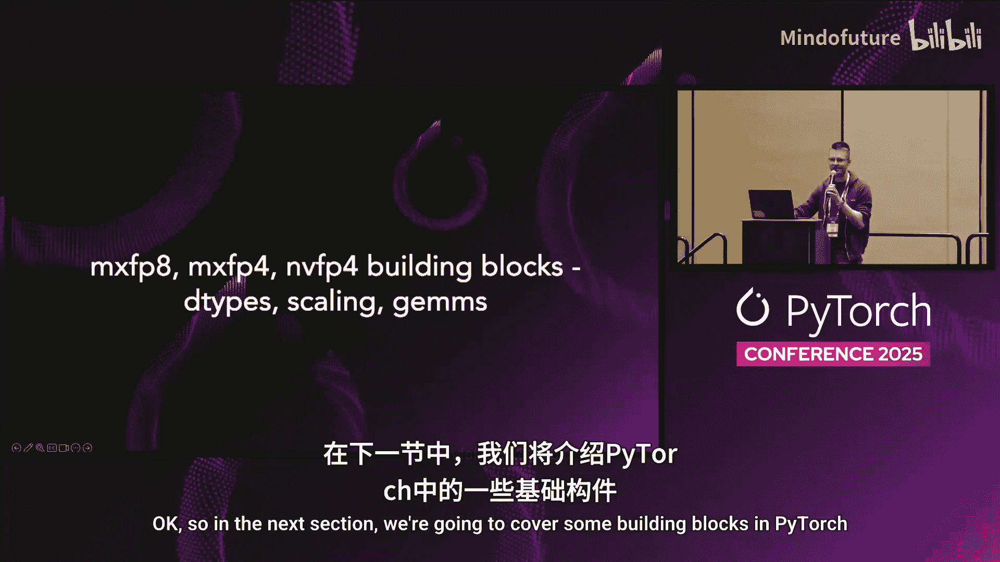
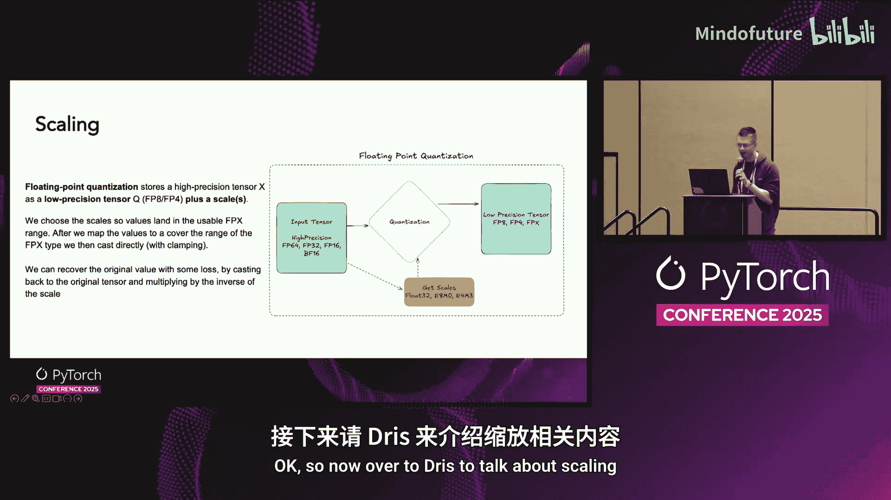
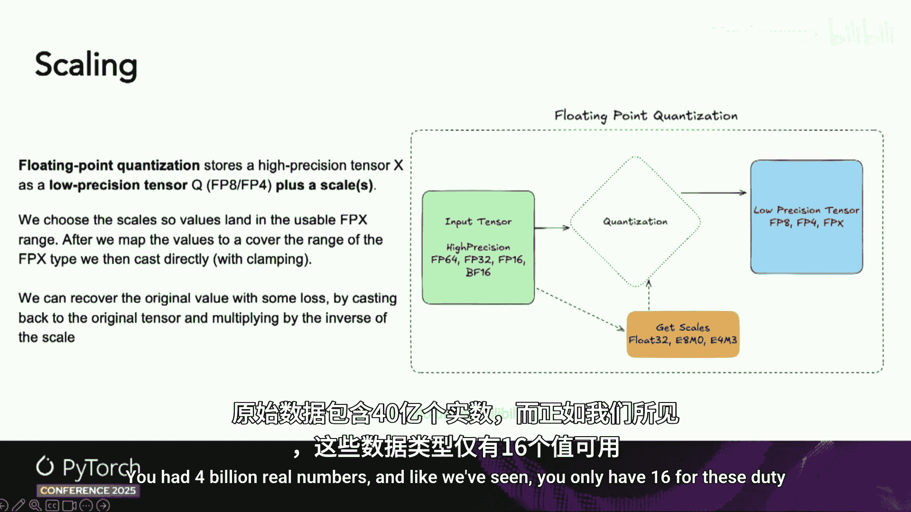
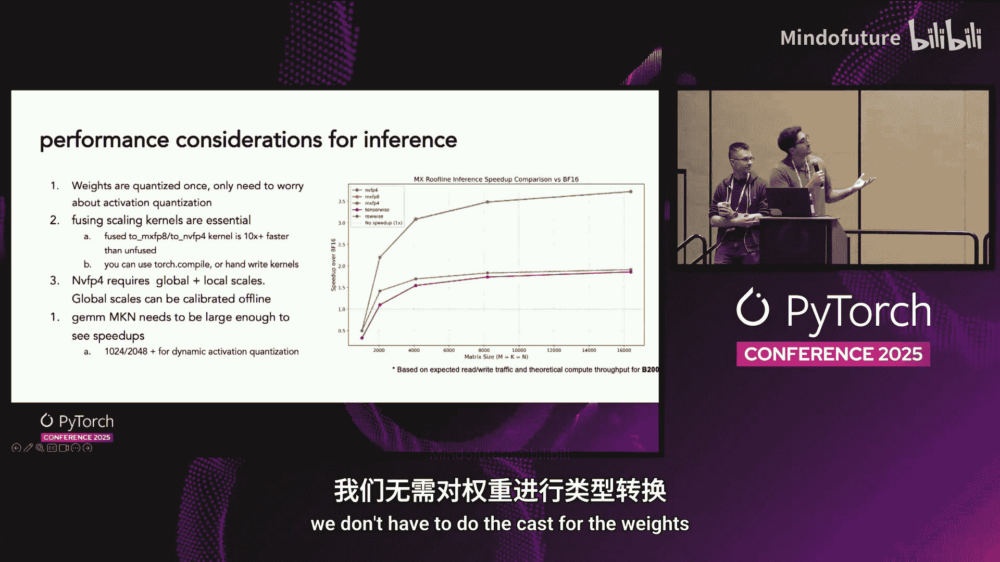
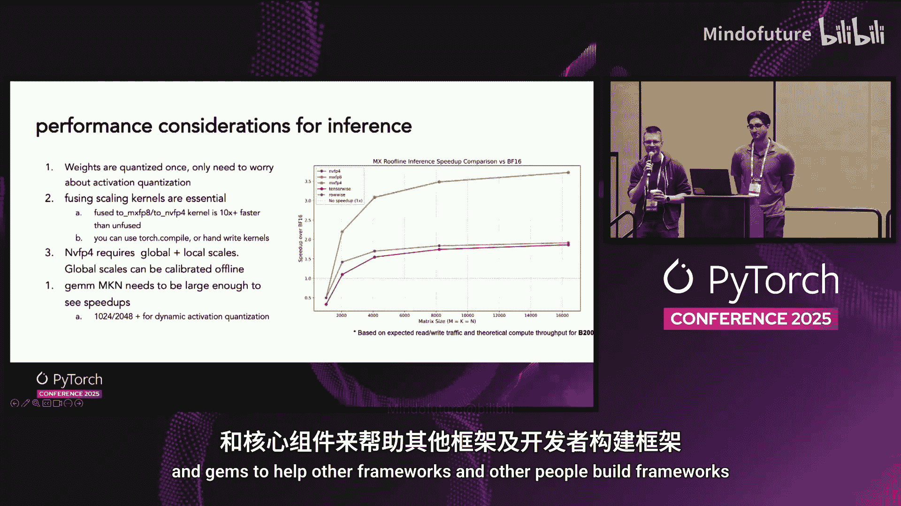
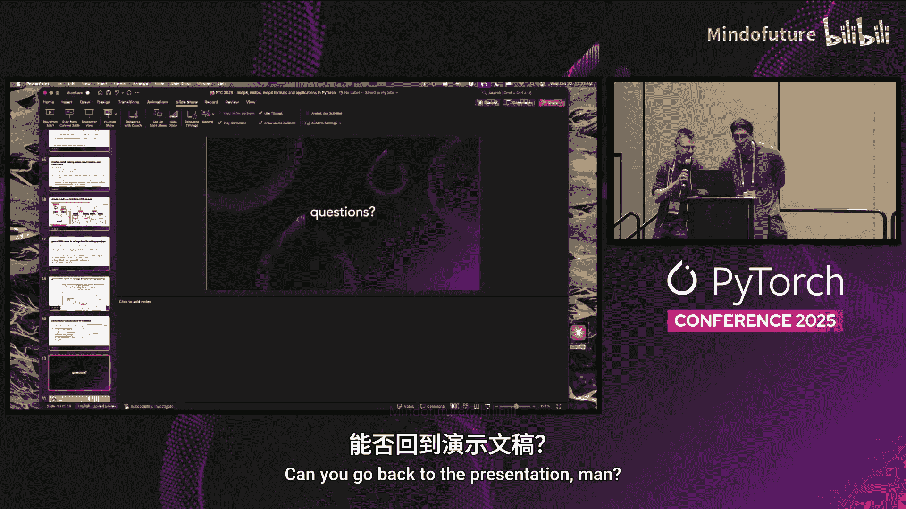

# 2025 Pytorch大会 ｜ Pytorch Conference 2025 p01 P01_mxfp8__mxfp4__nvfp4格式及其在PyTorch中的应用-Vasily_Kuznetsov__Driss_Guessous__Meta -BV1b8kRB6EJG_p1-

Hi everybody。 My name is Vasili from Batorch。😊。

And I'm Jesica Seus， also on Pytorrch。And today we'll talk to you about microscannon formats in Pytorrch。

 MXFP8， MXFP and MV before。😊，And we'll just switch off， kind of speak in there in a talk。

So I'll find though what we'll cover today well cover what these formats are。

 we'll cover some of the building blocks and Pytorrch that you can use to build things with these formats。

😊，And we'll cover some performance kind of tips for training and inference with these formats。

So first， I just have two slides explaining what are these new formats and why you might want to use them。

And the first slide is very high level， on the left you see。A B a B flow 16 kind of jam。

 you have a ten here you want to put it for a gem why you might use this formats if you quantize these on Thursday and X8 you pay some。

😊，Overhead to cast it and you might lose some precision。

 but then you get a tosor at2x smaller and your gem can run up to2X faster and then all the way on the right。

 if you use four bit formats， such as M before I mix it before。

 your tenor is even smaller and your gem is even faster so basically it's a performance versus actually trade off。

And this is a very du table， I apologize， but the table kind of talks through what these formats are specifically and how theyre defined so first MxF V8 you get a compression ratio of almost 2x your gems can be faster off to 2x。

 you're not going to see exactly a 2x but it's a theoretical lap around。😊。

It's supported on the new NVIDA and AM hardware， the element D type is flu8。

 the scale D type is flu8， the8 times0 and we're going to talk about what that means figured out on the slide。

😊，And it's a quantized format to have block size of 1 by 32。Then in the middle we have MXFP4。

 it's basically MXFV8 but F4 instead of FP8， so compression is almost for x。

 gems speed up is up to almost 4 x， same hardware。😊，The elementD type is also new at F4。

 and we'll talk about specifically how that is defined。😊，And the block size is the same as MxF8。

And finally all the way on the right， MVFP4 is another4 bit format we on Ptor now。

 and this one is only supported in very hardware， the LMD type is so4， the scale D type is flu8。

 and the block size is smaller than the V formats， the block size is 16 onpack or8 packed。😊。

And there's also an outer scale， which is a float 32。

Okay， so in the next section， we're going to cover some building blank andtorch that you can use to use these formats。

😊。

And before I dive in， the slide represents like a high level overview of how these building blocks fit into quantizing a den and then doing a jump。

So the second box represents the scaling， so if you want to scale your tensor to x of8。

 you need to use the new scaling format， which Dr is going to talk about a bit further。😊。

Then the third box is you need some new D types to represent the data in the scale of an MXF tenor and we'll talk about the D types and finally you can call a new low precision gem Z by torch to get the performance benefit when you do gems and Dr is going to talk about those。

So first， let me cover the two new details in detail and the first details you have is called Fate8 M0 fN。

 it's a very fun name to pronounce。😊，And what this D type means is this is an on exponent of a F 32 or a B Fl 16。

So on the top of the slide you have your bit representation of the F 32 number。

 if you just take the exponent bits， either take them as or you do some rounding。

 then you'll end up with a float8 the A0 revenue。And the correct explanation of what is the f and U mean F means this is finite encoding。

 and means there is a n， but it's a non steroid band， it differs from the IP 754 spec。

 and U means there's no sign bit so this is an ons sign encoding。😊，And what is this Z type used for。

 this is the scale D type for the microcaling formats， MXFV8 and MXFV4。

 you can do power of2 scaling with the Z type， it's available on byy 2。7 and higher。😊。

And I also call out this as the She D type， so you cannot just call any app on it that supports sorry only very limited number of Us。

 so what you can do is you can create tensorors of the Z type， you can move bytes around。

 you can concatenate things， you can view you can reshape。

 you can cast from higher precision to the Z type。And you can use this as a scale input to the new jumps that we have by Do。

And the second detail I want to cover is called Flo4 E2M1 fan X2， the other very fun name。

And this is basically two flow4 numbers backed into2 byte。

 so imagine starting with two high precision numbers， for example， if you float 16。

 you have some routine to compress them to flow4。😊。

And then you pack two them together and then you get this new D type。Ex on the suffix F is finite。

 so there's no infinity here， n means down ser n， there's actually no n in this encoding。

 and x2 means this is two numbers back into one byte。😊。

And this is important because this is the elementD type for two of the four bit formats we now have MXFP4 and MVF4。

😊，This is available in Pythro 2。8， it's also She type。

 this one is even more shelled than the previous one you can basically create the sensor。😊。

And you can use them as scales for four big jumps。Okay， so's now over to Dr to talk about scaling。

Thank you。Okay， I'm going to give an overview of how to actually use these new floating point formats on the latest hardware with Pitorrch。

So if you were to store a high precision FP32 tensor。

 let's say directly in FP4 you would just simply lose too much information you had 4 billion real numbers and like we've seen you only have 16 for these duty types so one critical technique for preserving accuracy when we're going to these new formats is something called scaling。

The idea is pretty straightforward at a high level we're storing a high precision tensor as a low precision tensor plus some scales。

 and those scales are typically also tensors。And we do this right to minimize the loss of information。

Okay。Before this talk， you might be saying， I know how to do this。 I can just call Tensor do2 F 8。

 and the goal of this graphic is to try and convince you not to do this。On the top。

 we have a normal distribution， it's pretty wide， but it's not uncommon to see tensors with extremetreal values in this range and this magnitude。

And in this case， the extremes are at 800， so if we were to directly cast to FP8。

 we would need to clip the maximum， we would need to clip these values to the maximum representable value。

 that's a tongue twister and F8 which is 448， so everything above this limit will be clipped to 448。

And on the right hand side， we can see some metrics for how much information we're losing in this process。

 The MAE is the mean absolute error across all the values in the tensor。

And we compare to the original， this quantize and de quantantized version。

 we can see pretty high air magnitudes up to 352。And the bottom is using a very basic scaling recipe called per tensor scaling。

And by the numbers we can see this basic recipe already greatly improves the MAE and the max air。

Okay， so these are some of the basic formulas for how we calculate scales。

 The numerator is again the maximum representable value in the D type that you're going to be casting to。

 and the denominator is the runtime calculated AMX in the tensor that will be casted。

 So in the case of FP8 we have 448 and for FP4， this would be6。

And you might be wondering why the extra powers of two， again， this is related to the E8M0 D type。

And this is the base intuition。IfIf the scale is greater than one。

 we're going to stretch the values that fit within the range。

 and if it's less then we're going to compress them。Okay with this knowledge。

 let's look at two popular scaling recipes that have been used on Hopper and MI 300 GPUs on the left we have per tensor scaling and on the right we have per row scaling。

 some diagrammatic conventions first， these little windows and dash windows or tiles they represent the granularity which we're going to be calculating scales over。

 so for per tensor scaling which is the simplest to understand。

 we have one scale factor for the entire tensor for the entire tensor and this window is in this case an M by K window。

And for per row scaling， kind of as the name suggests， instead of using one window per tensor。

We're going to use one window per row and this gives us M different windows and M different scale factors。

 and this ultimately gives us more total scales and empirically this reduces the impact of outliers and this leads to lower reconstruction loss。

And notice in both cases， the scales themselves are stored in FB32。Okay， another very popular recipe。

 this was introduced in deepsek V3， and for their scheme they actually use two different recipes depending on if the tensor is the activation or the weight of the linear or the ME layers。

The reasons for the different recipes per tensor type has to do with the need to transpose the weight during backwards。

 and if your block size is square， this ends up being faster to recompute。

And so for the activation on the left， we use a window of 1 by 128。Or in other words。

 we break up the tensors into rows， and then we break up the columns into tiles of size 128。

And this scheme is getting us closer to the new microscaled formats and the schemes they use。

But again， in this case， the scales are in FB32。Okay， we should be ready to look at MX。So what's new。

 is's a little bit of a rehash of what Va silly said。

 but we're going to adopt the new blockwise scaling recipe like in deepse。

 and instead of using a 1 by 128 tile， we're going to use a 1 by 32。

And instead of scoringing the scales in FP32， we're going to use the new E8 M0 D type that's been introduced in Pytorrch。

And this is like there's one other very important recipe on blackwell， and that's the NVF before。

 which V discussed。Instead of a window size of 1 by 32， we're going to have1 by 16。

And although it may have seen that windows of scaling need to be non overlapping。

 NVFP4 actually does two levels of scaling， there's one global scale， one global scale per tensor。

 and that's an FP32， and then the1 by 16 block scales which are not stored in E8M0 but are actually stored in FP8。

 specifically the E4M3 variant。Okay， I threw the kitchen sink of recipes at you。

 I'm more of a visual learner， so I made some animations that took a very long time to create。

 so I hope you like them。We have the high precision tensor and B float 16。

Let's first take a look at per tensor scaling， we're going to get one AMax tensor for the entire tensor。

For per row， again， we're going to split the rows up individually and in these windows。

 we're going to calculate the AMax values。I couldn't fit 1 by 32 on the slides。

 so I chose a block size of one by two。But again， you iterate along the rows and along the columns。

 calculating scales， calculating aaxes。And once we have our Aaxes。

 we're going to plug this into that calculation that formula I presented earlier。

 and this is going to turn these aaxes into scales。

Let's look back at per tensor what the full flow is， we then broadcast a scale to every element。

 we do the pointwise multiplication， and we can directly cast to our new D types that have been added in Pytorch。

Again， for per row， very similar， the broadcasting is only within a window。 in this case， it's a row。

And we cast。啊。And finally， we' have block scales again。

Each block seal only applies to the respective data。Yes。嗯。Okay， so what about performance？

This is where kernel fusion becomes absolutely critical for the end to end recipes these numbers are gathered on a B200 GPU and we can see that per row and MX scaling can be done in a single kernel while per Tensor needs multiple kernels and unfuseed scaling operations are slow。

Why， because without fusion they require multiple round trip memories， multiple rounds trip。

 multiple rounds， trips to and from global memory， and arithmetic intensity for these kernels or make them strictly memory bound。

 and so this ends up being very wasteful。And again。

 one of the primary benefits of these low precision MX formats is the dramatically increased compute throughput on this newer generation of hardware。

And specifically， right these formats matter most for matrix multiplication because that's where all the flops is。

 We want to make our GPOs gober。We've done this work。 We quantize down to low precision formats。

 We've explored different recipes for minimizing error。

And now we have the ability to do this calculation in a single pass。

 but to actually realize the benefits， we need specialized matrix multiplication operations that can consume these formats。

And this is where Pytorrch's new public scale MMAP comes in。

 it lets you express the quantization recipe for your scales， your data formats。

 the layouts of those scales， and we automatically match it to high performance gem kernels for the specific hardware you're on。

You describe what you want， piey chart handle the routing， and you get the right kernel。

And while it's not shown in the slide， we also have a new public low precision gem kernel gem API。

 and this is very important for the new mixture of expert models that are very popular。Okay。

 so I said throughput is faster for these new types， new D types， but how much faster？

This is my classic caveat that benchmarking is hard and there's a lot of foot guns this was done on a recent version of Pytorch on a B200 GPU。

 the gray bar plots are B float 16 performance， the purple is MXFP8 and the oranges NVFP the clear trend we want to see as arising for larger more compute bound kernels。

 we see the total flops and the speedup over BF 16 approaches their theoretical values of 2x for MXFP8 and 4x for NVFP4。

Okay， cool。 so let's go over some performance considerations for training and inference。OkayOkay。

Okay， so we'll just share some things which are important when you're doing low precision training and you think about performance only only have a few minutes of you only pick two I can talk about this for hours we'll talk about why using careless is important and how much performance I can buy you and we'll talk about kind of what size of gem shapes you should have to expect a speed up when you're training of low precision。

😊，So first I have a table here to demonstrate。😊，That you need to have few kernels if you're trying to scale things MXFV8 and the sta has two rows。

 the first row is an unfusesed kernel to cast your B 16 den to MXFV8 across Team0。

 implemented the native fightershops。😊，AndThe second row represents the performance of that same operation but fused。

 we choose to use touch compile power1 couldide like a triton or a cuto or hypocarnal to do the same thing and you know for these implementations the fused one is 34 times faster so it's a 2x it's not a 4x it's like 10 x or more so you really need to fuse the kernels。

😊，And。And。Also， if you think about your naive kind of low precision training recipe。

 you have your forward and backwards formulas for going for image to multiply。And。

Common jump kernels currently require the first operant to be in row major and the second operant to be in column major or memory layout。

And because of this requirements， you actually need to for。Formats where you're scaling is 1D。

 you need to scale each tensor two times to kind of get all these six low position tensors。So。😊。

In the picture format， you can see there's six to M max F8 kernels here。

 so basically you really need to fuse your kernels。

 either of a compiler such as large compile or by handwriting kind of the fuse kernels relevant to your model to。

😊，Get us speed up over be slot 16。And the second thing I want to talk about is why you need to have large gems to see a benefit from low precision trading。

So I'm going to use MXF the8s in this example， but MXF before andV before are very similar。😊。

So I have a very simplified formula here on the second line of my slide。

 basically if you're trying to do low precision training。

 your baseline is your BL 16 gem time because you don't need to scale anything for BL 16。😊。

You'll see a speed up if the right hand side of this formula is kind of is smaller than the left。

 so on the gem you might get， I don't know， 1。7 1。8x， a little bit less than 2 x。

 and then you pay some overhead to cast your tensors from high precision to low precision。

At large shapes， your jump times are a cubic and then your scaling kernels and memory balance。

 it's quadratic and kind of the larger your shapes are。

 the more the cubic terms dominate and that's where you see the speedups。😊。

So if you plug all of this into kind of a simple roofline model and you plug in the memory bandwidth loop of your hardware and kind of the reported compute or the top computer your hardware。

In this slide， we're using the ones from the NB 20 view。

 you can see that as your size of your jump increases， eventually you'll。

You'll see the point where the benefit from quantitizing a gem is larger than like the overhead you pay for scaling yourtensors。

 so the larger it shapes kind of the more you can get from low precision training。😊，Okay。

 some performance considerations for inference， since weights are static for inference。

 we're going to quantize them once and we typically store them in the checkpoints。

And similar to training， the dynamic scaling for activations should also be fused into kernels。

And this can be done again with either custom kuta， Triton kernels or torch compile。

We've seen that how calculating a global scale can be very expensive compared to local scale。

 so for NVFB or other recipes that require per tensor scaling。

 this can typically be beneficial to be calibrated offline on some data that's representative what you'll see during inference。

And again， for gem shapes， they need to be significantly large in order to see the performance benefits。

 and this is again a simple roof line model， except when now we don't have to do the cast for the weights。

Okay。😊，Any questions？不是。The we get。they don't have like these special positions to how do leverage the to discuss like you them。

of the use。

Okay。U。Yeah I think the question was the as far as you know the Tensor cores don't have support for these formats so how do we utilize them so on B200 and newer the Tensor cores do have support there's a block scaling recipes blocks actually block scaling PTX instructions specifically for these formats so they have specifics for MXF4 MXFP8 and NVFP4 the accumulator is always an FP32 but you can utilize the Tensor cores for these instructions and these D types。

嗯。Yeah。My phrase like Council R are。Have you guys prepared on their open source libraries out there。

AndWhere do you guys see yourself thanks， got it？Yeah， so for this talk。

We want to talk more about like the low level building blocks of how Ptorch can give。

D types and gems to help other frameworks and other people build frameworks。

We do have Torchio， which I guess I'll go to。Oops， can you go back to presentation month？

So we do have a Torcho Gi herbository， which has workflows for pre training， QT， BTQ and inference。

 however。😊，What Torio is trying to do is trying to provide like a native Pythic experience。

 which is very composable with all the other Pytor ecosystem libraries。

 and it works on different depth of hardware。And different frameworks out there might optimize for different things。

Okay。One question。We have that。Oh。Toqua it supports our all this new and export。

We have the integration。我。Like the model by size。I was like。

 could you review the question I heard maybe 80% of that， I'm so sorry。哦。

So I think we have a Torch compile bookend which called OpenWner Bookend。

 and it supports the compression with such types you'll describe MXP4 MXV8 natively。

 would it be working from out of the box if I just take a model like compress it for like Kda bookend or Nvi Bookend and just compile it to was OpenWner。

 or what should we do to enable that？And sorry to clarify。

 you said your backend already to supports all these these types。Then it should work。So I'd say。

For MXFP8， it really should work out of the box for MXFP4 we're still working on making Thorrch Compile fast。

滚定。啊，Get up your slides。Oh yes， if you go to the conference website and you go to the page for this talk。

 there is a PDF file with all these slides。😊，Can you show that the animation is？That's really。

Thank you that's that is the hardest part to post， but I can I can figure out a way to get there。

 Yeah， that's a great idea。I think we have time for one more。How。我。Okay。To。now that recent。

I think your question was， does the speed up for different block scales when you say different block the actual size of the scale？

Yeah， for the new MX epi formats the actual like the minimum window size is defined by the hardware。

 so it is like constrained to 32， you can go bigger by like broadcasting the scale along a bigger tile。

Not necessarily。 Yeah， I think it depends on your kernel and if you're able to still do it in one pass。

 I think that's the main。Quin。Okay， cool， we're getting flagged off。 Thank you， everybody。

