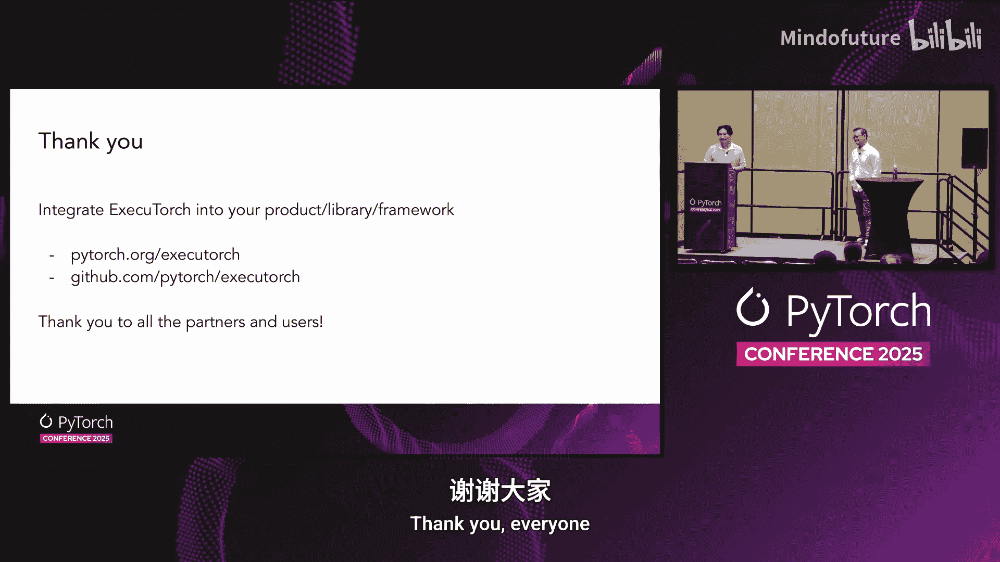

# 2025 Pytorch大会 ｜ Pytorch Conference 2025 p02 P02_ExecuTorch_1.0-移动与嵌入式平台通用可用性状态概述...-_Mergen_Nachin__Cemal_Bilgin -BV1b8kRB6EJG_p2-

Hello， everyone， very excited to be here with all of you。 My name is Billin。

 I'm the engineering manager for Pythtorrch on device。😊，And I have Megen with me。

 whos the tech lead on。Pytororch on the ViML and today we've got some exciting news for everyone and we'll be covering the Ex Torch 1。

0 release， this is our general availability release that we've been building together with you folks over the past few years。

😊，And。Executtorrch is is Pytorrchches on device， AI solution。

 We have been building executivetorrch to enhance privacy。

By making your data stay within your device， for example， you can do translations for WhatsApp。

 it improves the latency by making sure that the data is not requiring to do that round trip to the servers。

Improves the cost， saves the cost by running these M L workloads at the edge。

Rather than those expensive GPs。It gives you remote access without requiring。Networking and。

A few other reasons for doing on the YM L is you know， especially on the L M side， on Gen AI。

The models are getting smaller and they're getting smarter。

 was what a larger model used to be able to do a couple of years ago are now available with much smaller models on the edge。

嗯。The those are some of the benefits of one device M。

 But there are some fundamental challenges as well that we had to。They have to solve for。

Batter life and power is one of these。 these tiny devices。 It's very easy to drain the battery。

 These edge devices also have a lot of memory constraints， memory bandwidth。 thermal constraints。

 It's very easy for your glasses to heat up when you're running these workloads on on the edge。

And the hardware heterogeneity， right， we have multiple different chip sets。And。

The need to optimize for each of these platforms is is a big challenge。And。

To solve for those challenges， we ground up built executive toch。And with the Excuttorrch。

 we're able to stay within the same PyTch echo ecosystem from authoring all the way to deployment。

 you start with your PyTtororch program and with Torch exportport。

 we were able to do full graph capture and with progressive lowering were able to get that Pytororch model into the E devices。

And without requiring any conversions or rewriting。We're able to solve for this problem。

A couple of examples on showcasing， some of the simplicity， some code snippets， out of time。

 it's as simple as know， iniating your model and exporting the model。

It's for athletic sports and then later stages you can send your program program to Edge when this particular case we are using。

The X andMpack partitioner to utilize the CPU excccelerators that we have。

 and finally you're writing your program into the flat cover。On the runtime side。

With the given model model file with it。Four lines with four lines。

 you're able to up your model file and you know create an example tensor and simple module forward。

 you're able to get your inference we're giving some examples on the C++ side。

 We have the same simple APIs on the S side for I。 and we also have the similar simplicity on the Android side with Kotlin as well。

Some design principles， and I'd like to emphasize， hopefully most of these are not news。

 We wanted to make sure that Execor is portable， right， supporting a wide variety of age platforms。

From powerful mobile chipets to embedded systems。And performance。

 we wanted to make sure that the run time is lightweight and with strong partnerships with the hardware partners。

 we've optimized the performance as well。Productivity， staying within the Pytororch tool chain。

 making sure that you are able to go all the way from authoring to deployment without necessarily needing these sometimes awkward conversions and debugging experiences。

These were some of the design principles， obviously。

 we wanted to do this an open source with the community。

 that was the driving factor for us to you know， release executivecut Torch two years ago over the MVP wanted to build it together with you folks。

And modularity， we're providing well defined workflows for ptorch programs from capture to transformations and execution with out of box components。

嗯。In terms of that timeline and just giving a little bit more history， started with MVP。

 as suppose mostly to gather feedback and again， build executive Toch this stack together with all of you。

Shortly after that， we've added Laama support and they are alpha release。 This is when you know。

 VLM support and executives George started picking up。And we improved our SDK quite a bit。

 There were a lot of delegate enhancements。And last year， during this conference。

 we provided some strong performance numbers on L LMs。And we gave some early adoption stories。

And we also provided some API stability。And today， finally， after all of that hard work。

 we are going to be going through some of our ecosystem integrations。

 We're going to talk a little bit about adoption。 We have strong adoption。

 We're going to talk we've improved the backend coverage and reliability。😊。

And we'll give some of some of those examples。嗯。Without further ado， again， as of today。

 we are generally available。 And with multiple success stories。

 I'll start with some of the internal adoption。Executorch is integrated into all of meta apps。

 is integrated into Facebook， Whatsapp， Instagram and Messenger is powering multiple different use cases。

 serving billions of inferences for billions of users。

 It's required a ton of reliability and hardening work。And。It not only powers the famo appss。

 it also powers our RL headsets and smart glasses， there are multiple use cases that we are running。

All under the Ocus headset and Ray badden smart glasses。嗯。For external success stories。

 we've partnered with Li AI， Private mind， Nimble Edge。

And multiple models are getting served by these external partners。

 there are a number of ecosystem integrations with software mentioned。

They integrated Extorch and are have built N executivetorch serving multiple users of theirs。

 partnered with hugging face to。Increase the model coverage through optimum。And。嗯。

Torcheo for interopoperability on the quantization side， onlaught AI。

 Us and Media Flair for on theice training and Digica for a number of use cases that they're supporting。

And these ecosystem integrations and adoptions is only increasing。I know we expect a lot more。嗯。

Another area since that we have improved since the beta release is the back end coverage。

We have XMpack with Ar plyD AI for CPU acceleration， Apple， CormL。

 for Apple Silicon and quauallcomm AI for the Quallcomm， hexagon MPU。

 arm MeosU for NPUs and Vulcan GPU， these are all production ready。I'm serving。

Multiple use cases for meta。嗯。There are a number of other backends that we have added over the past six months to a year。

 ArmyGF， N XP for Neutron MPUs， Samsung， E for EnoOS and MPUs， Open Vino from Intel has been added。

And。Cadence， DSP， Mediatech， NPU， Apple， MP will continue to harden these delegates and make sure that they are serving Win of users as well。

嗯。A few more features before I give it to Mergen that we have developed for the general availability。

 I mentioned one of the key areas where we worked hard for this release was reliability and hardening serving billions of users and multiple use cases for different variety of hardwares。

No easy task。 We Ex torches now at meta scale， able to scale and provide that reliability。

We've got strong coverage and performance guarantees。

 thanks to the Qualcomm team over here on the Qualcomm engine backend， especially on LLNs。

 some of those numbers are going to be available on our website with the arm on the arm side。

 ClyD SM SMM2 enabled。And you know， multiple use cases run efficiently on low power arm ets U。And。

We've also added Windows support。And improved the UX for build and the Swift PM and maven builds。

We've added program data separation。 and for example， you can run Laura。

 which was a long requested feature from us。Torgeo interoperability。

 this one is also quite important for us because we are now able to run multiple quantization algorithms like HTQ。

And we also added an experimental feature for doing jascript and browser support via Wm and。Yeah。

 there are multiple other features that we've added。 But without further ado。

 I'm actually going to pass it to the Megen so that he can go through some of the demos。

Thank you Billgan hey my name is Mergen so as Billgan said Execut Torch is a general purpose runtime and whatever you can write in PyTtorrch Pytorrch。

 it can be lowered through export with minimal work and these are some of the example models we have in the LLMs。

 the computer vision models， the speech models and and so on and so forth。😊。

So let's just maybe take an example of a multimodality。

 If you think of multimodal the architecture is relatively standardized now。

 there's the audio encoder or vision encoder。 there is a projection layer and maybe a decoder layer and we are basically trying to standardize it along with the hackingfin transformformers library and be able to export it to executive torch in a very compatible way。

 So you can use online script to run it for instance。

 Voxstr iss an audio modality audio inputs modality。

 and you can export to executive torch and on top of that you can just use that in your runtime directly using the three types of API Java C plus+ and Swift in iOS。

😊，We have a few demos。 let's just pick this one。So this is running Gema 3，4 p parameter。

 This is a vision and。Viion and text input model and you what it's doing is that it is taking a image as an input as as well as a text as an input。

 and then it is running on X impact on R CPU with Clyde enabled on this one so you know this is a memory bound memory bandwidth bound。

 So as a result of the pre field。By fundamentally， it is slow。 But you know， when you。All right。Okay。

There we goSo once it actually is able to pre the tokens be is is roughly8 to 9 tokens per second。

Right， there will be a few these kind of demos throughout the。Throughout the。So this is a vuxtro。

 So describing audio。 I don't have the audio folder this。

 Ill I'll upload it into the slides later today。 But you are trying to basically speak to the to the phone。

 And then it's describing a the。Decribing the， the interaction between two people here。

So this is a come conversation between two men， possibly friends。Talking about tattoos。Yeah。

All right， oops。嗯。Laura， this is a common request we've heard from people。

 So the idea is that you basically create a foundational model。

 let's say you use Lama as a foundation model， and then you have two data sets。

 you fine tune it let's say in this example， one for Nobel Prize winners from 2025 Lama was not like this is after Lama launched。

 So it doesn't Lama doesn't have the information and another data set for executiveor tutorials。

 And in this case， we are showing you can load two Laura adapters together simultaneously without incurring extra memory or binary size load on the code。

 so。Oh， no。So what。So yeah， so here， so this is the adapter specifically for that thetrain for fine tuned for executive tutorials。

Alright。Alright， so these are some of the demos we have， you know。

 you can go to our website and look at more of the success stories and demos。

 And I want to talk a little bit about， you know what we are thinking for 1。

1 and beyond in the future。 and know we work so hard until now。

 But you know we still want to actually do more things in the future。 The first one is， you know。

 we have 12 backends as of today and and four of them are production ready。

 So we would like to actually work on continue working on the8 remaining backends to be production ready。

And on top of that， you know， ecosystem。 So we executor， we think of it as a low level library。

 And I do think a natural step is in there where the middle layers or higher level program higher level like middleware layers。

 you know， that' more more， for instance， modeling libraries or SDK can be integrated executor directly there。

So maybe in the robotics space， in the IoT space and mobile space，The next one is desktop， laptop。

You know， we've been talking about， you know， the edge edge edge。

 one thing that's the big elephant in the room is like， right right， can you run on gaming pieces。

 Can you run gaming pieces with Kuda backend and a lot of people are doing this kind of local type of inference on gaming pieces。

You we've seen with like inspired by Lama， CPP and M L X。

 these are great runtimes that we've learned a lot from it。😊。

So executive tos traditionally don't have Qup。 But until now， we have。And so let me just show maybe。

Dancing in the masquerade， idle troop and plain sight ja。

 pop poorl cliff shot who at in today or not。 But such a time has little singles a。So this is a poem。

We are basically running this poem in me。Running this poem coniv in the windows on R TX 580 with no C plus completely no Python。

 an Inency or lip torch dependency。And then the prompt you are asking is like。

 how is the speaker feeling right now， It's specifically chosen because， you know。

 compared to whisper， for instance， know， you can't do that through whisper it doesn't convey emotions。

 But with this demo， we are able to retrieve bit about the emotions of of the of the audio。All right。

 so we have three minutes， so let me。So these also demos will be available in the portal。

 So Jama 3 is available as well。 We also enabled。Whisper， whisper directly here。So what is that。

Just this morning， we enabled it。嗯。When the is the apostle middle classes。

 we are glad to welcome his gospel。 So this is a transcript。 So let's see whether it is able to。

Transcribe on on the。On the consumer laptop。Yeah the Mr。 Cultter is apostle of the middle class。

 so yeah， it is able to transcribe very quickly。So we have numbers so far。

 This is by no means a final number。 This is we've been， you know， if you， for instance， look at it。

 it's the 50 tokens if it's quantized to 90 tokens， it'll cost to 100 tokens for whisper。

10 to70 tokens。But I do think this is a。Very early， but very promising direction。

 So the idea is that， you know， this is a model agnostic。

 So instead of focusing on all yellow lenss or only vision。

 you can actually do anything model agnostic like whispers available reson available right So we have demos on these。

And stay in the Pytorrch ecosystem， no Python runtime is required。

 so you can actually run in this native C+ plus environment。

 no lip torch so you can save on binary size。Yeah， one thing that you know。

 Pytorrch already has the ka backend available。 So we do not want to reinvent the wheels。

 So we are using the compiler technologies directly and actually interoperate with executive torch。

And the validate Windows and Windows， WSL and Linux so far。Yeah， still early。

 but very promising direction， and we were so excited about this direction to be going into this the new market of AIPCs。

Also， we're currently experimenting on a similar approach on MacBook too。

 So leveraging metal GPU by using A O TI。 So this is another example where voxer example of running。

呃。Voxstr， but use the kernels from the Pyth core and use it directly from the N metal backend and compile its compiles and be able to inference。

So this audioon that captures identity chain。Anyway， we have another numbers for this still early。

 just enabled yesterday。 Thank you， Manuel。呃。All right， so I just want to step back。

 you know we talked about Execut Torch 1。0 really this is mobile and embedded。

 is really the bread and butter of we are gonna to continue working on mobile and mobile and embedded systems。

 And I just want to say first of all， thank you to all the partners and I see so many familiar faces in this room。

 and Im glad that because of the collaboration we are able to successfully announce Executor GA。

 and also want to thank the teammates Pytorrch E for working really hard to come to this place。

 Thank you everyone。😊。

