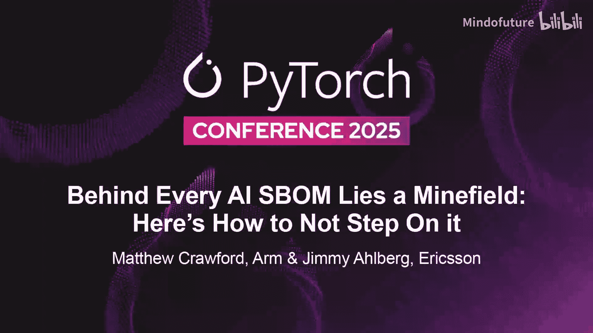
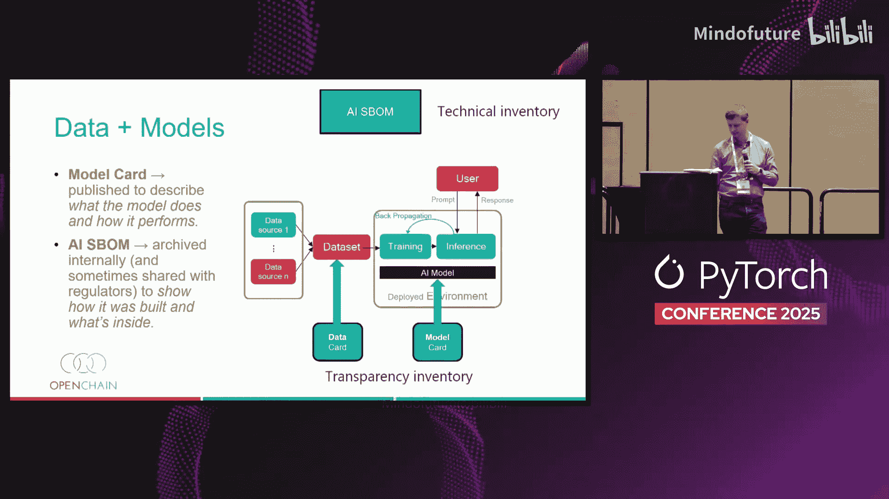
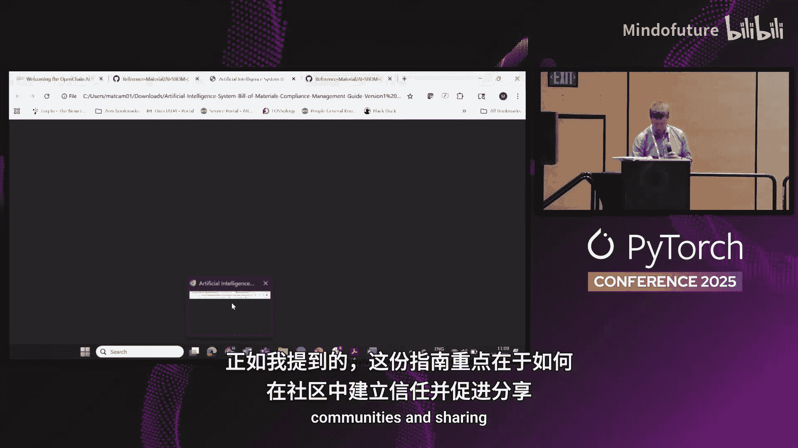
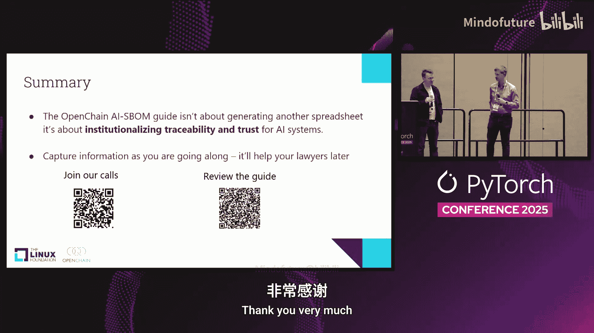

# 2025 Pytorch大会 ｜ Pytorch Conference 2025 p03 P03_每个AI物料清单背后的雷区——如何规避风险-Matthew_Crawford__Jimmy_Ahlberg -BV1b8kRB6EJG_p3-

Good morning everyone。 Thank you very much for coming to our talk today。

 We're going to talk a bit about open chain and building trust in the ecosystem。

Before I start though， I've kind of got a rhetorical question。

 how do you build trust in either somebody that you know or an organization that you work with Ill give you an example I was working sort of a few months ago and we had a new contractor on board a new company we were going work with I had nothing to do with like signing up that person or the company I didn't deal with the contracts but I sit in the open source office at the company and I sent them a message saying I need some documentation on what you're giving me。

 It's called a system Bill of materials and within sort of half an hour they were able to produce that system Bill of materials for me in the right format and it was just what I wanted and immediately I had trust in that organization。

And I think it's really important that。We have trust in the ecosystem and this system Bill of Mater。

 I guess it started， you know，10，15 years ago and Kate and others have be talking after me about the sort of the creation of these system Bill of materials that ultimately resulted in building trust in the organization。

Now opencha has been part of this journey， we've kind of worked with the SBDX community and others to try and build trust in the ecosystem by looking at the process so that document I referred to someone will have had to create it。

 someone will have had to review it there have been a process to train people so they know what they're doing and all those parts of the process ultimately result in that final documentation and that's the part that open chainin is involved in in that process to build trust。

And that's the vision of open chain it's to build trust in the supply chain and the things that open chain do。

 creating standards， working with the community， creating reference material。

 and it's all about that trust so you can sort of share best practices and we're all aligned because ultimately it results in sort of cheaper faster。

 more efficient processes and the whole industry can be more efficient。

 it can be quite difficult to quantify in a short term。

 but when we look at the longer picture that is when the ROI comes back to the community。

So open chain itself theres。25 board members， there are many。

 many contributors and in the last sort of decade there have been two ISO standards that have been created the first one is the ISO standard for open source license compliance5230 and this was again in 2016 a group of people in the industry there was a problem with license compliance they wanted to get together try and build up trust in the ecosystem and a guide was produced then the guide became a specification and then it was accredited by ISO in 2023 the open source the open chain community created a security assurance ISO standard following the same lines Now these are very high level process standards they kind of don't tell you exactly what to do but they're saying you should have a process for X Y and Z theyre usually very simple they're suitable for all companies all sizes and the community。

He's also provided a lot of sort of help and guidance towards creating them。

Now these standards were created sort of the start of this decade。

 but legislatureators have come by and they've noted a few things， so in the first one。

 it's requiring SBOs in your process and the Cyber resilience Act in Europe and theres executive orders in the US they're requiring these software Bill of materials or system bill of materials and I guess it shows that the work that that open chain community has done amongst others has sort of laid that foundation。

For， for legislators to look at and review。So the open chain community it spans across a whole range of different verticals and there are thousands of contributors and you won't be able to read at the bottom but PWC did a survey of people or companies that had done the ISO 52-30 compliance standard and found that 20% of all companies in Germany or medium and large companies had signed up to this standard。

 so thousands and thousands of companies have worked with us on that community project who developed good trusted processes in our ecosystem。

So the open chain， we have a number of different groups， there are regional groups。

 there are industry specific groups and there are sort of community work groups and I'm going to be here today to talk to you about the AI work group if you're interested in any of these you can scan that QR code but actually just coming back to my first point about trust I don't know if you've come across the wordquiing which is an AI cyber resilience cyber threat of AI systems producing QR codes that go to malicious sites so I hope you trust me that that is a reasonable QR code of which I can assure you that it is that was just an side that that's certainly a new threat coming to the industry。

So the AI working group， you can scan that QR code we meet a couple of times a month and in 202023 we started this group we got together again industry experts in compliance of AI and we tried to write down what good compliance would look like in the community and over the last 18 months we have gone from。

Sor of discussions to writing this open chain AI S bomb guide。

 of which I'm going to discuss that now with you。Just build this one up。

So as you know a lot of people will be aware in this room if you're sort of more technical。

 there's lots of information going into these AI models。

 there are different data sources going into data sets and you can be capturing that in a data card then the actual model itself it has training information inference information and we can produce a model card。

 this is all around the transparency of what is the model in the system and it highlights you know what the model does and how it performs。

But an AI S bomb， something slightly different。 This is more around a technical inventory。

 and it deals with sort of how the the model was built and what's inside it。

 And I think by sharing this information， we're going to build more trust in in the community and we're already starting to see some regulators sort of thinking about requiring AI S bombs in when sort distributing it into certain communities。

So here is the guide and I'm very pleased to announce that we launched this guide yesterday。

 if you want to take a scan of that QR code， I'm going to go through the guides just to highlight some of the points。

 I've also got some paper copies here if anyone's interested afterwards。

 but this guide as I mentioned， just highlights how we can build trust in communities and sharing。

There go and yeah sharing best practices if you're developing AI models。

 So this guide here its split into three sections， the first two are kind of about the guide and definitions and I will skim past it。

But， here we go。The section three is the main one here。

 and it talks about having an AI policy in your company。

 having competent people in your organization so they know what they're doing and they have the right skills。

 whether they're in governance or they're technical or they deal with privacy or other areas that are required。

 people should be aware of the requirements in their role， what they need to be doing。

A company should define， you know， if we have an AI model， what the scope of that model is。

 and we should be documenting that。There is license obligations this comes back to the kind of the traditional work that Openchain had done。

 you know the data sets that I mentioned on the previous slide they're all going to be under certain licenses。

 many open source licenses or proprietary licenses。

 but it's having a process to review those licenses so we can build trust again that if you're shipping a model that you have reviewed those licenses。

 and they should be in accordance with what you believe is acceptable and right。

And there are transparency obligations and transparency in AI models could be classed as sort of slightly controversial topic。

 but this guide here is more talking about your reviewing what is required to disclose rather than actually highlighting what you should disclose。

People should have necessary access and project should be necessarily resourced， but then 3。

9 talks about the actual AI SB itself。 the guide here says that we should be having an AI SBO it can be in any sort of format although SPDX is a format and Kate and others will be talking about that shortly and so this guide is more saying you need to have processes to create them。

 but ultimately you also need to create the guide and that's where Kate will talk about the details inside an AI system bill of materials and remember that's the information about the model how it's performing and helping people understand what's inside your model and the final section is you should have people involved in sort of governance of that model and sort of looking around at legislation that's coming out to say okay the EU AI Act now requires you to do XY。

An executive order here in the US also requires additional information。So that is the guide。

 It is sort of six pages of detail。 it doesn't go into that much detail。

 It's quite a light touch process， but again we're hoping that if organizations can start using this and adopt this。

 then as we move through this AI revolution， we can build trust because we are creating these AI system Bill of materials in a process that is appropriate。

Go back to my slides。Okay， and as I just mentioned。

 and Kate and others will go into a lot more detail shortly。

 this QR code goes to a white paper that the SPDX community created and goes into detail about sort of what things should be required inside an AI SBOM。

And you know， the SPPDX group， they have an AI profile and you acknowledge that AI systems combine both software。

 data and models， and the risk really does go beyond the license compliance that we're more used to in open source software。

 We now need to include things like data provenance， privacy and how the model behavior。

And as I said， know traditional SBOs missed these details。 So the SPPDX 3。

0 adds the AI and data set profiles which capture this information。And AIS bombs。

 you know they can vary really widelyly and there are key fields that we think we should be capturing。

 things like the model type， training information， energy use explainability。

 and you can read them on the screen that keep going bias size， update mechanisms and risk。

 there are a whole host of different fields that we should be capturing。

And as we progress over the next sort of few years。

 we'll start to see these more AI these AI bombs develop and get used to what is kind of mandatory or what is accepted in best practice。

 but ultimately， the open chain guide is all about you should be creating them and having a process behind them。

And we are seeing that regulators are increasingly requiring AIS bombs for both disclosure and audit readiness。

Like I said， Kate will go into more detail about the actual detail of AI。Epon， shortly。

So just in summary， the opencha AIS bomb guide， which I sort of walked you through briefly before。

 it's all about building trust in AI systems， it's not just another spreadsheet。

 it's not just more things to fill in however you for the developers out there I really want to try and get the point across that you know capturing this information now on your model what it was trained with what the licenses of the datas were is going to be so so helpful and ultimately is going to help the lawyers later when we're going to have to disclose this information so my sort of call to action for you guys are if you're interested in this community in the compliance of AI systems join our calls we meet a couple of times a months in different jurisdictions and also review the guide if you've got any comments。

 come along to our calls or ultimately start adopting these guides because ultimately we need to build trust in our AI systems。

That's the end of my talk now I'm going to invite Jimmy up here to talk Jimmy's our chair of Open Chain and I will just ask Jimmy to give a bit more of an update on Open Chain and then we'll open it up to questions。

Yes。So thanks， by the way， this is probably the biggest stage in room I've ever spoken。

 so cool to be up here and about Openchane， I think it's got a very important mission and it's done incredibly well in building trust and harmonizing how we do open source license compliance and that's been incredibly helpful in reducing transaction friction in various supply chains and getting that down to sort of a low level that enables us and everyone else to focus on what really matters。

 developing great products。I think by if we can replicate that with this AI guide。

 then I think we will have achieved a lot because that means that instead of spending time with the customer or you know your supplier about。

 you know，What was's your process， can we trust that we can create the replicability in that So what this calls for means that we can now say okay are you are you complying with this AI guide okay if you are great can I see your artifacts。

 your policy your processes， what roles you have and I can invalid and I can validate that okay the information I'm being given here in terms of the bomb is like the accurate and I think that's so incredibly helpful in reducing friction speeding up transactions and allowing everyone to execute that speed。

I think that's about what I wanted to say， but we can open up for questions if there are any。

Have a gentleman over there。I think there's a room hang， there's room in mind， I think。你爱。是。Sorry。

 you're going to get the mic and then youre can to repeat the question。Hello。

 there was mention of AI regulators requiring AIS bombs。

 do you have any examples of which regulators might start requiring that？So for example。

 under the EU Cy resiliency Act。The model itself， it regulated on the AI Act。

 but if you put it in a product that's subject to the EU Cyber resiliency Act。

 you will need to account for that as part of your software and you would need to provide a software built material for that as well。

Nothing in the US at this point。好。Kate's got a point。FD， oh， yeah for medical devices， that're right。

 FDA for medical devices is what Kate said， got it， thank you。Any further questions or comments？

So I just wanted to understand if you're talking about a company that's mostly just private and generating our own data and then training our own models and using it on our own edge locations。

 so the primary value of something like this would be the compliance aspect of it。

 not really to work with other companies used to like。How， how important do you think that is like。

 do you think that's like a major focus of like the open chain project or is it like a side effect。

 maybe I don't I wouldn't worry too much about the the partner aspect。 I mean。

 I don't know how small logic， you know， your company is even if you're doing something internally。

 you know， moving it to another team or talking to another team。

This guide can go right down to you know almost individual conversations。

 You have a process to communicate several bits of information。 Yes， it can be you know。

 huge large companies talking to other huge large companies。

 but this guide is really designed to be agnostic to that size and if you read it and review it if you have that in the back of your mind is if I'm going to talk to another team in your group。

 then you're following following the principles of that guide and that should build trust between the two different teams rather than the two different organizations。

 which is what I was trying to get across and to add to that I think it's in the same way as open chain license compliance 5230 ISO standard。

Was very successful as sort of shaping a guide when a lot of companies said， okay。

 we need to start working more structured with open source。 What processes do we need to have。

 What what sort of bits and pieces do we need， So that served sort of as a blueprint for them putting things together。

 even if most of the work they did was sort of internal。

 It was still a very useful guide of what was best practice in industry。 And I think。

Speaking from my own experience， it's a great struggle to try to define。

What processes should we have in place to deal with AI， What sort of policies do we need。

 What sort of。Different staffing roles that we need and having something like this。

 even though it's very high level it still sort of gives you a certain level of comfort that okay we have these things at least sort of we' we're following a blueprint right and it's sort of something that seems to make sense so from that perspective I would say like if you're sort of。

Foring your AI function in the company or your AI office。

 this is sort of a useful blueprint for them to understand and also to bring internally say hey。

 look this is sort of what seems to be developing as the industry sort of best practice way of doing these things then all the implementation choices that are here like what your policy should be what your roles look like。

 I mean those are best up left up to sort of the company to selfde side that well in our scenario we're going to call this role guardian or we're going to call this role champion I mean that's up to you。

 that doesn't really matter。 important part is that the role is there。

 there's adequate education and sort of resources allocated that role that the policy exist what the policy is I mean that's up to you to determine。

But the fact they should have one， at least。That's very helpful know could I also ask quickly when it comes to like software build of materials。

 it's very deterministic。 you always know exactly what pieces of software are being used in your system。

 but when it comes to like AI there's like very different kinds of datas and maybe they're sensitive and maybe internally you can include more information externally there's less information you want to share is that something you've incorporated into your thinking and it's certainly in our thinking I know Kate will talk about this in the whole of the next presentation and she's nodding at me there but I think one point I would get across is try and document it all now and if regulators or your company decides to share later。

 it's gonna to be so much easier than having to oh all of a sudden we need to find these four fields because a regulator is coming in and finding it we need to go and find the people who did it and so on and so forth。

We all know it's a very fast moving industry， those people might not be there anymore。

 you know they have a laptop crashed， that information is gone or it's all in your head and they're now working for a competitor。

Being early on with documenting these things is really helpful。

 how much you need to share or how much you want to share。

 That's something you can make up your mind on later on with making sure that you have to date that to share if you need to。

 Miss key。Take the last question。Ggoory， Nokia， I have a question with regard to quote of low。 So if。

 if you're a lawsuit， how much isbo is actually helping you to prove that you had。

ThatM running based on that data set eventually reinforced Learn with the information provided。

 Is this something you have been through yet。From one aspect。

 depending if I get this from a supplier and。I get the S bomb and I review that and if sort of by looking at okay。

 they are following this guideline， at least I can point to the fact that I've done my due diligence on that material and some of this will probably always be a bit opaque in the sense that I can't really verify it objectively。

 I will have to say take what they're telling me with a certain amount of trust。啊。

So then having you know quality standards to fall back on and say well like I did my due diligence I check their process like I can't verify this data but I can verify that their process should generate good data right then at least I've done my due diligence yeah yeah exactly but do you have like do you have use cases where you know these asBum as being used in the quota blue and any do you have any feedback from that？

Nope， all right， no thank you。Thank you everyone。 We're at time now。

 I'll leave these guides up here if anyone wants to take a copy later， but thank you very much。

Thanks。