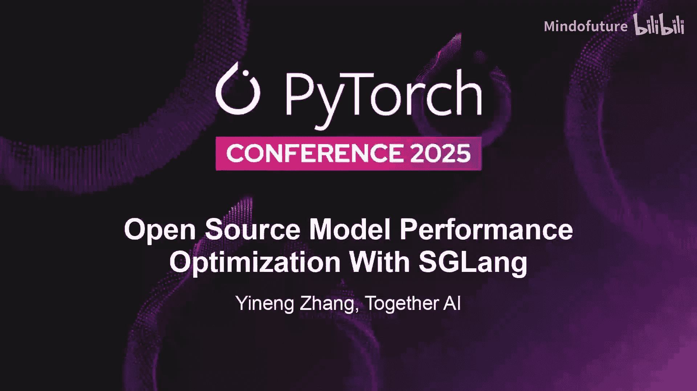
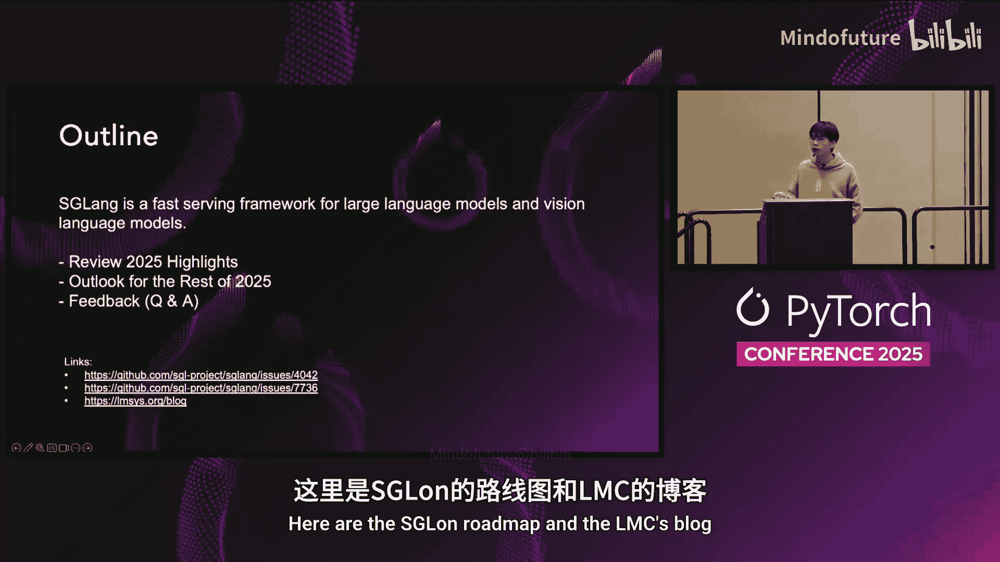
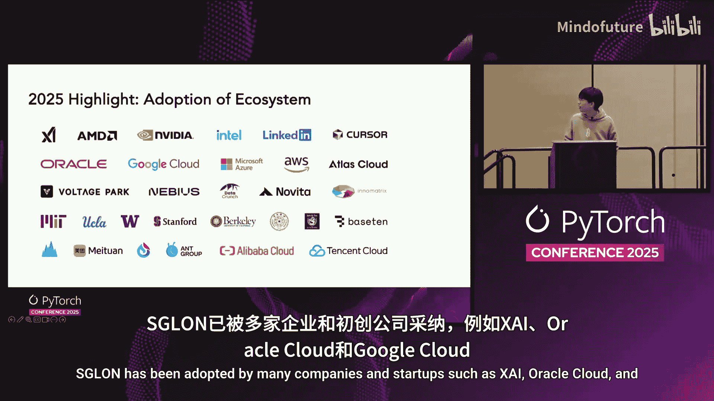
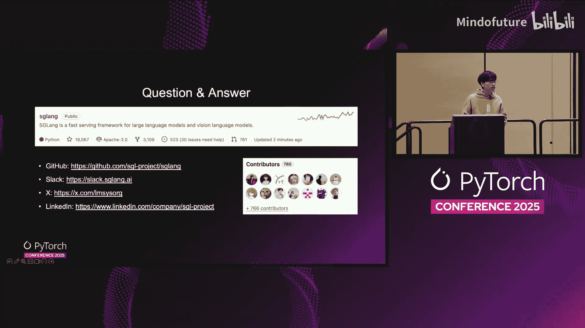
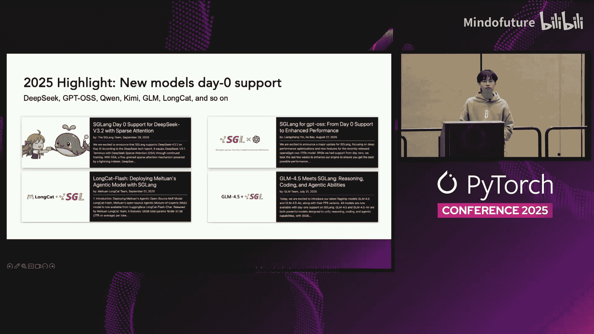
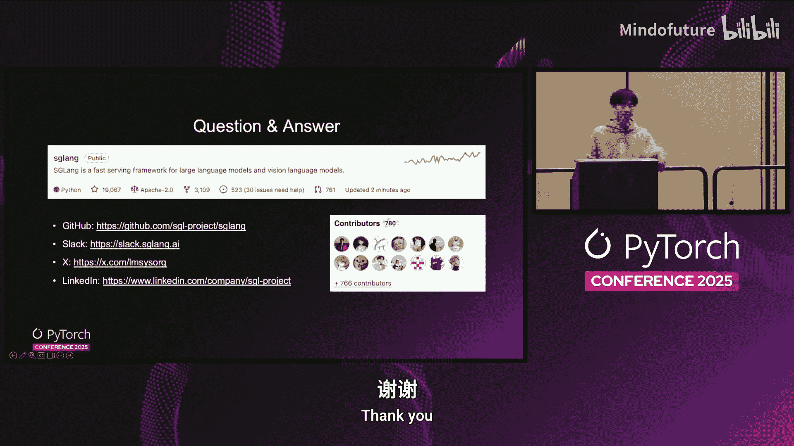

# 2025 Pytorch大会 ｜ Pytorch Conference 2025 p04 P04_使用SGLang优化开源模型性能-Yineng_Zhang__Together_AI -BV1b8kRB6EJG_p4-

Hello， ifang， I'm Yinanzhang。 I'm the astro call Monana。

And I'm very happy here to give a talk about open source model performance optimization with with S July。

😊，This presentation reflects my own personal view as a member of community and opinions on my own。

 If you are interested with open source， feel free to reach out to me with my Github X and LinkIn。

This is today's outline。 S G line is a fast sufferinging framework for large language model and feature language model。

 Today， we will work through the。😊，2025 highlights outlook for the rest of 2025。 And at last。

 we will have some time for Q And A。 Here are the asron roadmap and LM Cs blog。

Let's take a look。 This is 2025 highlights。 It includes deep fee 3 optimization。

 large scale deployment。Reinforcement learning integration， speculative decoding training， high cash。

 deterministic inference。New models stay0 support， model deployment orchestration and the adoption of ecosystem。

This is the first part。 deeps 3 optimization。This year。

 we have implemented so many optimizations for deep fee 3 to make deep deep3 run faster。

 We have implement the following optimizations。 It includes the flash attention 3 integration。

 dynamic M L A to M H A switching， deep gym integration， kernel fusion。

 and D P attention after this optimization。 We can reach nearly two times boost in throughput。😊。

The second part is about large scale deployment。At 2025 May。

 we have implement PD D desegregation and large scale E P after these optimizations。At that time。

 we can reach nearly 52 K input T S per node and 22 K output T S per node。

It's been five cheaper than the dipsick API price。 And this result has been reproduced by more than 10 teams。

Here are the blog。And the third part is about。Reinforcement learning。

The slime team has used S G long for an air rollout。

 and slime is a framework built on top of Macron L M and S Glon。

 It has been used to power large scale training for G L M 4。5 and G M 4。6。

Etrona also works well with other I framework， such as Ferrow and a。A few months ago。

 I launched another project named Spkfordge。 You know， Eagle 3 is very popular in I M influence。And。

 but it's hard to use because you need to change the Eagle3 of the model by yourself。

 But there is not exist easier to use framework to change the Eagle3 model。

 So we launch this project。And it has native support for advanced architectures。

 something like Queen 3 and GPT O S S。 It supports scalable distributed training and memory efficient training。

 We just collaborate with the official Eagle team。 It has been used to train GPT O S S and queen 3 and has been widely used by the community。

😊，Another milestone this year is about the high cash。 We can reach up to six times throughout put。

 and 84。Lower T T，F T with high cash。We just implement this with a structure named high cache and GPU assist I O structure。

To get the efficient cross caching， we support the smart prefech and right policy to hide transfer latency and boost the catch hit rate。

We have already supported Mke and Thr F S。 This system has been used by Nofita AI and Group and Alibaba Cloud。

😊，Here， we focus on the deterministic inference a few days ago。

 maybe thinking machine just released a blog。 Yeah， talking about the。Deterministic inference。

 and S now also supports fully deterministic inference。 We leverage the batch in。Knel library。

 open source by thinking machine labs。And it's more than two times faster with kgraph。

On the training side， we can collarate with the s team， and we can。😊。

Rach 100% reproducible ill training on Queen 3，8 B。S Ju is very popular。

 open source influence engine and it fully open source。

 So when the frontier labs want to open source their big models。

 they will reach out to us and give us some support for the Z support。 So this year。

 we have supported deep6 fee 3， G BT O S S， Queen， Kimmi， G L M， longca， and so on。

 thanks for the community efforts。😊，Another important part is about the model orchestration。

O M E is a project open source by the Oracle O E team。 Its open under a project。

And this is a Kubernetes operator for the enterprise grade deployment and surfing of the large language models。

😊，One use case is that we collaborate with the key team。 We can use O M E and S。

 We can just launch a 182，80。😊，28 GPU cluster for deploying Kimi K2。 means just one click。

 It's very easy to use。S G long has been adopted by many companies and startups such as X A I。

 Oracle Cloud and Google Cloud。

That's what we have done。So far and here are the outlook for the 2025。

 we are recently re the spectrum decoding memory pool and multi platformat abstraction。 For example。

 we want to support Nvidia， M D， Intel， N U and TPU。😊，We will continue to optimize sleep 63。

 GBBT O S， S queen。And we want to reach the sort of performance and reliability。

Another big thing is the astro router。Right now， it its new name is S J model gateway。

 I think is the next generation for S J router for easier deployment。😊。

And many improvements are on the way。E Glon has reached the。19 k stars。

 please give our project a star and welcome to join our slack。 Fo us on X and Li in。

 Thank you very much on the nearly 800 developers in the community。

 as well as the users who give us provide who provide feedback to us。😊，And also。

 thank you for the audience to attended this talk。 Feel free to ask any questions。😊。

Do you have any questions。Oh， please。Yeah， it's a interesting question。 I think currently yeah。

 in the open source space， there are three engines， Ten R T M， S G long and C O M。😊，On Nvi GPU。

 I think 100 M has the best performance。😊，And etro line is。

Pformant and easy to use compared with F M。 Actually， we are the competitor with each other。

 We have all the advanced features。😊，So I， I， I think。If the enterprise want to adopt。In engine。

 they will compare。The performance， the usability， the stability。 So， yeah。

 we just compete with each other。😊，Oh， please。Just following on that。

From a first principle perspective， you compare the。And does you problem。

What is it S V language is focusing on。In terms of objective。Oimizing for versus SRD and PLM。Yeah。

 this is a good question。I think。S G line becomes so popular because the deeps fee3 model at last year December。

 deeps just open source the deepsig fee3。 and it's a big model。 at that time。

 I think S G line is the only one engine or framework to support deeps fee3 well， because last year。

 maybe at August or September， we have already optimized the M L A And yeah。

 we have done a lot of optimizations for that model。 So when deeps fee3 comes out。😊。

I think the users has no other options。 That's why it's become very popular。 And this year。

 we also optimize other models， something like queen and GT O S S。😊，So， yeah。

 I think we have a good relationship with the frontier labs when they want to open source the new model。

 we can give the day 0 support。😊，It's， it's hard for other engine。

 something like maybe Ten R to get that， because， for example， deep P 3，22。

 they only collaborate with astronaut and F M， yeah。Please。

I was just wondering if the whole thing in my life is。P the cost down。And I you at。

Combinations of chips。Processors and downstream， should I be。And we get new for you。嗰啲。

Some mother up and coming。If that's。嚟诶知咧。Oum my。Some脚 said。It just me。A lot of benefit from the cost。

Yeah， this is a good question。 I think currently S has the first support for the Nphiia GPU。

 MD GPPU and TPU。 Also， we have other hardware support， for example， inter CPU。The astro team。

 I think， focus on Nvidia， M D and TP U。 and for other hardware。The funder。

 maybe they will have some team to support us， yeah。Yeah， so I， I think for your use case。

 I will recommend NVdia and M D and TP U。😊，Yeah。Please。You talked about。

library for。啊，呀呀呀呃。This one， right。O。実生。ていたけて。data sets that like。Let's say theoretically。

 if you want to train Eagle3 for GPT S 120B， what's the size of the training dataset you need to find your in model like that Yeah。

 it depends Does it matter by a model like do you need slightly different data for like different let's say deepse model？

Or would you recommend using same data set across all models。Yeah， it's a good question。

 I think it depends。 Actually， when the LM Cs community train the Eagle 3 model for GT S S。

 we only use， I think one T data from hugging face。 It's the open source data。

 We not use the private data。 I think only one T。 And I remember Nphiia。

 they also train the Eagle 3 model， maybe for Lama 4， I remember they use nearly 5050 T data set。

 So it depends。 Yeah， so I think， yeah， if you want to use spec forge to train the popular models Eagle3 draft model。

 maybe you can just try to use one T data。 it should make sense。

 I think it doesn't matter with the model itself。😊，see1 T sounds like a lot。 Is it like。

Oneanting maybe is not allowed， right。Yeah， okay。Yeah， on， on the kind of deepse optimizations， like。

this one。 Yeah， I'm wondering， is there any， any more optimization left to do。

 Is there like anything left on the table and like。

If you think like what are those optimizations in the roadmap， exactly？Yeah， this is a good question。

 I think I haven't covered in these slides about the B200 optimizations because， you know。

 maybe after May this year， B 200 becomes more and more popular。

 and it also support the F P4 quantization。 So in the latest amount of S G long。

 we also support F P 4 optimizations， and we recommend to use F P 4。😊。

We recommend to use FP for M O E， FP for quantnotation。

 and it can reach nearly 300 T S for basis size 1。Is there a degradation in the quality when use F4。

It depends。 actually， if you just use something some accuracy data set。

 something like GSM I K and M M U， it totally fine。 Yeah， it will not affect the accuracy。Please。啊，呀。

So for the RL。呃，sme没什么。So that like。No， she didn says something about。

Using just like frameworks within the Ral training cycle。 So how does that work like。Do you have。

 let's say， APIs to like L chain， for example， and then。You have this like multi。

 you have all the traces or something like， how is it different from just like a collab notebook with like。

Unsthed JRPO， for example。嗯。Yeah， it's a good question。But I think for， for， for this framework。

 I can explain the reason behind that why the slam team created this framework。 Because， you know。

 before this framework， there are so many open source engine for the I O training for， for example。

 open I O HF Fer。But they are hard to use。 You know。

 for the frontier labs when they training with the Nvidia GPU， most of them use Mac AM M， right。

 They will not use FDP and。For so， and sometimes they not， They don't use the open source lecture。

 They have so many modifications。 They have their own internal fork。

So how to bridge the internal for connector with the open source influence engine。

That's the pinpoint。 That's why they created this framework。

And it has been used to power large scale training。 You know， G I M 4。5 and 4。

6 is a very popular large language model。 And I， I think this has already been used in production。

 So that's why we can try this。😊，Yeah， framework。 Thank you。O， please。他的回系的。Youage of。

So one dependencies，0 Mq and C MQ。From Indonesia Glan yeah， yeah， yeah。 yeah。 Yeah Q run。

 So I just wonder if there's any roadmap or any pain points of using it or its just or where。嗯。

Or have you look to other technologies for the messaging。Besides certain ZQ。

I think in the near future， we will continue to use this。 Yeah， yeah。

 we have no plan to replay this with other library。 Yeah， okay， thank you， okay。哦， please。Excuse me。

呃，林什么。Yeah， exactly。 I think when you enable the deterministic inference， it hurt the performance。😊。

And we compared this without chgraph。That's the baseline。 Yeah。

 we have a support for the deterministic inference。 And the first version， we don't support kgraph。

 That's the baseline。 And after that， we make it compatible with the kgraph。 Then we can get 2。

8 times faster， yeah。😊，这个。Yeah， I， I think， for example， for the attention kernel and gym kernel。

 if you don't need to care about， determines inference。You can use more advanced optimization。

 something like stream K， but。For this determining inference， you need to turn off that。

 and it will hurt the phones a lot。Okay。啊， please。1 click O and B。Oh， this one O， O。

 What the size of each P workers and how you adjust the ratios dynamically。Yeah。

 this is a good question。 Actually， we collaborate this withkimi team and O M E team because at that time。

 Kimmi just open source， and it's very popular。 And for through put use case。

 we just want to use PDD dis and large scale E P， but it's very hard to use。

 You need to set up multiple nodes， multiple workers。😊，And how we designed this。

 I think its very easy because for Kmi K2 model， you have the configuration。 You know the weights。

 You know how many。M O E layers， how many experts then you can decide with that。For example。

 you can use one expert per GPU， and you can decide out how many node used for per。

 how many node used for decoding and which par should we use。For different node。 Yeah。

 but to more understanding， the P ratio can depends on your traffic。 Yeah， yeah， exactly。

 The P D ratio， Yeah， is decided by the traffic。 And we also support the dynamic P D ratio for example。

 maybe right now or the PD ratio is4 and compared maybe 3 and in 50 minutes of the traffic just changed。

 the traffic pattern just changed。 and the PD ratio can be 5，3。

That's totally fine because our design in the P D distribution supports the dynamic connection。😊。

So every request will pick a new PDD pair Pre node and decoding node。

 And if the pre node is over overloading， we will increase the pre node。

 And if the decoing node is over， we do the same thing。Okay， one quick follow up。

 So yes the students still using the moon cake transfer engine Where we are。 Yeah。

 we support so many transfer engines。 For example， we support moon cake。 We also support Nixon。

 Nixon is open source by Nvidia， and we also support another transfer engine developed by M D。 So I。

 I think for us， we just provide the abstraction and other founders or teams can just integrate different back hands for their use case and needs。

😊，I see， thank you， okay。呃，Please好是。How is the support of new architecture such as gated Deltanet and Mamba blocks in isl as compared to VLM。

 Because we are seeing a lot of new architectures coming up and。

Like as compared to all the transformer models。 Yeah， good a question。I think maybe a few months ago。

 queen just released a queen 3 next。 It's a hybrid architecture。 It also used linear attention。

 and we have already supported that。 So after that， maybe I remember the T T I or O O T I I， sorry。

 just give us the support about the member architecture。 So in the latest of astroron。

 we have already supported that。😊，Okay。Oh， please。言我れた番さ。Btfield， Kel。Yeah， actually。

 I it not ready Yeah， to use。O。I， I think currently flash At4 only supports the preview。

 It not supports decoding。 And we have already integrated that。So you can use hybrid attention。

 hybrid attention。 You can use F A 4 for prefu and other attention back for decoding。

 And you can get the benefits from the F A4 optimization yeah。

O。Please。So， let's assume。I'm building an AI application for an enterprise vertical。

So what levers you would recommend in terms of model architectures。

 the target hardware and the use case where you will recommend me use to use SVL versus VLLM？

It's very complicated， I think， because for different use case， you will choose different models。

 For example， something like code agent， you want to use deep 63 like model。

 And for some agent task may be Daagon。 Maybe I think Queen 3，8 B is enough。 So it depends。

And when you use different model on different hardware with different workload。

 the engines performance also， yeah， different。 So you need to maybe just do some simple benchmark。

 compareare different engines and to see which one is most suitable for your use case， yeah。

Thank you。哦， please。Sorry， can you speak again， I。啊他分。不有SP。Yeah， I think so。 We should do that。被告20。

喂。Oh， sorry， we， I have reached the time we can discuss offline。 Thank you。

Thanks， everyone。