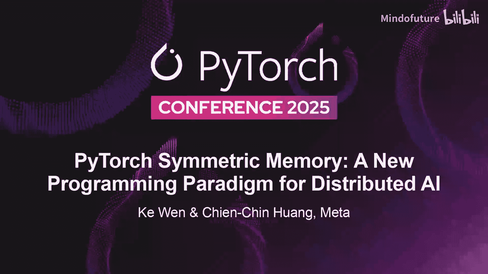
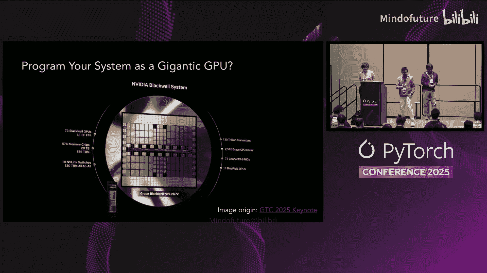
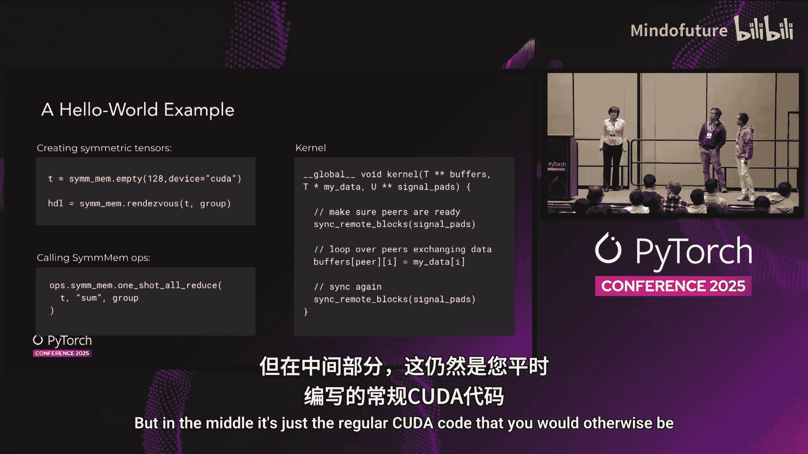
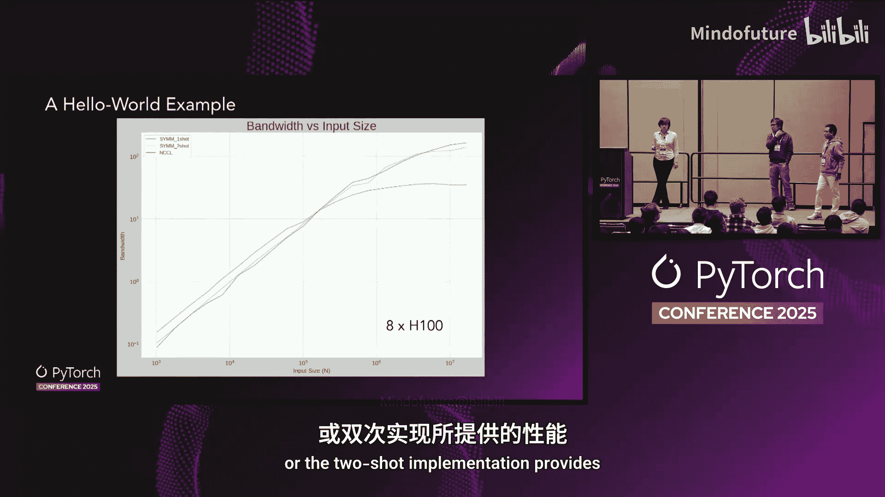
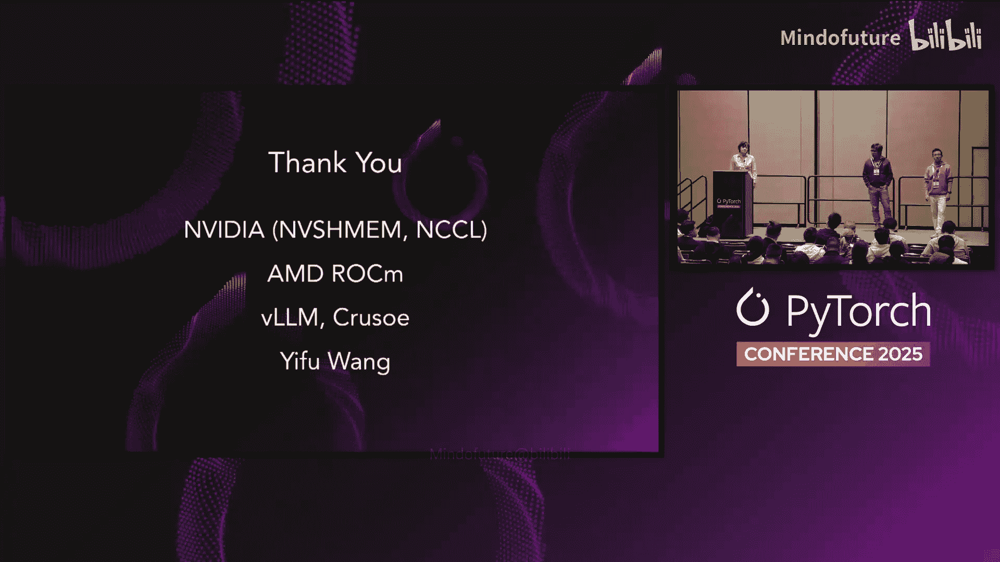

# 2025 Pytorch大会 ｜ Pytorch Conference 2025 p05 P05_PyTorch对称内存——分布式AI的新编程范式-Ke_Wen__Chien-Chin_Huang -BV1b8kRB6EJG_p5-

Hello everyone， welcome to our talk。

I'm Kwa， I'm super happy to be here with my colleague Chin Chin and Natalia to present you Tito Su memory。

 a new way of doing distributed programming。😊，We have plenty of time。

 so let's start with a couple polls。Do you think it's possible to program your system as a single gigantic GPU？

Can you raise your hand if you believe that's possible？

Can you raise your hair if you think that's not possible？Okay。Second， poll。

This is how we write our distributed program today。Everything on the whole side。

 we call some touch ups， and then we call the I T do R reduce to do the complication。

Do you believe one day we can move all this code into a device kernel and let it run inside a single device kernel and let it do a complication。

 Again， can you raise your hand if we believe that's possible。😊，O， we have more people now。

 Can you raise your hand if you think that's not possible。Great， so。

If you have the same imagination as we do， I hope you will find the next 25 minutes worth your time because we're going to bring you a one star shop for authoring your own multi GPU kernel。

😊，So what is symmetry memory in Pytoch？We can go back to the two basic communication mechanisms between processes。

One way is called message passing。It is similar to packing all the information into a box。

Take the box to a post office and ask the post office to ship it out for you。

And because of the round trip to the post office， youll want to pack as much information as possible into the box。

And hence， this limits your flexibility of communication。

Share memory is another way where two process just open up some of its own memory space to be visible to the other process。

And the communication， the data access， can be made arbitrarily at a very fine green。

So if it is that great。How should Pytch enable it？Next， next welcome Natalia to walk through it。Hei。

 so let me tell you a little bit more how Pythroch enables symmetric memory on the technical level。😊。

Did we have the slide in between？I'm sorry。So there should have been。The slide thats。

We need to correctly allocate this memory。😊，On all the GPUs that can be used for interprocess communication。

 but unfortunately correctly allocating it requires some less common knowledge it uses APIs from different vendors that are not particularly well documented and it's really easy to go haywire trying to do this In fact even when we were doing this we fixed the memory leak pretty late in the game and it was present for a long time because it's hard to know which APIs to call in which order。

Then enabling a peer memory access is also kind of tedious so if you are left needing to do it yourself every time you want to experiment with some distributed APIs。

 this would create quite a lot of developer friction for you and finally even if you opened up those memory regions for the process to communicate it still doesn't mean that any process can be and write in any address space at any moment it once they need to agree between themselves when particular memory is safe to write to when it's safe to read from although reads and write visible the way we expect them to be visible memory spaces in GPUs are a complicated topic and getting it correctly is hard so。

Pyrosymmetricmetric memory is solving all those problems for you。

And the way it's solving those problems is you are partitioning the address space in each of your devices。

 you designate some areas of that address space as accessible to all your peers allocated as a symmetric memory。

 and from then on you can write your own communication kernels or implement whatever communication patterns that you want to implement。

The agenda of our today's talk is a simple example of how you can use existing kernels and existing py symmetric memory。

 then we'll move on to how you can write your own kernels with symmetric memory and finally we'll touch upon going into larger scale than just intraode or inwining domain。

Simple example of using symmetric memory in Pytorch you are allocating symmetric memory in a very similar way like you would allocate any other tensor in pythtorch then you call a rendezvous on the tensor to make sure that all your peers know how to communicate with this region in your memory and from then on you can use it in your kernel or in other communication patternss the simple way to do it is for example。

 to call the symmetric memory kernels that we already have implemented in Pytorch like one shot or reduce。

If you want to do something more complicated， an example on the right shows you the very bare minimum of what you can use to write your own kernels。

 you are getting pointers to your peer devices that you can use for communication typically you would start this kernel with synchronizing and making sure that all the participants are ready to start and the memory is ready and you would do the same thing in the end because otherwise your kernels might get out of sync。

 but in the middle it's just the regular quoa code that you would otherwise be writing。

And here we are showing the results for the one shot symmetric memory kernel mentioned on the previous page and in latency bound regimes where you are already reducing small messages。

 the latency of this direct memory access kernel is clearly much better than what nickel or the two shot implementation provides。

So what capabilities does symmetric memory unlock It allows you to implement arbitrary communication patterns。

 for example， if you want only a subset of your devices to participate in some collective communication that's pretty hard to do today with Nel but with symmetric memory you just write your own kernel that calls only those peers that you want without creating a new process group and it will work because you as a developer control it。

 it enables， as Ka mentioned in the beginning communication computation fusion within a single kernel and apparently a lot of you guys are already doing it but we are just hoping to make this experimentation easier and more accessible to everyone and finally it enables low latency。

 remote access so in latency bond regime where you just want to access your peer memory as fast as possible this is your ticket and next Ka will talk about some custom communication patterns that are enabled by symmetric memory。

Thank you， Natalia。For arbitrary communication patterns， I'm going to give two examples today。

 one is called a mixture of S， and second is tile tensesorous communication。😊。

Msure of S is an architecture that shuffles token between the attention layer and as layers。

 And the key part of it is that there is a router that runs on each GPU to determine which token goes to which expert。

 And because of the decision is dynamically made， we are faced with the issue that when we look at the input buffer to the auto shuffle。

 The split of the as chunks are dynamic determined and the information。Lives on the GPU。

So if we were to use a traditional Nikel API to perform this all to all。

 one issue would be that we will have to sync the split decision back to host。

And then wait for the host to issue the next GP operation， which is all to all。

And because of this host to device sync。The GPU will be waiting for more instructions to do and hence a store in the GPU timeline。

 as you can see here。 And that hurts the performance。With cement memory。

 everything can be inside the kernel， as Natalia just mentioned。😊。

On the left hand side is a device function that does the split exchange here， I'm telling my peer。

 hey， how much data I want to send to you。 And also， I'm telling my peer， hey。

 this is the offset in my sand buffer that you should get the data from。😊。

And on the right hand side is another device function that my peer read those meta information and use that meta information to perform the actual data fetch from mysymmetric memory buffer。

😊，So with this， we avoid a D to H sink。And what's the speed up4 x if we want particularly inference workloads。

If you look at the trace， you can see that we totally eliminate the gap on the GPU side。

 and every kernel， no matter is compute or communication， they got packed up together。😊。

And because of the No syncy computation， we can apply Cgraph。

 which is really a key for how you run your D application fast。The second example is from Tilling。

Here is a big tensor。Every rank has this tensor。Just with different data。

And I'm cutting the tensor into four quadjects， and I want to reduce each quadjeure to a different rank to perform some data processing there so that I can paralyze the data processing on this big tensor as a whole。

This is a very common pattern in high order optimizers that does blockwise optimization because you want different rank to optimize different parts of the parameter。

And with。Again， with traditional APIs like nickel， this is not possible because niel cannot support memory that's non contiguous。

 and a tile is exactly a data layout that's non contiguous。 But with symmetry memory。

 we can easily control where the cool threat should go look for the data。 We can tell， hey。

 this is the starting point of a continuousiguous row。

 And that is the ending point of a contiguous row。 So with that。

 you can write your own communication kernel。 And that's what we do in P symmetry memory package。

 We surface a up called multi root tile reduce。 So you just need to provide a bunch of tiles like this one。

4 tiles。 and then specify a bunch of roots，1，2，3，4 corresponding to each tile。

 and then the the app will end up as output tile at each of the rank。😊。

So these are just some examples of we doing things， but we want you to be the painter of the picture。

Next， my core will tell you how you can write your own kernel easily。Thank you， K。

 So Natalia and Ke already discussed how powerful symmetry memory is and also show us some interesting communication kernel。

😊，So you might want to write your own communication kernel。 So how can you do that。

So Triton is a very popular Python DS SL developed by open AI for writing GPU kernel or like a kernel for other bigs。

 So can you use Triton withsymmetric memory。Sure， you can。

This slide shows a communication skeleton written in Titon。

And the input to this triton kernel are symmetric memory buffers， signal pads， and also local data。

We first use Tritons load and store to load the data and put it into symmetric memory buffer。

 which will be then accessible by the remote rack。Then we use， again。

 use load instruction to load from remote rank buffer。 Then you can do whatever you want。

 whatever computation you want for with this loadier data。 All of this can be done with native。

 Triton primitive。But as Natalia mentioned， we need some synchronization。

 How do we know if the buffer remote buffer is ready or not。

 So this is the part that require some low label PT T X implementation。

 which we wrap inside the API that you can all use。So with this skeleton in mind。

Let's see how we can actually apply triton and asymmetric memory to a real use case。😊。

So this is this conipy extract from a real model。 and first perform or reduce and then add a bias to the result and finally perform onal。

😊，A pretty simple function。So when we use this model for inference。

 the input can be as small as 10 kB。So this pose several issue。First。

 niel reduce is not designed for a low latency use case。And also， because the input is so small。

 the three kernel launch overhead。Can be improp。So let's see how we can use triton and symmetric memory to solve both issue。

So for the first low latency issue， there is a well known or reduced algorithm。

 One shall reduce The algorithm is pretty simple。 just like each rank。

Receive the data directly from all other rank and perform the reduction locally。

So we actually implement the core logic of this algorithm on the right side。There are two loop。

 the outer loop just iterate through all the data block。And the inner loop， it through all the ranks。

 whether is local rank or remote rank。And we calculate the data address of each block on each rank。

 And again， we use load instruction to load the data，或 is local data or remote data。 It's the same。

 And we load this data and perform the computation， which is the reduction。

And we finished the one shot or reduced implementation。So we solved the first issue。

 How about the second issue， the current launch overhead。Can we extend this implementation？

 That's what we are going to do。So。On the left side， this is our final implementation。

 On the left side， we simply just extend our for loop to include the bias addition。

 because bias addition and also the reduction， they are all Lwise operation。

 so they can easily be put into the same for loop。😊，On the right side。

 we have R S known implementation in Triton。And we put all of them in the same kernel。

 So we only have one kilo launch。So finally， we also implement like2 reduce。

 and we experiment on a A H 100 machines。 And we can see that for small input size。

 our symmetry memory implementation actually allpers twice faster than niel communication。😊。

And when we increase the input size， the gap becomes smaller。 And eventually， yes。

 we need to switch back to Nikel's implementation。But this showcases a very important use case ofsymmetric memory。

 which allow you to write your own custom communication kernel to address some issue that the traditional communication library doesn't cover。

And we put all of these API and alsofuse kernel and Quicken。And if you are interesting。

 there are many more interesting kernels in at a Quaken kernel。

 and you can start by Qua and exposure this afternoon。😊，Next。

 Ke is going to discuss how to scale outsymmetric memory。Thank you， Chin Ch。 Yeah。

 we really don't want to stop there。 So we want your kernel to be even able to go across no S memory。

How do we do that？Let's look at how the traditional way work。It actually is a three party game。

 First， the GP will have to prepare the data and signal the CPU that the data is ready。

 And then the the CPU as a helper would prepare metadata for the network transaction and ring the doorbell at the N。

 Lastly， the N will fetch data from GPU and send it out。 So this three step round chip。😊。

Ha a lot of overhead。And heres the performance of the network assets。

But we want to let GPUs instead of CPUs talk。How do we do that？

AndVdia have this great library called IBGDA， which essentially allows GPU to directly initialize network transaction with the N。

And and thus it has much shorter initialization time。 also， as we know， Kutar blog has many threads。

So that we can prepare all the messages together concurrently。

And have message amount of threads pumping messages into the network pipe。

This help improve the ramp up of network bandwidth。 and lastly。

RTMA is the core mechanism that allows the ni to access the memory space of a remote node。Just now。

 Qin Xin told you how we can progress in match memory with Tritan。

 So how can we let Tritan go across now as well。This is how。Triton calling and whichman plug in。

You just write your regular Trident kernel with Triton dodget。And inside the kernel。

 you can call and wishman functionalities in a pyonic way。😊。

And which men do put send some data to some destination。And the pyonic API even observe。

Tsor semantic， where you don't actually need to give number of bytes。

 You can just give number of elements。 ass how you operate a tensor。

And for Triton to recognize that this is the external plugin， it's very simple with torch。

 You just need to add this request and wishman decorator。

And Triton will bring in the assembly when it compiles the code from。Both the kernel itself。

 as well as the Amman Library。On the whole side， just regular business allocate the symmetric tensor。

 random wood， and then call the Tritan kernel with the symmetricsymmetric tensor。

This allows the kernel to go across node。So what will happen in the future。Aalia。

Yeah so we are not going to stop here and we will work on both including new interest and operations in Pytrch itself and we hope that you as a community will use symmetric memory to realize some of your developer plants we also want symmetric memory to be actively used in our DS cells such as Triton and heliion and people are already actively working on using symmetric memory in heliian again some of the details can be seen in the Cken poster today and finally we want to do better of hold vocalization and reporting。

And unfortunately I'm out of time here， so the main takeaway I want you to have from this talk is that you shouldn't be afraid of actually writing your own communication kernel。

 similarly to how Triton recently enabled a lot of people who are not expert ka programmers to write their coa kernels。

 you should be able to write your communication kernels also without doing a lot of extra prep work。

Thanks to our awesome colleagues who worked on this project。We're ready for questions。

 if there's any。I think Pao。What's your recommendation。好屋嘅住过啊。a symmetric。Oh， that's a mic coming。

 sorry。Hi， what is your recommendation， how can we debug performance issues。

 communication issues with symmetric memory， when we use symmetric memory。

 I can explain when you use Pytorrch， we can use， for instance。

 PyTrch Pror and see nuclear nickel calls and see how long it would take。

With this library， as I can see on your slides， there is a kernel that combines computation communication and it takes some time and it also as you said heavily depends on the hardware。

 on the NIC， on the on GDA in general GPdirect syncnc and the following。

 so how if it takes for some reason if it takes a long time how we can debug this issue and how to who we should complain to about the performance of symmetric memory on different hardware。

Do want this。K do you want me to take it or do you want to answer So the first thing with all communication kernels is to determine if it's a really kernel issue or if you are just facing some struggle in your workload and you can use byythch Pror to help you do that after you've determined that yes actually there is no struggle it's a kernel taking a long time if you are using try and try and provides providinging tools that allow you to mark the regions of the kernel and they would tell you for example。

 in their profiling tools， how long the computation part of the kernel takes place and how long the communication takes place and if you've localized your failure to communication that's not getting as much bandwidth as you would expect then at this point since we are relying on EnmeM I would talk to en people about what's going with that。

And I think that would be a great question for NVDdia， too。

 How can you look inside a kernel to see what the instructions is doing。

 maybe inside compute have some kind of functionality like that。😊，Second question。Sorry。😔，Oh。我推荐这。

I think the my case at the back。 So I'm new to en。 I've seen the potent get constructs in your slides。

 Are they blocking constructs。That's a great question。 There are both blocking version。

 which is just put or get， and there's a non blocking version， which is put M and get M。 Okay。

 so in the nonbing version， how do you manage the synchronization。

 So you must pair it with enrichment acquire call to make sure the transaction finish。

 So would they be similar to acquire lock sort of a thing in the glue on T L X level or the synchronization primitives。

 even very higher level。So， what is the level of synchronization primitives in the NVm。

 I think that that's the question。mNot familiar with Google I， so sorry。Yeah。Last last one。Oh hi。

 Sha McGn from Red Hat。 I just had a question in the off node context。

 So if we're thinking of this partition global address space is kind of a flat thing。

 How do we think about data locality and what sort of challenges might there be。

Another great question。 So I hope you only is changing data you need to exchange。Like。Yeah。

 there are a lot of like way of preserving data locality， right， So for example。

 pipelineing you put the entire model way on one single GPU。

 That's one way of preserving data locality。 And so yeah。

 it's actually the programmer's own wisdom rather than a burden of this programming model。Thank you。

