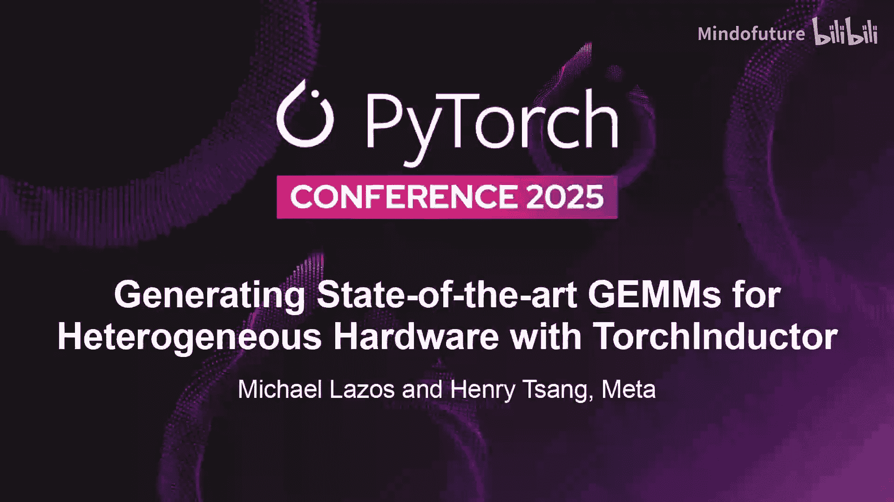
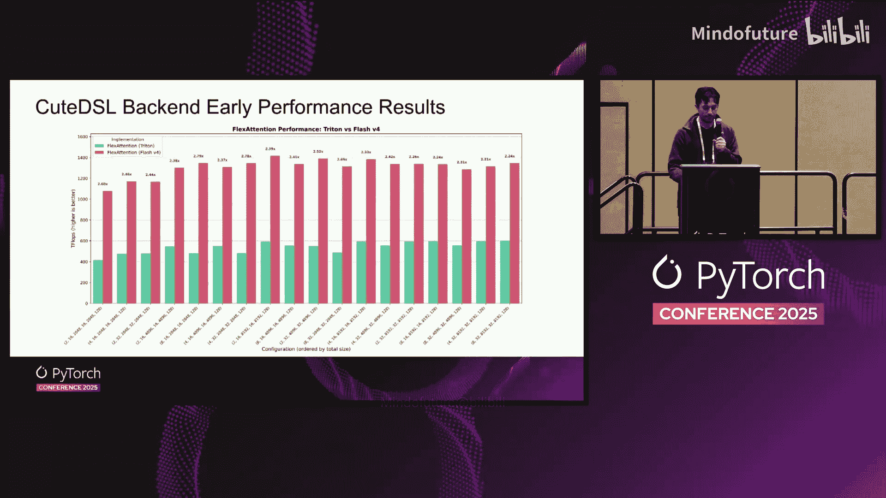
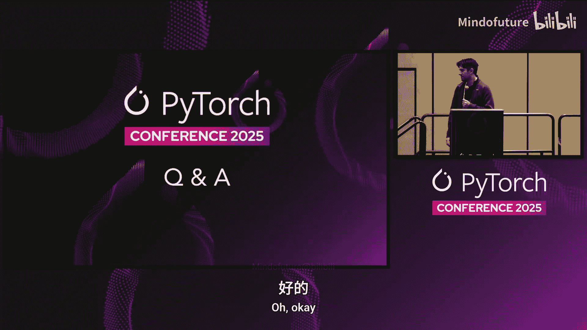

# 2025 Pytorch大会 ｜ Pytorch Conference 2025 p06 P06_为异构硬件生成先进通用矩阵乘法算法...-Michael_Lazos__Henry_Tsang -BV1b8kRB6EJG_p6-

Hi everybody， I'm Michael Lazos， I'm a software engineer at Meta。

 and today Henry and I will be presenting our work。

 generating state of the art gems with Torch Inductor。

This work is a collaboration between others at Meta as well。

 Reen contributed the composable kernel backend and Drriss contributed the QDL backend。

And so now quickly just go over the agenda， first I'll cover the motivation。

 the current state and why we use vendor specific libraries to optimize gems。

And then Henry will cover our integration into PT2 with the cutlas and CK backends。

Then it'll come back to me where I'll talk about how we further customize cutless kernels with epilogue fusion。

And then how we utilize that epilolog fusion to accelerate float8 gems。

 and then we'll close out with the ongoing work， which is to integrate the QTL backend。

So first of all I'll cover some background， this is how gems were handled in torch inductor before our work。

And so without auto tuning enabled Torch induct will just scan your model and find all the MaMll calls and convert them to A10 calls this will just dispatch to Kub Bs for NVIDdia and hipipLs for AMD。

The main disadvantage of this approach is that it doesn't allow fusion so we can't。

 and this is due to our inability to fuse with compiled binaries。To get around this， we use Triton。

 which we can fuse with because Torch inductor generates pointwise ops using Triton。

But in order to get comparable matmail performance to couplas or hip losss， we have to auto tune。

And so the reason autot is necessary is because in the past decade plus。

 GPU architectures have become really complex with the rise of deep learning and AI use cases in order to handle a large variety of workloads。

 new hardware features have been added，AndThis increases the architectural complexity。

 and as a result， there's really like a ton of different choices you can make when you're designing a gem kernel。

A small subsetsid of these choices are the tile sizes， whether you want to use warp specialization。

 what kind of instruction shapes you want to use for some workloads。

 small instruction shapes will be better， and for others larger will be better。

 and then also whether you want to use asynchronous memory transfers。

 and these are known as the Tensor memory accelerator on the latest GPUs Hopper and Blackwell。

So the simplest auto tuning solution to the problem of too many choices is just to try them all and sometimes there are way too many choices and it'll actually take forever to try them all you can autotune for days and days and get all of the optimal and gem kernels in your model and so to get around this a lot of libraries will。

Configure user tunable knobs， which will allow you to tweak the search space or also introduce heuristics。

 which can also make the search space smaller。And so in order to reach Soda performance on gems。

 we opted to use AMD's composable kernel and NviIDIA's cuttless library。

These both support auto tuning as a firstclass use case and our belief is that a compiler should be able to optimize choice as well。

 given a specific problem， as a JI compiler， you have the information at runtime on what problem sizes you're going to be tackling。

 so you should be able to make the optimal choices。

And so one note I want to make here though is our goal is not to beat couloss on all shapes。

 coubOSs and hip losss are both houristic based approaches which can't have full coverage in all shapes。

 your binary size would get too large， and so in order to get full coverage on all shapes。

 that's where our auto tuning approach would come in where we can then see these shapes that aren't well covered by kubloss and hip lossOS and optimize well for them。

And this also has the advantage that it allows flexibility for fusions and we won't be dependent on Triton performance optimizations on new hardware。

 the latest an example of this is with Warp specialization。

 Triton just recently added this when other vendor specific libraries had them earlier when the new hardware was released。

And so this drives from the point that vendor specific libraries tend to be lower level。

 and this really just falls an industry trend that in order to utilize the architectural advantages of each vendor。

 you need to expose those。Those capabilities to the language you're using。

And to draw this point on further， our own Ed Yang declared Triton dead due to its lack of well performance。

 but I don't necessarily subscribe to this， but I think that Triton's。

Lack of blackwell performance is leaving an opening for these lower level libraries to perform well and threaten its dominance from the past few years。

And so with that， I'll hand over to Henry， who will cover our integration with Torch Inductor。Hello。

 so I'm Henry， software engineer at Me。 So how are we going to use the gems generated by colors， C K。

 etc cetera。 iss kind of we have to deal with the templates ourselves。 We have to compile it。

 and then we have to pipe it， etca。I we want to provide a easy to use solution through torch inductor。

 Basically， we want it to be hardware agnostic on a torch inductor level。 Basically。

 you use torch compile， turn on a flat， and you' be able to use gems generated by colors and CK。

And especially crucial is that we are able to， through torch inductor。

 We use some components that we already have for Triton backend。

 Let's take a step back and talk about how we do it for Triton currency。😊。

How do we generate a gem with Trident or how do does inductor generate a gem these days。

 The The way it works is we have a problem shape， which is like M and K for jam memo。

 We have a torch M M， the metadata we need。 We have data type， we have layout。

And an inside torch inductor， we are going to generate one choice with kla or hipla。

 depending on the hardware。 We are going to generate multiple choices using templating for Triton。

And then we're gonna use Triton compiler to compile them just in time， parallel。

 And then we're gonna to benchmark all the choices we have to see which one is the fastest for our specific shape and data type layout。

 etca。😊，So in other words， if we follow this pattern， all we need to do is， well。

 instead of generating， I mean， alongside with generating templates for。Triton。

 we just generate C plus plus code for colors and C， K。 instead of combiningil with Triton compiler。

 we just in time parallel， Comp them with MVCC or clang depending on which back end we are using After that。

 we have a dozens choices we just going benchmark them and figure out what is the best jam to use in our problem shape。

So here's the auto tuning workflow。 I'm not going to talk about the picture on the right hand side iss just templating。

 compiling and auto tuning。 I just want to highlight one advantage of this method。😊。

The idea is that we don't have to think about it too much。

 We can just look at any combination of cons。 We pass them into the templates。

 It's going to generate C plus plus code。 And then we are trying to compile it and trying to run it。

Well， we don't guarantee that all of them is going to run or compile perfectly。

 but as long as we catch it from the user' point of view。

 iss that you're passing the metadata and we give you a really nice jam to use。

So what do we support by default， we support Torch compile。

 Basically the recommended entry point for python usage to compile a model。 We also support A O T I。

 which is the train brother of Torch compile for serving a model in C plus plus runtime。

We support dynamic shapes again， we try to mimic the support we have for Triton in particular I want to highlight our innovation for dynamic shape。

 namely when we do templating， we make the gems input shape and noick so you would generate one kernel1 c plus code compile into one dot and itll be able to handle all basically all the shapes that you pass in we will still auto tune on one shape but that kernel has the capability of serving multiple shapes。

😊，We also support various kinds of caching to make sure the integration is nice and easy to use again。

 we try to we made the temperature gems input shape andgnostic so that they are highly reusable for different shapes you can just re the same dot SO artifacts and this is like a mitigation to cut long combination time which we might come back when we talk about QDSL。

So what are the results on H 100 with the colors back then。

 we see decent performance compared to Atton and slightly outperform Triton。

 And I just want to reiterate the motivation we talked about the beginning。

 We don't aim to beat A on all the shapes what we care about is full coverage of shapes through auto tuning and flexibility for fusion。

😊，And another thing want to note is that results depend a bit on Kudar version because Kublas AK A1 improved a bit since Kuda 12。

6。And similarly， we have results for C backend。 what we are seeing here is varying like a mixture of results as in on some shapes。

 Triton is performing better on some shapes Helast is performing better。

 which is actually what we want to see。 We don't want to see one backend performing the best on all the shapes that would kind of make other backend less useful。

 and we tested the shapes all the graphs we tested them on normal shapes so we didn't capture all the shapes but from experiments we see better performance on some non standard shapes like split shapes etc。

😊，So I'll hand back to Michael to talk about epi fusion for colors。

So now'll talk about how we further customized cutless kernels with epilolog fusion。

And so in ML models typically gems are followed by an activation or some pointwise ops。

 they can also be followed by reductions， but the main point is that you're followed by some memory bound op where the gem compute will dominate the memory bound the memory reads of the epilogue op and so the main goal of this fusion is to hide that memory read by applying those ops directly to the elements of the result of the Mam as they're computed。

 and this also removes memory transaction that would typically happen after the MaML so here in this diagram you can see in the typical case after a Mam you'd write back to the result to global memory and then the activation function or epilogue pointwise op would read read that result back and that adds latency and so we can remove that memory transaction and just append those ops directly to the Mamel kernel。

And so initially we tried to generate C++ directly and this didn't really work out well。

 it's really complicated to emit cutts C++， and I would not want anybody really to do that after our experience。

The performance was really good， so directionally this was the right thing to do。

 but the maintenance burden from the compiler complexity was too high。

And so we deprioritize this work until new features of Cutlass allowed us to implement this a lot more flexibly。

 so some of the features that Cutlas added were the Elolog Visitor Te API and Python tracer。

This allows us to drastically reduce the complexity of the compiler while generating the C++。

And so what epilogue visitor trees are are they a composable kuda kernel library。

 they're built out from these templized kernel classes which are really similar to the gem universal templates that Cutlass already provides。

 and so they provide。The extensibility to basically change all of the different kernel meta parametersa via template types on the class itself。

 and so this allows you to autotune the epilogue similar to that the way you'd autotune the gem。

And so this is all open source， so it was really easy to see the code and extend it if we needed to。

 and then additionally in addition to that API， the Elog Visitor tree API。

 we Cuss also provideded a Python tracer to generate the C++ templates。

 Torch doctor is already good at generating Python because we generate the tritonops and so this was an easy extension compared to generating C++。

And so here's an example of what an epilogue visitor tree will look like。

 it represents the expression on the left as an abja syntax tree of ops on the right。

 and so this allows you to compose an arbitrary sequence of ops in the epilogue right after the MAm and allows you to do it easily in that as you add more ops。

 the epilogue you can just treat it as any other epilogue， it's composable in that way。

And so here's actually what the epilogue code looks like that inductor generates。

 and so you're allowed to use a subset of Python where all the ops in your expressions are supported by cut lists and all variables need to be assigned once and the way this Python tracer works is it goes through this Python function it looks at it generates an expression tree from the Python expressions using Python's Introspection APIs and then as you can imagine from there。

 it takes it basically visits that expression tree and generates the epilogue visitor tree from that expression tree。

And so in order for inductor to generate the Python code。

 we have what we call an ops handler and so torch inductors defined by run IR uses this technique to in the IR on the left you can see that we have opstopm and ops relu。

 the ops handler itself is overrable so you can basically override ops to mean anything you want a lot of our analysis passes are implemented with this technique where you can analyze memory usage。

 you can analyze shapes and this allows us to basically implement different operations over induct's IR so in our case when we want to emit Python code we just make a python printer ops implementation so that opst relu will just print the code on the right。

 the raylu Q expression there and then opsmll will just implement an inline multiplication on the right。

 and so this allows us to translate arbitrary expressions to Python code。

And so in order to integrate with the NVIDdia EVT tracer。

 you have to pass it some metadata through this API where you define a dictionary where you map each name used in the example epilogue to a fake tensor and so these fake tens are distinct from the ptorrch fake tensors in that they just basically encapsulate some metadata that the tracer will need to generate the correct cut list code。

 and so some of this metadata is just the data types so it can know when to do type conversions in the epilogue visitor and then the shape so it can do shape analysis and add reshape operations and also the layout in order to also analyze the reshape operations。

And so once you pass in the dictionary， you can just trace that Python code and get the C plus code that you want and so here's an example of the generated C++。

You can see how it's implemented types for each of the different pieces of the tree。

 so a here is loading the output of the mapM Alpha is the scalar that I showed before it's doing a scalar broadcast and the same thing with beta and then compute zero is saying we're going to do a multiply and then this is an actual node in the tree where it's applying the multiply to the alpha in the accumulator and then similarly down here it's also applying a multiply to the beta in tensor C。

 and this isn't the whole code because it's actually too big to fit on the slide but as you can imagine you wouldn't want to really write all this by hand as the tree gets it's pretty large。

And so in essence， you're embedding the tree structure in the C++ type system。

And so overall here's the whole system of the phases I've described so far。

 you have the model which torch compile will then generate the inductor IR and then from the induct IR we go to the Python EVT and then from there we trace that Python EVT into the C++ EVT and then we splice that code together with what Henry the system Henry described。

 we get the regular C++ gem and we generate the compiled SO from both of those C++ snippets。

And so here are performance results for a Raylu Add benchmark at BF16。

 it had a 6% genomeamine speedup on the shapes used in Lama and a 6% speed up versus Triton and an 8% speed up versus A10 and you can see the difference between the max speedup and the genomeamine speedup really shows you that there are some problems where this auto tuunning technique is really applicable and then other problems where it might not give you as much benefit and so the max speedups are pretty good on some problems are getting 50% to 60% speedups over Triton and A10 respectively。

And so here's a more in depth analysis of the results on the left we have M equals 64 and on the right we have M equals 65。

536， and on the x axis here we have all of the shapes from Lama。😊，And so when we did the Geine。

 we had M range from those two values from 64 to 65，000。

 but you can see that cutlas usually outperforms。Triton and definitely both Triton and Cutlas outperform A10 because A10 isn't doing any fusions。

And so there are still some shapes， you know where we're trying also outperforms， as Henry mentioned。

 where we're not really aiming to win on all shapes， but on a lot of shapes。

 Cutlass is definitely providing reformance boost。And so we use the epilogue visitor tree technique。

 not just for arbitrary epilogues， but in this case， also for when we know the epilogue in advanced。

 so for Fate gems， you often scale the output。Either row wise or tensor wise。

 and I have the example epilogue for that on the right here where you just to bring the value back to BFat 16。

 you have to scale it and you also can optionally add a bias so。

We wanted to use upload Visitor trees for this because instead of hard coding。

 you might have to hard code every option where you might want to add the bias or allow additional fusions。

 but using Galo Visitor Tree API allows us to leave those doors open for the future to have even more flexibility。

And so here's how you would use the FP gem in your model。

 you would get the X and WT matrices from the quantization beforehand where you'd quantize those values to FP8。

 and then you'd get the x inverse and W inverse scale matrices from that quantization as well and then。

You can also specify whether you want to use fastS accumulation that uses a technique and N VDdiaA GPUs where it will use the Tensor core accumulators。

 which will periodically sync back to registers to upcast。

 but this is basically an accuracy versus speed trade off and typically it's true for inference。

 but false for training because the accuracy loss will mess up training often。

And so here's the C++ code for an FP8 epilogue， it's really similar to what we showed before。

 and you can see that we do a column in row Bro and then we do a multiply again with the accumulator。

 we just do two multiplies and that was the epilogue I showed before。

And so here are the performance results for FP8 so here I show both all the backends with the fast version which use Fast a and then all the backends without fast because to show basically the contrast between inference and training and so you can see fastA does have some tangible impact and also the results here in general are just are better than what we got for just the Raylu add we have。

Generally an 8% speed up Geamine， these are also on llama shapes， by the way。

 and you can see with cutlesss without fasta。That we get a 16% speed up over Triton and then the max speedups are also pretty significant the reason the FPG speedup is so high as I think there were some heuristics where FPG FPG was weirdly slow on some of the shapes where you're in so I just take that with a grain of salt I don't know if that's cutless being really good or FBG not doing so on some shapes。

And then 3332 is the instantiation level， I kind of alluded to this earlier where some libraries will have a user tuable level that allow you to tweak the search space and so we picked this instantiation level because this was the largest search space that if we went larger。

 it didn't seem to give a lot of extra performance benefit。

And so once again here's a chart of the F8 performance results。

 cutlas does really well across all of the llma shapes again。

 and we also range from M equals 64 on the left to M equals 65，000 on the right。

 on the left with small M cutlas seems to dominate the other backends。

 but on the right it gets a little more muddled where Triton does well as well。

And so now I'll switch gears to Q DSL， which is the new DSL that。That n video is releasing to。

To in essence， eventually be the new language I will use for auto tuning and so this language is easier to maintain because it's implemented in Python and the main benefit is that it has faster compile time like 100 x and the reason that's the case is it uses a custom MLIR compiler versus NVCC to generate PTX directly from the Python code。

And there's been a lot of OSS adoption， just a treeD。

 flex attention and both flash attention have adopted this。

 and it uses the same abstractions as cutless， so in theory it should be able to get the same performance at the PTX level。

And similarly to cutlas， we take the approach of implementing templates and torch andductor for QTSL。

 these templates are a lot simpler to maintain since they're implant and Python。

 they're faster to compile as I mentioned， and the one drawback is although since QTSL is pretty low level。

 it can be very verbose， some of the gem implantations can be thousands of lines of code。

But overall the performance has been quite good and I think justifies this investment。

And so here's some early performance results with QTSL。

 we show the flex attention version with Triton versus the flex attention implemented with flashV4 which uses QTSL。

😊，And this really illustrates that the Triton performance really has not been the best on Blackwell on all of the different flash attention shapes here。

 we're getting over 2X performance improvement over Triton。

 and so in the future I think this really justifies our investment will continue working to get QTSL to implement more operations。

And that's everything we have， so any questions？Oh， yeah。You。

Oh okay。Testing testing， okay， testing。 Okay， yeah， so it's not very fancy。

 It's just the kernel would take in tens pointers and some met data。

 which is like the the shapes and the stride。 And then because when we compiled the color code。

 we didn't make them static。 So they didn't get hard coded in the。

Cos current also they can just handle most of the shapes and most of the dynamic shapes。

 There are some small constraints with which dimension it could be dynamic。

 which dimension couldn't be dynamic。 There are also some concerns with layouts。

 but for the most part， its pretty dynamic。そ到大。So。ization of CKP。Theself。I don。Well， the question is。

 is the question that how do we specialize at compile time on things that can change at runtime？Yes。

没有查。Oh okay， so since we're a Jit compiler， we actually run the static build of the CK kernels at runtime。

 so we get basically the shapes from the workload and then we run their whole compile pipeline at runtime and then we guard against if the shapes change if we have dynamic shapes。

 we'll basically reuse those same kernels。No matter what if the shape changes and you'll just have tuned on one specific set of shapes。

 if you're not using dynamic shapes， we'll recompile if there's a new shape encountered。

 so we guard on the shape compile for the first time you encounter a specific type of shape。Yes， yes。

 and then if diet for， yeah， yeah。So what about overhead？For compile， not compile。Gt。first time。

That's said next time。せ。だな。It's not that bad because we compile them in parallel。 Ibodying。

 I think C K per kernelno is like a few seconds。P combination， but you do it in parallel。

 It's not that bad color is the one that is taking more time。 Ya so happy to follow up more。

 But then I think we run off of time。😊，Thank you， everybody。Thank you。

