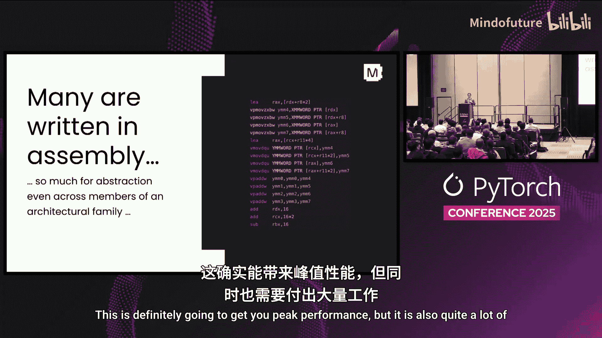
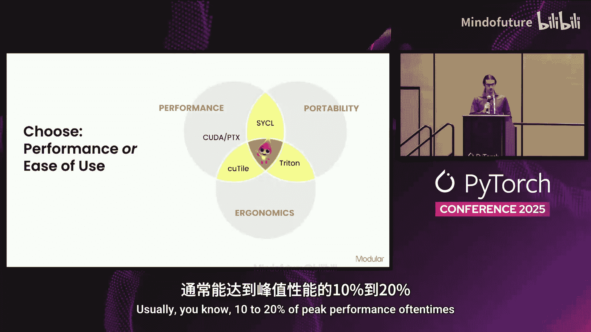
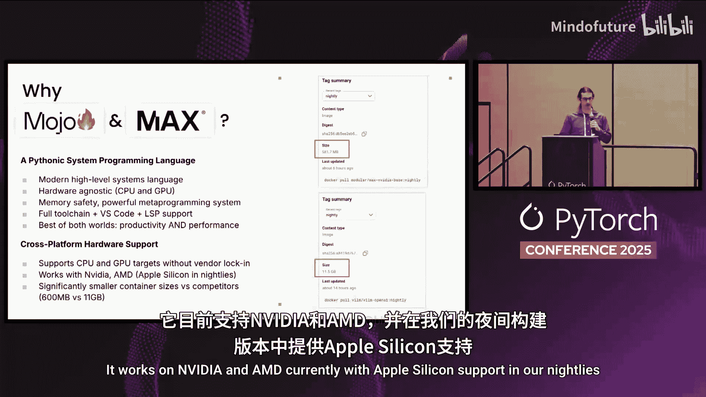
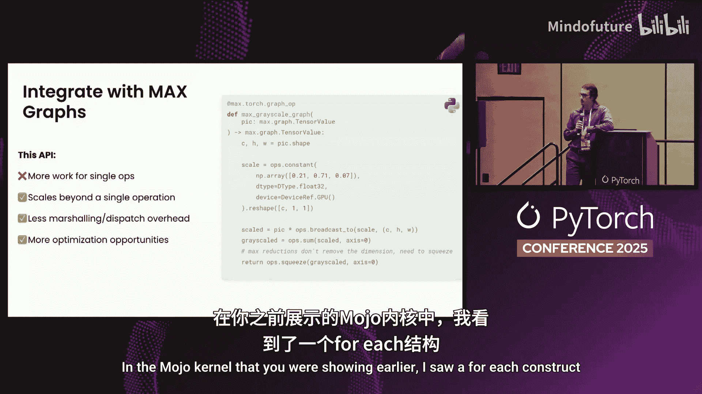
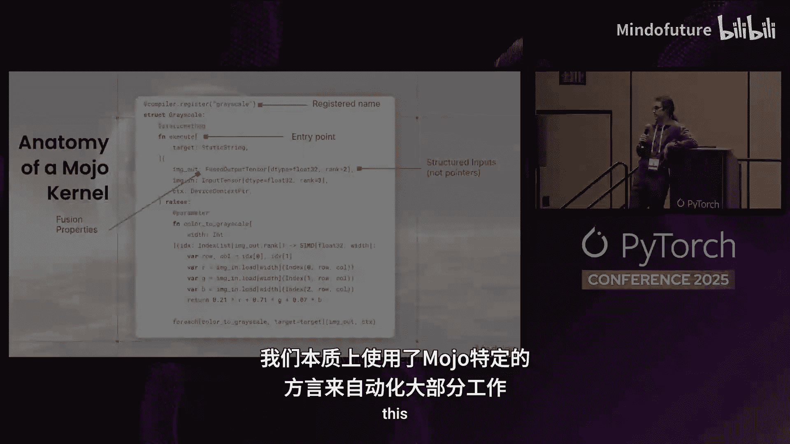

# 2025 Pytorch大会 ｜ Pytorch Conference 2025 p07 P07_Mojo_+_PyTorch——通往定制内核的更简捷高速路径-Spenser_Bauman__Modular -BV1b8kRB6EJG_p7-

My name is Spencer， I'm a compiler engineer at modular。

 I'm going to be talking a little bit about how to Thank you。

How to use Mojo to make your life easier when implementing Pytorrch custom ops？

So the overall agenda here is I'm going to talk a little bit about first Ymojo， YMax。

 what are these things and why do we need yet another language for implementing kernels？

I'm going to show you how to write a custom app in Mojo。

 then how to interface that easily from Pytororrch。And hopefully along the way。

 convince you that this is a good thing you want to do from the perspective of performance and ease of development。

So first a bit about why Mojo and to do that， let's take a look at the lengths people have gone to to get peak performance out of their systems。

So what does it look like to write a kernel that actually uses all of your hardware well？

Still to this day a lot of them are written in assembly or PTX or some flavor of the above。

 this is definitely going to get you peak performance。

 but it is also quite a lot of work and it does often not very portable。

Okay。There are other solutions that devolve into various kinds of meta programminggramm like using C++ templates。

 a composable kernels， this kind of correctly identifies that the problem is one of meta programminggram。

 it's just that meta programmingm in C++ is not all that pleasant。

 you have to provide you know what 30 or 40 different template parameters here just to specialize on all of the relevant details like data types accumulators。

Different underlying layouts， all of the hardware properties。

 so while it's in the right direction it is still quite unpleasant to use。

And everything else is like various flavors of DSLs that are often just abstracting over assembly code like one DN。

 C+ plus DSL to generate assembly。Or you could choose a various Python DSL to also generate assembly code like tensile here。

And there are other weird templating solutions that are all in the kind of meta programminggramming space。

 in this case， templates。Not C++ templates to really get all of the performance out of your code and I these are all indicative of one that meta programminggram can solve the problem。

 but also that you really can't trust your compiler with a lot of these languages and that's why you end up bending over backwards。

And the end result is something that is still not particularly pleasant to use。

 all of this code falls into the category of kind of write onces read never。

 it's very difficult to debug and there's probably not any tooling for most of these systems in terms of actually helping you write it。

So when you choose have to choose a system to implement a custom app。

 you're left kind of making this choice， which is do you need peak performance。

 if so you're going to choose some baroque system like that or you know handwite Kuta or PTX code。

 this will definitely get you good performance at the cost of very expensive developer hours and the result often is not very portable。

Or you can go with something that is a little easier to use。

 there's been a proliferation of kind of DSL based solutions recently， systems like Triton。

 gluon Q tile that are， in some cases much more portable。

 they are certainly a little easier to use from a developer ergonomics perspective。

 they often feel like writing mostly normal Python code。

But you're usuallyly banking some trade off to get that ease of use， right usually？You know。

 10 to 20% of peak performance oftentimes。

嗯。So that's a bit about why Mojo exists。It's a little hard to talk about Mojo in the context of machine learning without at least introducing Max。

 so a little bit about the history of Mac here。

So in the olden days， all these frameworks would ship very large kernel libraries。

 as we saw in the prior talk。Things like fusion is very important。

 you know you can't just ship a small number of orthogonal kernels。

 so in practice before the advent of various fusion algorithms。

 you would ship every conceivable hand fused version of all of your kernels。

The combinatorics of this do not look very good， so you're shipping thousands of handfuseed kernels。

And you know， usually gigabytes of compiled code if it's a pre compileild library。

AI compilers have kind of solved this by automating some of the fusion process。

 this is basically a prerequisite for any modern AI compiler to do this kind of operator fusion where you identify subgraphs of your tensor computation。

 figure out what is legal and profitable diffus and then synthesize a single callable kernel out of it。

Like I said， this is basically a prerequisite and it works very well in practice。

 but there is a problem of generality here， which is that it just has a lot of edge cases where it can fall flat right a lot of common limitations or things like dynamic shapes。

 sparsity and quantization all make the problem of doing automatic fusion harder there's。

Just more to figure out in terms of， is it legal to do this fusion and is it indeed profitable？

So these are often cases where the compiler adds heuristics that make the fusion process just less reliable。

And。Another common case is one of custom ops so custom ops in many systems are black boxes from the perspective of the compiler right so the compiler looks at it says" I don't know what to do with this thing and just has to leave it unfusesed for the sake of correctness and GenAI has really only made this problem worse so there's very rapid innovation in new modeling patterns things like complex attention mechanisms this is in practice resulted in an explosion of handfusesed kernels。

Just because you can't trust the compiler to do the correct job。

 another domain that has similar problems or things like KVC。

 which has its own kind of domain specific。Optimizations associated with it that you basically have to teach the compiler about de Novo。

And that really illustrates the problem that if you're relying on the compiler to do all of this。

 well， compiler engineers don't scale particularly well。Speaking is one。

 we take a long time to implement new features in the compiler。

 so if your model development cycle involves coming up with a new modeling pattern and then going out to your compiler engineer and saying。

 hey， please make this fast for us well， one you have to hire that compiler engineer and two it's probably going to take weeks or months for them to actually implement it。

So that is just makes it very difficult to rapidly iterate on new models。

And that is the problem that Max was designed to solve right so Max is you can think of as the the platform that sits on top of Mojo。

 so Mojo is the language of。Implementing high performance kernels in our stack on top of that sits APIs like the Python graph API this provides a familiar ptorrch like interface to tensor computations so it feels very much like using vanilla Ptorrch。

可的。The output of which is consumed by our graph compiler。

 this is a very traditional graph compiler that does a lot of the automatic optimizations you're familiar with。

 things like shape and， automatic kernel fusion。😊，And supplementing that our systems like our optimized GPU kernels。

 these have a lot of hardware specific optimizations in them and various hardware abstractions we provide to allow you to deploy models。

Across a variety of hardwares。So a little bit about how this works in practice。

 like Mojo is kind of the secret sauce of this system， so how does it enable this productivity。

 Mojo itself is a kind of modern high levelvel systems language。

 that means you can write pretty high levell code iterate rapidly。

 but as a systems language it gives you very tight control over what ends up coming out of the back end of the compiler。

In addition， it's hardware agnostics so it runs on CPUs and GPUs currently and has a lot of the modern high-level features you expect out of a modern programming language。

 things like memory safety， a powerful meta programminggramm system。

 which itself is a key part of how we generate highly specialized code for a particular target。

 you get a full tool chain including a compiler and debugger。

 all of the editor integrations that you would expect like into VS code and LSP support。

So this gives you the best of both worlds， you can be productive。

 you can write high levelve algorithms， you can iterate rapidly， and when you need performance。

 you can drop down， get that really fine grain control over what goes on in your algorithm。

And if you need your algorithms to be cross platform。

 Moto doesn't just support CPUs and one particular GPU vendor works on NVDIA AMD currently with Apple Silicon support in our night lease。

So okay， that's kind of the theory of why Mo exists。Let's see some code now。

 so what does it look like to actually write a custom kernel in Mojo？

So this is a grayscale kernel implemented in Mojo， there's nothing particularly special about grayscale here。

 it just fits on a slide and is easy to explain。😊，And for the。For the purposes of this talk。

 all of the details here extend to every other kernel you're going to write。

 including all of our internal kernels。So all of these kernels start with a compiler registration。

 this is just a decorator that associates a name to your kernel。

And that name is what you're going to use to refer to this thing from the Ptorrch level or from our Mac graph API if you'd prefer to use that。

All kernels are struck with at least one method， this being the execute method。

Execcuts the entry point into our kernels so it contains obviously all the code that is going to be executed when you call into the kernel。

 but the interface to this thing is also important in that it is reflected as the interface to the Python level op。

 so we have structured types like fused output tensor at input tensor。

These become outputs and inputs respectively of the op at the ptorrch level。And at the Mora level。

 these things are。Well， they're normal ma types， but they represent structured indisal buffers。

 so they hold things like the underlying data type of the data。

 they know the shape and underlying layout， so they're not naked pointers here you don't have to do any low levell pointer arithmetic。

If you notice the fused prefix here， this is how we indicate operator fusion。

 any custom op you write can opt into fusion with other ops in our max execution engine。

 this is done on a per operaand basis for either your inputs or outputs。

 so in this case a fused output tensor means this has the potential to be fused into its consumer。哦。

And so that's the interface to this kernel。The rest of the code is in fact the implementation。

 so everything here is implemented in terms of the for each function。

 for each is just a normal Mo library function， it comes with our standard library。

 it will parallelize and vectorize a given function across either the CPU or the GPU。In this case。

 we're giving it the color to grayscale function， which just computes one or more output pixels for a given input or for a given point in the iteration space。

 and it does that by loading the three color channels and doing all the proper arithmetic。

 you could also implement this using a low level block index based Kupa API if that is your preference。

 it really just depends on you know， does our standard library contain anything that fits the algorithm you're trying to implement。

And so just to convince you I'm not trying to completely pull your leg here in terms of performance。

 this is a quick comparison of that same grayscale kernel against an equivalent triton implementation。

The Y axis here is through points or larger is better。

 and we're comparing on an H 100 a B200 and an MI 300， so depending on the particular system。

 we're somewhere between 1 to2% faster to about 15% faster。

But obviously this is a very simple kernel， it's not representative of the very complex kernels that are what you're usually implementing when you reach out to implement a custom app in using some tool。

So can we say anything about more realistic sized kernels to that， I want to preface by saying。

 you know at modular， we do in fact implement all of our kernels in Mojo。

 we have quite a few of them at this point。And they are all maintained by a relatively small team of engineers。

 roughly 10 people， and that team maintains all of those kernels for all of the hardwares that we support。

 which is CPUUs and seven GPU architectures for the three different vendors that we currently support。

 and we still manage to get a state of the art through report on real production models。

So in my mind， that is a strong indication of the productivity enabled by Mojo and the Max ecosystem。

But obviously everyone here probably wants to see numbers。

 so fortunately we recently had a series of blog posts on how to optimize a matrix multiplication for blackwell architecture in Mojo so this is a comparison of our in-house Mojo implementation of matrix multiplication compared to coubblast so we're comparing to NviDdia's own matrix multiplication on their own hardware and again this is in terms ofteroflops so throughput larger is better there are one or two。

Bars here where we're more than a few percent slower。

 but those are mostly cases that we haven't really optimized for that sort of average case here is that we're somewhere between a few percent slower to even a couple percent faster than a vendor library on their own hardware so if that is your metric of performance that you need。

 then Mojo definitely can check that box for you。So okay， that has been all Mojo code。

 this is obviously a Pytorrch conference so but let's talk about Python for a little bit so I'm going to show two APIs here for integrating Mojo into Pytorch one is an API to sort of directly call custom kernels and the other is an API to call larger Mac graphs for when you start collecting a large number of kernels。

So calling individual kernels is very straightforward here。

 you simply have to load the library of custom ops that you've provided。

 there's no extra compilation steps here， you use the custom opp library type and you give it a path to wherever your kernels live on disk。

Internally that loads all of those compiler registrations and will expose them via in this case custom ops dot the registered name。

 so in the next code snippet here we have。We're wrapping the grayscale kernel and something into something with a more pytorrch like interface。

 so something will take torch tensors and produce torch tensors。

And to do that we allocate a new empty tensor for the result and we call the grayscale kernel via a custom opstock grayscale since it is in destination passing style and we give it the result tensor and the input image tensor and you just return that like a normal value。

 this is very similar to wrapping triton kernels if you've ever had to do that and probably worth mentioning that this API is completely compatible with torch compile as is the next one。

And so some tradeoffs for this API that API is very simple to use。

 it's nice when you want to do some kind of testing of your ops。

 but it doesn't scale particularly well just due to issues of dealLP and stream synchronization。

 when Tensorors cross that boundary from Pytororch into our system。

 this is something we're working on， but it is present at the moment。And obviously。

 if you're calling individual kernels， then you don't get all of that nice fusion goodness that we talked about earlier。

 since you're just calling individual kernels， our system just doesn't have any additional context to perform fusion。

So once you have curated more than a few custom operations。

 there's a good chance you'll want to use this particular API。

 this API scales a lot better beyond single operations。

 mostly because it has fewer fewer boundaries between Ptorr and our execution engine and it gives a larger context for our execution engine to optimize。

 so the code on the right here is an implementation of the same grayscale computation。

 it is implemented in terms of the max graph API， as I mentioned previously the graph API it is intended to look like you're composing tensor computations very similarly to how P Tor works。

And to do with the grayscale computation， we create a new constant of the per color channel correction factors。

 multiply the input tensor， and then some across the three color channels。And to expose this from。

Or well， to expose this to pytorrch is similarly simple， you just slap a max。torrch。

graphhoub decorator around it， and that handles all the work of actually doing the compilation and marshalling tensors between our system and pytorrch。

So yeah， those are the two ways to interface to Pytorrch， so high level takeaways here。

 Mojo Max give you a single system where you can prototype and optimize kernels without the usual transition of prototype in something like Triton and transition to Kuta。

You can do so without any vendor lock in， and now we have an easy API to provide integration with Pytorch。

So thank you。And。And yet。I think I have some spare time here， so any questions？Yeah。You， sir。

Yeah that。Oh thank you， do you have any specific benchmarking or profiling tools that you typically use when writing these kinds of kernels？

So I am not a kernel author， but I will say we can use all of this kind of standard things like if you're on you're targeting NVIDdia。

 you can use all of their profilers， it''s very similar to writing a kernel for whichever particular hardware you're writing it for。

Yeah。Great talk， thanks， I'm curious about you mentioned Mojo does kernel fusion， correct？

So in the previous slide， you showed an example about decorating， well yeah。

 and also the previous one you showed an example about decorating the function with@ Torchd compile。

Um。So my understanding is that in you know， normal Pytorch。

 this will be compiled into like a few striking kernel， right， but yeah here。

That's not going to happen， right， because you have a custom op。Correct， so we we are opaque to。

Torch compiles fusion system okay so it's going to be like a graph break and it has to come to Python to call the custom up and then it should work with with without introducing a graph break。

 but it will be like an opaque function call okay and then on the next slide。It。Sorry。

 the next example， I mean so here。Will these be fused into in in Mojo or there be Okay。

 so they will be fused within the graph compiler will。

End up synthesizing Mo code that calls into the kernels that implement broadcast to multiply and opts that some。

 I see。 So you're synthesizing Mo code that gets strict compiled wherere。

Not quite synthesizing Moro code yet， but something very similar within the compiler。Thank you。go。Hi。

 so in the Moja kernel oh sorry to with the speaker beside me in the Moja kernel that you were showing earlier。

 I saw a forage construct that is iterating through the tensor shape and then you're doing the C operation right Yeah exactly so。

😊。

I would imagine from a compiler point of view doing fusion would become simplified if I see for each operation or a reduction operation。

 but let's say I'm not using for each because my loopist is not in that fashion let's say I have a triangular loop let's a causal masking so if I write down using the loop nest would Mojo be still able to fuses by doing the fine grain dependence analysis so we're not doing any dependence analysis if you annotate something as as fused right like unfusesed output tensor you are are at testing that it is correct to fuse this thing。

I see the the responsibility is on the programmer yes you have to know that it can be fused and that's why we provide fine grain control because some some operations may not be safe to fuse other ones but I could be fusing at different levels or that I could be doing elementized fusion which is in the innermost loop I could be doing fusion at some levels about that how would the programmer specify all that。

So we do have some specific constructs for element wise it is。

More more or less sugar around this kind of this same structure though， within our system。

 element wise mostly means all opera ends and results are fusible Okay one last question since it is the device agnostic right the Mojo programs that you write at a higher level how do you manage the complexity of automatically optimizing for a device do you have an auto built into it or do you have a cost model driven heuristics like how do you deal with generating the best code and you're able to match with kubs。

is this specifically true for device assignment like inferring optimal device assignments or now let's say the gem kernel that you were showing results earlier。

 how are you able to match with K+ by writing gem at a very higher level？That is done by hand tuning。

We do have some like auto tuning tools to help automate that process or the programmer is explicitly telling all the things to do。

Yes， okay， okay， that's all。可能。嗯。So。Thanks for the talk。 I'm。

 I'm curious like for the slide you showed where you compare to Triton and you get a lot more performance and B 200 as far as I understand。

 like， you're still going through the， you know， somewhat similar MLLRR pipeline， like what's。

What'sDo you have a quick insight on like how you get that actual performance？

Um I do not immediately just because I've really examined what is going on on the Triton side。Oh。

Its we don't use any stuff。Oh， I see it's specifically about going through the existing MLIR pipeline tools Yes sorry so I guess like maybe I'm wrong in this。

 but I thought that you guys were using MLIR or do you generate L of VMIR directly Yes so while we do use MLIR we do not use any of the upstream dialects all of this is implemented through internal dialects so we have essentially Mojo specific dialects that are used to automate a lot of this。

