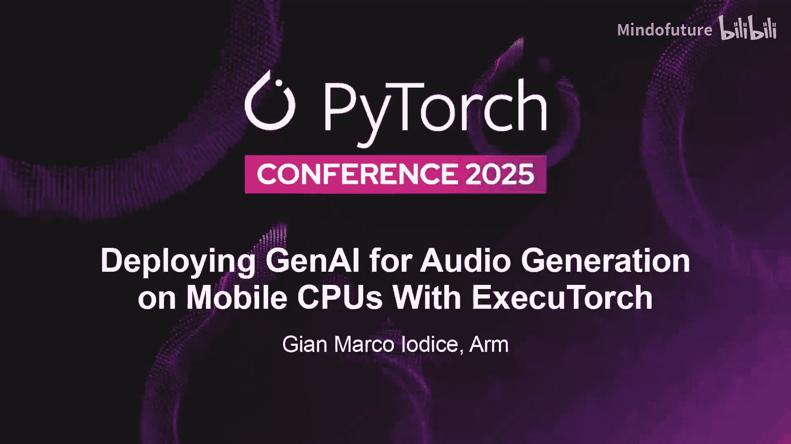
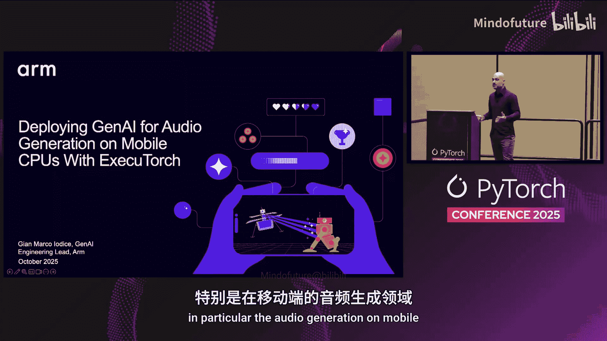
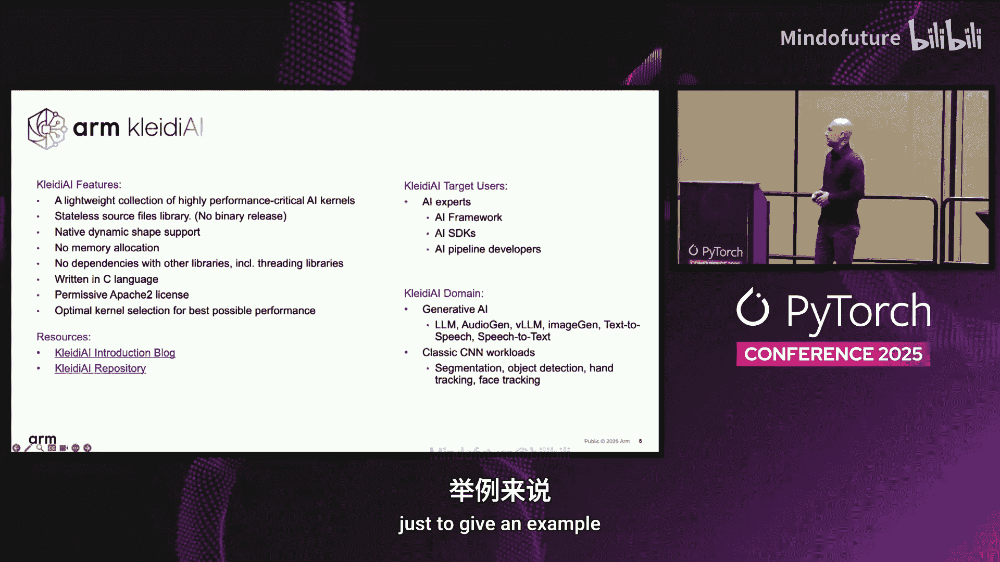
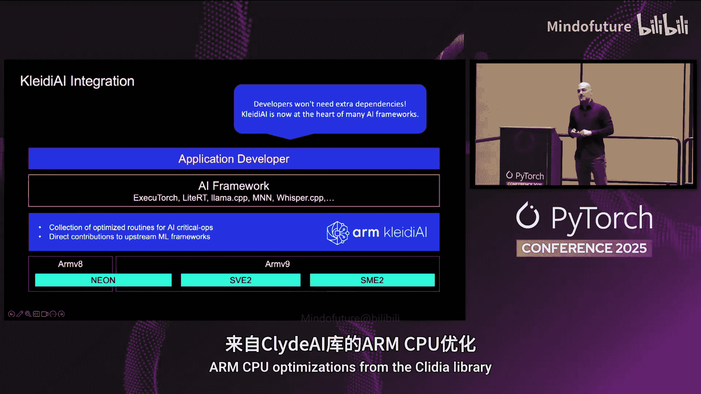
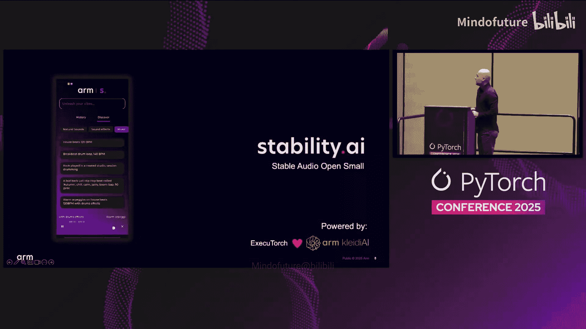
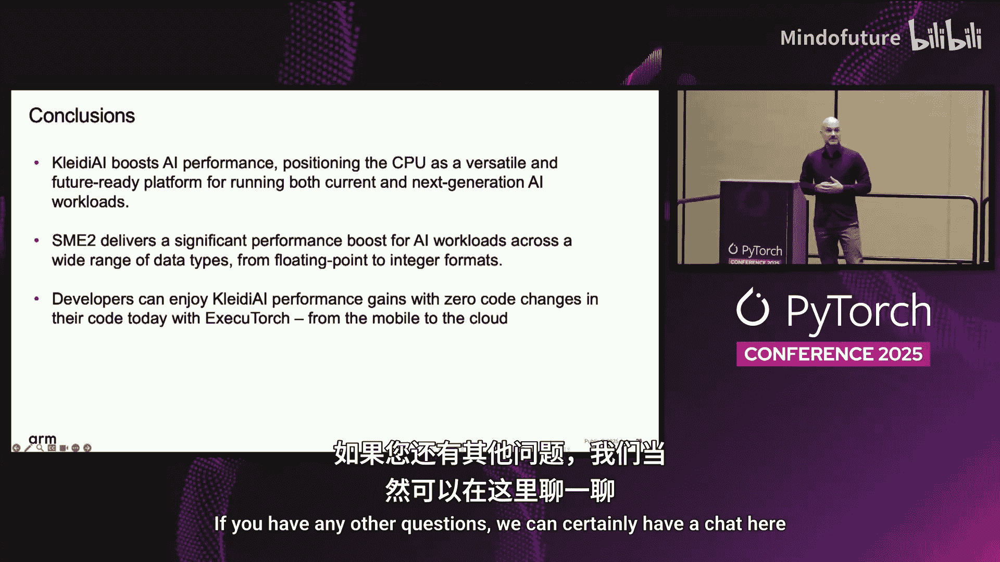
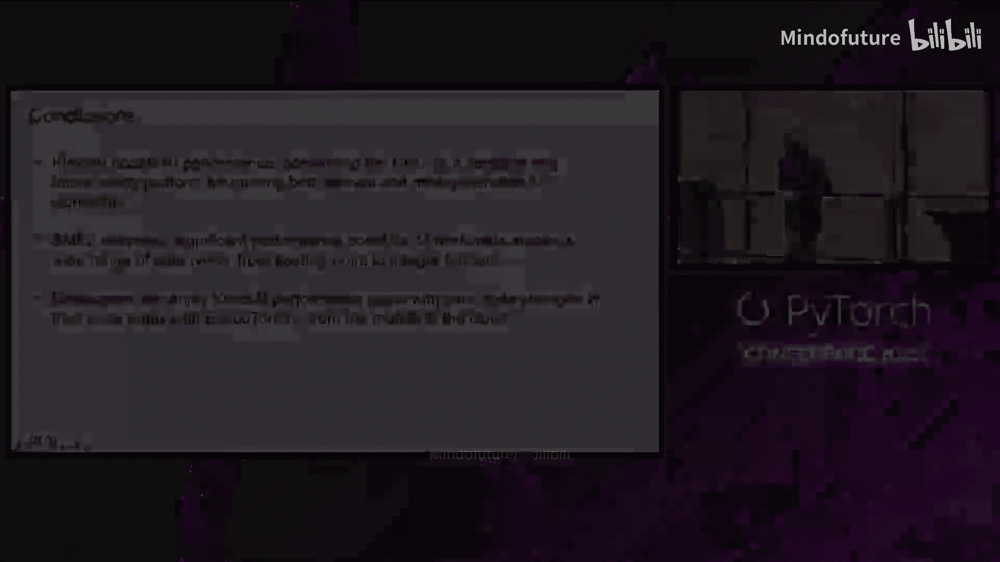

# 2025 Pytorch大会 ｜ Pytorch Conference 2025 p08 P08_基于ExecuTorch在移动端CPU部署生成式音频AI-Gian_Marco_Iodice__Arm -BV1b8kRB6EJG_p8-

So what a great pleasure to be here again at the Pytorch conference。 I was here also last year。

 I'm going have also like to recap what I presented last year。

 but it's also great that I have this presentation after the brilliant presentation from Mergenberg on Excut Hch 1。

0 because actually what I'm going to share today is what we have successfully built together。

 Okay andre we are going to see some performance data and also an interesting use case for generativeI in particular。

 the audio generation on mobile。😊。

So this is a summary， a story I'm going to tell you today is a story about performance and portability across different devices。

Hold on。 Wasn't this presentation about mobile。Yes， it's going to be a presentation about mobile。

 but if you're a mobile developer， you know that after designing your mobile app。

 you will need to test your mobile app somewhere。 maybe it's an emulator。But what about performance。

How do I know whether my， my model will run with the performance that I want。

 What kind of tools or what kind of solutions do I have to estimate the performance when I want to deploy something on mobile。

And believe it or not， you have multiple options if you're targeting the M CPU。

 And this is the story I'm going to tell you today with the help of the great executors and Clyde AI。

😊，This presentation starts with what I presented last year， some use cases for generative VI。

 And when you think about generative VI， in particular on mobile， we have seen something earlier。

We think about text okay so we put something， we asked the chatbot to answer some questions and as we demonstrated last year。

 we can expand the chatbot to provide， for instance， a summarization from a group chat， for instance。

 I have infinite let's say 50 unread messages from a group chat from a group chat and I don't want to read all the messages I can use。

 for instance， an LLM to give me a summary and discover what for instance。

 my friends decided to buy for the gift of my friend。

What is behind these demos that you you can also do it on your own because we have。

 and I have the links at the end of this presentation。What power actually this them was。Do things。

Execut toch。And Clyde AI。Clyde AI， which has been mentioned also earlier in the previous presentation。

 is a very lightweight library that contains the critical operators for running AI workloads on the MC CPUPU。

😊，What are these critical ops， matrix multiplications， for instance， or convolution ops。

 just to give an example in all the different flavors and what are these flavors are the data types。

 Okay， We live in the world where we we have not just floating point as a data type。 We have B F 16。

 We have floating point 16。 We have integer 8。😊，We have integer 4。 We have also integer 2。

1 B quantization， and so on。So ClyDI contains all of these critical op that are required to run these AI workloads very efficiently on the MCU。

The other interesting thing about this library， it does not contain any dependencies。

 so you can take what you need and has been designed for being the library for AI framework developers。

 so you need to be an expert for sure to integrate these operators in your AI framework。

Is not a library just for generative VI workloads。Is also a library that where you can use it for accelerating for recent convolution young networks。

 just to give an example。

So if you are a developer。What do I need to consider， Do I need to integrate Cde AI。Not at all。 Okay。

 use Ex to。And you're going to get the benefit of Clyde AI for free because it's already enabled by default。

 So you don't need to consider extra dependencies in your flow。 just use execut H and target。

 for instance， the AM CPU。 and you're going to get automatically all the arm optimizations。

The armM optimizations， which are， let's say， selected at runtime because Exors provide a mechanism that at runtime detects what hardware capabilities the AMCU has and select the proper for recent AM CPU optimizations from the ClyDI Library。

😊。

But。😡，What about the use case I mentioned at beginning beginning？This is audio generation or mobile。

 and this is super cool。 It's super cool， because it opens。😊。

And other interesting use cases that we can unlock or mobile。 What kind of use cases， Well。

 if youre a content creator， for instance， you can use such application to generate your perfect audiobe。

 okay， or if you're a DJ， you can use this application or this model to generate your perfect sample to create your music。

But what kind of music？Let's see。 because this is a video。 Let's see if it。 Yes。

 This is a demo we created。 We have some prefix prompt just to the demo but。😊。

So the audio quality Trust me is amazing。 We are talking about 44 kiloher， okay。

 audio samples of 11 seconds length。 Okay， sterophonic effect。😊。

You can generate your path big for your DJ console。

 You can also generate sound effects for your video， like a thunderstorm， a magic spell。

 Just to give an example。 You just need to prompt it， and you can generate it。😊。

So one question that most of the developers actually and they ask me is。

 should I run this locally or should I run it in the cloud？Well。

 it does not exist a single solution that fits them all， right， Okay， Certainly。

 this is a use case that we want to see running locally and why。Because if your content creator。

 I'm00% sure that if you put your prompt， you were not gonna get the。

 the perfect audio sample that you want at the first attempt。 It will be anyerative process。

You're gonna try。 You're gonna fail。 You're gonna try again。 Okay。

 and you're gonna adjust your prompt。 You're gonna adjust maybe other parameters to get the perfect sample that you that you need。

Since you， this is a tenative process。As you can infer， what is actually very power hungryungary。

Is the Internet connectivity。 You don't want to send infinite requests to the cloud， right。

 So that is the reason you want to have something that runs locally to minimize also the data transmission that can actually be。

Quite a lot， it can penalize also the energy consumption， quite a lot。

But there are scenarios when actually， the cloud is needed。

Maybe because you want longer audio samples， not just 11 seconds， maybe you want 20 seconds of audio。

Or maybe because you want the same level of performance across different platforms， because。

 as you know， I mean， we have many mobile phones out there， but with different capabilities。

In some cases， certainly we can achieve the target performance from a user experience。

 What kind of level do we want to achieve。 Let's say for 11 seconds of audio。

 at least something below 10 seconds is acceptable， okay。😊，Above that。

 probably from a user engagement is not great。 And maybe in that case， we can consider， for instance。

 the deployment in the cloud。But what kind of cloud deployment。

But we can consider the AM CPU cloud deployment。And here I'm going to also open the the topic about why。

 for reason， you can use the cloud， the cloud for maybe providing the same level of performance across different devices。

😊，But also， the cloud to have an estimate about what kind of performance I can also achieve on my mobile phones。

And this is the beauty。The beauty of execuretorch。And Clyde AI。The same code。

The same model can run everywhere。If you target an MC CPUP， you don't need to change anything。

 You take the same piece of code。 you run on mobile， It will run also in the cloud。

But let's unpack the pipeline behind this audio generation model。

 which is based on the stable audio opens small from St AI。Is made of three different models。

 The conditioner， which takes the text prompts and it does embedding。 We have the diffusion step。

 which is called eight times。And after that， we have a compressed data。 Okay。

 not the audio in the the full audio。 We have a compressed representation of the audio。

 which is passed through the auto encoder， which is responsible to generate the final strophonic audio with 44 heers。

😊，The diffusion step and the auto code are the most expensive。

 So what have we done to achieve the target performance of something below 10 seconds on mobile。

So we decided to quantize the diffusion step with8 bit quantization。And since for audio。

 we need to preserve the quality， we could not use intake for Yo encodeder because this is the most critical part from a quality perspective。

 Therefore we decided to use FP16 forio encodeder instead。

If you're interested in understanding how we use executors to generate the model。

 how to quantize a diffusion model， and how to use the FP 16 model。

 we have released the source code and the documentation that you can follow basically everything I'm going share today。

Here I'm going to unpack the two key things you need to。

 to know to get in in terms of how we manage to achieve the performance of。

To achieve the target performance。When I said in， I didn't mean static quantization。

So if you are familiar with the em in development， you know that there is a static quantization where you quantize everything in intake。

In some cases， this is one case， this is the case where we could not we could not use static quantization。

And the reason for that is because we didn't have the data set。Okay。

 so since we didn't have the data set， we could not staticly quantize all the ops in the network。

 So in order to bypass this limitation， we use a Pt2 implementation。

 we use a dynamic into quantization。 What does it mean。

 It means that the weights quantize staticly quantized to in。

 But the activation instead is still in floating point or22， dynamically quantized to in。

 how by extracting statistical information from the activation like the main max to calculate the quantization patterns。

 which are the the zero point and the scale。The other important bit of this is the auto encodeder。

1 floating。16， nothing honestly super complicated， apart1 one thing that you need to probably consider。

 The input and output of the model is cap floating point or22。We。

Theioton encodeder takes an input from the diffusion step， which is F P 32。

The output is still F be22 because it something you're going to store in the audio file。

So if you consider an FP 16 input and output， you also need to implement a conversion step。

On in your application。And if you don't do it carefully。

 you're going to penalize the performance of your pipeline quite a lot， okay。By doing so。

 we basically delegate the conversion to the execute framework。

 basically dispatch the conversion with the routine from 14。 to FP 16。

 which has been optimized through Non on the MC CPUPU。😊，What kind of performance。

And here I am showing the performance on Nn on a mobile device and also on a Grviton Full machine。

 So in the cloud。😊，Same code， same model。 I haven't changed anything。

 I only changed the way I build the application， of course， because for Android， you need。

 for instance to provide a tool chain， the different tool chain to cross compile it on the director machine easily a Linux machine is just a CMake and I don't need to to provide anything because it complies natively。

What can you infer from this light？You can infer。The running in the cloud。

 you can have a ballparing number in terms of what kind of performance you can achieve。On mobile。

Okay， and this is very important。 Okay， because at some point， when you develop your mobile app。

 you know， you don't necessarily have access to your mobile device。 What do I do， Well。

 one way is to basically have access to an instance。An arm an arm based instance。

Try your executor application， try to run it and see what kind of performance you get。

 as you can see， the discrepancy between the mobile performance， at least up to four is very。

 is very small。😊，The other takeaway from this light is the level of performance you can achieve in the cloud。

 because if you're not satisfied on the performance you achieving on mobile because you want probably a better user experience。

 you can increase the number of course and you can also improve that performance。😊，But for mobile。

 there is another story。A new level of performance for AI。

 which is coming and is about the SM2 technology。😊，So SM M E2 technology is。

 is a new armed technology in the Ar V9 architecture， CPU architecture。

And it promises to bring new level of performance。 And we are gonna see some performance towards the end of this presentation。

😊，It is built on the S V2。 So if I'm not familiar with SV2。

 is a scalable vector extension is like neon， but the the vector length is basically。It can scale。

 okay， it's not fixed to 128 Bs。What's the beauty this of this technology that has been already enabled by defaulting executors？

Therefore， you don't need to provide any flags。 use execut toch。 As usual， you。

 if you have SM M to enabled， you're gonna leverage the S M2 routines。

Was the most important feature or operator available in the S M2 technology。Is this。Is Mopa， okay。

 is the Ma auto product accumulate。 This is the core routine to accelerate matrix multiplication routines。

😊，If you go to cloudde AI and you go in the matrix multiplication folder。

 you're gonna see how basically we exploit this routine to get the performance。

 to increase the performance through the S2 unit。The instruction is provided here。

 If you're not familiar with a product is basically an instruction that given two vectors。

 it it returns a metrics。And from a matrix multiplication perspective， how do I use it。Well。

 this is a matrix multiplication。And basically， you can combine different multiple instructions together。

To return to to to calculate the full metrics multiplication， of course， in your routine。

 and I'm not going deeper because unless you are interested on the performance optimizations in clientde AI。

 but basically， you emit different multiple instructions in order to perform the full metrics multiplication。

The other interesting thing Walter to mentioned is that this instruction or SM2 in general is not designed for a single this type。

Is designed for different data typess， okay， floating point。Including BF 16，1 floating。16。Integer 8。

Integer 4 integer 2。 How do we do it integer 4 integer 2。 There is an interesting instruction。

 I love it。 To be honest， I love that instruction is the newta instruction that allows you to basically do all the quantization operations that you need right and basically in a very efficient way。

 You can do integer 4 integer 2，1 bit quantization also a bit of no linear quantization like the M X FP4。

 for instance， Okay using this instruction。😊，What kind of performance can we achieve。And this time。

 I'm reporting the performance。On a laptop。 and why on a laptop。

 Because if I'm developing a mobile app on my laptop。

 I also have an and I have a laptop powered by an arm CPU， for instance。

I can have a ballparing number about what kind of performance I can achieve on mobile phones with the SME2 technology。

And here I'm reporting the performance for one core only。 And as you can see。

 we are talking already about 7 seconds of latency to generate 11 seconds of audio。

 using only one core。😊，If you use full ch， while it goes way below 4 seconds。 Okay。

 and the performance uplift is absolutely amazing。😊，Again。Do I need to change something in my code？

Nothing。This same code， the same code with execute Or and Cla I， no changes。

The CMake is the same as on Linux。 don also in that sense。

 you don't need to have something specialized。And you can have。

 you can experience the level of performance with S2。And this is the thing。

Because the SM2 technology。Is available in the latest Android N Ios devices。And of course。

 if you have one of the latest laptops with laptops with an basic CPU。

 you can experience SM2 already to have a sense of what kind of performance I can achieve on mobile。

So， conclusions。I actually impressed because Im very on time， very， very on time。

 So in terms of a conclusion， what I， what are the takeaways from this presentation。😊，For sure。

 we talk about Cide AI and the importance of CDI for AI framework developers to achieve very good performance on the MCP。

 This is the key to enable great performance on the MCP。😊，The other takeaway is around S2 technology。

 This is a technology you need to consider If you are developing a mobile application you can experience already on a laptop。

And you can already experience it on the latest Android and our US devices。😊。

And the other thing is that。Because of executorsche in a way has been designed。 Okay。

 you can experience this level of performance。We know changes in your code。 Okay。

 this means that the same code， the same model can run in the cloud， can run a mobile。

 can run at the edge and can run also on the laptop， powered by an arm CPU。And I think with these。

 I have finished thanks a lot。Any questions？Yeah。Hello， O， it works。 O， its very exciting。

 And I'm wondering so the AI can run on arm CPU then can run on like a video saw arm CPU。😊。

If you have an arm CPU， absolutely， it runs everywhere。 The minimum is the MVA dot2。

 So you need an MV dot2 architecture， and it can run everywhere。Okay。

 and then some full up question sorry。 So when you do this on the fly quantization， right？ do you。

 do you know how much is overhead。And I guess you are just doing very straightforward like mean Max。

 You're not doing any like entropy based or some other fancy way to calculate the scale， right。Okay。

 so so the question is， is if it， if it is a latency to dispatch the computation on cloudI is it is is the question will you do the on the fly quantization。

 right， yes。Okay， so the question is， for integer dynamic quantization。

 is there an overed in terms of latency if we do the quantization on the fly？😊，Of course， there is。

Bu is minimal。Okay， the minimum is because， first of all， you are reducing the data type。

 the bit width Okay， is like a very memory bound。 So going to be limited by the memory system， okay。

But there are also techniques where you can dynamically quantize。Perform the metrics multiplication。

And do again， another portion of the quantization of the fly。

 What I'm trying to say is a kind of tiing approach。And in this sense， basically。

 you are going to minimize the number， the the memory traffic to and from the external memory。 Okay。

 and the impact of the dynamic quantization is very low。

 What we have observed is that that routine is basically is below the 10% of the overall execution time。

 Okay， which is quite good， I'd say。😊，last。 So when you scale from one CPU core to multiple CPU code。

 right， I noticed that it scale play well on the cloud CPU， but not on the mobile CPU。 Why is that？

 I love this question。 So why do we scale almost perfectly in the cloud and automobile mobile。

 What's the difference？ So the CPU is more or less the same。

 But what is different is the memory system。You don't have the same memory system on mobile that you have recently on on in the cloud。

 And that is the main reason。 Okay， so basically， what you have on mobile， that kind of。

It doesn't saturate， but it does not scale perfectly， as you could see， for instance， in the cloud。

That is another question there， y。I know like extension for。Federated learning for like audio apps。

 so you can sync between local to cloud。Okay， so no。

 CD I is just a collection of routines for AI workloads。

 It does not have any routines to synchronize workloads between the cloud and the edge。 So basically。

 it only has the routines that can run。On mobile， on the M CPUP。

 or mobile or on the M CPUP in the cloud， depending on where you're running。

The runtime ex or runtime will make the decision on which Cde AI operator to call。Nope。

 that is a note。Okay， so thanks a lot。 If you have any other questions。

 we can certainly have a chat here。 So thanks again。😊。

