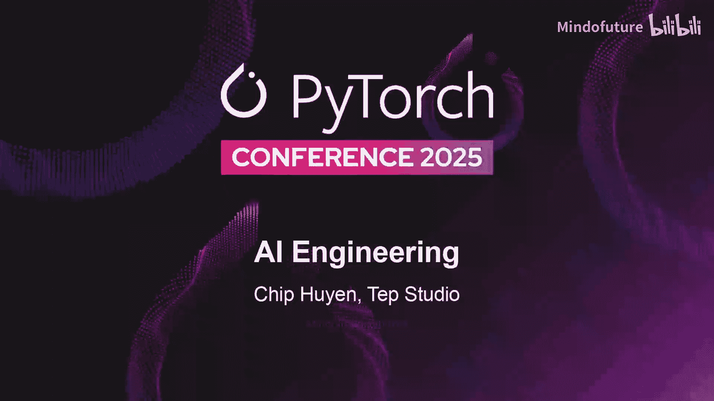
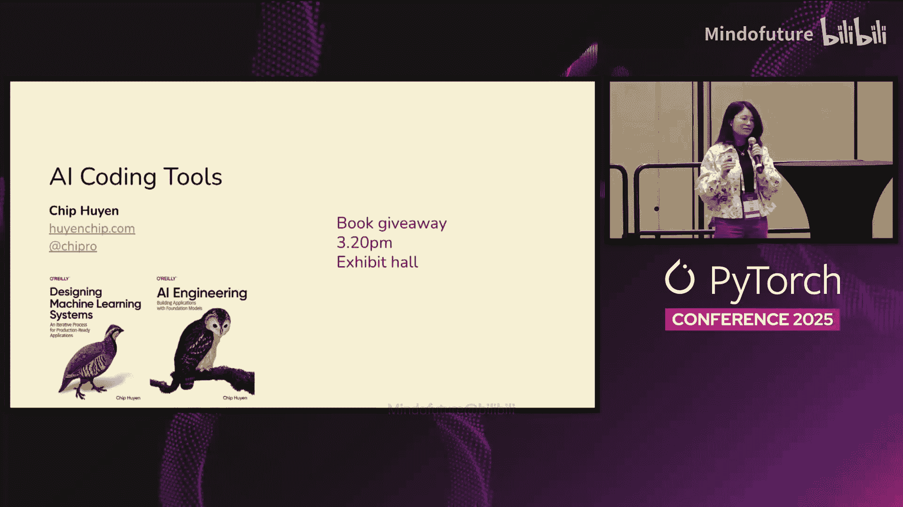
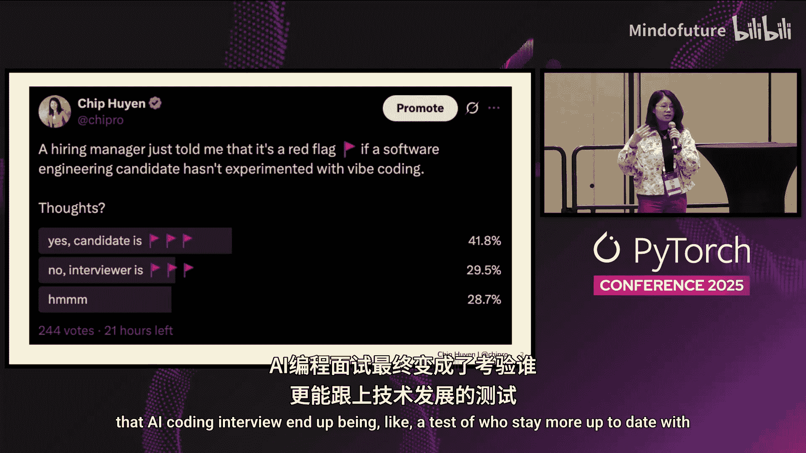
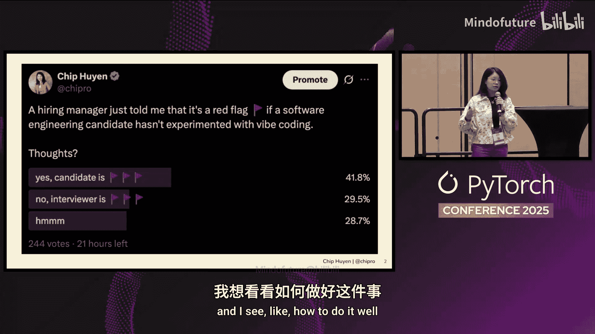
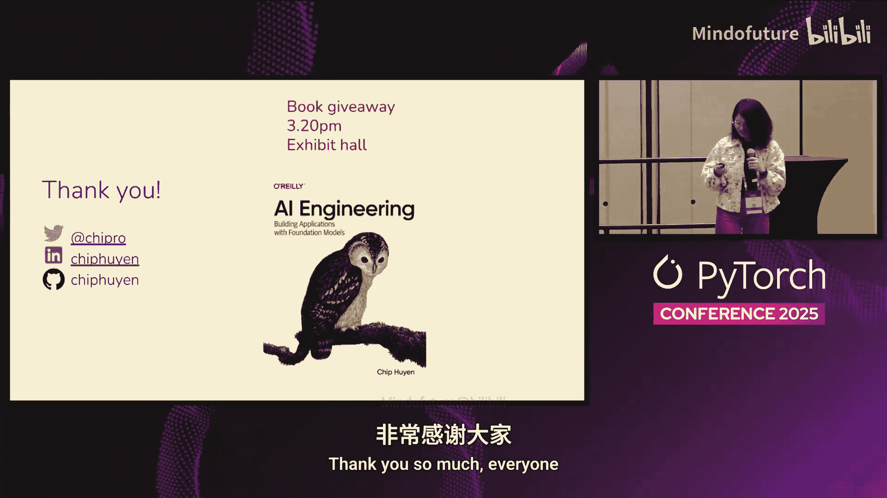

# 2025 Pytorch大会 ｜ Pytorch Conference 2025 p10 P10_AI编程实践-Chip_Huyen__Tep_Studio -BV1b8kRB6EJG_p10-

So hello， everyone。 My name is Chip。 And I'm here to talk about coding with AI。

 I know we changed the title last minute because I thought we could do something more fun for this audience。

 And okay I've been to a few talks here and we have a lot of talk on kernels。

 So if you're here to learn about a torch comp。 This is not the right sessions。

 want to go to other sessions。 So this is more light。

 And I just want I feel like coding with AI is still such a new topic so I feel like I'm still learning about it as well。

 And so I gonna be asking some questions throughout the sessions。

 So I don't realize the term vibe coding because I feel like you vibe where I feel like it should be more systematic and more engineering focus。

 So I hope that we can talk about it as well。😊。

So before we start， I must want to ask， like， who here has been coding with AI。Oh， almost everyone。

 So this morning， someone told me he's a hiring manager and he told me that if he is interviewing a candidate for engineering。

 so engineering， is a person has not experimented with AI coding。

 then he would consider that a red flag。 So who here agrees that like is a red flag if a candidate has not experimented with AI coding。

Okay， so a few。 so actually like this morning， before the talk。

 I just like tries you did it online and I don't tweet a lot。 and I'm really afraid of this tweet。

 but because of you and feel like it need to data。 So a lot of people I think I have of people think is a red flag but also like a lot things that is maybe too much to ask the candidates to Vibe code。

 So actually a question that I've been asking people is is like for companies right because a lot of people record with AI how do we interview for it like should we incorporate AI in the interview process and someone told me that a lot of time because the next generation of coding tools is so much better the previous generations that AI coding interview and up being like a test of who stay more up to date with technologies So thing is an ongoing discussion and if your company has successfully implemented AI coding interview I would love to learn more I see how to do it well。

Okay so so we can just give a quick in of coding to because you are so I feel like a lot of you here are like very serious code engineers。

 so you pretty very familiar with your technologies So there are many different kind of like interface I think the first generation is like IDbased interface like when you have something a VS code and then you can just code record in in in editor and then you have like C is the next generation is very come on now like cloud code open code like Ge andi and I just found out that Amazon has their own Q as well I'm not sure who's using it but I feel like people some people do like it and also like this Github interface pretty excited about So the ideas that you can maybe you have a PR and then you can invite the AI into the PR and can review and suggest comment and of course the last one is a web interface when for example you can can upload a screenshot of the website interface you want and just ask produce the website of the interface。

So our curiosity， who heres prefer IDE based？Almost everyone wow， who hears befo C Y。A few。

 like still a lot。 And who here prefer Github。嗯。😀は。So I guess for web interface。

 let's see who's a brave soul。 So we don't have enough front end engineer here。 I say， yeah。

So actually did this company recently。 so about like we pull about like 1000 engineers。

 and this is and this is a preference。 like almost everyone went for IDd。 But interesting enough。

 I also did another one with my friends。 So I met all my friends go on zoom and then made them do a zoom。

 You might wonder what friends I have。 But yeah I have a friends。 So yeah so this is a preference。

 And I do realize like the preference is actually change a lot with like how much exposure you have had with AI coding tool。

 And I so when talking this company and they told me that I cannot take the result at face value because it turns out the company has adapted I based coding tools。

 So a lot of the employees have not had experience with like C。

 So of course I cannot have that preference。 So I think like nowadays with AI coding tool。

 I don't think is one tool。 I see that the most productive people actually work across multiple interface and actually。

😊，a books I really like is called as a principle of this effort。 So the idea is that whatever we do。

 we choose the things that take us like this effort to do so。

 And I do see the same workflow with like coding with AI。

 So we usually start with something that it like requires a list effort。

 So maybe when you start out right you can start with like an agent tech thing we want to build something let's just throw into like prior prom as the agent like maybe like cloud code or like codeex to just do it to end and when it fail。

 So we start something like maybe higher effort maybe can go into the code base things our so So I think I start moving more and more toward like list effort and better AI coding tools are becoming So we see that people going more like a more autonomous tooling。

So。So yeah， so I think like productivity measurement。

 I feel like with this crowd is probably not a grid。

 So one thing that's like I work quite a bigger companies nowadays is once a company spend a lot of money adapting toolings。

 So executives start looking at like the usage and they like okay we pay so much money we don't see a lot of people using it So what is okay like executive how can just as a CEO or the board that this is worthwhile。

 So people are looking into a lot of way to measure productivity and I would love to hear from from you like how do you measure if you ask individual。

 a lot of people say yes we feel more productive but how do you measure it as like investment to show it to people And I think traditionally we have productivity measurement like engineering time and lies of code。

 And of course it is not ideal because one thing with engineering time is that I don't really care if things takes longer。

 if it don't have to pay attention to it So I think of it as like the mental。😊。

Energy so let's see this like if something can go from end to end， right I can just put it there。

 maybe it can take like an hour， but then if we can just go to bed and wake up and have like 20 of them or like 10 of them and I can just seize the results the next day that it's not that crazy anymore。

 So I engineering time is a bad metric for that And another one is like for the life of code like it's really good at like producing code but I don't think it's a good measurement anymore because we need to care about like how does this translate to like actual task done and I think it's a long discussion and a good love to hear from you all how do you measure that。

😊，So when I think about like energy time we think about mental energy。

 what I think about is a measure of autonomy， right。

 like how do we measure like how autonomous AI coding tools are And this is borrows idea from Ram newic。

 Sos he's a professor and he's a creator of this very cool tool like own hands。

 So idea borrows from a cellding car。 So different level of like automations。

 So the first level it's like auto completions。 It's like you still write code。

 but then you can accept like reject auto completions like suggestions from the AI。

 the next level is like partial automations。 like you can only automate like certain very small subset of tasks。

 like maybe you can write for like a functions or you can very very small feature fix or bug fix。

 And I think humans still need to review a lot of this task。

 And the next level is like conditional automations is like you can full automation on like very。

 very for automation a lot more task。 first example all， like a new。😊。

Use the entire app N to end and the next one is higher automations and it can basically do almost everything except for specific codebase。

 for example， like legacy oracle codebase or some like very strange language is that like you don't see a lot。

 maybe nice some quota optimization could be considered one a specific code base and of course。

 the next level is foreign automation。😊，So I think I， I imagine it's like most of the tunes our day。

 I like between level 2 and 1 and and 3。 I don't think that we are at four yet。

 but see that we are getting there very soon。 So one question I have is it like。

 how do we measure automations， right， Like how do you So like there different level of。

Of automations。 and like how do you measure it。 And I think the idea is that we need to know how good AI is so that we can assign the right task to it because like like just like a manager I don't think you can assign a very complex inter and see they fail。

 you need you to know what is the intern capable so that we can assign the correct level of complexity to that。

 So I was thinking about one things I thought about is like interrupt rate。

 So you think about a start driving car。 like you can let the car just drive。

 But then how often do you have to like jump out and like no no change the action do not do this right So I feel like if you can just let the car drive maybe like10000 of miles interruptions you can have a much higher confidence so you have to interrupt it like every my or every10 miles。

 So I think about that the coding workflow。So it was like doing it。

 And it was like talking about instruction rate。 And some people that told me that I adapting it。 So。

 for example， here is the blog post from my CEO of a continued debt。

 So we're talking about like in the past when we do like delivery pushing coach production。

 One thing we measure is a build time like how fast we can build and deploy things and the faster we can do this then the mores that our continued delivery is gonna be。

 And you think of it is similar with code。 like the longer we can stretch out the introduction rate like the lower disruption rates and it more confident we can have tooling and the more energy we can spare to do other stuff。

 so。😊，So like this， I do think it's very important to like reduce interruption rate because one thing is that we less less mental energy。

 the other is increase of higher potential for like subag So are you familiar with like the subagent task when you have a coding agent is spin off like some tasks running parallel。

 And was reading the system prompt for this task or like subagent。

 one things interesting that stood out to me is that because humans cannot interrupt the task right it can interrupt the main will flow。

 but you can interrupt the subagent So it had to write and spin of tasks when have the high to complete with our human interruptions So if you can reduce human interruptions。

 then it allows the agent spin off more tasks more complexity to reduce should be more efficient。

 Of course it can reduce the context load for model。

 So I know that we have like model with very high long context context length。

 But like context length is different from context efficiency。 So we're doing a lot。😊。

Like benchmark or long context。 for example， actually I'm working with a publisher right now should like using usingI to translate a book from a language another。

 And even though people say that translation is a song task But force something as long as a book it still have a issue。

 for example， if you translate a name to like a specific characters like language like if you translate in that way in the first chapter maybe by chapter 30 you want to stay the same。

 and we have so many issues a consistency。 So yeah and a book is not even that long100000 words。

 So it's way， way smaller as like a million or 10 million token。

 So the same thing with coding long as the code base。

 we see the less as like sometimes it forgets the function name and stuff。

 we can go and choose some of the。 So I do think like every interrupt。

 you create more context for you to remember。So like if we can just like get it autonomously run longer。

 low interaction rate， then we actually being can get the AI coding tools to be more efficient。😊。

So our curiosity， what do you think is the current interaction rate for a coding tool。

 maybe something like maybe the strongest coding agents that you can think of。25%。50%。 Yeah。

 I think it's a tricky questions because with things that I believe so like I have asking a lot of people about it。

 And thiss a big difference based on I actually have this tool or a niy de。

 when we look up the clock code locks and see like people interrupt rate。

 And this is what from multiple people， not just from me and I see that it range from a very。

 very different type of like can go from 6% to like 50%。 and it really depends on a few factors。

 So one thing is like the user background right So I see I see that people from like engineers versus non- engineerines and also like senior versus junior engineers。

 So like for engineer versus engineer is pretty obvious like for like nonengines for PM or like a technical manager。

I shouldn't say technical manager or not engineers。 But Im like， yeah， but like， okay。

 imagine someone who is not engineering background。

 then you use AI to generic codes and you're less likely to like interrupt because you maybe not understanding like what exact code is being written。

 So you just want to see the end result。 But like for senior versus engineers。 That is interesting。

 Who hear think as senior engineers are more likely to interrupt AI coding agent。

So who here thinks that geo engineers are more likely to interrupt。 So actually I looked at it。

 and I found out that senior engineer actually less likely to interrupt。

And the reason is that because I senior engineers maybe it is not， of course。

 it's not a blanket statement， right， I think it like a lot of time people who have a lot of experience writing code or like writing complex document or like design docs。

 they have a very clear understanding of what the end product should be。 So they write very。

 very good prompt。 And specs and just give them like allow the agent to do more。

 And I think another pattern I have seen is that a lot of people they do like one pass of like writing the first specs。

 And then they produce the product。 And then they look it's not quite what I want。

 And instead of trying to fix it。 So it's just like okay now I know more the specs like what you want So rer the specs。

 And then I produce it again。 and it's the second time around the interrupt rate is a lot lower than the first time。

😊，Another thing is， of course a task type。 So like of course like there's a big thing like whether you work on like legacy codeb or like a green film like you're starting a new code base from scratch and writing code and of course people say that's like okay it's a lot easier for AI to work on a fresh new code base rather than trying to work with existing codeb and another one is a text stack So actually look at a different one from like different languages like Python。

 jascript or like Ru and another thing is like task complexity which one is like more obvious because it's a more complex tasks and' more likely is that humans we need to step in and I stop it So I want to ask a question of。

Which language do you think a coding agent can be the best at， Like who here thinks Javascript。

 like out of Javascript and Python and Dr。 So who here thinks is gonna be the best at ja。Okay。

 who here think best at Python。Whoa， we are the Python crowd。 And who here thinks the best addressed。

Few， so， actually， so I， O， first， I when interview my interview。

 a lot of people are not Ru programmers。 Like fighting them is pretty rare。

 I guess I need to go to my some fancy conference somewhere。 sorry， This is a very fancy conference。

😊，So， so actually， like， people told me that Rus actually is really good at Rusk。

 And the theory is that。They are a lot of like bad gras group on the Internet。

They are like morely good Python code on the Internet。

 but usually people who choose Rus are like pretty good engineers。

 And so Rus code on the Internet is pretty good。 So like it can produce very high quality And I Ru like it has a great compiler。

 So it can fix back as you go as well。 So it was talking just I'm sure you have heard about one of this like engineers like marketbergs like crazy money for I heard it create a lot of like internal stripe within meta。

 but I'm not gonna go into it。 but yeah so was talking is like a very strong engineers。

 And he told me that experiment like say if he jar it like about 10000 lines of code with Python versus10 code Rus。

 And it told me with Rus you can accept like 90% of it where with Python can accept like maybe like 4050%。

 So what I for him like iss a lot better with likeding Ru， which is very counter intuitive。😊。

So one things I also track is like the command complexity over time。 So when we do codebase。

 So the codebase I work with with like AI coding agents are pretty complex。

 right So you start my small and then it grows So I have a lot of interact back and forth like adding like this feature or this feature And one thing I track is like the numbers of every step per comment the comment I give it。

 and how many steps that it takes to complete over time。

 and naturally as a codeb grows bigger it takes more steps for it to complete because a lot of the time it takes span searching looking for the right file looking for the right functions where put the code and like we have address the issue before So very natural if you look at a lot of this it would see that increase upward for me is that it's not okay its because of like every time I wait for you to finish searching every an extra step it take more likely on fail and it longer I have to wait and I'm very low patience。

 So I think I try to I try to。Keep it like flat。 And this one thing that like， heres one project。

 So I was using it。 And then I was start writing。The back end in jascript， I don't understand why。

 but like it's the first reaction it did So as I changed it to like Python and you can see that it immediately got rid of a lot of code and it also like become way way more affection when I extra step Another thing I did was that I refer to a long code fly So for me when I tried to work with echo agent my go try to keep it like very flat because I wanted to time to take to complete extra task to be not too long because I don't think we have to face of like can leave it overnight and wake up to it yet I still have to I still babysit it quite a bit。

So， so one thing is a thing about like how to reduce in rate Interion rate。

 And I hope I can convinced you that interaction rate is like something important， at least to me。

 because that's like thats me that is like stand between maybe chooses like wake up to something that's working versus like me having just pay attention over time。

 And it's one thing I realize that I cannot multitask very well because it's like I think like I can babysit maybe like4 or five Asian at the same time。

 I don't know how other people can do it。 But like if very easy keep track of it， lose track of it。

 So if I don't have to babysit， it can like spin up between like I don't know。

200 where if I had to babysit， I have to like can only do only a few other time。So for me。

 it's important。 So， of course， they are different levels of doing it。 you can do is a model level。

 like you can just build a model with better， better reasoning capabilities or just better pretrained capabilities。

 Another one is Iune developer， right， you can do like better agent first good like better tune design。

 creating like better tunes that you can use or like with Ining。 I heard own the race nowaday。

 Who here is actually doing Ining。😊，O， a few who hear thinks that I of fightning is important。A few。

 okay， wow， you really don't think I function is important。 Wow， good good feedback。

 but I do think another thing is like users because it's very important to adapt our workflow to each agent。

 and it's something that takes time。 And it's something I actually have issue with because a lot of there's a lot of papers discussing like developers productivity AI coding tools。

 and a lot of times it concludes that no it not like it makes developers more productive feel more productive。

 but in reality it does not。 And a lot of this setup， they give developers very。

 very little time to get used to this coding tool。 So I think it's not fair because it does like using any new tools a lot of back and forth to understand the agent and change the workflow to it。

 So I don't think that yeah， I do think it's not something that can happen overnight。

And there's some things that my friend told me that especially for like very experienced engineers。

 sometimes I get frustrated because like okay it takes way too much time shouldn I get the agent general what I want。

 so I would rather just do it myself。 But the difference is that if you work with the agents you force yourself to write the problem write really good specs is' a skills that you learn over time you get better over time and it's actually become less frustrating and more efficient。

So another so when I talk like human air workflow。 So usually we start with like planning。

 right we rise a specs， we see like what we want to achieve。 and then we execute it。

 and we write code。 and then we verify and we maybe run tests through it。

 maybe integration tests and like open it I know local host and like look at that workflow。

 And then after that， we like go back and say okay， we do this fix stuff。 And let's see each step。

 how we has changed with AI。So the first is like the planning， like writing specs and instructions。

 I don't think it has changed。 like humans we still need to do that really well。

 And I think that people have been using AI， like asking you to Jerry specs， yes， you can do it。

 but it's still you as as people who develop the app need understand the users well and have very clearly what do you want use a requirement。

 So now good coding is like what I spend most of my time on writing a lot of this like specs and instructions。

 Another thing is like verify So I going to verify more because I think execute isload you a lot of AI。

 I think really depends because for simple features is easy can for if you create a website you can look as a website。

 But more complicated features like like maybe like banking transactions and do a lot of likek testing is harder because it's not obvious。

And of course， the last one is like execute。 So I do think it's like people do it less and less execution of code。

 like people don't write code anymore。 or at less like less and less of it。

 And people say me that a lot of time people told me that they don't even look as the I anymore。

 like a lot of times they could entirely in the terminal and they fix it through like Github like PR review and they don't go in as I So'm very curious was a future't look like if you don't do it。

 And sometimes when it gives this talk people get very angry。

 were like what So am I just want to be a person to review code。

 like I became a So engineer so they can build fun stuff， do fun stuff。

 but now reduce as a person like code reviewers and I have never met a single person who enjoy code review I don't know about but like if complain a lot about it。

 I do think that if you think about a workflow in someone before here it's just like if you think about it's a lot like a manager work as you hire you go up corporate chain。

You actually do hands on execution less and less。 and you start like a lot of work is in assigning tasks and reviewing the outcome from like people below you。

 So I do things like we become more and more of that And I think somebody have a good way putting it like coding is pushing us up the higher level of tractions so we don't do lower level anymore。

 but we do need to have a bigger pictures and understanding how to assign tasks so for me I think of it as of course spec driven development a I I think it mess a little but yeah so like flow of course we need to write a lot of specs and coin is like spec driven development another one is like I do think it's important for error we can look at a type of error that coding agent mix and we can adapt our。

Goflow to reduce the Sky arrows。 So for example， here's one of the graphs。 I look。

 so I just look as the arrows a cloud code made。 And I realized one thing is like the number one type of arrow I have is like content not file。

 So it's because in code base big like when you try to ask it should do something。

 So it was just like okay， maybe I think that the code is in this file。

 the code the function name is chart is name like this。

 And then it try to search for it and it doesn't fight it。

 So for it I try to do very well with structure my code my code base so that it make it easier for it to fight。

 So it just like be very， very tyrannical about the coding structure。

And another thing is just like like going mentioned is like pushing it up to high level abstractions。

 So we need to think about it holistically like having bigger picture understands the requirements and just like be very clear about what we want So yes that's pretty much another thing is that AI coding tools that I improve incredibly fast So about a year ago I did this experiment of like how many steps an AI agents can perform at once and back then like a lot of them cannot perform more than like fivestep at a time reliably at a high success rate and I was looking at like my cloud code on my project and you can see is like the average number of steps it take is like 14 which like incredibly high and sometimes attempt to go into hundred of steps of course step is not not a perfect metric for it because some step are easier to do if you ask it to for some browse website and it's a lot easier than I try to call the right function So not steps it's not good metric but I think it's just like a proxy but I think。

P incredibly fast from like  five steps a year ago。

 And now we can go to like 10 15 and1 like 1 hundred0 steps。 So yeah， it's moving very fast。

 So I'm a time here。 Thank you so much， everyone。 So the organizer have been very kind to like bought to buy a bunch of books like engineering。

 and theyre gonna be have a giveaway。 And they want me to tell you like a 320 today in the exhibit hall。

 Thank you so much， everyone。😊。

