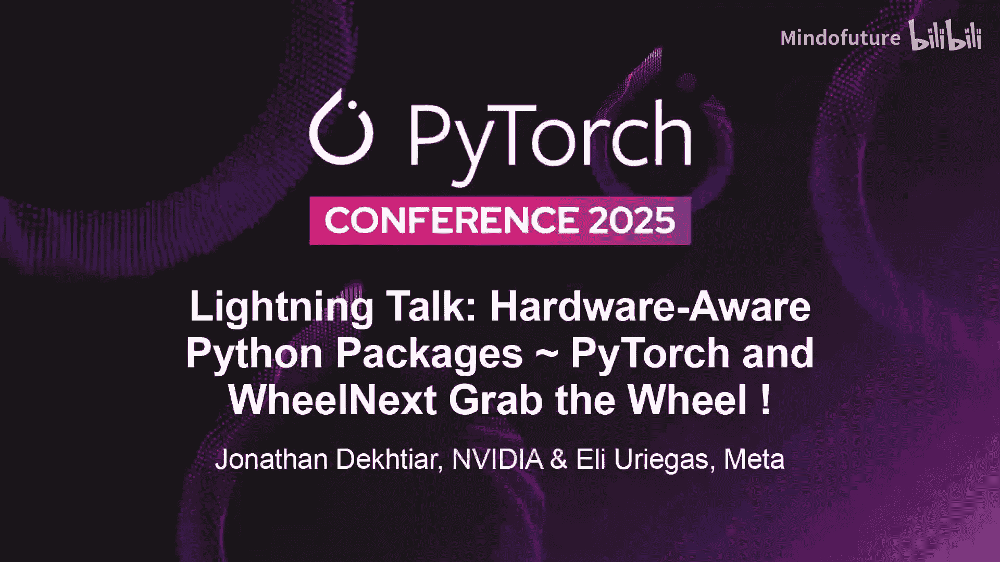
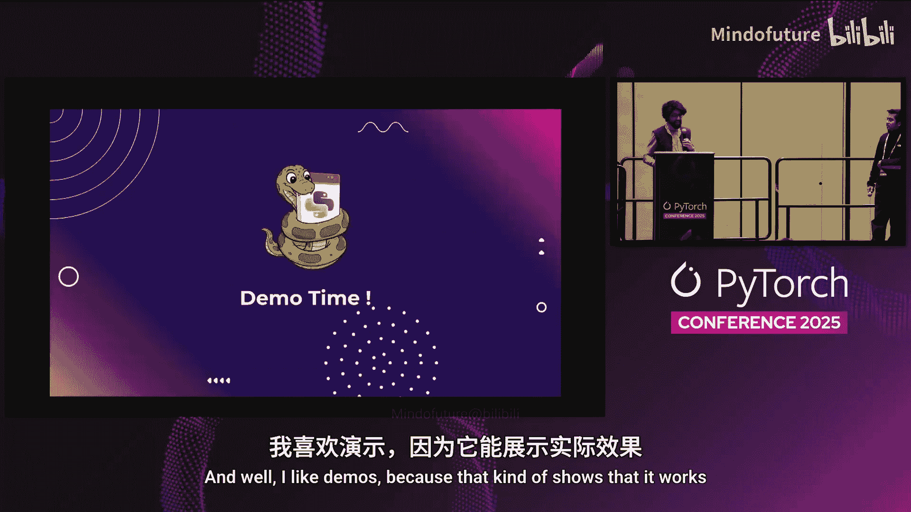
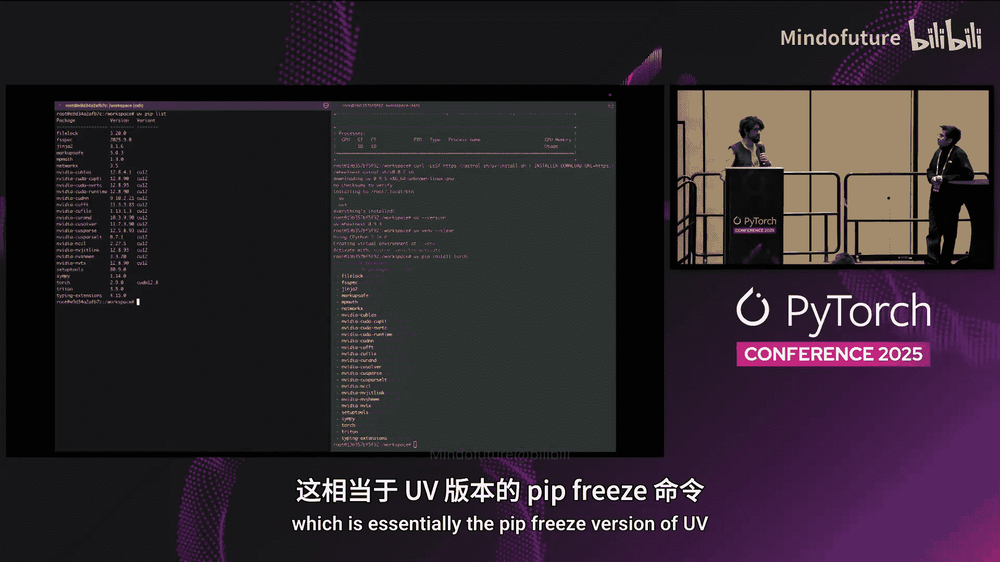
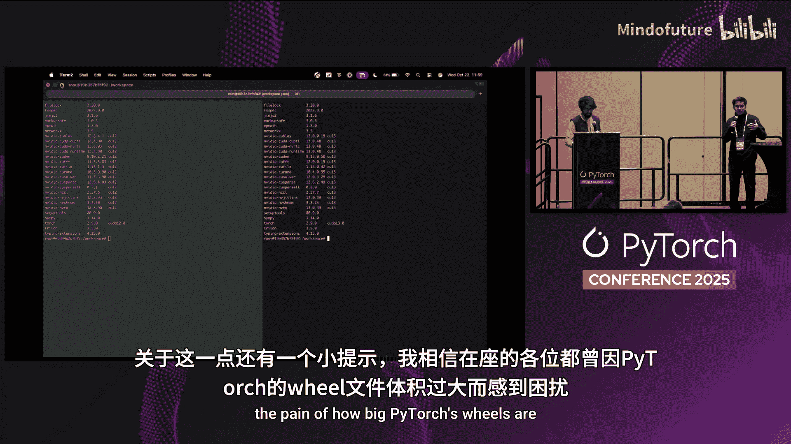
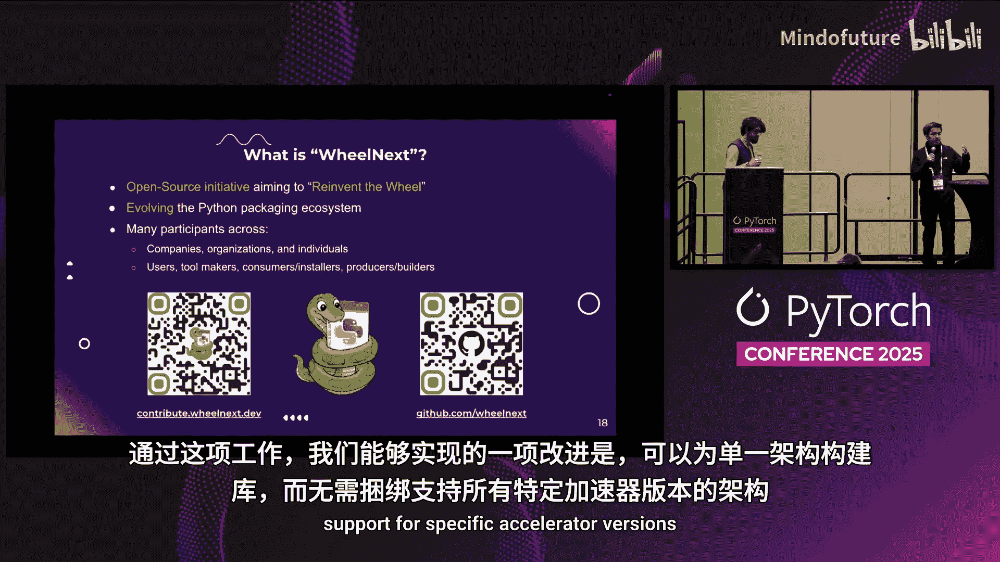
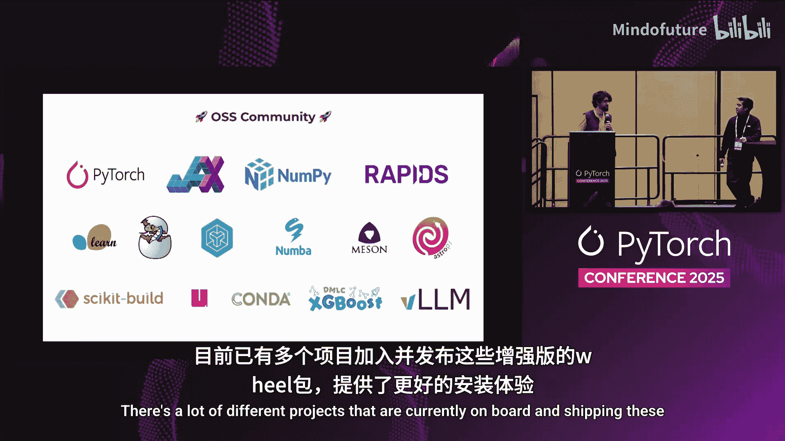
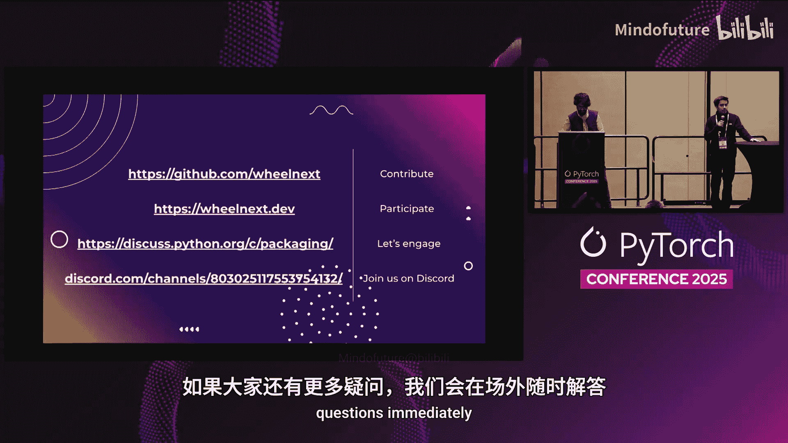

# 2025 Pytorch大会 ｜ Pytorch Conference 2025 p11 P11_闪电演讲-硬件感知的Python包~PyTorch与...-Jonathan_Dekhtiar__Eli_Uriegas -BV1b8kRB6EJG_p11-

Awesome， hi， I'm Eli and this is Jonathan。 we are here to talk about hardware aware Python packages。

 Pytorch and wheelnecks， grab the wheel。

So to give you some context on ourselves， Jonathan here works at NviDdia on Kuta Python。

 and I work on the PytorrchDevelop infrastructure team over at Meta。So first and foremost。

 I think everybody asks us around Wnecks， what is the goal。

 what are we trying to do and I always have a thing and I just sayPip install torch and everybody goes wait what we already have that and know I mean Pip install torch where no matter what hardware you're running it'll install the correct version of Pytorrch and I'll kind of go over what are the problems and how we can get to this point throughout this。

So what are the problems？First and foremost the problem number one is that Python packaging lacks the ability to finally describe hardware。

 what does that mean in terms of like kuda versions in terms of compute capability， arm versions。

 special CPU instructions， Python packaging doesn't currently have a way to do this。

 we have a standard right now that kind of dictates it around like CPU architectures which I think is really good and we can follow that pattern as we come into more things around finally describing hardware。

So to give you a sense of what this looks like for the average Python Pytorch developer。

 I think everybody has experienced this at some point when trying to install Kuda version where you have to add your extra index URL it's not entirely clear which index URL you're supposed to use so this is the example for Kuda 13 for installing the latest version of Pytororch。

This is the example for Ka 12。8 for installing the latest version of Pytorch。

 and this is the example for Kuda 12。6 for installing the latest version of Pytorch。 As you can see。

 all of these are different and who knows which one is it's supposed to be。 I mean。

 I know because I wrote it， but。Who really does know？And I think at the end of the day。

 this cannot be the best answer that we have。 We must do better。

Problem number two I think I'm highlighting it right there in our last couple of slides is around using different package indexes。

 I think right now we don't have a really great answer for this external package hosting is just difficult and it's really difficult to get consensus on I think there's been a number of pubs that are trying to address this and no consensus has been reached out but we're trying I think there's also a no standard mechanism across installers so I think whether you've used UV orve PIP or if you've used poetry I think everybody has their own way of specifying index priority and we have to do better on that。

And I think that there is an opportunity for packaging name collisions across different indices。

 you know， supply chain attacks are very real， Pyttorch experienced one about three years ago with the Pytch Triton package。

 and so we want to push forward standards that enable people to have the most secure supply chains as possible。

And finally， I think it's all about scaling up distribution。

 Python is becoming more and more popular， PyTtororch is becoming more and more popular and as such we have to have an understanding that the package size limitations that are currently brought on because PiyPy is a free service are just not going to be the greatest moving forward as packages get bigger and bigger and bigger。

And downloading large packages and binaries is difficult， and we are slowly improving this situation。

 I think PiPe released PipePi organizations earlier this year。

 and we're super excited to be able to try all of these different things out and help push standards forward to help improve the Python packaging situation。

And so now Jonathan is going to talk a little bit about wheel variant。Thanks， Eli。

 so I'm gonna try to present to you the solution that we have come up with pretty much over the last year in collaboration with many。

 many people。 and this is an upcoming standard that we're gonna try to propose within the entire packaging community So this is not official approve work today。

 but I'm try to gonna present you how we envision it So essentially what we want is as Eli said。

 Pip install package and as you do this。 the package manager kind of look in the system and say， oh。

 I say you have could at 12。8 install on that machine Sm120。

 So I'm going look in the registry at all the version of Pythtors that are being built and available and pick the one that fits the best this machine that could be only one that could be zero。

 that could be multiple but I'm gonna install the one that fits the best。

 and we have this working today， you can actually try it you just need a special。

Of U that has a special behavior enabled， and it will work out of the box。

 You don't have to mention any special flag。 You don't have to mention a special index。

 You don't need to do anything special。 And that's what we want。 It should just be this。

So how does you work under the hood， when we build these wheels。

 essentially you can see a new appendix to the name file that is essentially a label for the artifact。

 it doesn't carry any meaning a site of being a sort of string identifier。

 a unique name to that artifact， so there is the Kuda 13 for example。

 that require a Qa version over bound of 13。0 and list bunch of GPU art SMs that this specific binary is compatible with。

😊，And then there is a tiny bit about ordering to kind of say， if you can pick this one in priority。

 if you cannot just default to that guy。And well， I like demos because that kind of shows that it works and otherwise it's just a bit of words。

 so I have it live if it doesn't work， I have a video， you know the demo God。

Just to reiterate， I might need to zoom out a little bit。Here we go。The one on the left is a Ka 12。

8 machine。 My resolution has changed。 I'm sorry， better。So there is coa 12。

9 on the left and Kuda 13 on the right as you can see and we're gonna to see how doing the same thing on both machine is going to give totally different result So if I go and install UV on both and I need a special build of UV which just to mention is built by the UV team。

 we didn't fork it， UV is directly supporting it as first party branch essentially and if we do UV version on both sides。

 you can see that we get UV wheel next which is essentially this augmented version of UV that is enabled to look into the machine and kind of do this fancy decisions So that's great。

 then we're gonna create our virtual environment。Because that's important。

 So I'm going to do the same on both sides， UVVN。Clear。And then。

I'm going to install pagetorch without telling it what to do or what type of machine I have。

So I'm going to do U people install torch on both sides。

It's going to download all the dependencies and install everything。Which is great。

 So let's clear the terminal for a bit and just type U PP list。

Which is essentially the P freeze version of U。

And now analyze the different result on the left on the right and the left。Alright。

 so if you look left and right， you can see that different artifacts were installed on the left side。

 we can see versions that are actually are not the same between Kubla， for example。

 on the left and on the right， That's normal because you picked the Ka13 or the Ka 12 release that N video built。

 And if we look at torch。 Well， we have the exact same thing。 Both are。Tauus 2。9。

But they have different builds。And different dependency sets。

And while this is working across architectures， it detects the GPU。 so for example。

 SM 50 and SM60 have been duplicateprecated and are not built anymore for Qa or。

 so if you have an older GPU it automatically detect this and go and install the right version of Tous 2。

9 that will support these older Ss。And as a note， now we also ship as part of Tous 2。

9 AMD and Intel version。 So this works across the board。

 and we can start doing CPU optimization like A Vx 51 arm。 Well。

 it turns out that max CPUs not RV7 So you could actually get a speed boost if you were to use the right acceleration because you know that they are RV to RV9 versions。

 So all of these things will be out of the boxs。 one little note about this too is that I know that everybody here has experienced the pain of how big Pytorchches wheels are one of the things that we can really get out of this is building for a singular architecture instead of having to bundle for all of the architectures that we support for specific accelerator versions。

 And so we can really have a point where we have very。

 very small wheels compared to the big wheels that we have now。

 And so this enables that type of work as well。 So just have 30 seconds。

 so I'll go pretty fast wheel next we already talk to you about it。 It's an open source。😊。

initiative that includes many， many different companies， many different open source project。

 and our goal is to evolve the Python packaging standards to support the scientific compute iss the work of many people not just the two of us and it's important to give them credit for the work that has been done there's a lot of different projects that are currently on board and shipping these augmented wheels that have better installation story and we would really love for you to give it a try if it doesn't work and if it's not all trust simple。

It's broken and we want to make it better。 so please give it a try。

 It's just a couple lines of bash and it should just work。 if you have any question。 Yeah。

 if you're also interested in talking to us more in depth about the technical specifications of how wheel next works I will be at the meet theDevelop section for Pytor Stevinra this afternoon in in the exhibition hall would highly recommend to come and speak to us。

 Jonathan will also be at the Nvidia booth in the exhibition hall throughout the day so would highly encourage now after the tool Yes。

 absolutely so any question。Yes， please。Like， could you give an example？Oh， so yes， A。

 we are actually working on it。 We were hoping to have a demo， but one of example is VLLM。

 for example， has an hard dependency on Pythtorch， and it will probably be we are trying to come up with a fix and we are hopeful for it。

 and if anybody has any more questions， we'll be right outside to answer any questions immediately after the session as well。

 So thank you。 Thanks。😊。

