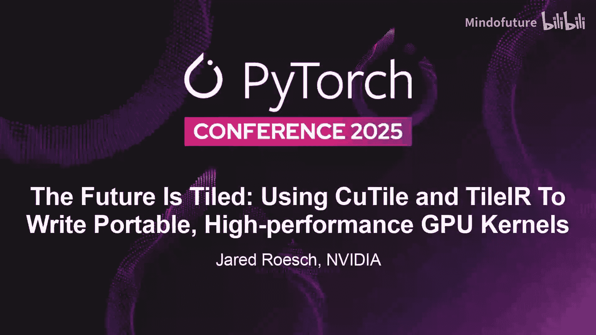
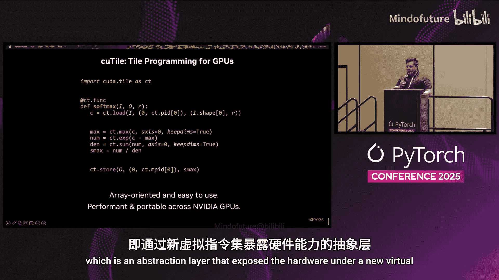
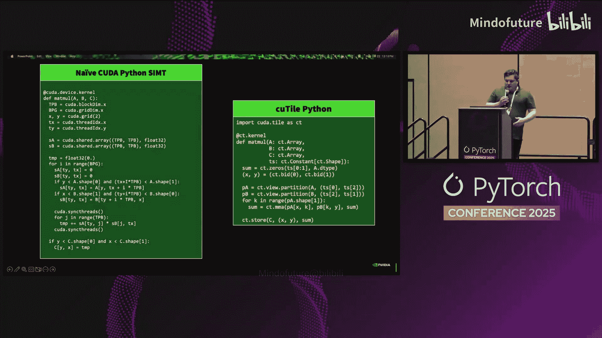
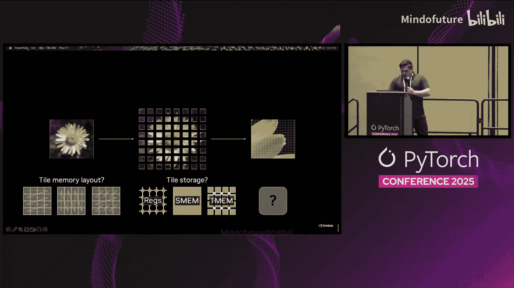
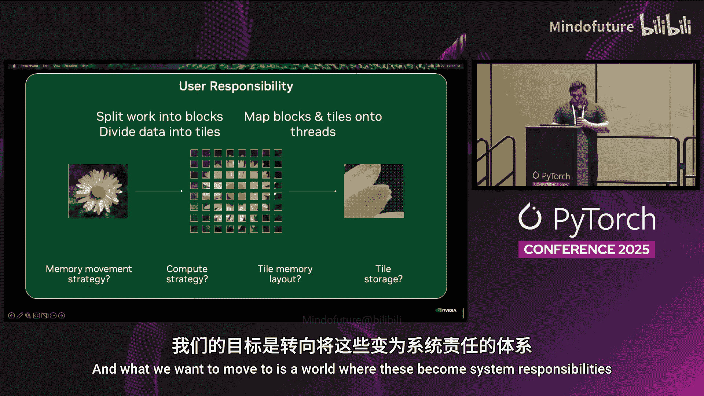
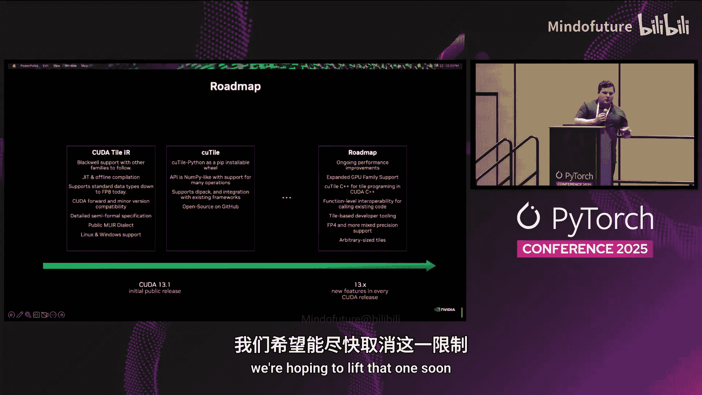
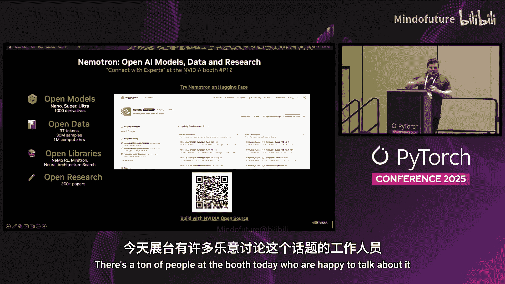

# 2025 Pytorch大会 ｜ Pytorch Conference 2025 p12 P12_未来是分块化的——使用CuTile与TileIR编写可移植高性能GPU代码...-_Jared_Roesch -BV1b8kRB6EJG_p12-

Good afternoon I guess it still feels like morning my name is Jad Rush I'm a distinguished engineer at NVIDdia and unlike Jim I'm not going to have any cool videos of robots today because we're talking about cogeneration today I'm going to be talking about the futureist tile。

 this is a talk following up kind of on our introduction of Kuta tile and T IR last GTC and we want to go a little bit more to the details today。

So as agenda goes， I'm going to briefly touch on why we're doing this。

 why are we evolving the programming model of GPUs。

 we'll briefly talk about coatile in its component pieces， we will go through a couple examples。

 we'll talk briefly about performance and then we'll end with roadmap and future plans for this work。

So one important thing to think about is GPUs have evolved over time。

 we think about them sort of as a monolithic hardware device， but if we go back to the 1990s。

 GPU started very much as a fixed function accelerator。

 that was you accelerated a few primitive that you cared about in hardware and the programming model of it was call a couple APIs to do those things and just dispatch of the hardware。

By the time we get to say 2001， people started to want to have more control and you see things like programmable shaders show up where the hardware now takes a fragment program that you can use to customize the behavior of the device it became a little bit programmable and then by the time we get to the 2006- 2007 time。

 people have been doing lots of things by abusing this programmable shader model and you see the evolution of things like GPGPU and with the introduction of the G80 and then CUa in that following year。

 made we hardened that into the hardware where now you had a uniform shader and compute model where you could run programs that compute it in arbitrary ways and you have flexibility over the pipeline and the ordering of them the task you did。

 and this really unlock GPUs。Now that was 2007， the GPU is not frozen since that time。

 we've actually evolved quite a bit if we fast forward now to 2025。

 we've evolved what GPs can do quite a bit， so for example now we have new compute and memory hierarchy layer levels。

 we have introduced threads or threads so you can do divergence。

 you get new cooperative operations that use threads in different ways and allow you to mask some of them off。

There are new coprosors like the TA， which is a DMA engine for tensors。

 you get things like tensor cores， low precision， hardware sparsity， and on and on and on。

Though in that time， the Kar programming model has evolved at the K C++ level。

 but the actual abstraction has remained relatively stable over that time。

The reason why we want to evolve is actually the number of tools， as I've been saying。

 have we've granted you is grown quite a bit， even just looking at Ampere to Hopper to Blackwell。

 the number of tools in your toolbox or writing GPU code have increased dramatically。

 but the programming experience has not changed as much。😡，For example， if we take something。

 there we go， if we take something like Tensor cores just as a single example。

 the tensor cores evolved every generation。Oh sorry my slides are taken for a second to load the Tensor core has evolved any every generation so if you go back to Volta。

 the Tensor core primitive was actually very small dimension。

 it only used a quarter of a warp and when you write a kernel you have to program against this primitive so you've seen things like in the last few years like thunderh kittens come out where they built an entire library around the primitive unit that you compute on and then you do all the work to pipeline your memory and stages of your computation in order to feed that core primitive unit but then what happens when it evolves next is you have to rewrite all your code so you can see by the time we get to Hopper the Tensor core looks very different and it requires not only a single warp but for now so now you need to cooperate across multiple primitive units in the GPU。

So why do we want to evolve？There are three main reasons。

 one is we want to simplify like we saw on the first slide。

As we've evolved the hardware we want to simplify the programming model to match it。

 so we want to simplify writing GP programs and we've also seen in that same period there be more and more standardization on the kinds of programs that people are writing。

 today they're very clear data parallel array programs that people are writing in Pytorch in deep learning in general。

 and so it's easier to understand the kinds of programs that people want to write。😡。

I don't know why the slides are taking so long to load。

We also want it to be target from any language， but especially things like Python， as we've seen。

 the world has shifted from people writing lowleve kernels and things like C++ or assembly into higher and higher level abstractions。

 whether that's Triton， new things like Mojo or Heon。

 that're all coming out in order to kind of lift this level of program abstraction。

 and we want people to be able to build the ability to program the hardware。

 not just in one language， but in the language of their choices or in the frameworks of their choice。

This slide seems to just take forever to go forward so finally we wanted to define a stable abstraction for the Tensor cores and related to hardware so another challenge that I touched on is that every time we evolve one of these if you write a program for them。

 you have to rework the program to get peak performance and we want to make it possible for you to carry a program forward without having to rewrite it for every generation。

So how are we doing this， we're introducing two pieces so we announced this initially back at GTC and I'm going to touch on both of them today。

 overall the effort to extend this programming in theuta programming model we refer to as Kuta tile。

 it's the biggest programming model extension to Kuda since we released it in 2007 and we're introducing then two component pieces today which is KUutile。

 a DSL for teleprogramm directly in Python so you can see that this is a high level DSL。

The goal is for to be array oriented and easy to use and perform an portable， like I just discussed。

The goal of this DSL is actually mapped to the thing we're going to talk about in a moment。

 which is an abstraction layer that exposed the hardware under a new virtual instruction set。😡。

Just to give you a taste of what this looks like， here is a naive Kuta Python ST program。

 so this is actually another thing that we've done the last few years you can now write low levelve threaded kernels in Python directly that's what's here on the left now this kernel is still pretty concise but it's definitely not say the art performance wise and it is not using any of the hardware accelerator features that we just talked about。

😡。

So you can see on the right we have a very simple Qutal Python kernel that is only a few lines of code and actually has access to all of the features that I just discussed you can see an equivalent attempt here in Cutlas to write a highperformance sort of state of the art kernel but this is actually very complicated this is all C+ and it requires you to be an expert in using cuttlas and all the caveats that I just discussed apply like if the architecture changes you want to take this from Hopper to say blackwell you have to rewrite this kernel while you can take the same kernel across all the architectures and run it there。

So Kutal itself is built on top of what we're calling Kuta Tal IR。

 which is a virtual instruction set for InVD GPUs， so when we introduced Kuta back in 2007。

 we actually introduced something called PTex which some of you may know about which is a abstraction of the hardware where you are at the thread level where it describes the behavior every logical thread and the driver and runtime system of KutDa is responsible for mapping that to your actual device for the longest time this is how we've given you forward its compatibility in KUa when you ship a program we can take the PtX for the new GPU。

 adjust it and then execute it directly in the device so you can ship a program you wrote a long time ago and then bring it forward with you on the new device。

TL IR is a new sibling abstraction to PTX and our goal is that it is overlapped in some ways but also just joinedin in others。

 so our goal is that you can write certain programs here that are not expressible in sorry the other way around you can write programs in PTex that you can't write in TIR but the TLR programs give you more performance portability so the goal here is to be able to write regular array or data parallel programs。

😡，Those programs that you write at are much easier to achieve peak performance and we're making as stable and portable as we go forward in the future。

 so if you write one of these programs today for Blackwell。

 it will work in the next generation of GPUs。An important part of doing this work is that it's not just another way to program you know like another DSL or another framework。

 but it's actually about doing all the work to make this work natively。

 so we're building this as part of the KUDa platform which means it will work with the debugging and profiling and all the tools that you know and love and there are new challenges in exposing this abstraction in developer tools not just in the programs themselves and an important part as well is that we're opening the actual intermediate representation as an open MIR dialect meaning that you can naturally import this into an existing compiler or a system that you're building and directly emit TIR yourself so just like you can use LVM。

Or PTexX today as a backend for your compilers， you can also use TIR。

So what this looks like from a stack perspective is today we have something here on the left where we have frameworks like Pytorch and Coy and N。

 Kublas， Culas， et cetera that all sit on top of coucce++。

 which eventually gets compiled to Ptex we have things like Triton。

 which have their own MRIR based compiler that emit Ptex directly and what we're doing is we're extending this so there's a new level at the bottom TIR and today we're shipping couile built on top of that。

 but as we move forward in the future， our goal is things like Triton can directly target this abstraction if they choose。

 we can also migrate existing DSLs that people are building out in the wild。

 or you can cobuil a brand new DSL without having to do all the work that's required today。

From a programming model perspective， we view this as an important middle step in the programming model today there's a lot of focus on sort of grid level programming。

 right？😡，You write a program， the system figures out how to divide that into blocks。

 figures how to split your data into tiles， and then maps both onto the low- levelvel threads to actually compute results。

 so if you use something like coBs， et cetera today， all this is taken care of for you。

On the far end， just like the example program I showed a little while ago， the user has full control。

 and this is what happens in PtexX today， the user has has put their work into blocks。

 then into wars into threads， they have to sign the appropriate data。

 they have to figure out the tiing factors， they have to figure out the pipeing， so on and so forth。

 and our goal here is introduce a middle level abstraction that splits the difference。😡。

So you can see， like I just said， Kublaaz is here at the grid level。

 we say have something like kuda C++ at the thread level。

 and we're going to put kuta tile right here in the middle。So the important question is。

 what are we abstracting from you？So you can see here back in the old days。

 the existing programming model， we have the unit of execution is a thread。

 so you're always thinking at the lowest level about what a single thread is doing。

 there's hierarchical decomposition that you have to do from a block of warps。

 then from a block of warps into warps of threads and then you have to think about the memory axes and the behavior of each individual thread。

😡，In the new world， we have one unit of decomposition， which is a tile block。

 you take a grid and you split your work into a tile block and each tile block processes one or more tiles。

 and that's the only decomposition you have to think about。Then on the data side。

 when you thought about it before in the thread world。

 you have to think with the individual decomposition of every tile， tensor， vector， et cetera。

 in the number of elements that each thread is going to process。😡，In the tile world。

 we just have arrays and tiles which are aggregate values。

 so each tile block can load a chunk of data， it can do something logical on it。

 like addition or matrix multiplication， and it just works。So。

From a compiler and runtime system perspective， what are the things that are abstracted as well。

 well questions like how do you store the tile？😡，So when you're writing for the existing world。

 you have to think about MIIN registers， MI I in shared memory， MINT memory， or somewhere else。

I have to think about what is the layout of the tile。

 so if you've ever written really low level GPU code。

 you know that you have to think about bank conflicts or swizzling or all these complicated questions about how the memory is accessed and in what order。

You need to think about your memory movement strategy， so as you're writing a kernel。

 a lot of the work is pipelining from the higher memory scopes into lower memory scopes。

 and there are multiple tools in the instruction set for you to do this。

 whether it's a synchronous load or a copy and as synchronous copy or a bulk copy。

 and you also have to think about at what stage and level you're at in the memory hierarchy at what time。

And then finally， you have to think about the compute strategy， the tensor cores。

 if you have the right problem size and the right compute intensity are the right strategy。

 but they're not always the right strategy， for example。

 vectorizing a loop and writing it by hand can be faster。

 but you have to think about all these considerations today。😡。

So what we're doing really is those are all user responsibilities in the existing world and what we want to move to is a world where these become system responsibilities。

 so all the user must do in this new world is split the work into blocks， divide the data into tiles。

 and then write their program from that perspective。😡。

So what does this look like from an actual code perspective here's something like Softmax for example。

 this is a slideware version of it， this is very close to the final syntax。

 there might be some variations but before release but you can see it's not very very long one important thing to highlight is that in this model global arrays are mutable so you can see that the input buffer I and the output buffer O highlighted in orange here are dynamically size tensors in global memory and that's what the kernel takes in as arguments。

You can see when I want to get a tile from it， I can call load load in this case takes an index and a shape and what it allows you to do is interpret the global array as a sequence of tiles and then pick the I tile out so in this case we're turning it into a view of tiles that are。

😡，Input dimension zero by R and then we're loading the zero by x dimension out here the BID is actually like the grid ID of the tile block so just like in Kutuda where you get a grid ID today you would get a grid ID here so if you know one is the y dimension two is the Z dimension and then once you have that in hand all you need to do is compute on tiles so once we've loaded from the array we have a tile here notated in the green。

😡，Tiles have familiar operations on them so in this case you can call max， you can call X。

 you can do subtraction， you can compute the sum， you can do division all these tiles are immutable values that are only visible to the block so from this perspective we've abstracted the low level so the details of where this is stored what layout it has etc or all removed from you and then when you're done all you need to do is store and in this case store is does the inverse of load where it uses dimension of the tile to interpret the size of the grid the tileling and then it uses index to write it back。

An important thing to remember though is that mutation only occurs through global memory。

 so when you do something like transpose a tile here， if you don't store it back。

 it will not be visible。😡，And the reason we do this is it gives us freedom to reorder the operations to change their memory layout。

 pipeing， and so on。An important part two is that these are built in， so we have uniform launch APIs。

 all the couda driver APIs that you're used to work with tile kernels。

 so here's a tile kernel that we just looked at in green。

One important thing to also call out is that complexity like， say， for example， TMA descriptors。

 which if you've written Triton or other sort of higher level tile like programming models。

TamA Descriptors are one thing that require host and device synchronization and management and they often leak out into your programming model we've abstracted and handled all those here。

 so you don't see those even though if we're using the TMA they never appear here and then when you launch on the host it looks like this you just take an input array。

You copy it over， you allocate output buffer， you call launch， and then when you're done。

 you copy back to the host。What this also means though is that out of the box you can just interoperate with other kuda code。

 so here's a kernel written in the SIT style， that's the one using the kutaitt decorator and then one here kuta tile。

fk and it just another simple kernel and both of these can be called in the same kgraph kind of in the same pytorrch model etc ce。

 they just work like normal device functions do in kudDa today。😡。

So to wrap up I want to show just a little bit more worked example so here's actually a full matrix multiplication there are ways to further optimizes just to note but this is sort of the naive slideware version so we start by first obtaining the block IDs so as I said the execution of the abstract machine is that you have a grid of tile blocks or each one has a coordinate and then they are logically a single thread of execution if you want to think them about them that way each one can only view its local state if they want to communicate you must do it through memory so in here I am。

Inside of this block， I am the block denoted by XY。

 and I'm going to compute that subtile of the matrix multiplication。😡。

So you can see that the first thing I want to do because I'm doing a K reduction is I'm going to allocate a zeros buffer。

 so in this case I just call zeros， one important thing to note is that we can deal with dynamically sized to tensors。

 but tiles must be statically shaped so that allows us to retain the performance while also still giving the flexibility to write dynamically sized kernels so in this case when I want to allocate the accumulator I actually took sorry I skip something we have four input arguments we have a input array。

 B input array， C is the output array and then we have a constant time compile time parameter which is the tile size。

 so I need to allocate the accumulator buffer at the tile size that's why TS is passed there。

Then we have an API for getting the number of tiles based on a certain view。

 so if you want if you want to tile a with the tile size denoted by you know TS0 and ts2 which in this case is like the small M by small k tileling that you want so let's say you're doing a 64 by 64 square tile for your multiplication that would be 64 and 64 it will tell us a number of tiles that you are going to be able to get from that dynamic value and then you can write a loop that does reduction over it。

 so the loop looks just like a loop right you know 4K and range。

And then the inside of the loop we're just going to do two things first we're going to load so we talked about load briefly before the same thing applies here with A and B。

 I'm going to load the tile denoted by xk with that given shape the order parameters are like nuI it allows you to talk about the layout I'm going to do the same thing with B and then I'm going compute just again a pure operation on tiles which is MMA so importantly the immutability comes up again。

 this is why we pass some in here as a argument to the third argument and we return and assign it to the variable again this allows us to actually update that tile and memory as we're doing the loop and then finally when we've done the full accumulation over the K dimension。

 all we do is store back to memory and so that's all you need to do to write a matrix multiplication in co tile today。

Importantly， the semantics here are not too far in some sense from the actual virtual abstraction。

 and that's part of what makes this easy is that we have the ability to build sort of the programming language features that map down to the constructs that we have at the IR level。

 and there's nice synergy in between doing that。So one thing that I want to touch on before we run out of time is。

A little bit of taste performance so we will discuss the release of this stuff in the next slide these are sort of beta results of just a few cherrypic you results that show what is possible you might ask after all this talking is like hey you're abstracting a lot is going to be really slow and what we've observed is that actually the freedom that we get by changing the programming abstraction is actually allowed us to get pretty compelling performance results over a lot of workloads that people care about to talk a little bit about what's on the slide in the light green we have the programs written in than DSL and then the dark green we have picked different benchmarks that are known to be at least inside of Nvidia that the sort of state of the art performance on that workload so for example the first one is from Cutlas I believe the second one is from T yourtLLM and so on so here you can see that we're within 10% sometimes slower and faster but we believe that the productivity improvements even when you're in small margin being a little bit slower。

ighThat cost and we believe that this is something that we can maintain over time。

So I think with the final moments， I just wanted to talk briefly about the roadmap。

 oh also one last thing on the performance I forgot， this is all recorded on a B200 by the way。

 so this is just one snapapshott of one platform as well。So finally in the roadmap。

 T IR is coming Ktal in general if the effort is being released as part of Kuta 13。

1 which is one of our upcoming releases， we're releasing two pieces just to reiterate。

 there's Cuta Tal IR， the virtual extraction layer like PTX so that's going to come with initial support for Blackwell with other support to follow it will be available both as part of the JI compiler in the driver and also as an offline compiler tool that you can invoke directly just like PTXA it supports the standard data types down to FP8 today with us to do more work to extend that in the future it has KUa For and minor version compatibility。

 we're also releasing as part of the first release of detailed semiformmal specification I think the PDF is about 200 pages right now so there's a lot of detail there for you to read and then we'll be releasing a public version of MIR dialect。

 which you can then use to link and build against if you're writing a compiler and this obviously works on all the Cuda Plaforms Linux and Windows。

We're also at the same time releasing Kutile Python。

 which is the DSL that I just showed you the D cell is coming as a PIP installstable wheel that you'll be able to install like any other DSL。

 the API that I showed you today is very nu P like our goal is that the programming models a little bit different than say Tri and or other similar abstraction levels where we want to be more focused on array fragments so there's some changes in the APIs and design than a little bit different we support all the standard integration points。

 for example DL packC， it will work with your Pytorrch models。

 you just treat very much like a function and everything just works out of the box and then finally we'll be doing this in the open source so the DSL will be available on GitHub。

 you'll be able to send contributions， read the code so on and so forth。

Finally in terms of roadmap over the next series of 13。X releases。

 we have many fun things planned including a lot of ongoing performance improvements。

 extended GPU family support bringing support back to older GPU targets like ApiR and Hopper we will also be releasing support for doing this in co to C++ look to more details next year we're working also on functional level interoperability so you can call between fragments of code that you've already written inside of a single layer kernel the developer tooling has many new features slated including more debugging tools and tracing tools and performance tools and then we will one big push is also F4 and mixed precision support and then finally one thing we want to do is support for arbitrary sized tiles I don't believe I said this before but today there's a power of two restrictionsion like Triton and we're hoping to lift that one soon。

So with that I think I'm right at time， you can find these online obviously there's a bunch of other resources if you want to hear more about this people gave talked about various portions that I touched on today at GTC and you can go back and find a lot of those great talks today also at the NviIdia booth we're doing a lot of things in open research one big push has been the Nemoron models we're trying to drive very open collaboration on the models。

 the data libraries and the research itself， there's a ton of people at the booth today who are happy to talk about it if any of you' are interested and then we have various events going on here at open source AI Week feel free to drop by the booth and grab this QR code if you want to go to any of them and with that I will just want to thank everyone on the TR team inside of NviDdia we have a ton of people work on this project that obviously I get to be the voice of just a very small number or there's a very large number of people represented in me talking about it today but it represents a lot of people's work I want to thank everyone for their hard work on it。

And with that， I'll open up to questions， thanks。Hello thank you so much for your presentation that was really good I have two questions one is with respect to fusion so in the previous example of softmax I saw that we were separately doing the exponential the Mac and the normalization so if we wanted to do we trust the compiler to target something like online computations or would we in your view in the future actually pass it to something like a Qa Python kernel that can do more fine grain optimizations from a Taier kernel essentially。

😊，Yeah， so I think if I understand， I think there's two strategies。

 one is much like people doing other compilers like the graph compiler could do fusion of the TIR code itself。

 which should conceptually be easier because memory is more abstracted and then I think the other one is the compiler also you could write a much larger kernel and replace it and it's easier to rewrite a fuse kernel and compile it so I think those are the two like advantages you have today over other systems Okay that makes sense。

😡，Hi how do you decide on the size of each tile I it more of your input data driven or hardware Yeah so I think both like it's very hard in general to select like oracle orracly maybe pick a perfect tile size so it's another thing that we expect of little autotune I think it depends on your workload size because for example simple things like if you have more than one kernel on the GP at the same time the behavior of DRAM changes like you might want a different tile size might perform better it's not a very easily statically assignable thing so today that's something we expect little autotune。

Thank you。Okay， I have Christian regarding this one。

 so how to do the web specialization programming if you I use the code tile。Yeah。

 so the compiler itself is responsible for handling Warp specialization by the userza can not can you right so there are some hints that you can give to the compiler that I didn't talk about today to control some behavior but part of our design choice here is to abstract Warp socialization from the user Okay got it Okay so what's the impact on compile time when I use the new IR？

Oh， sorry， I'm looking it's hard to find people， thanks。Yeah。

 what's the impact on compile time I think right now when you generate a kernel is like worst case in the order of seconds roughly so it's not and there's still optimization to be done。

 I think given that a lot of people are doing offline compilation。

 like we don't expect it to be super painful from that perspective like from that perspective because you know you do auto tuning you compile and then you ship it but it definitely introduces a new like possible if you're doing JI compilation like a new possible compile time cost。

Yeah。Hi can Ty IR do TMAp warp specialization etc ce so the IR level is built to be like the semantics or designs that we can do those things so we will actually detect when the TA is eligible and we will do the work to warp socialize and pipeline and do all the transformation is required but our goal is to actually pull those details up and that's part of the goal of the portability and I have to stop come find me after if you want to talk more。

