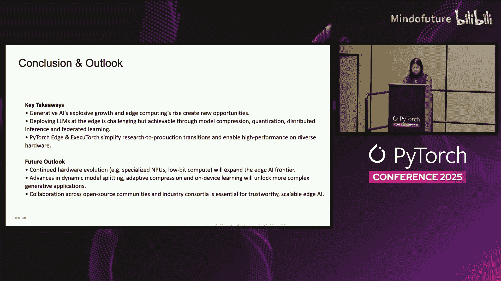
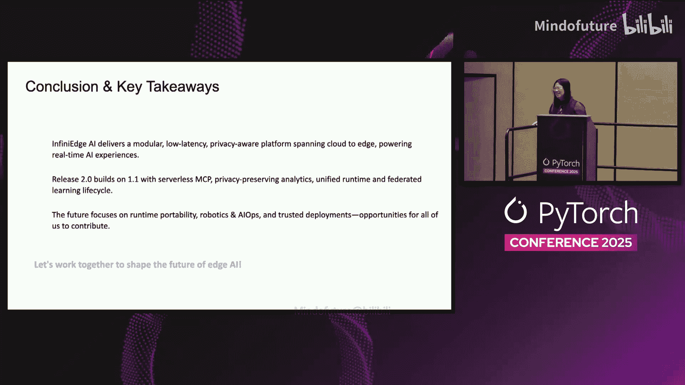

# 2025 Pytorch大会 ｜ Pytorch Conference 2025 p13 P13_利用PyTorch在分布式边缘云中实现生成式AI-Tina_Tsou -BV1b8kRB6EJG_p13-

Welcome， I'm Tina Jo， the TSC Cha of Infinite H AI at the LFH and a TSC member of OpPia atF AI and datata。

Today， we'll explore how Pytororch enables us to developer and deploy the generative AI models across distributed edgedge Cloud。

 Well look at why this matters the challenges of running large language models on resource constrained devices and innovations in Pytorch edge and executetorch that makes it possible By the end of this talk。

 you know how to architect optimize and benchmark generative AI solutions that run efficiently on geodised edge infrastructure。

Over the next 25 minutes， we'll cover the generative AI and edge computing landscape。

Including explosive market growth and adoption of statistics。

 We look at the challenges of deploying large language models at the edge， focusing on compute。

 memory and latency constraints。 I will introduce Ptorch， edge and S Q torch。

 our tours for running models on mobile and edge devices。

 We discuss distributed architectures and optimization， techniques like model parting compression。

 quantization and federated lending。 Our share performance benchmarks and case study demonstrating order of magnetic improvements。

 We finish with best practices and an outlook on the edge AI ecosystem。

Infinniage AI is a community that bridges edge， AI and data。

 and broader open source ecosystems to build generative AI on distributed edge clouds。

Our workshop during open source AI Week next tomorrow。Covers edge inference， data pipelines。

 privacy enhancing techniques and AI agents running near users and devices。

 It's geared and towards AI M engineers， edge and cloud practitioners。

 open source contributors and maintenance maintenanceers。

 and product leaders exploring real world edge generative AI participants will learn how to run generative AI workloads on geodisributed edges。

 design patterns for privacy， latency and reliability and see demos using Infin AI and SGL the agenda here includes context and updates from Infin AI。

 deploying SG land on Nvidia DJX Sp， scaling AI infrastructure。

 deep dive into feature emergence and gring。A hand Don La and Q And A。

 Sal Kco and La more and join us。The LAI and Data Foundation is a global community nonprofit。

 building and supporting an open AI and data community we drive open source innovation across AI machine learning。

 deep learning and data the foundation unites developers and users and industry leaders to collaborate。

 share best practice and support development efforts and create new opportunities membership tiers range from associate free for academiccadeia academic and nonprofit organizations through general to and premium levels that offer governance participation and board seats our committees focus on business intelligence and AI data ops M ops and machine learning securities。

We collaborate closely with the LF edges Infin H AI and the wider open source community。

Deeploryying large language model at the edge is， is very challenging。

Modern L Ms contain billions of parameters and may require tens of gigabits of memory。

 and far more than most edge devices can handle self attention operations are computationally heavy and run slowly on low power processes so naive deployment leads to unaccept latency。

 We also face trade offs。 compressing models reduces size， but may degrade accuracy。

 using lower precision accelerate inference， but increase the nu numerical error distributing the model reduces per device memory。

 but ads communication costs。 What should do and successful edge deployments balance the trade offs through careful optimization。

Genative AI and edge computing complement each other。

 running influence on the device reduces latency and protect user privacy by keeping data local。

 Offline capability allows the reliable user experiences， even with spoty connectivity。😊。

Adoption is accelerating。77% of US business are adopting generative AI。

94% of daily users report productivity games and 67% feel less pronounced。 Meanwhile。

 edge adoption is driven by 5G networks， industry I O T real time insights and the need to reduce network bandwidth costs。

 These forces together create a powerful opportunity for edge AI。

Pytororch extends its ecosystem to edge devices via Pytorch E a research to production S for mobile and embedded deployments。

 SQ Torch is the key runtime， an open source own device inference engine built by meta with partners like arm。

 Apple and Cocomm and SQ Torch allows you to export Pytororch 2。

X models into a stable compact representation。That can run efficiently across device hardware from mobile GPSUus to microcontrollers。

 It prioritizes portability， working across different architectures， Product， retaining the pythtor。

 developer friendly workflow， and performance， delivering low latency and small memory footprint。

XQ Toch differs from Pytorch mobile by using the new Pytorch compiler and enabling moder customizable runtime。

 It also integrates with metal and N API backends for acceleration。😊，At the edge。

 we often cannot fit the entire model on one device。

 So we participation it across multiple devices and orchestras the inference through a central coordinator。

 Each device holds a subset of the models layers and exchange intermediate activation tensors over local networks。

 We use pipelines parallellyization where devices process different input to tokens concurrently。

 and reconcurrent pipelines paralleling to minimize idle time。

 This architecture allows memory per device to shrink and throughput to increase as more devices join。

 We also use the data paralleling across clusters。 The central coordinator handles synchronization。

 scheduling and fallback to the cloud。When needed， this distributed approach unlocked high capability L Ms on low power devices while managing latency and reliability。

To make edge inference practical， we combined the several optimization techniques。 First。

 model compression uses pruning and knowledge dis to create smaller student models that retain performance Second。

 quantization converts weights and activations from 30 to bit floats to lower precision formats like in8 or FP 8。

 reducing memory by up to fourfold and enabling faster computation on specialized hardware。 Third。

 distributed inference splits the model across devices。

 using efficient communication protocols to exchange activations。 First。

 federated learning chains and updates models on device with local data and aggregates updates centrally preserving。

😊，Pro and enabling personalization。Combining these techniques helps meet memory。

 latency and accurate targets。Let's look at the performance improvement from applying these techniques。

 benchmark， benchmarking shows that optimization L M's frameworks can reduce memory footprint。

 I think one of my。Figure is missing from here Never mind I I will just verbal talk to it。

 So benchmarking shows that optimize the LM frameworks can reduce the memory footprint and inference latency by an order of magnitude compared to naive deployment with minimal accuracy loss hardware accelerators like Amazon E2 in2 provide three times the compute and four times the memory of previous generation instances。

 delivering up to four times higher throughput and 10 times lower latency when evaluating your own deployment。

 benchmark memory consumption latency throughput and accuracy across different quantization levels。

 batch sizes and hardware configurations use open source tools like torchbe and measured。

And to end latency from device into input to outputs。

 So these insights underscore the importance of cure for optimization and hardware selection。

Here is a case study from NDLM， a model distributed inference approach for large language models on edge devices。

 The model is partitioned into multiple blocks distributeding across low power devices each device sends intermediate activation vectors to the next device。

 The system uses reconcurrent pipelines parallellyization to reduce idle time and increase throughput as more devices are added in experiments。

 memory per device decrease significantly and throughput increase nearly linearly with the number of devices。

 This case demonstrates that with proper partitioning and scheduling we can run large models across edge clusters while meeting realtime requirements。

 we discuss。Work well where bottlenecks occurred and key lessons for your own deployment。

Based on our experience， here are some best practice。

Choose the right model size and architecture for your use case。

 smaller models or fine tuned versions of Lama2 may suffice。

 apply compression and quantitization early and profile performance to find the best precision。

 In aid often offers a good balance， use distributed inference and pipeline parallelization to scale across multiple devices。

 ensure your network bandwidth and latency are sufficient。

Incorporate federated learning when you need own device personalization and privacy benchmark rigorously under the real time the real world conditions and use hardware accelerators when available。

Adopt open source stacks like Pytorch edge and SQ Torch and contribute back to the community。

 Keep security and privacy in mind by increasing activation transfers and applying differentiated privacy techniques for federated lending。

So here comes an open source spotline with Yomo connecting reason to actions。

 so you can see the user started from the app and sensors use the event IoT Teleme here and then it connects with the YoO coordinator which through the quick string TSV1。

3 which is quite low latency and then the Yomo connector here the bridges inference and execution linking through to action and unlocking the full value of Infinity AI you can see the YoO coordinator here can cover geo distributed multi region and also cross the first auto routing to provide high availability and then it can connect if you are here calling from San。

To Delhi in India and then it can reach the HLM there runs the Xtorch and Pythtorch edge there。

 and also it connects with the MCP using the MCP function calling。

 So it's MCP ready and server this architecture， strongly typed languages like the typepescript and goland is supported and in the back end it supports to the Sa。

 So we have been running to like several typical apps there。

 one is like we use the whisper and to do the T TS and we also has a fashion app called style AI and it can do the styling recommendation and the virtual trial on。

So predictive simulation is crucial when designing AI infrastructure。

 frameworks like A Zroing a model， the entire AI pipeline， it's the LIM graph graphs。

 the runtime software and hardware characteristics and distributed topology and compile them into simulation workloads。

 the system uses graphbased compilation and generate optimized kernels and schedule across devices and simulate performance across multiple levels like micro architectureit。

 system level and force stack by exploring tradeoffs across hardware design。

 model traces choices and scheduling strategies， simulation can produce actionable insight for memory provision。

Rongtime tuning and cost optimization。 This helps answer questions like Shall I use a GPU or CPUU。

 How much memory do I need per note which quantization level offers the best tradeoff simulation driven co design aligns model engineering and hardware procurement。

 reducing the trial and errors in the production。To conclude generative AI and edge computing are both growing rapidly and combining them offers a powerful new experience。

 but also challenges due to the massive size and compute demands of LMs we discussed how pietorrch edge and SQ torch enable own device influence with port and productivity and performance distributed architectures and optimization techniques like compression。

 quantization， distributed inference and federated learning make Ls visible at the edge variable at the edge。

 So benchmarking shows that this strategies can reduce memory and latency by orders of magnitude。

 Looking ahead。 We see special。😊，the hardware， improved compilers， dynamic models。

 splitting and more open source collaboration。 your participation in communities like Elf edge F AI and data and Inage AI。

 which is part of E edge will accelerate this progress and I see I probably talk too fast。

 sorry about my faster speed。 I can show more details in the In AI to see how it goes give me one second。

Im switching。To。The sides。

Since where at this site， I think it。Yeah just we at this slides this is my contact I'd love to continue the conversation and you can scan the QR code to join our community connect me and access the resource now let me move to another。

Sites， sorry about that。ok。I can talk about the Infinia AI updates and roadmap because this is exactly talking how we use Pytorch here。

Oh， it's not showing， I have to download it first， okay， one sec。I'll just download。And open it。

Okaypen。Yeah， so this is actually the slides I'm going to show at tomorrow's event。

 is's across the street from IV headquarters。And you can see we already deployed and released 2。

1 already， release1。1，2。0，2。1。 Now we are at 2。2。Here you can see the infin H AI is more like modular and scalable which helps the flexible components orchestrate the AI agents across the device。

 diverse device and environment， also it's fast and private。

 and because we optimize the wrongtime provides low latency inference while protecting the data from the edge last analysis list is the open collaboration。

 its community driven deployment invites the contributions from engineers。

 researchers and and enthorists。So。This is the one down one highlight where we have is to enhance the performance which we optimize the inference engine and scheduling the reduced latency and increase the throughput on resource constraint devices。

 and we unified from edge to cloud。How many means I can see Okay like the deep integration with Sp and OPia Sp is around time。

 OPia is from F AI N edge It stands for the open platform enterprise AI。

 It provides something more like nameing。 Yeah， the open source name。

 provides a one click pipeline spanning edge devices and cloud services。

 we do have a realtime demo and no code agents there。So the release 2。0 the server and data tools。

 I just introduced Yomo just now。 It's a serverless MCP。

 And there's something called edge data agent。 It's more like privacy preserving analytics with LM。

 Imagine you work into the Egypt museum right， You are theBT and what's this that And where do you want to see this moneymy。

 the new mummy， It's probably not in the Internet， no matter you through the deep research or you search on the web。

 It's not there yet。 So there are some of the local code generation and on Perms data there。

 you can do the multi step workflows for the rich insights when you are in the。This is one okay。

 allright， so and to know more about In AI， I invite you to join our AI workshop tomorrow and so far we already have 155 people register and the waitlist is still open if you want to join I can just let you guys in I think which is the best one。

Okay， I have one minute。 So this is a key takeaway。 The release 2。0 builds on 1。

 one with service MCP， private preserving analytics。

 unified runtime and federated learning life cycles。

 So the future focus on the runtime port robotics and AI ops we have a physical AI there and trusted deployment opportunities for all of us to contribute。

So I guess I have no more time， Ray？Yeah， it kill me。

Thank you everybody， thank you for having me。