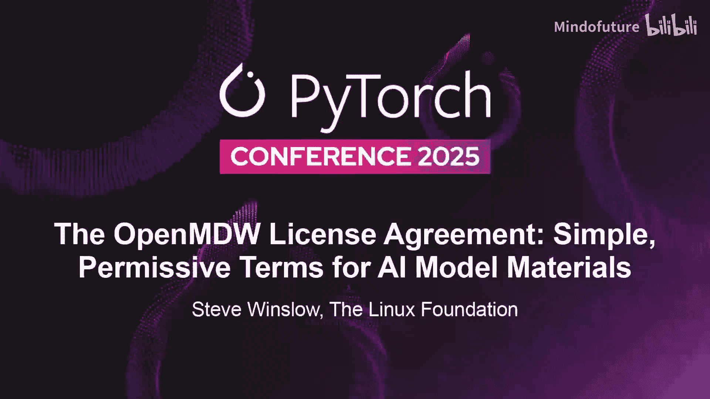
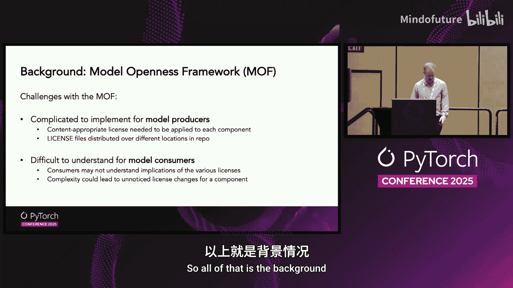
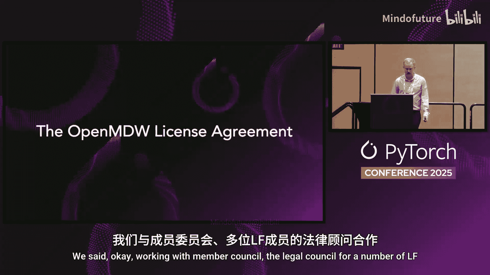
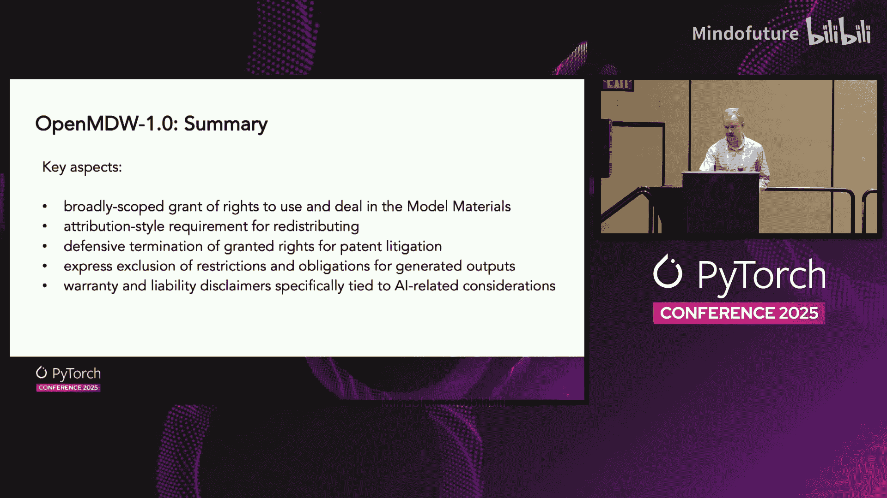
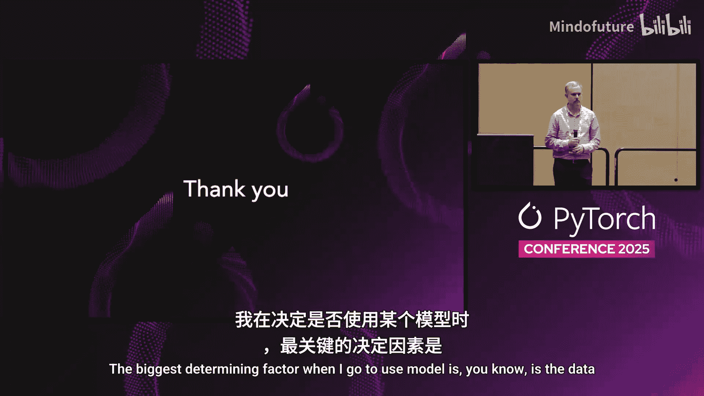

# 2025 Pytorch大会 ｜ Pytorch Conference 2025 p14 P14_OpenMDW许可协议——AI模型材料的简易宽松条款-Steve_Winslow -BV1b8kRB6EJG_p14-

And this is where it gets complicated because the mof， I don't try to read that。

 But the mof lists out each of those different components and says， well。

 use this type of license for this one or this for that one and so on。

 And so for folks who wanted to。Comply with them off or conform to it。 They ran into some challenges。

 it said， you， we it's a lot of different licenses。

 We don't necessarily know what we put where or how we。

 what text literally do we put in which files talking about which parts of an AI model and on the model consumer side。

 kind of similarly。If you come to it and you say， okay， well。

 I've got this license for the documentation and this for code and this for data and so on。

 it's how do these work together， It's not that' it's not that you can't。

 It's just it's more complex than it could be。So all of that is the background， we said， okay。

 working with member council， the legal council for a number of LF members and then talking with others in the community。

 we put together several iterations and then eventually released the OpenMDW license agreement and the。

The first rule for writing an open license is don't yeah this is you shouldn't， but we did。

 there's always a challenge of adding， you know， there's been a goal to not increase proliferation of multiple different kinds of licenses。

 I think a big strength of the open source software community over the last decades has been to coalesce as much as possible on a fairly small number of common licenses。

You and in the drafting process a big part of what we did was to see could we leverage those licenses。

 is there a way that we could still fit within the same frameworks of what's already out there and add just a bit or work with them in a way that would make it kind of meet the goals and that what we ended up deciding was we were going to take the approach of let's create a simple open permissive license that's really geared towards AI models and their distributions so。

The openpenM DW1 dot0。 So the websites here， openMDW dot AI。It's a permissive license。

 So if you're familiar with the sort of permissive versus reciprocal license spectrum in open source software licensing。

It's intentionally towards the permissive end。 Its here's this stuff。 Do what you want with it。

 limited obligations for providing notices and such。

 but geared towards elements of machine learning models。

 So intended for use with that kind of collect any or all of that collection of components that make up what it calls the model materials。

 And we'll look at that in a second。嗯。It covers whatever is released under the license。

 so it covers any of those components， but the license itself doesn't dictate you must include these components。

 so it's sort of whatever you put in the distribution and say is under this license is under it but not mandating that you must include all 17 or whatever categories of those things。

And we'll talk about the scope of the license grant that's included for that in the way that that's framed and on the implementation side。

 it's intentionally meant to be easy to implement， put this text in a license file in the root of your repo and that's intended to be the goal so。

Again， don't try to read all this， but we'll go through this in more detail more specifically。

 but this is the full text of the license it fits on a slide。

 the part in the right is all caps and it's annoying and we'll talk about that a bit later。

Let's do a deeper dive on it， so I'm going to go line by line and just show what's in there and talk briefly about it at the top so to kick it off by exercising rates granted to you under this agreement。

 you accept and agree to its terms。And thiss a little bit of legal boilerplate。

 but part of the goal here was what we were talking about before with that assumption in open source software licenses of software being copyrightable。

 there being is a license to the underlying IP and choosing to exercise that license or not being the kind of mechanism by which you you use that license。

I don't want to get too deep in the weeds on this， but we framed it this way to make it clear that it's a license agreement that it is intended to be a contractual。

 not that you have to sign it， but a contractual undertaking of if you choose to exercise rights under this agreement。

 you are accepting its terms。嗯。The next paragraph， this is sort of key to the whole thing。

 this is really defining essentially defining the variable model materials and to say in the rest of the license where we talk about model materials。

 we mean the materials that are provided to you under OpenMW。

 and those consist of one or more ML models including their architecture their parameters。

And then all related artifacts that are provided to you under it。

 So whatever the stuff is that's being distributed， the model。

 whatever documentation or code or such along with it。

 if it's being distributed together under openM DW， then。It is part of the model materials。

 and that flows through in the next sections that we'll look at。

So next is really the core license grant or the core permission grant。

 which is if you comply with the agreement terms， then you have permission free of charge。

 so no royalty to deal in the model materials without restriction including under these different explicitly named rights and if you're familiar with open source licenses。

 that language will sound familiar this was kind of geared off of and started from the MIT license and this is comparable that deal in without restriction is similar to language used in the MIT license。

During the drafting process， we did decide to explicitly call out。

 including under copyright patent database trade secret rights， there was sort of a desire to say。

 in this context， let's be clear we intentionally， if someone's distributing a model under this license。

 we intend for it to include that entire scope of rights。

 So giving a little bit more padding to what's meant by dealing in it without restriction。

So remember， so that's that sorry I'm going back one， those license terms。

 you're granted these rights subject to complying with the agreement。

 so what do you need to do to comply？So the key requirement is if you are distributing any portion of the model materials。

 So if you're taking part of what you got and you're giving it to someone else。

 then you retain a copy of the agreement。 So a copy of this text and。Any other applicable notice。

 copyright notices， notices of origin。 So this is。Very much intended to be similar to the attribution style requirements from permissive open source software licenses that if you're going to redistribute it。

 include copy of the license text and copy of the copy or other notices of origin。So。嗯。

The there is a sentence which kind of， again， analogizing a little bit to you may have seen this in the Apache license or others where。

If you are receiving rights under openMDW and then you want to turn around and sue someone saying that these model materials infringe a patent。

 then the intention is your rights under the license go away。

 So if if you're a recipient of this stuff， you want to use it under openMDW。

 but then you want to go and turn around and sue someone claiming patent infringement。

 you're free to do that。' this is not stopping you from doing that。

 but you wont your rights to at the same time exercise the permissions granted to you by someone else under openMDW would go away。

So。And then finally for sort of the substantive parts of this。

 the last piece is openMDW does not impose any restrictions on your use， your modification。

 your sharing of the outputs generated from using the model materials So this was sort of core the whole thing it's that we're talking if we're talking about AI models。

 whatever the outputs are from it， there is a desire to say those outputs do not become encumbered by the license requirements。

 so that what we talked about a moment ago for that you if you're redistributing the model materials themselves。

 if you're redistributing the model over the code or other parts of it， keep the license text。

 keep the attribution notices， but when it comes to output generated from using the model。

The intention here is to say that it's not encumbered by openMDW。

 there's not a requirement that this obligation lives with that output forever。

The key thing I'd say here is this is all of this is about what obligations are imposed by the license itself。

 so for those generated outputs， nothing is no obligations are imposed by the license。

The license the provider of this can't give any more rights than what they already have so for instance。

 if applicable legal requirements or if applicable law says，You know。

 you have to comply with these regulatory requirements or if copyright law says someone else somewhere else has rights in the outputs。

 you know， openMDW and no license can kind of magically make that go away。

 the intent here is just to be explicitly clear that I as the the provider of these materials。

 I'm not requiring you to。Have to have any obligations with the outputs generated from the materials。

So。And then there's a bunch of all caps legalese。 This is， you。

 I'm not going to dig too deep into the the specifics of it。 but that sort of right side of the。

 the slide that I showed originally is。Fairly detailed disclaimers of warranties。

 disclaimers of liabilities。 Part of them were specifically drafted with a focus on topics in the AI space。

 So making it clear that， you know，s it's not a free lunch。 you。

 as the recipient and the user of these materials， you're responsible for what you do with them。

 So don't come back， essentially don't come back and look to the providers of the materials with a claim for liability if you're receiving these rights and exercising them at no cost。

Under Open MDW。Just on the all caps thing， there is if you grab the slides later。

 there's an interesting article written by Lewis Via， I think a while ago。

 talking about this in giving a little context for why lawyers seem to like screaming at you in their legal documents。

Yeah， so just to summarize， and then we'll I think we've got a bit of time so we can open up for some questions in a moment。

 but just a high level of key aspects of OpenMDW， so it's a broadly granted scope of rights to use the model materials that you receive and to deal in them without restriction。

It's， it has an attribution style requirement for redistributing。

 So if you're taking what you got and you're baking it into something else that you're giving to somebody else。

 then retain the applicable notices and the license text。There's that defensive termination。

 So if someone initiates patent litigation， then the rights they're receiving go away。

There's that express statement of we're not imposing any restrictions on what you do with the outputs of that are generated from the materials。

嗯。And then those warranty liability disclaimers that are specifically tied to AI related considerations。

So so I mentioned we went through several iterations of this and drafting and review process together with the member council。

 the legal council from the LF member companies and got a lot of input went through several drafts and eventually released this earlier this year so starting to see a little bit of uptake we've had conversations with a number of companies and institutions that are working it through working it through their processes and looking and saying are there models that fit into this fit into this framework where we really do want to make it as clear as we can that we're giving away as many rights and doing it under terms that are really geared to open distribution of AI materials so we're hoping to see more uptake of it we' I'd be happy to talk with you or to hear any questions so thank you。

Not sure if there's mic， but if there are any questions。Happy to take them。Yeah，这。

Sorry for making you run from all over there， so good question， is it license or contract？😊，Yes。

I think the intention is that it's both， I think there's， you know， as I know you know。

 there's a lot of。Complexity tied up in that question。

 But I think I would say it's intended to be a contract because of。

The nature of the you the complex nature of the different right underlying I rights that may or may not be present。

 So it's intended to be a contract to pick up the obligations for。

 for retaining attribution notices in exchange for receiving that scope of rights。Thanks， yeah。Yeah。

 I think it was there。What's the difference between Open MDW and the Apache2 license？Oh。

 that's a complicated one。 So Apache， so。Very high level。Apache 2。Like other， you know。

 essentially all their open source software licenses， it's geared to open source software。

 So it talks in terms of the source code being available or。嗯。

Forget off the top of my head if it refers to object code explicitly or executables or something having to do with the essentially a compiled version of the source code so talks about those。

 it talks about obligations for if you're redistributing it for rights the scope of rights that you're granted So a number of things that are covered or analogous to things that are covered in openMDW。

 but it's doing it in the context of software source code。

 And so this is sort of what I was saying before is it's not。Yeah。

 it's not that the anyone is going to come after you because you put a model out under Apache too。

 it's just that it may add some friction for when a lawyer is sitting down to look at it and they're saying。

 okay， how do we comply with these requirements or what rights do we have under this license where what we've got is not software。

 but it's an AI model， it's a collection of model parameters and all the other pieces around it。

 And so I think it's that。Kind of that friction that comes from the extra step of having to think about it。

 whereas openMDW is intended to try to take some of that ad clarity， take some of that friction away。

嗯。呃。So the question was would we recommend using this license over CDLA so CDLA is a it's actually a group of a few licenses that we。

 the LF worked kind of similarly with our member companies about starting about eight， 10 years ago。

Specifically geared around data sets。 And so it's， you know， it's even shorter than this。

 but it's the most recent version of it is even shorter than openMDW。

 It's specifically geared to data sets。I think it's it's a little bit of a question of context。

 It's sort of the same thing of if you want to be really clear about you an AI model distribution consisting of these different collections of things and having rights that are geared towards how it's used then that probably open MDW is a little more appropriate for it if it's really just pure data like a pure data set you've got it you might be easier to go with CDLA。

 but CDLA does have a similar concept on to this and it was sort of an inspiration for this part of the。

No restrictions on generated outputs。 There's a similar in CDLA， there's a similar concept of。

No restrictions on I think it's the results of computational use of that data set。

 so it's kind of similarly， if you take a data set under CDLA and compute it to generate something。

 then no restrictions on the outputs of the results of that computation so I think there was good question。

things is true。

没没议。So good question， several things tangled up in there so the question was one concern for people who are looking at using a model would be what went into it。

 what was it trained on was their copyrighted copyrighted materials was their personal data subject to the GDPR I don't want to go so without going too deep into whether whether or how those legal obligations flow through I think your question was just does OpenMDW give you any guarantees about that stuff not being present definitely not it definitely does not give you any guarantees about that and I think any open source license would not similarly would not。

The I think for considerations of those sorts， what I would look to generally would be less about what licensed terms is it made available under and more about what's the community process。

 the sort of governance structure， the charter， the mechanisms that。

The community building that model has put in place。

 like what are the steps they've gone through to try to get it as clean on the front end for what's going in。

I think that's probably a more- if those are the concerns。

 that's probably what I would look to is for more risk mitigation rather than what are the terms that it comes out under。

嗯。Yeah。Yeah， yeah， and I think if you are here for the talk before this talking about SPDX。

 the AI build of materials， I think that's sort of what exactly what they're trying to do is how to represent that sort of metadata in a machine and human readable way。

 So I think there was one of here。Can we use MW with AI models that leverage？😔，Libraries from GL。

 like GL 1，2，3， like if I have a model that uses GPL 1，2，3。

Is that an imp restriction or it a good idea， I'm just not clear。So it's a good question。

 so I think the question was， can you use Open MDW on a model that？

Interacts with or relates or incorporates or relates to something like a GL。

 a library that's under the GL open open source software license。

 So GL is one of those reciprocal or copy left licenses。It's a good question。 It's a complicated one。

 I'm looking at the time here。 and I don't think I have time to get into the weeds。

 But what I would say is。Part of the goal of open MDDW was to say。

It applies to the collection of things that you put out under that license。

 So kind of it's I think it's， I would say it's particularly useful where the collection of things you're distributing are sort of greenfield that it's code you've written yourself or that's code that you code documentation。

 things that you do have this， the certainty that you can provide that full set of rights。

 Could you take someone else's third party GL materials and just say I'm now distributing this under openMW now you couldn't do that。

lot of complexities when it comes to how it interacts or where's where do you cross the line that the copy effect would apply to those materials。

 so yeah， that would be。Much longer talk but I think I'm getting the so I'm getting getting the time up now。

 I'm happy to chat a little bit afterwards， but I think I should。So thank you all。

