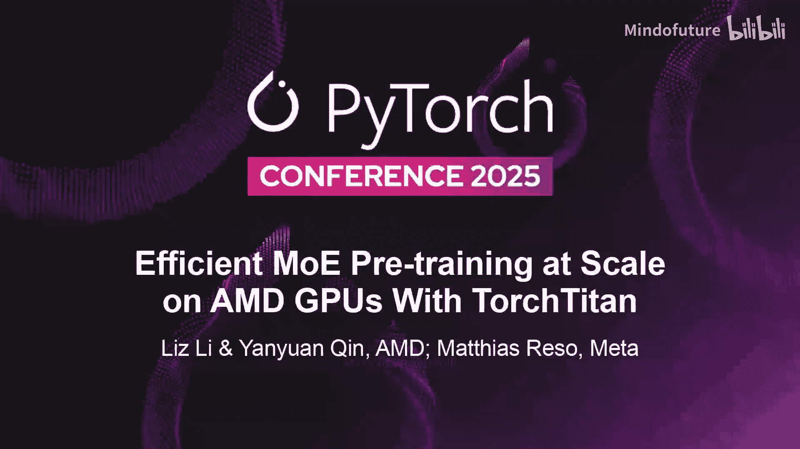
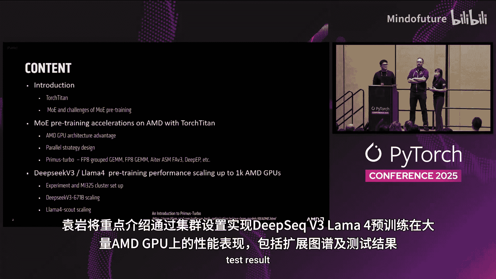
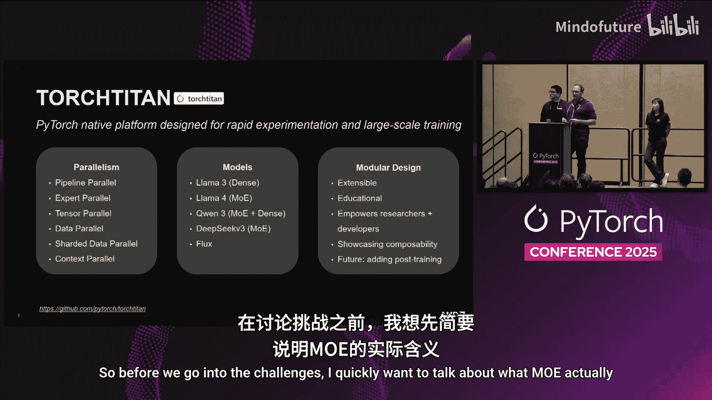
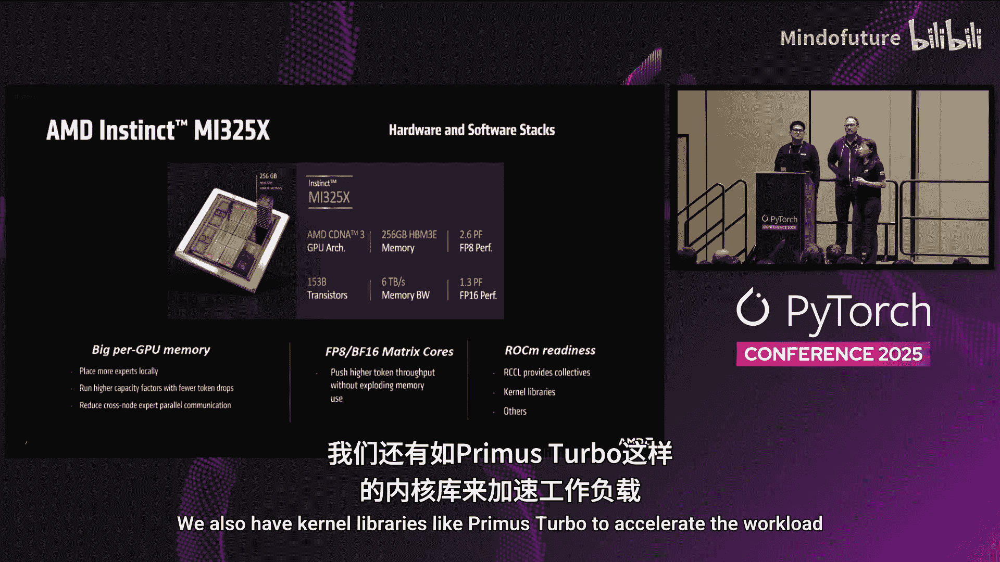
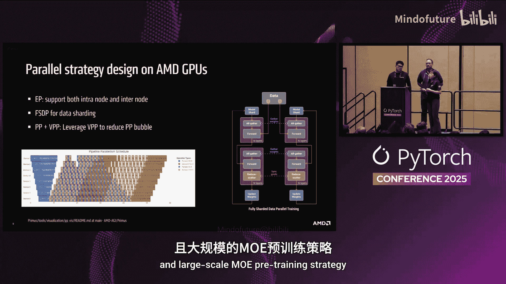
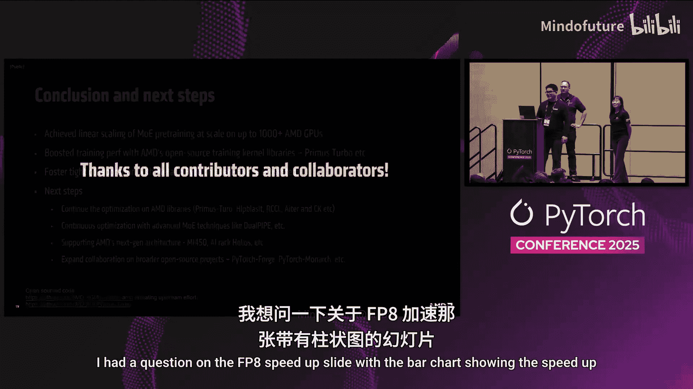
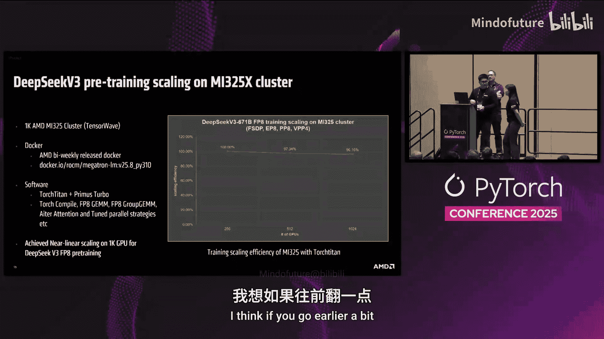
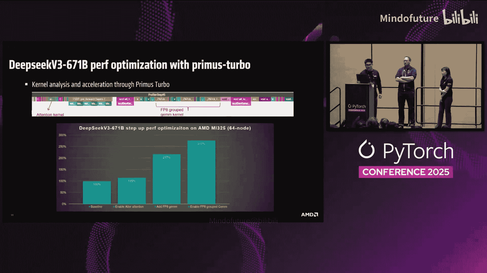
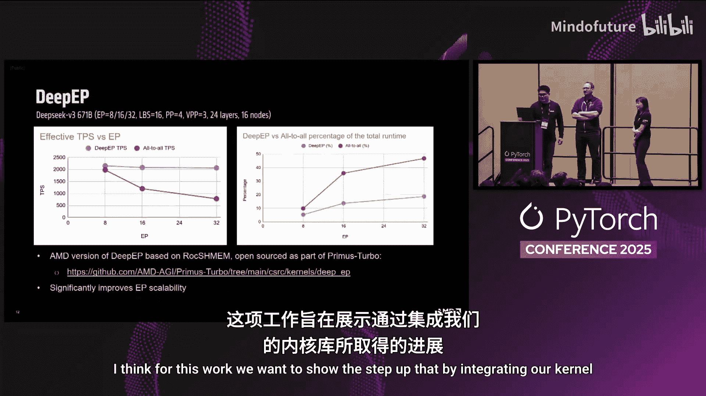
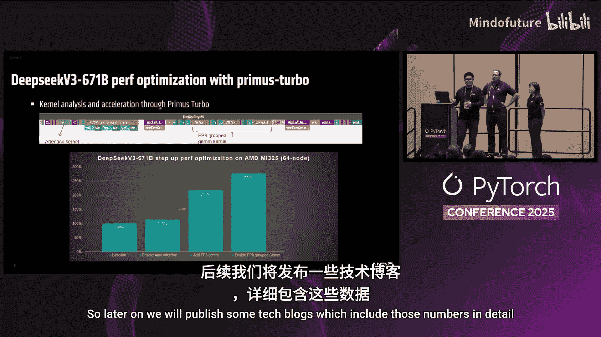

# 2025 Pytorch大会 ｜ Pytorch Conference 2025 p15 P15_基于TorchTitan在AMD_GPU上实现高效大规模混合专家预训练-Liz_Li__Yanyuan_Qin__Matthias_Reso -BV1b8kRB6EJG_p15-

Hello， everyone。

嗯。Welcome to our talk I'm Li Lee from AMD， so today I'm so excited to talk about our latest work with col from AMD Yan Yuan and from Matiaez。

 so our topic today is efficientffic MOE Pre training at skill on AMD GPUs with To Titan huge thanks to all the contributors and collaborators from both AMD and Mes。

😊，So here is our outline of today's talk， so Mats will first introduce Torch Titan and also recap the concept of MOE models and the challenge of pre traininging MOE models then I will dive into how we are going to accelerate ME model training on AMD GPUs with Torch Titan so we'll focus three areas AM GPU architecture advantage and also our parallel strategy design and our training kernel library Pri tuurbo。

 then Yan Yuuan will focus on the performance of deeps V3 Lama4 pretraining upscalell to one key AMD GPUs by introducing our cluster setup up also the scaling charge test result。

Okay and now let me hand over to Matts， thank you very much Liz hello everybody I'm Mats from the Pytoch team as is already mentioned and I'm here to talk about a bit about Torch Titan which is our Pytoch native framework for large scale training and we develop Torch Titan basically to educate people but also to show the best interests but at the same time we want to try to bring the best performance to the people and in people's hand and we do this by making it very easy to use so it's basically just a single configurationag file where you have all the power to your disposal and it just empowers researcherses and develop to quickly iterate over a different training configurations and adjust that to their environment that they have in front of them and for example all these parallelization techniques are integrated in torch Titan for example。

 pipeline parallel extra parallel you can just。😊，Enable them with a single configuration line regarding model coverage we are trying to keep it as broad as possible so we have。

 for example， Lama3 for dense models and then for MOE models we have Lama4 and now we added deepseqv3 as well as thequint3 series and we have flex for image generation and I think there is more to come in the future so before we go into the challenges I quickly want to like talk about what MOE actually stands for so this mixture of experts when you go from a dense model like Lama3 to an ME model like Lama for what you replace is the big MP layer after the self attention and we replace that with multiple MLPs which are potentially smaller than the original dense layer and then we have a routing element basically that decides which。

Expert， which is the small MP， gets to work on this token。

 or it might be a subgroup of all the experts。 And then there might be a shared expert。 So。

 and that gives us the possibility to basically handle way larger models with small parameters and while we are still staying within the same compute budget。

 So the computation will be the same while the memory footprint can be way bigger。

And that's improving the training speed， as well as the training accuracy。

 as we have seen in the last year。So to comes to the challenges of pretraining and training MOE models in general。

 first of all， we have like the kernel efficiency， you can imagine that if you have a batch with multiple tokens and all of them get routed to different experts you will end up having to call these expert kernels basically which is the matrix multiplication and so that is very inefficient on GPUs and what you want to do is you want to fuse these together so you end up with something called a grouped general matrix multiplication that takes care of multiple experts in one kernel call then after the routing basically we have a communication step because when we do large pretrainings we have like a large cluster sub with many nodes so we apply expert parallelism that means that we have different experts on different GPUs and so we need to communicate these intermediate results of the token to these GPUs so all the GPUs have to communicate and the big allto all communication。

And that takes time， and so we try to mask that。By overlapping it with compute and also apply like shared memory techniques to make the communication as efficient as possible。

 and then there are composibility issues with， for example。

 AD found out that if you if you were just naively combining FSDP and pipeline parallelism together with expert parallelism。

 you ended up with a lot of pipeline bubbles and a bubble means that you are not doing any work on a GPU in a pipeline stage at a given time and that makes the training inefficient so these have to get we have to get rid of these to make the training efficient。

And then the are like routing and stability issues that you can face where you basically have a routing collapse and you route all the tokens to a single expert。

 which makes your training inefficient and also the accuracy will get worse。All right。

 so let's continue now with Liz and see how M D solve these challenges。 Thanks， Thanks Matt。 So yeah。

 as we know all the challenges of M O E per training。

 So let's look at how can we accelerate M O E per training challenges on EMD GPUus。

 So we will look into the three key contributing areas。

 The first one is EMD GPU architecture advantage。 Second one is parallel design。

 parallel strategy design。 and also we will introduce our new training kernel library prim tubo。😊。

So the instant MI 325 x is our leadership product and Excel in large model per training and inference。

 so it's based on CDN3 architecture， it includes6256 gig memory and also 6 terys per second memory bandwidth in terms of compute it includes 2。

6 Pflps FP8 performance and 1。3 Pflps F16 performance。

 so the big per GPU memory its super important for MOE per training because we can place a lot of experts locally on each GPUs。

We can also run the higher capacities with lower token drop。

 so therefore we can reduce the cross node expert parallel communications significantly also the F8 and BF16 matrix course can further push our token throughput without exploding the memory usage lastly we have workM force stack iss fully ready。

 we have communication libraries like Rico to provide collectives。

 we also have kernel libraries like per tu to accelerate the workload。

So AMD GPPU， we fully support multidimensional parallel strategy design。 For example。

 we support both internal and internal expert parallel。 We support FSDP for data sharding。

 We also combine the pipeline parallel and virtual pipeline parallel to reduce the pipeline bubble。

 together， we create a very efficient scaling efficient scaling strategy to enable the stable and large scale M E training strategy。

😊。

Thats。Okay， so Prime Turbo is our general purpose kernel acceleration library for large scale LM training on AMD rockM。

 It's providing high performance completeness and ease of use。

 If you look at the diagram on the left side in the front and it supports multiple frameworks like Py and Jacks framework is coming。

 and for the components layer， we also support high level building blocks like operators， modules。

 distributed primitives and other kernels。 So for the back end we have all the support of important AMD compute and communication libraries like hip blast C K8 Ri Triton and others。

 So Prime Tbo support for range of MD hardware， including MI3，25 M355 and field。😊，A I 450。

 So we want to make sure the probability of the performance cross all all our range of hardware。

If we look at the right side， this is an example code inside Pri tuurbo calling F8 group jam just in a few lengths of code。

 so we only need to write like two lengths of code in in torch Titan to call see F8 group jam in primary tuurbo。

 so this is really easy to integrate， really easy to use for everybody。😊。

Here is a table summarizing all the kernels we support in prime turbo If you look at the table jam and group jam。

 we all support BF16 FP16 we support FP8 with Tensorwise rowwise and blockwise quantization the FP6 and FP4 support is coming soon attention kernel we support FP8 and B FP16 and BF 16。

 we also support FP8 with blockwise quantization and DEP we support intra node and internal node DBEP we also support melanox today and the broadcom and AI support is coming soon auto to all kernel we support FP8 with Tensorwise and rollwise quantization and we also support a lot of elementwise offs including normalization activation functions Rob and so on。

So this slide， we want to show a step by step Per optimization of deep C V 3。

 full time pre training round with prim tu acceleration。 If we look at this。😊，This picture。

 So we use we use torch profiler to profile the workload first and identify all the key bottlenecks and hot spots with different kernels。

 Then we use the kernels in primary turbo to accelerate them。 So the bar chart here is showing。

The per step optimization using the prim turbo kernels in a 64 node deepseion run。

 So in terms of in terms of throughput， we baseline as 100%， if we include enable a attention。

 the throughput can get up to 15%， then if we enable F8 jam， we get a huge performance boost。 So。

2 x of the throughput。 Then we enable F8 growth jam。 It gave us like 2。

77% compared to our baseline throughput。 This is a demonstration of our prime tubo kernels efficiency。

So prime tu also include deep EP， which can accelerate the auto to all performance significantly。

 here we demonstrate the deepEP using a deep thick round if we look at the curves here on the left side in terms of throughput。

 we look at the red curve。 The EP size is increasing from 8 to 16 to 32 We can see the total is dropping a lot with EP size increasing。

 but if we enable deepEP with the blue curve we can see the total output is almost identical even we increase EP size。

On the right side， it's the auto of latency percentage of the total run time。

 Similarlyly for red curve， it's the normal without deep EP run。 we can see with EP size equal to 32。

 the auto of latency is almost like 3050% of the total run time。 But if we enable deep EP。

 the auto latency will reduce like less than 20% it's a huge performance increase。Okay， with this。

 we want to show the pre trillion performance scaling up to 1 K GPU。 So anyway， please。Okay。

 so now I want to present our like experiment results with To Titan to train deep sQ 3 and Lama 4。

 And first I want to talk about the experiment and cluster setup and then go through the results in detail。

So for this MI 325 cluster。 and in total， we use up to 1000 GPUus to run this workload。

 and this cluster is hosting in tensor wave。 and for the ink side is equipped with Brocom sort2 innc is band is about 400 gig per second。

 and the protocol is Rocky B2。 So the backend network is connected in a factory topology。

 which is typically used the GPU cluster。So if we look at the deep with training skin results。

 So here we use the docker， which AM by weekly public release docker。

 So you basically can find this one on the Docker hub。 And for the software side。

 we use Ti and in both the primary tubo。 So we enable those features including the torch compile。

 I pay the jam I paid Google jamer attention and tune the parallel strategy based on our hardware features。

 So if we look at the right figure the axis is the number of GP that we go up axis is training like scaling efficiency。

 So if we put this the first set the 100%。 and if we further like four times of the total number of GPS。

 and we can achieve like lesson like4% job。 So I want to mention that the parallel strategy we use here is FSDP plus E P and P and VP。

And we also tested other like M O E models， which is Lama4 gauge。

 So this model is smaller than the deeps V3， but still。

 we can achieve very good like linear skin on this M O E training。Beyond that。

 we also like check the nu accuracy with our model training。 So for this one。

 we use deeps 3 we enable the IP8 training for the data set， we use the I 4。

 which is the public data from hugging phase for the learning rate。

 we picked the default value in the Titan。 we have it run for 900 iterations。

 So if you look look at the figure， the X axis is the number of steps Y axis is the loss curve。

 So basically this training curve shows the on this M3。

25 cluster we can show the strong like curve with to Titan。So in conclusion。

 like what we did is we achieved the nearly new scaling with M E pre training at scale up to 1000 m GPPU。

 and we boost training performance with open source training libraries tu and also the Aer and also recallco libraries。

 we foster collaborations with metata in this P to open source ecosystem。 So in next step。

 we will continue our optimization on the AM libraries， including prime tulast recallco Aer and C K。

 and we will continue optimize the advanced M E features， which is including the pipe。

 this is recently upstreamed in the Titan。 So we will continue working on to make sure this feature is fully enabled in our hardware and next we also want to support our next generation GP。

Tature， which is M I4 50 and also our AI rack solutions。So finally。

 we want to expand our collaboration with the broader open source projects。

 including the Py Forge and Py Monarch， which just released today。 So finally。

 we have all the source code using products open source we have those rippo hosts in GiHub and we also initiate the upstream effort to make sure all our organizations can appear in the mainstream and the Pyr community can directly use it。

Okay， thanks to all the contributors and collaborators for this work and also thanks for the audience。

Okay。👏Yeah， if you have any question， please ask us。 We have six minutes。Yes。

I had a question on the F speed up slide with yeah， like with the bar chart showing the speed up。

 I think if you go earlier it。

A， yeah， Yeah， this one。 also I'm wondering it seems like you get almost the2 x from just the FPHM。

 I was just wondering if you can kind of go into it in a little bit more detail， because。Yeah。

 just like。If the Ja itself is a 2X， how do you get an N to N2X？Oh， go god ahead。Okay。

 so I the question is why we get8 jam。Performance up to like2 x okay， I can answer that question。

 So basically for the F8 and by default， the tor Titan will cause the torch A library currently has some like operators。

 And so those operators like we found that its not that efficiency。 but with primary。

 we need some on that。 So beyond the like the pure the F8 jam kernel。

 we also optimize some the qua parts。 So which make sure that it can like achieve like round 2 x performance boost。

Yes。Do have the same question。 How would it scale for。更收上去。1010000 chip。 Okay。

 that's a really good question。 So I think for that one， actually。

 we we can break down into like a multiple like tiers like solutions。 First in the kernel level。

 we want to make sure that the kernel level is very efficient example。

 for the8 we want to make sure can achieve the one that almost like a roof line。

 and another thing is the parallel strategy。 for example， we just mention the D。

 which is very helpful if we want to scale it from 1000 to like like1010 k or even larger cluster。

 So actually also for example， for the pipeline parallel strategy。

 we can also utilize the optimize the pipeline to make sure like once we scale up。

 we will like have like a smaller time for cross node like。Comic or something like that。Okay。

 and then yeah。嗯。Like without1000 GPUs。How would do we do it， Let maybe using the same like docker。

Yes， yes。Yes， okay。 the question， basically how to like reproduce the results with smaller cluster。

 I think in the result we show like， say if we use like say2000 sorry，256 GP。

 you can also like get some the results that we showed here。

 if we want to if you have like even smaller one like say you can even like say like reduce the number layers but for the with3 and you can reduce number layers and then run it。

 although it's not a full model， but you can still can see the performance boost by integrating our prime trouble。

Yeah， yeah， one thing to add is like even for deeps V34 model。

 we only need to use 16 nodes to run the full per so because of our memory advantage。Yeah。

 you can also reduce the layers of the dipse model for smaller training。

Really appreciate the deepsek results， but you mentioned also Laama and flux。

 did you have to change the parallelism strategy or like are the results consistent across those other models I'm particularly curious about flux？

do you mean the different model like Lama 3 model， the dense model。Oh yeah。

 I think we did we also did the dance model patron training at the beginning。

 since this talk is more about M E models。 So we focus on the M E models。 But for dance model。

 we even have better scaling result。 So yeah， we definitely can show show you later in offline。

 But for like dense model， we have pure linear scaling。 And because Lama3 like 70 B， it's very small。

 It can fit just into one one node。 So yeah， that's no problem like we can tune the parallel strategy a little bit。

 but the result is super good。😊，Hi， thank you very much for the talk。

 I really appreciate all the numbers and the tables。

 so my question is with basically almost or more than 1000 GPUs that you guys use to train the MOE models。

 what kind of specific routing or parallelism choices you guys had to make to achieve the linear scalinging performance。

Oh， I think for， for that one， like like in the original like deepse paper。

 like they use some auxiliary loss or some like node limit routing for for that。 But for our case。

 we use first， we use the E P8， which means we don't need like those like node limit routing or or some something like that to do the routing and and and so other than that。

 we try to make sure like keep the same as the original paper。Yeah， thanks for the talk。

 whenever if you could comment on the MFU， like hardware utilization that was achieved GPUs during these large scale training runs。

MF forU going。I think for these results， we for this work。

 we want to show the step up that by integrating our like like kernel libraries for now， we。

 we didn't like including the absolute M F U number， but like a。

Yes， so， so later on， we will like publish some tech blocks， which， including those number in detail。

 yeah。

