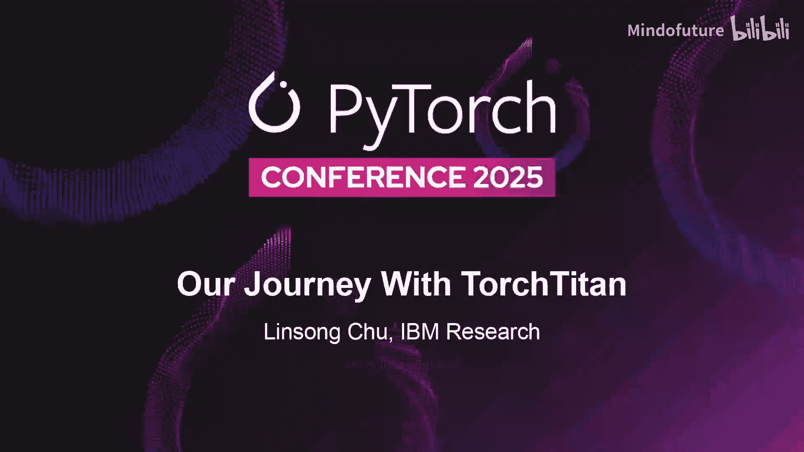
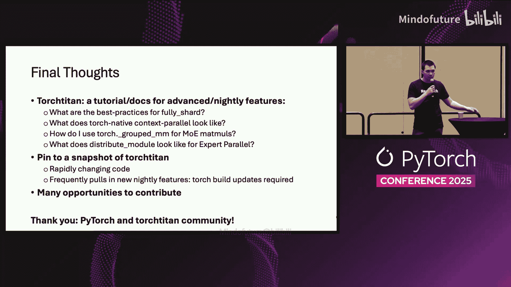

# 2025 Pytorch大会 ｜ Pytorch Conference 2025 p16 P16_我们的TorchTitan实践之旅-Linsong_Chu__Garrett_Goon__IBM_Research -BV1b8kRB6EJG_p16-

Okay， hello， hi everybody。Thank you for coming here today。

 so my name is Garrett Guon I'm at IBM Research and I'll be talking about our journey with Torch Titan and some of our collaborations with the Pie Torch team at IBM research so first of all。

 thanks for the opportunity to speak this was prepared with my colleague Lnsng Cu who unfortunately couldn't be here today。

 but I'll be talking about our work together。A brief timeline。

 so we were I would say early interested very early for sure in Torch Titan。

 which I'll explain a bit more about what that is in a second。

 and I'll talk about the early exploration period， what made us interested。

 later I'll talk about how in April of last year， we started evaluating torch Titan as a framework for doing real full scale production runs for some work at IBM research。

I'll go into some more details about how those production runs went and all the really nice performance features of torch titan that we found in those runs。

And I'll then stop with some reflections on what's changing recently and where Torch Titan is going。

 the things that we're excited about with Torch Titan。

So what isrch Titan Torch Titan is a torch native platform for large scale training that means mostly pretraining。

 mostly large language models right now， but it's really nice in that it's totally native no external dependencies。

 it shows you how to do full end to end runs with fully chartarded data parallel。

 tensor parallel pipeline parallel， all the things you would want。

 and how to combine them in a torch native way。And it's something we've been following since the days when it wasn't even called Torch Shedden used to be called Torch Train。

 but it's graduated from the Pytorrch Las days。And so in this early period， so at IBM research。

 we have our own open sourced training stack， FMS， FSDP， which we've used again in production runs。

And so。First like why consider looking at other options here， this was the kind of evaluation phase。

And at this time period when Torch Titton was first coming out， they were equally performant。

 there was no performance reason to change， they're quite similar in that they were based on fully sharded data parallel。

 both of them， but there were some really promising developments that were catching our eye so one was at the time upcoming support for FPA training。

 I'll talk a lot more about that later on and the nice benefits you get from FPA in Torch Titan。

This was a time when FSDP2 was also coming out， so this is a fully sh API for those of you familiar with that。

 you know， I would say a more ergonomic API， also more performant。

 something else we were interested in。But probably the main thing was Py Torch's excellent history of building these great super useful repoos。

 building great communities， and the promise of what was to come in the torch Titan development。

So we also work quite closely with PyTrch at IBM Research。

 this is one of the quite relevant collaborations that we had at this phase that made its way into Torch Titan。

So here this had to do with activation， checkpointing。

 which is a method where you don't save of all the activations in the forward pass。

 but you recompe them in the backwards for memory savings。

And it was at the time very standard to checkpoint every block， every layer in your model。

 but in our runs， this was not quite flexible enough we wanted to do more selective checkpointing this originated in FMS FSDP and through collaboration with Pytorrch this eventually made its way into the torch Titan if you're interested you could read more in this blog post and this is part of an evolution of more and more advanced activation checkpointing in Pytorrch so now you don't just have the checkpoint at the block level you can do it at the level of individual torch ops anyway part of a nice story that's continued to improve to this day。

So in April of 2024， this is when feels like forever ago now。

 but this is when Lama 3 was released and internally at IBM Research。

 we started a project to replicate the full Lama 370B training。Model training run。W it's 70B。

 so it's been used and continues to be used as a research vehicle at IBM research。

 so a lot of our previous work tended to focus on smaller models。

 or maybe not so small back at the time， which were really good for a quick iteration， data ablation。

 novel architecture， exploration， speculative decoding， things like that。

But a 70 B model is more in the Goldilock zone where it's much larger。

 but you don't need to specialized。Training to train at well。

 things you we were already familiar with where we're good enough， the strong inference support。

 all the support that Lama models have and it's just more capable of course。

 so it's a strong testbed for more advanced workflows like RL tool calling， agent uses。

 that kind of thing。But it was still not maybe obvious at the time whether George Titan was fully ready。

And so our collaboration with the Pyarch team continued。

 so this is one blog post you can read about about improving checkpointing。

So rather than writing to disk， writing to persistent storage in a blocking way， you can do much。

 much better if you off it to a non blocklocking thread。

Here are some performance plots of the kinds of improvements you get with this strategy。

These are features that are now fully integrated into torcht， and it's just a flag。

You if you want to use this？And the other part which I've already alluded to before was the Float8 training。

 and so this in this collaboration， we again worked with the PyTtororch team to demonstrate the efficacy of using lower precision D types。

So this again， was fully benchmarked in torch Titan in November of last year。

Here we're using F8 in two different ways， so both for the linear layers， that is the float8。

Matrix multiplies， but also float8 allgas for fully sharded data parallel。

 so rather than doing the allga in B float 16， you save half the bandwidth and it makes quite an improvement so  50% throughput speed up。

Again， a feature that is today in torch Titan and very easy。And profitable to use。

So the actual training run started in late 2024 and here we built off of the snapshot of Titan that was available in August。

 but to actually make it production ready we needed to add a few things a lot of them on this slide are now available in upstream torch Titan。

 but at the time， know things like weights and biases support didn't exist。

 you couldn't log to weights and biases， you know a small thing but important for tracking the status of the run。

We also needed a hug and face adapter， so in Torch Titan。

 the native way that save checkpoints is with the distributed checkpointing API where you get many small files which。

To use， you want to coalesce together into a single hugging face model， you want to run evaluation。

 you want to do anything that touches the hugging face universe。

 having an adapt like that is super important。Other things we needed were more flexible checkpoint resuming。

 so after a model failure， you want to load back the weights and the optimizer state。

But for other use cases， you might just want to load the weights again。

 that was something important to us。And another feature was having more fine grain control on the global batch size。

 So you know， in training your your。Re resources may change。

 more GPUs may become available or some may go away。

 and you want to be able to continue training while having the same global batch size or increased batch size as you go in training。

 so I gradient accumulation didn't exist at the time。

 so that's something we also needed to implement。And later on。

 we also do longer context training for 70B， where we used advanced positional embeddings like yarn。

 which some of you may be familiar with for better long context。Performance。

So one area where we especially found that we needed some additions。

 some improvements for production readiness was in the data loading。

And here we were able to pull in some aspects of our own training framework， FSDP。

 and had a bunch of features that we found necessary for really doing runs at scale。

So the first one is rescalalability， so again resources weren't always constant overtrain and if you're going to train on a different number of GPUs。

 ideally you'd have it such that the data comes out in exactly the same way as in your original resource setup so our data loader implements this feature。

It also is capable of other things like handling pretokenized data， or if you need to。

 it can tokenize on the fly。There is a very efficient memory sorry memory efficient shuffle。

 so some of the kind of stock options and torch have quite high memory constraints if you want to shuffle。

There's also more advanced multidata set sampling， so if you're combining data sets。

 you want to weight them in particular ratios， this is also implemented and it's all fully checkpointed of course so if your training run dies。

 you can resume and you'll be guaranteed， of course to continue just where you left off in terms of the data。

If you're interested in this， we had a talk on this last year， Davis and Lndsng。

 of our colleagues from IBM Research， check out that YouTube video from last year's conference。Okay。

 so in late 2024 is when our actual full scale。Pre training run was kicked off。 So， again。

100% based on you know， torch Titan， it really uses。呃。

Mostly Stock Tor China with a few of those quality of life improvements that we talked about。And。

And the main takeaway is that we were able to get to the same 70b evaluations in a third of the GPU hours using torch Titan。

So where does this come from， some of this comes from the FP8 improvements， so that's the 1。

5x throughput enhancement from FP8 mapms and FP8 FSDP2 all gathers and other advancements also let us hit those evaluation marks in half the token budget and the main takeaway here is that you know with some amount of small additions。

 really torch Titan is ready for end to end training。

 know it's a proof point especially where it is today that you can do full end to end production level training in torch Titan。

So with this model， we've continued to work on this in 2025， some of this is again torch Titan based。

 so really long context extensions using native torch Titan context parallelism。

 so that's when you have a really long sequence and you split it in the sequence dimension。

 that kind of thing is supported in torch Titan。And continuing post training。Outside of Titan。

So last， I want to talk a bit about trends。And Torch Titan that we're seeing now。

 these are things that I think are really fun and exciting Torch Titan is really showcasing some of the capabilities of stock Pytorrch with some of the work that's going on here。

And essentially， the things that are changing is that there are new models that require really fundamentally different training paradigms or fundamentally different layers and building blocks to train them well。

And yeah it's all architecture driven so torch Titan originally was veryllma centric。

 it was just the one model， just Lama， and it was great you know I showed you how to do everything withllma。

 so Tensor parallel pipeline parallel just like everything you want how to combine them how to do it in torch but at some point that is a little narrow and now we have more options so fairly recently there's a full implementation of deepseq V3。

 there's also an implementation of quinn3， it's Odommore experimental。

 but there's also diffusion models。Examples of that in Torch Titan。

But it's really the kind of first two categories that have driven。

 I think a lot of the recent fun changes in Torch Titan。

And it's the need of mixture of experts that I know we've heard a lot about and we'll continue to keep hearing about at this conference。

 mixture of experts has been a real forcing function for some of the changes and advancements in torch Titan of late。

So work continues in collaborating with the Pi Torch team in these aspects。

 so make sure of experts they require some more specialized kernels in this blog post。

 we discuss one approach to these kernels and benchmark in Torch Titan， if you're interested。

 please do check out that blog。But the main thing I think is really exciting is the rapidly maturing expert parallel support in torch Titan。

So for these mixture of experts models， they're defining features that they have these huge weights。

Logically they correspond to different experts and the native way， the natural。

 most advantageous way of training these models is expert parallelism where you put different experts statically on different GPUs。

 you know on GPU0， you get some slice， MOE0， some chunk of the experts。

Another chunk goes on GPU1 and so on and so forth， and then you just communicate some kind of communication is required across GPUs in order to correctly train the model。

And。This is actually not easy to get right and there have been a lot of improvements in the torch Titan ecosystem for supporting this。

 so like it's quite easy to get the gradients wrong to get them wrong by a factor。

 but that's done correctly in torch Titan， you do get the correct gradients。There are specific。

Settings for fully fully shard the FSDP2 API that you'll want to use for expert parallel training these are also handled correctly as of late in torch Titan it's also important to。

Balance your loads well so different numbers of tokens are routed to different experts in this strategy and you don't want to become too imbalanced。

 so there's mechanisms for helping enforce that balance that work in torch Titan and there's the possibility of also having custom metrics that visualize that routing that any imbalance you might have which is also super helpful in practice。

Some of you might have come from the symmetric memory talk from before。

 a future direction which I know is being worked on for Torch Titan integration。

 is a GPU initiated all to all that has to do with the communications we need for expert parallel not available yet but it's coming and that'll be a huge help so very very excited for that in the future of Torch Titan。

One byproduct of this work of late， where we're adding new architectures。

 new models is that it's easier than ever to integrate your own models into Torch Titan。This was not。

 I would say， not always the easiest， but it's a much smoother path today。So as an example of this。

 we do a lot of experimentation on top of Torch Titan at IBM。

 one project of one recent project was to build MOE hybrid models where you have a mixture of experts like we've talked about。

 but instead of just having standard attention layers， you also have novel linear attention variants。

 this momba2 for anyone familiar interspersed and Torch Titan has been a really nice framework for doing that kind of experimentation in a mature way。

So。You might have also heard earlier today in the keynote that IBM， we have our own accelerator。

 the Sire Sire card， and Torch Titan is in a mature enough state where it's also useful for spire development in the following way。

So for this new chip for this new card， we need constant testing of prioritized models。

 so of Lama models of granite models and this gets expensive quickly so if you're using say a full 8 billion parameter model for this testing it just takes too long and so what is more useful it to have essentially truncated versions of that model。

 so instead of having all 28 layers， however many you just have a few know the shape pens or shapes at the same size。

 so it is a real proper test of the spire hardware but you also can't just use random models。

 so if it's a random model it's just too not representative of what the actual models will do the numerics are different distributions are different and so you need like tiny models for this kind of training for this kind of testing to really。

Capture everything you'd want。And so we're using torch Titan to build these tiny models and it's really helped a lot。

 so there's quicker development time around， reduced CICD budgets。

 it's been a huge help and today Torch Titan has I think all the infrastructure you need to make this easy to make it kind of plug and play for building these tiny models。

And you know， Torch Sitan。Its main use case is training at scale， But again。

 it's mature enough that even if you're just doing tiny model training is a good place to start。

This is an example of one of these models， this 1 billion parameter three layer model on Huging face。

 there is a spire plug into VLLM and having like references to these models in PRs。

 we're using them to test PRs has been a big productivity gain for us。

So yeah there's more I could say on Torch Titan， but I think I'll leave which just some final thoughts。

 one of the things that I've personally really loved about Torch Titan and the way I view it is that it's an excellent source。

For docs and tutorials about the latest。Torch features。

So either both for nightly features or just for really advanced features and how to use them properly and not just in isolation with some tiny。

snippet that might not give you all the context you need。

 you see how they're used in a full end to end code base。So some examples of this， like one， know。

 what are the best practices for the fully sh API？There's a lot of flags here。

 it's not necessarily obvious how to use them。Like I talked a bit before， for expert parallel。

 there are very specific best practices to use， sometimes you want to reard after the forward pass sometimes you don't and torch heighten is a good reference point for what the state of the art usage is。

Say you want to do really long context training and you don't want to pull in third party dependencies。

 you can reference torch Titan for how to do context parallel training where you can scale up to very。

 very long sequence length。For going back to MOEs， there are。

 I think still private ops for doing the specific kind of mapmals that you want to do for a mixture of experts this like grouped MM and the kind of best documentation for this is in torch Titan。

 it shows you what the arguments should look like， you know what the shapes are。

 where exactly you call that， and another example on this point is for expert parallel。

So how do you use the detensor APIs for distributing your mixture of X model over many GPUs。

 how do you hook it up so that the right all to all communication patterns are automatically applied in an elegant way。

For the practitioners out there， I do have some points of advice that we've found in our development。

And basically， it is particularly important。 I'd say to pin to a snapshot of Titan。 And some。

 some things aren't so special here。 You know， the code changes rapidly， but that's。

Not so different from other reos。But another。Ting that can be a bit of a headache is that Torch Titan also does pull in regularly new nightly features。

 and that means you might also have to rebuild your total environment that you're training on you know if you're using an image。

 then it might start failing if you pull in new torch Titan code， things like that。

There are many opportunities to contribute， it is in a mature state but there's many quality of life places where there have been recent improvements from Mike making it easier to add new models or configure models in custom ways to add more custom metrics to your usage of Torch Titan and many underlying performance parts that can be improved as well。

 so please do consider contributing and I'll end with just a thank you to the whole Pi Torch team and the Torch Titan community。

 we've had a really nice experience with this and just thank you all。

So the question was， who are the target users of the software？I think it is useful for。

For a variety of users， so I mean one， as we see and you can use it for full end to end production runs。

 with some modifications。I think it is great for research too， so you can fairly quickly。

Iterate on model design， training strategy， things like that and you get a lot of the infrastructure you want for free。

 so you don't have to worry about checkpointing you don't really have to worry about proper parallelization strategy。

 I think it does let you focus pretty well on the models。If that's your use case。官。This host。

So the question was about the largest cluster that we've run torch Titan on and the performance and I think I will avoid answering that question thank you sorry I can't answer Mark on that point。

So the question was about nickel environment variables。So I don't think on our end that we needed。嗯。

Let me not say something wrong， we do certainly have specific nickel configurations for our cluster and there are some set and touch titan。

 I don't know how they differ off the top of my head， but that's a good question。

 those things do matter。Yeah， so the question was for the async checkpointing。

 how does the memory usage compare， I think this is actually touched on in either in the blog post or there's a Pytororch developer post on the same subject I think there is。

There was at least an experimental option for zero copy where I think there is no extra memory overhead。

 if I believe， I mean this is all CPU memory too， it's not a aco and GPU。

I don't know today what the default is， whether there is an extra CPU memory overhead copy required。

 I'd have to check。嗯。Sorry， if we've integrated with what？

There is fault tolerance integration into torch Titan。

 that's not something I've worked on much myself， but I know there are various torch FT flags that are available。

 I'm not sure the degree of integration， what's available yet。Our training was pretty stable。

 so it wasn't such a concern for us。Yeah， so in terms of comparison between torch Titan and other frameworks。

 I mean I think I guess I don't know this but my sense was that torch Titan was intended as a megaron replacement。

 that's always how I think of it， I think it is a lot more ergonomic to you so I personally used deeppe megaron and these kinds of things and really having the very torch native design here is super super helpful I think。

I think it's very clean and understandable in ways that I did not always find to be the case in some other frameworks。

 so it's been a very positive experience from my use cases。I'm sorry， I couldn't clear hear that。

Oh its it is mostly night native， are you asking like whether there are custom Triton kernels or things like that。

 so it's mostly torch native ops in some of the MOE parts there are a few。

Titton kernels that I think are still used there。99% of the cases is it's very much stock by torch。

Oh， sorry， I got to wrap up。All right， thank you。