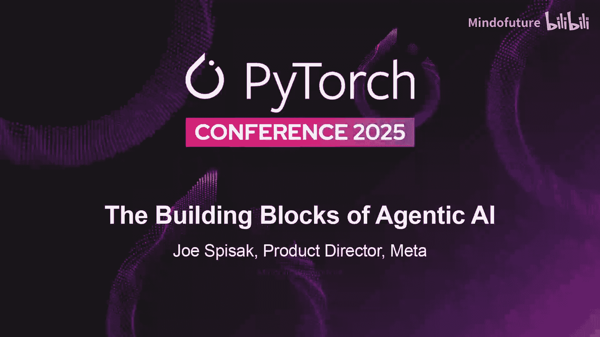
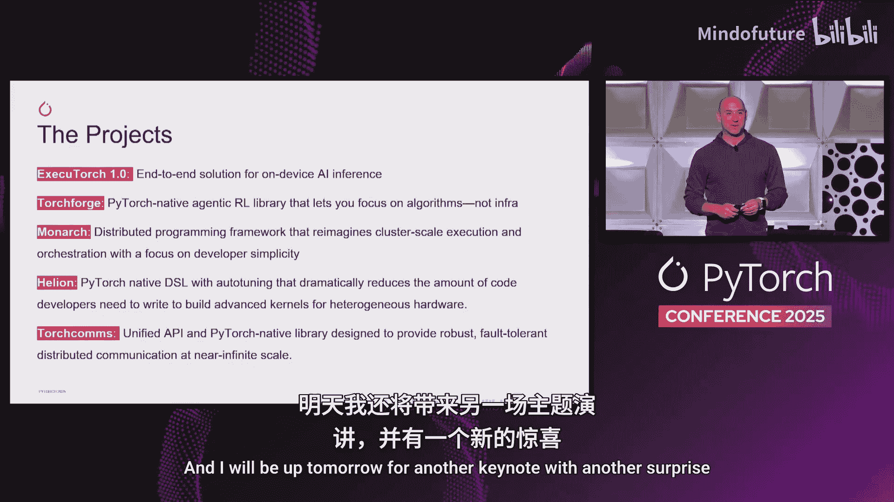

# 2025 Pytorch大会 ｜ Pytorch Conference 2025 p17 P17_智能体AI的构建基石-Joe_Spisak__Meta超智能实验室产品总监 -BV1b8kRB6EJG_p17-

Thanks for having me up here， appreciate it。Who made the AI infr sumummit yesterday？Okay， good。

 you're going to be happy with some of the stuff I'm talking about。 Okay， so welcome again。

 I'm Joas Pia， I'm with Meta。 I've had the pleasure and honor to be working on Ptorrch for close to eight years now。

😊，It's been a journey， it's pretty amazing wherever where we are today。Yeah。

 I mean I just become myself lucky that I've been able to work on this such an amazing project with such an amazing team for such a long time。

 you know， we've been thinking about actually let me back up a second。

 we've been thinking about the next generation stack for quite some time obviously like the scale that we operate at meta dictates that we need to think about different things in this case。

 you we we support PyTtororch， we believe deeply in it， so the tools that we build。

 we think about not only them being PyTch native in the terms of like they look and feel like Pytorch。

 but we really think about interoperability with this ecosystem really you all。

 like how do we work with you all， how do we make a foundation that others can build on that we can then leverage and obviously build on top of and so on。

😊，We also build for scale， as I mentioned so we ourselves have buildings of users on our platform。

 we train models over。More GPUs than I think we probably should that we can afford but we also need to scale up on inference and to mobile devices and edge devices so scale and basically all axes。

 actually matters a ton to us and then lastly I think we we've talked a little bit about actually that's why I mentioned the AI infrra summit we talked about hardware heterogeneity。

 the world is super heterogeneous we're building data centers with our own silicon if you caught Jim Matthew's talk last night we obviously invested in different vendors so we have this world where we're going to have accelerators on devices。

 we're gonna to have accelerators and data centers。

 all these things need to work together at some point and actually come together and so we need to build for this heterogeneity and this future that we have。

And so hopefully you've caught some of the blog posts that have come out this morning we put out I think six posts they're all very deep dive on Pcharch。

org definitely check them out So you know when we were thinking about what this stack would look like in the future we actually took those three principles to heart and so every layer of the stack has literally been disrupted and probably like the last kind of one to two years here starting with you know really I would say the kernel and the infrastructure layer。

 how do we actually build and we actually have LLMs energygene kernels if you find Mark serafine floating around here somewhere you can hang out with him and talk popcorn and of course we have the project called helium which I'll talk about。

嗯。Basically， how do we accelerate that this whole layer basically allows us to move faster at training。

 move faster at inference， explore the space and so on Torch comms， if you saw。

 which hopefully made someone's Christmas list from AI Infrra summit yesterday is a comms collective library focused on hardware He 80 Monarchops Monarch is a distributed orchestration single controller project that underpins a lot of our new multidata center。

 single data center like largescale cluster scale development and then Forge or Torch forge as we call it is our RL post training and agent layer that we're building。

And then on top of that， we obviously partner with VLM is a great library for inference at scale on the cloud side。

 and then we launched the GA for one Do of executive Torch。

 and that is what we use at scale at the company。And we have great partnerships around it。

So if you look at some of the things we've launched like our glasses and our wearables and so on。

And so just kind of dipping into the projects themselves， so Excut Torch 100。

 huge ecosystem around it， we have quaualcomm and arm and cadence and all these folks。

 this is literally our end to end development framework on device from wearables to the phone。

 we use it at the company and we have this really amazing ecosystem， please join us by the way。

Second I mentioned torch forge， so the goal here is to build something that accelerates researchers and really takes the infra out of RL development and so we partnered if you saw our blog this morning。

 we partnered with coreweave as well as Stanford to showcase it and it really it comes through from a research perspective you can iterate on algorithms。

 it's very simple it builds on for builds on monarch。

 the next project which is a project that we built basically to reimagine what it means to do distributed training。

 so single controller is way more。Pytorrch friendly or Pytor native。

 then trying to build on Pytor attributed。 We see this is the future of how large scale orchestration is going to happen。

 We're excited about it。😊，Healian， if you check Jason Anselll's talk out。

 you'll see that you can basically now author kernels with way fewerer lines of code and still hit roofline performance and actually hit even better performance because it incorporates auto tuning and so if you want to write a kernel。

 say like in 30 lines of code， maybe in triteton it'll cost you 120 lines of code and it actually even get better performance。

And then lastly， torch comms。You know we've been in this world where we've had a fragmented Rel。

 nickel， we had a bunch of stuff internally that we had built。

 we wanted to create an ecosystem around this area because it was just ripe for disruption and innovation where we're bringing together obviously our close partners and VDdia and AMD and others in our own silicon and building this communication layer that we can all contribute to that we can all make better that's fall tole that's robust and frankly like has to scale to near infinite levels of GPUs and compute elements in the future so we're super excited about the stack is very early we'd love for everyone to come in collaborate and work with us check out the blog posts and I will be up tomorrow for another keynote with another surprise so I will see you tomorrow。

 cheers。😊。

Thanks， Joe， cheers。Alright。