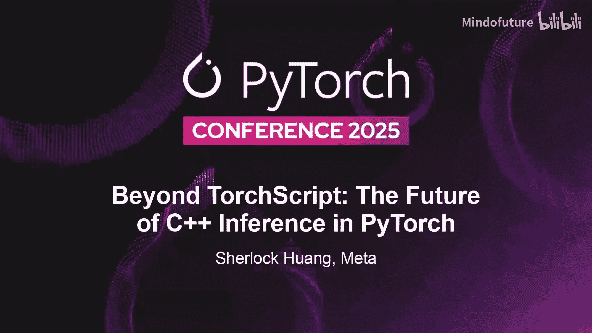
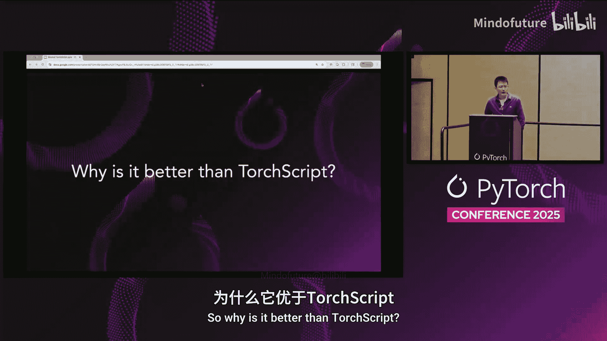
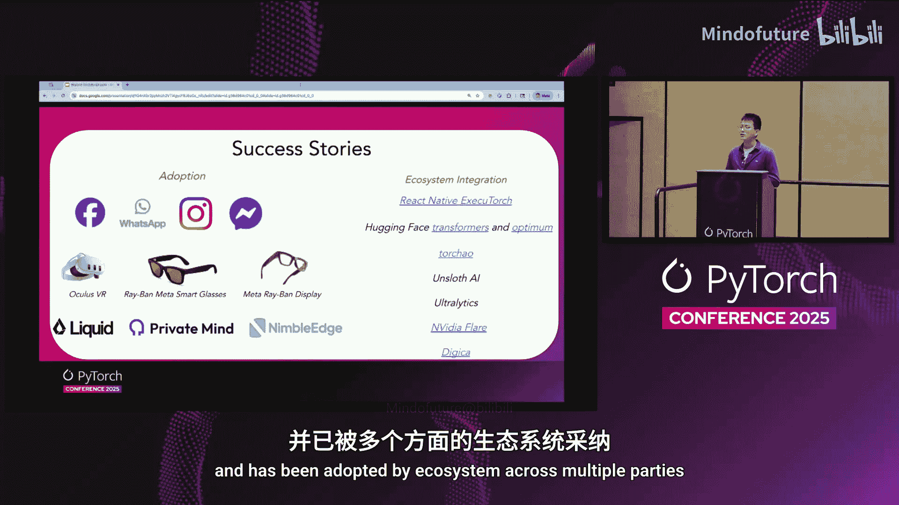
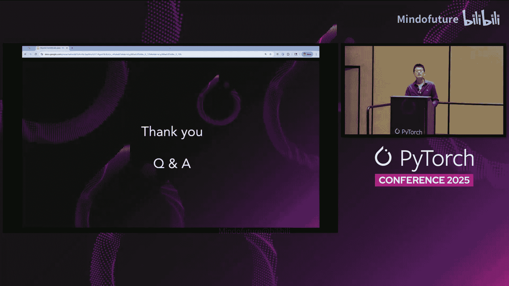
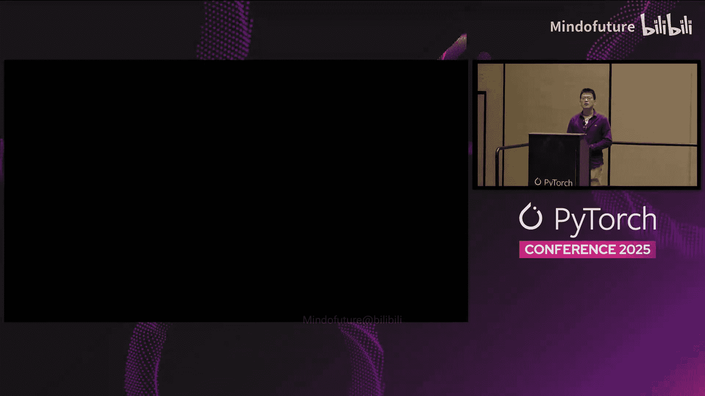

# 2025 Pytorch大会 ｜ Pytorch Conference 2025 p18 P18_TorchScript之后——PyTorch中C++推理的未来-Sherlock_Huang__Meta -BV1b8kRB6EJG_p18-

Hello， welcome， everyone。 I'm Sherlock。 I'm from Pytorrch Compr team of Matt。

 So the work I'm about to present is a joint war between Pytorch compiler team and executive Torch。

 And the topic today is beyond Toscript like and the future of Python La inference in P Torch。😊。

So I guess today we have a forum of people who actually care about the fate of To grid。 And today。

 I'm gonna share a few news about it。😊，First of all， let's revisit why we have All right。

 let's first talk about the purpose of Pythonless inference。 like Pytorrch is all good。

 and everything is in Python like why we try that hard to get out of Python and try to do inference。

 there must be some concern behind it that you have to ditch the python for good reasons。

 And we know that like this is coming the practice in productions。

 So when you look at this few scenarios， especially the edge or the metaverse or some like mission critical systems。

 typically they are requires low latency and like tight memory budget。

 and this is why we need to get out of Python get rid of all the Python overhead。

 and typically what you have is a C plus plus like runtime environment。😊。

So here's the reason why people really like Pythonless inference。 So first of all。

 it' for much lower latency in the mission critical systems like every micro count。 For example。

 selfdiving car。 you want it to be a realtime system。 You cannot imagine running python in it。

 And also Python is an interpreter based language and interpreter layer just add another likeisecon like microsecon of the overhead to achieve this kind of like deterministic run for real time speed。

 usually people would vote for C or C plus plus based implementation。

 The second reason is resource constraint。 For example， the a device and embedded system。

 typically limited by the amount of memory and power you can use。

 So Python requires that requires a bulk key interpreter usually is not the right fit。

 So without Python like so no python run time。😊，A typicallyically like lightweighted optimized for memory and power。

 that is more suit for such scenarios。 The last reason why people are foryonless inference is it makes a deployment cycle easier。

 So we want to deploy the entire python environment。

 we simply just want to export a model into some kind of like compressed format that is like portable and you can ship it into multiple environment。

 So the rule of thumb here is that use Python for the heavy lifting training phase where you can like you want the flexibility flexibility of the eager experience。

 But when it gets to production great inference people for like see or inference engine for a high stake low resource demand on the edge。

😊，嗯。So let's take a bit look back into the history and revisit our opal tour script。

Tsscript is the core technology that enable Pythtorch model to run independent of Python Historically。

 It the bridge from a research model， like。To a production system。 so to create ascript model。

 there's commonly two ways you can either g dot script it。

 which is doing a Python DSL Python DSL parsing to create a static graph or you can do a dot trace。

 which is like tracing that's happening in the special level。 But at the end of day。

 you get a graph inscript I R。 And then you can do all kinds of optimization on it。

 try to compile it and eventually package into some kind of format， typically it' like P file。

 And then the result thing is then deployed to a runtime。 In this case。

 it could bescript interpreter or static runtime。 So this is the typical workflow in thescript stack。

😊，And over the years， like。People have deployed Toscript in their systems and we have run into various kind of like problems。

 we consider Toscript kind of like our first generator of like Torch capturing and compiler technology over years。

 we have developed multiple iterations。 So for example。

 we have experimented with symbolic trays and more recently with P2 based like Torch export graph capture。

 So here's we're going to revisit the problems we had with Toscript。

 and we will learned that like from this problem， we made new design decision in our new systems。😊。

Number one， the front end as I have mentioned， there are two front end。 there is a torch strip front。

 script front， which is very picky about Python syn。 Like if you have work with J script。

 You know that you need to write your model in a particular way in order to make the scripture happy There are a bunch of Python features that you simply cannot use because script doesn't support it。

 because of its nature。 It has uneven coverage on Python features。 Some are support it， Some are not。

 So they are very common requests about why don't you support this Python feature like named argument because that's not implemented。

 So it's not support it。 it adds a bunch of complexity to the p torch codeb So those other script problems。

 On the other hand， you can have trace， which is a tracing basedor operation like like。system。

 The problem is that it's unsound。 What you get in the end is a straight line graph。

 Even if theres some like， if else branch in your code。

 you doesn't see that you just faithfully record what you have encounter during this particular instance of trace。

 And another problem is like it last the structure because the tracing is happening inside CPP dispatcher and you have no knowledge about what's happening in the outside world。

 So it's very hard to linked like。The the Python original Python user Python structure in user code back to the To screen graph。

Okay， then moving on to the next set of problem that is people want to do optimization when you have such a graph。

 However， tensors in rate I。Doesn't necessarily contain all the metadata。

 There's no guarantee that the tensor has the information about like shape， D types。

 stride and layout， which are very critical for you to later do optimization on it。

 If you want to do any kind of fusion or memory planning。

 usually you are relying on tensor metadata to do a good job。 So essentially like。

People apply work around by running additional passes to pops， but those are not very reliable。 So。

 yeah， that's a limitation。 Another problem is Toscript I R。Expose all Python jobs to you。

 So as of today， it has over 2000 apps。 If you are a backend that tries to integrate against Tor gray I R。

You have a very large surface to work with。 Yeah， often。

 this is prohibiting like backends from implementing a reasonably good backend for a large set of model coverage if you are talking Tostiory I R。

😊，嗯。Now， let's look at the problem of the Torsscreen I R itself。Let's just look at this example here。

 This is a very like artificial example， which is a function that takes in a dictionary and a string and a tensor as input。

 And in the function body， you do some like dictionary lookup and stream manipulations。

 the good thing about J script is that if you script it。

 all of this python like operation are actually included in the IR， which is a bit crazy。

 but like it's there。 So you can see that there is like conca for the string。

 There is like dictionary lookup or dictionaryary set。 so。😊，Typically。

 an M compiler only cares about two things， right， It cares about tensor operations。

 It cares about shape computation。 So in P2 determine they are cement。

 These are the only to construct that。 a typical M compiler cares。 but in the tro grade I。

 we are putting a lot of nontensor operation into the IR。

 and those are hard to work with from a compiler's point of view。

 So this introduce this unnecessary dynamism into the IR。

 usually compiler which ignore it or try to write path to get rid of it。 But at the end of the IR。

 is not the right IR。 that is if you are trying to build the backhand or compiler against it。

Another word about like control flow。 People love control flow。

 People like one thing that people really love about script。

scripting is it automatically capture the control flow， like if else branch for you。

 this is good in a sense， it capture or if else condition automatically for you。 However。

 it also captures a lot of things that doesn't necessarily need to be dynamic。

 So everything regardless whether you intended to be dynamic or not。

 they are faithfully captured in the graph。 So as you can see in example here。

 like this simple program turns into this complicated I， which is has the if in your resulting graph。

 And if your compiler people， you know that like branching is a poison for compilers because you don't see。

Global picture， things are localized。 You can only optimize for like this small if else branch of the graph。

 and it prevents like global optimization， such like fussion and reordering。So essentially。

 it's good， but lights， it's too， too much to introduce a bunch of unnecessary dynamism。

 which make it hard for compile to compile。😊，And then there's a problem of compatibility。

 There are a multiple fold， multiple fold of like compatibility problems。 The comp problem。

 like Python itself and P itself， is constantly evolving。😊，Like instance。

 so there are compibility issues between trust group and like modern。Version of the Python。

 and then not to even mention the new feature that is happening in Pythtor 2。

 So it's simply not compatible with it's like the the thelex is not able to keep up with the new development。

 And then also there this offset problems。 because of this 2000 plus appss that are exposing the I R not all the ops are guaranteed to be。

 there are cases where like when you have operator definition B brokerage your graph becomes invalid。

 And when you run it， it just fails。So， and finally， like。

 when you have a graph and you do optimization， Okay， you reach the final， final runtime stage。

 The what kind of runtime you can actually build with such a graph。

 the best you can do is interpreter。 yeah， so you just run the graph no by no after applying some optimizations。

 And because like。😊，And， and then like at the end of the day。

 you're gonna rely on Pythr dispatcher to run the no for it。

 So dispatching overhead is kind of large。 And yeah， it's not very nice。呃。So in at the end of day。

 like， we come to a conclusion that like we actually have attempted to build multiple version of compiler based on。

Tk I R， and we are not able to I shape a very good ahead of time compiler based on Toscript IR。

 And we came to realize that this is very hard to fix incrementally。 Like I said。

 it's field talk to trace the involvement of Python Pytorrch。 It's a dynamic language。

 and you are trying to capture everything in a static graph with a limited set of like I definitions。

 It's， it's a losing battle。 second issue is that like， it's coming from its fundamental design of。

Tscript。 So， for example， like it tries to capture everything。

 Like every python language feature are somehow representable in a Toscript I R。

 So any PC breaking change of Pythtor or Python will cause the whole IR tube。To Chmbo， right。

 So it's not very busy compatible。 And finally， we have to。

 to reach a real production great run time efficient。 You like we， we we。

 we just have to rewrite from scratch。 So the overhead had。😊。

We have just discussed it's not like something we can patch and to be fixed， so。For all this。

 we need to like a the legacy interpreter and build a new foundation that is free of this like design choices that we made in the beginning。

 So starting fresh is the new is the only way to deliver a good and speedy stack that user wants。😊。

So we come to the the announcement today。 So we， because of all the limitation and problems that I have stayed above。

 we have decided to。Deprecate， to group。Starting from P tor 2。9 release。 But don't panic。

This is a controlled sunset。I want to be clear that。

There is no immediate implication of torgrade depre today。

So everything is a controlled depre instead of an abrupt shutdown。 First of all。

 all the existing prescription builds will still be maintained for sta。 However。

 it's going to be feature frozen。We are not going be developing any new features on top of transcript。

There will be bug fixes， but it will only be bug fixes for security issues。Right。

And we are starting this hard pivot by deleting the documentations from our Pyth 2。9 docs。

So if you go to documentation page， you won't find Toscript。 You can go back to older versions。

 But like， that's our way to signal to the world。 Like we do not recommend new users to。

I used for script。Finally， I have a clear end date。 So the code deions。😊，For that plan of records。

 it's gonna be four more cycles targeting version 2。14s。

This give us the community and industry plenty of time to move and transition。Allright。

 now we have talked about history。 Let's look ahead and see what's beyond Trascript。

 So over the past few years， you have seen Trscript you have seen P2 and we have been actively working on the successor of Tscript that is executive torch So it was built on top of the latest technologies that we create and as stem from Torch Compo and Torch export stacks So you might have heard from the previous talk that Mergen gave Excut Torch have reaches GA and 1。

0 today So we encourage you to export Excut Torch as a solution replacement solution for Torscript。

 So a few quick overview Torscript follows a very similar stack as the executivecut follows of similar stack as Tscript So in a sense that you have eager module you do graph capture。

 the new graph capture is Torch exportport， which you get。😊，Its an F X 18 graph。

 And then you can do optimization and executive tor lowering to optimize it。 And finally。

 it becomes a binary that is deployable。 And then you deploy you you。😊。

Run the actual lowered artifacts in executive torch one time in your favorite mobile embedded or desktop environment。

So why its better than taskscript like， First of all， the graph capture front end is now different。

 So we have。😊。

Work we have released like Tordo Expo about2 to three years ago。

 So we like have been using the extensively internally。 So just to quickly recap。

 I think most of people is already familiar with this is a tracing based graph capture that doesn't produce too much。

😊，Like random Python。syntax， it has a much fewer gaps with existing Python features。

 Also because of a dynamo， it has a soundnet guarantees that the dynamic shape that you capture during the tracing correctly populated all the tensor in the F X setting graph has a metadata information attached to it so that your backend or your compiler can reasonably optimize for it。

😊，Also， it's compatible with our latest advancement in P2。

 So it's up to date support for new features like Tensplus。

 You will never be able to toscript subplus， but you are able to export it in Torch export。 yeah。

 And then there's also lot of interest in like implementing your own kernel in Triton。 Sam here。

 You cannot do this in Torscript。 Torscript doesn't understand Triton。 but export understands Triton。

 So you are able to capture the Triton kernel。😊，It's just a few words about Exp I R。 So like。

 like I mentioned， if A F X graph has all the nodes metadata populated。

 So it give you a rich set of like tensor metadata allows you to do further optimization on it。

 And also， it's。😊，呃呃呃诶诶诶 the the the。The the edge dialect would provides even stronger guaranteed on the operator set that could show up in the resulting F XR。

 So you what you're gonna get。 It's a functionalized set of operator that we have handp and maintained and give them B C guaranteed。

 So this is what we call edge dialect。 If you need further optimizationizations on your own dialect。

 you can also do customization by adjusting the decom and then you have your own upset。

There's a long list of optimization that we have put into executive torch stacks。

 such as the state of our quantization and implemented memory planning and look at this long list of light delegation backend that executive torch has integrated with。

 I'm not gonna going through of them， but like we have closely working with all the hardware vendors to port the backends into executivech stacks。

😊，Finally， I just want to say one thing about the exact tor runtime。

 It has a low overhead and it's very small。 It's just like 50 kiloby。

 and under her is an efficiency plus plus implementations。

 it supports a wide range of architecture like Linux， you know， all the common ones。

 but specifically like to mention the iOS and Android targeting the mobiles。

 and it is embedded device。😊，Now， just to give you a few caveats about like this is work in progress。

 So executive torch currently mostly targets mobile edge and desktop device only All the control flow can be captured with Torch export。

 but you have to do many rewrite。 you have to rewrite it into a Torch do kind of like higher order offs if you understand if you know what To find Tor find is not gonna be supported。

 if you don't understand what To find is， don't worry about it。

 like its legacy stuff you don't want to know about it。 Finally。

 like the NVD GP support and meta support is experimental。

 we are bringing Ao induct into executive torch stack。

 we are able to compile a model into tri kernels by inductor and deploy it with executive torch。Okay。

 a few words about next steps。 we're gonna continue to support more models on the desktop。 Of course。

 like the front ten is going to continue to evolve to keep up with the new Python and Pythch features。

 This because like this is P2 native。 it's easier to do this we are gonna like a mature A T inductor for a better GPU support。

There are two example that we have released today。 workshop and Ja 3。 like if you're interested。

 you can go to the link to look for more examples。 These are generated models， by the way。

 And they are multimod。 They are not just L M。 This shows case that like how easy it is to take a multimodality like generated model going through export and then deploy in executive stack。

😊，And this has been a lot of adoption。 You have seen this in the keynote slides。

 So I'm not gonna repeat myself， but it's widely used and has been adopted by ecosystem across multiple parties。

Finally， I encourage you to try out a new executive stack。 There are tutorials and examples。😊。

And I will let people take pictures， And there are light。

Disord that we have developer there to interact with you。

 So if you need more like real time interactionss， go， go to this Discord。 And also。

 we are always available in Github issues。 So that's all for today。 Thank you very much。

 And I will have 30 seconds to take up questions。😊，Yeah。Yep。serialeralization operation。

canch C serialization， loading and saving。Lip towards serialization， which one are you referring to？

The torch。Operations for serialization。哎呀。Are you talking about like custom class？Okay。

 that's the torch point support。So this is a custom super sports clause。

 which you can define your own and deizations。😊，Right， so this is the another name is in Torch point。

 That's the torch point of。 So currently it's。Graph catchable by torch export。 However。

 the executive torch stack hasn't implement support for it， yeah。Yeah， no questions。意は？

What is missing？If we want to use the exact to forモサビ，サ use cases， what would be missing。

serverless deployments， sing， model sing use cases， what would be missing。

Yeah， so is it like on mobile edge scenario or no， no like data symptoms。Sorry， I'm。

Ss oh servers like deployments。 I think the main problem is that like our Qda support is still work in progress。

 So on server you per， you coulda you A O T Inductor， but A O T Inductor is still experimental。

 I think currently our major focus is still on desktop， but less of on a server。 yeah。😊，Thank you。

Sorry， I， I， yeah， I， I don't have time for another question， but we can talk offline。 Thank you。

