# 2025 Pytorch大会 ｜ Pytorch Conference 2025 p19 P19_开源训练后栈——Kubernetes_+_Ray_+_PyTorch_+_vLLM-Robert_Nishihara__Anyscale -BV1b8kRB6EJG_p19-

Hey everyone， thanks for coming， I'm Robert， spoke earlier today and wanted to go a little deeper technically here talking about the work we're doing with Ray。

 how it integrates with Kubernetes， Pytorch， VLLM and really the other components of the open source compute stack for AI to support post-train and just some of the more modern compute intensive AI workloads we've been seeing recently。

 so wanted to share a little bit about my background。

 I want to talk about how AI has been changing over the last year。

 what new workloads and new requirements we've been seeing。

 and then a little bit about how the infrastructure software stack has been evolving to support these new workloads。

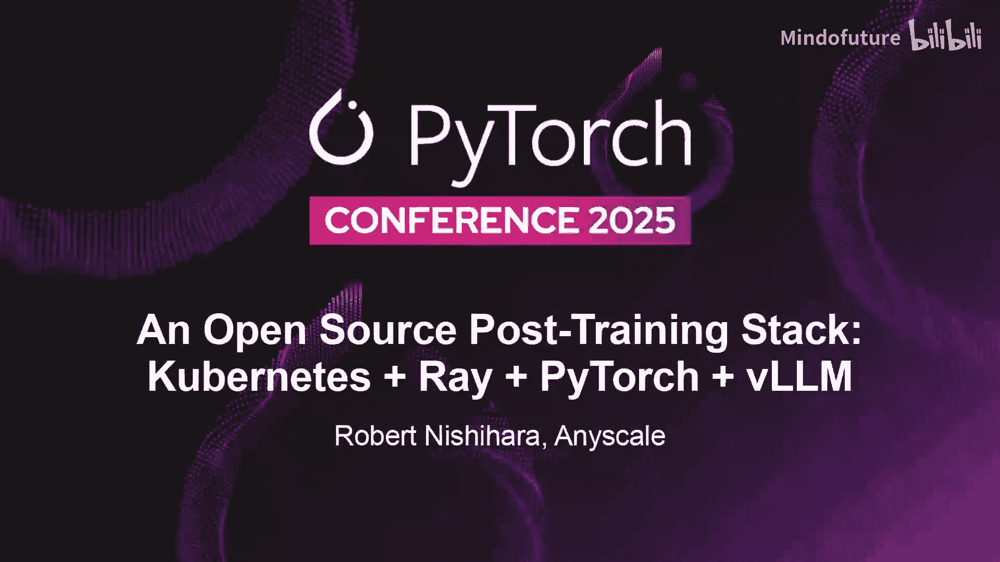

And earlier today we announced that Ray is joining the Pytorrch Foundation。

 so super excited about this， Ray is has been used along with Pytorrch， along with VLLM， with deeppe。

 other projects in the Pytorrch Foundation for as long as people have been using Ray。

 and so it's super exciting for us to just be part of that foundation。

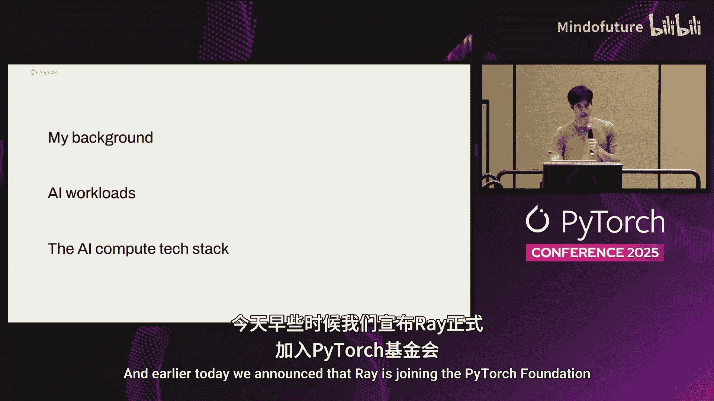

U。So my background， I started doing machine learning research， I think probably around 2012， 2013。

 and was a grad student at Berkeley working on deep learning algorithms。

 reinforcement learning algorithms， optimization algorithms。

 and actually had no background in distributed systems or infrastructure。

We were really focused on algorithms， but because you know even at the time to really experiment with AI to innovate on algorithms。

 you had to AI is very empirical， you had to run experiments。

 you had to try things out and see if they worked and to see if they worked。

 you had to do things at some scale at some meaningful scale of course。

 the scale at the time was not the scale that it is today but。Even， you know。

 as people focused on algorithms and research， we spent most of our time working on infrastructure。

 spent most of our time building systems to scale， compute across clusters， to manage instances。

 to run stuff on on GPs and。Because that was what was taking up all of our time。

 We thought there was an opportunity to build better tools for distributed computing。 Okay。

 so that LED us to start Ray back at U Berkeley。😊，And Ray adoption has really taken off over the last year。

 really with generative AI， with today's reasoning models， with agents， with reinforcement learning。

 These are the things that have really LED to。just a need for Ray and a really explosion in ray adoption。

 And a lot of this is really just in the last year。

And there are a ton of use cases I'm very excited about， but this is， of course。

 regular established tech companies， companies like Uber and Pinterest and Discord and so forth。

 It's AI startups like X AI or physical intelligence or runway or thinking machines。

 you know it's traditional enterprises as well。 So it's really Ray is widely used across the industry now。

😊，So what I want to talk a little bit about now is some of the changes in AI workloads and how AI workloads have grown more complex。

 and I'll talk about data processing and I'll talk about post training。So。

People have been doing big data processing for a very long time。

 Do you have companies like Databricks， companies like Snowflake。

 tools like Spark and Flink and Hadoop。

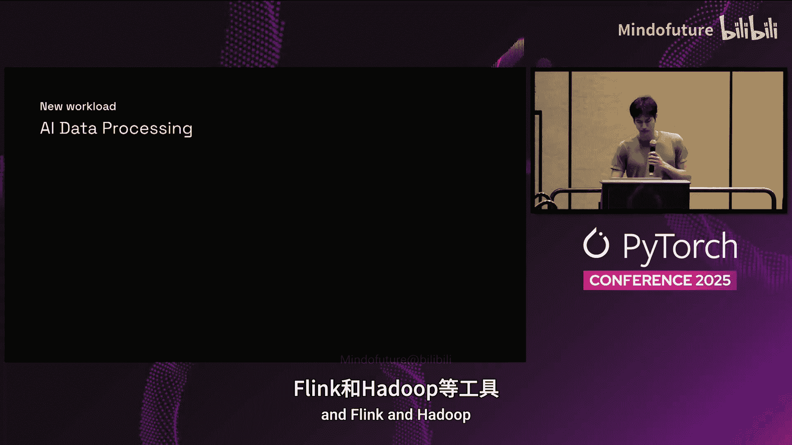

But the nature of data processing is kind of changing right and you have a world of tabular data that's moving more and more toward multimodal data。

 you have today you're people working with video data， images， audio， text， robotics sensor data。

 all sorts of things。And the way you work with tabular data and with multimodal data is different。

 right with tabular data， you're often doing regular processing。

 running SQL queries and things like that。 with video。

 you're probably not running a SQL query on your video。

 You're generally running inference along with other processing on this type of multimodal data。 so。

😊。

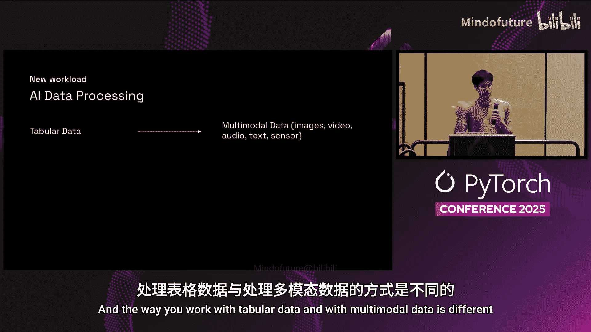

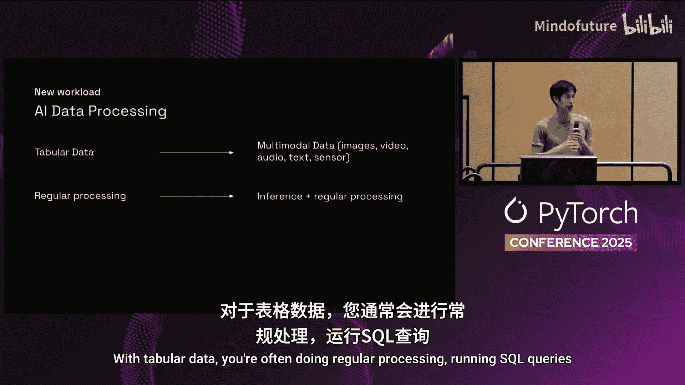

Data processing is becoming very inference heavy。And as data processing becomes very inference heavy。

 it becomes more GPU heavy so a lot of data processing is shifting to this heterogeneous regime where it's a CPU plus GPU workload。

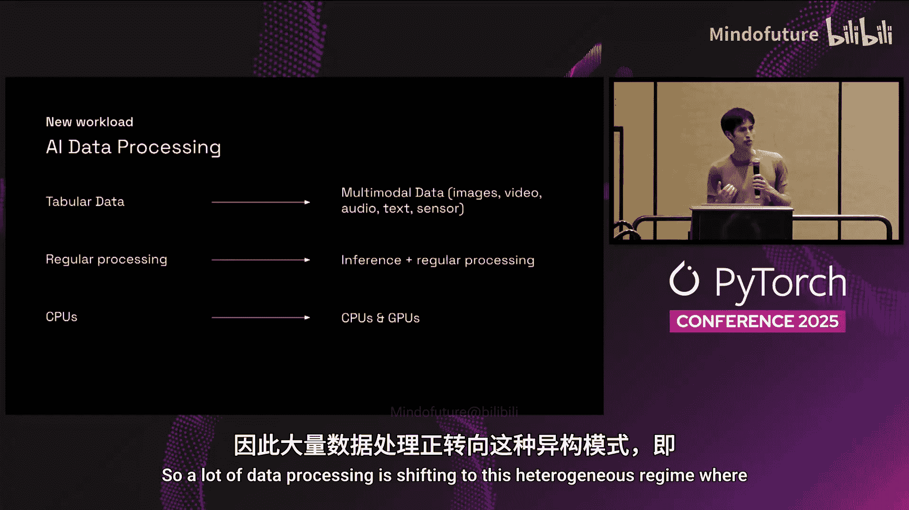

And that's very different because when people were building the previous generation of data processing systems like Apache Spark。

 you know， Snowflake， fleeing， Hadoop， they were really designed for a homogeneous cluster of CPU。

 They were designed for。More SQL like queries， more simple analytics and often more for tababular data then and so the shift now。

 if we're to summarize it in one sentence is from doing SQL on CPUs with tabular data to。

Doing inference on GPUus with multimodal data。 And that's a pretty big shift。

If you think about- and a lot of this is driven by the fact that multimodal models are getting better。

If you think about you work at a company and there are a lot of meetings and you might record some of those meetings。

 but most companies still don't record most meetings。And why is that， Well。

 no one's going to go back and watch the recordings。

And so you don't get much value out of recording it。U。

And you know you could use AI to kind of you certainly even today using AI to really understand video and get value out of video it's kind of video is kind of unwieldy It's like hard to do it's hard to work with。

 But as these models get better as we're able to get more and more value from all different types of data。

 while we're gonna get more value from the data and we're going to start storing way more of the data。

 And so I think we'll reach that point where kind of overnight。

 everyone's recording all of the meetings and things like that。

 You're starting to see a little bit of that。 but we're still not getting anywhere near the value than we could be。

 And I think we're going to start to get far more value out of multimodal data and then just as a consequence。

 the amount of multimodal data we store is going to explode and the amount of inference we do on that multimodal data to get value out of it is going to explode。

 So there's a huge shift in the nature of data processing that's happening here。😊。

The second thing I want to talk about is reinforcement learning right。

 of course we've all aware of reinforcement learning from Alphago and Atari and physics simulators that this was happening in 2015。

 2016， the whole field of AI was really focused on this。😊。

And reinforcement learning has really made a comeback recently because it's with deepse and with its use to build really powerful reasoning models to build agents。

And。This is very interesting from a systems perspective。

 so this is a diagram from researchers at UC Berkeley talking about Sky RL。

 which is an RL open source RL framework for post training， large language models。And。

It illustrates the anatomy from a systems perspective of running a reinforcement learning algorithm。

 So if you think about how this compares to pretraining or just training regular training of a model。

 The pink box there that says GRPO， PPO， that's basically running your training algorithm。

 If youre just doing regular training would be that pink box。 But to do reinforcement learning。

 you are not only doing training with the model， you are also using the model to generate data。

 So you're also doing inference。And the process and then so you're taking the latest model。

 shipping the model weights over to the data generation side of things generating data。

 and then shipping the data back to train on and it's more complex than that because the data generation side actually has multiple components。

 there's inference where you're running the model and then you often have some environment that you're simulating if you're trying to build a coding model。

 then maybe you have a bunch of dockerized code bases and paired with Gitthub issues and the model is saying things like clone this repository Cd into this directory。

 like apply this patch compile the project， run this test suite and all those commands are getting executed in the Docker container and so you need to scale the the containers that are running the environments you need to scale the inference。

 you need to scale the training and each of these could be a bottleneck。

 you might need different softer dependencies， different compute resources for each of these different。

Sort of pools of compute you might need and different ones can be bottlenecks at different time right as as these models get better and better at reasoning or for longer amounts of time throughout the course of training。

 the inference can go for longer and longer and so the amount of compute you need to shift toward inference might increase as you progress so there's all these different complexities to give you an example of more kinds of complexities that can arise as your reasoning for longer periods of time。

 you may want to have multiple you may want to kind of fork the reasoning and go down。

 explore multiple different reasoning paths and then recombine later different environments。

That you're executing may all have some shared rate limited resource that they're queryrrying like an LOM API or something like that。

 and so you need coordination among all these different processes that you're scaling to kind of handle that rate limiting。

 so there are many different systems challenges that arise with reinforcement learning that just simply don't come up with regular training and so and one of the main things here is increased heterogeneity。

 just more moving parts each with their own requirements。

And so what and Ray was really designed for heterogeneity， both hardware heterogeneity。

 application level heterogeneity， and this is something。We talked about earlier today。

 but as a consequence， nearly every open source R framework is built on top of Ray。

 So Ray is the open source framework we've been developing。 And Ray here is used in conjunction。

 Ray is handling this process orchestration and coordination and data movement in conjunction with a training engine like a megaron。

 If you're using large mixture of expert models or torch Titan or FSDP。😊，Or。

 and then on the serving side， we see a lot of S G Lang， a lot of VL L M and other engines as well。

 Okay， so this is， these are some of the technology stacks that people use for doing。

Reinforcement learning for post training LLms。But this is by no means converged this is。

 you know you have new RL frameworks emerging all the time and depending on the type of model you're using the architecture of the RL framework that makes sense could be different。

 and so I expect just more and more iteration on this space before things converge。

And so now I want to talk a little bit about the software stack for actually supporting these types of use cases。

 right， we have growing complexity with AI workloads。

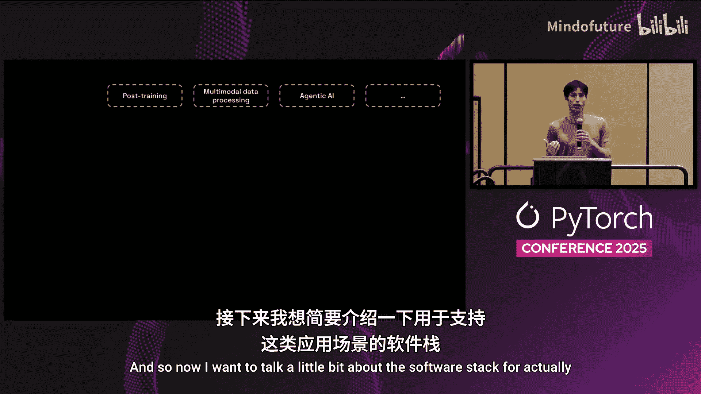

We talked about reinforcement learning， we talked about data processing with AI。

 and we have all of this powered by GPUs under the hood。 And so I want to repeat and I。

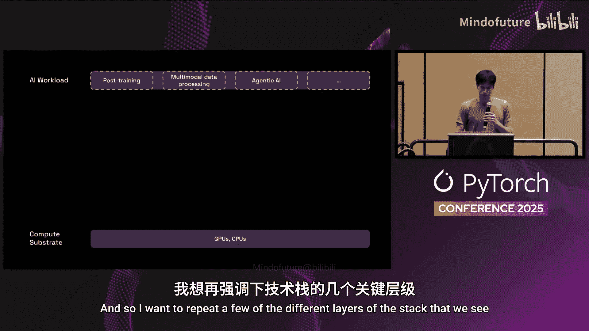

A few of the different layers of the stack that we see because you' have growing complexity on the applications。

 growing complexity on the hardware， and so you need a software stack in between that kind of connects the applications to the hardware and helps manage that complexity and that software stack has to solve these types of challenges。

 challenges around scale， resource management， failure handling， reliability and so forth。😊。

And we see a few common layers in this stack。 We all know piey To chart。

 This is the dominant deep learning framework。 This layer is responsible for running the model efficiently on the GPU。

 right， And there's a rich ecosystem of。Around pie torch for。Handling model parallelism。

 different parallelism strategies for handling you know， optimizations for transformers。

 both inference and training engines and。But fundamentally。

 this layer is about squeezing the most performance out of the GPU when you're running running the model and then Ray。

 which we've been building， sits at this distributed compute engine layer and this is about solving the distributed systems challenges of scaling right so that includes all this process or orchestration。

 coordination going back to this picture for a second you have all these different pools of processes that you need to manage to auto scale to handle failures to move data between them to coordinate them and synchronize them and they might fail。

 you might need to autoscale them， these kinds of things。

 So theres just this is all about solving those distributed systems challenges。

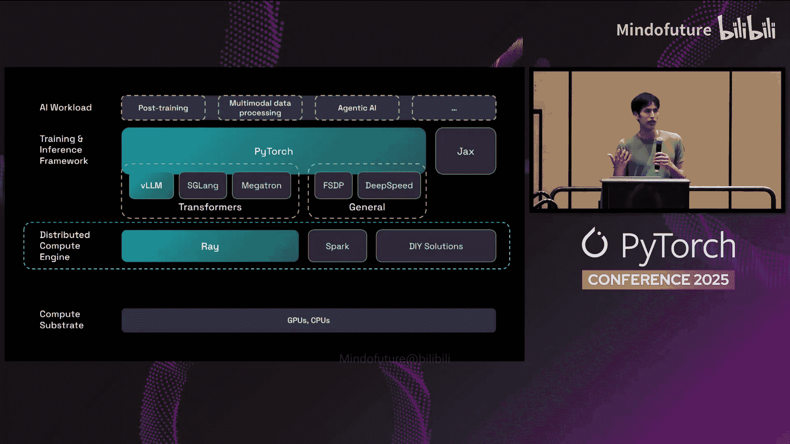

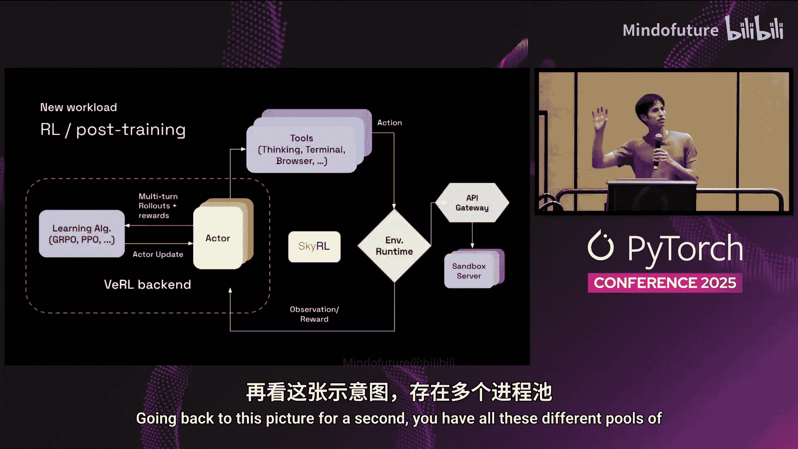

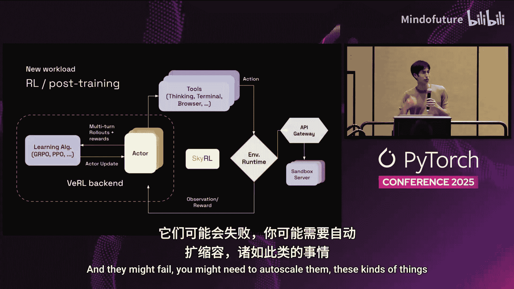

Within a single workload。And then this all runs on top of a container orchestrator like Kubernetes or SLRm。

 which is responsible for provisioning the compute。

 handling more coar grained considerations like user multitenancy， job multi tenancy。

 and really together all of these。providerov a stack for enabling complex AI applications。And so。

One thing I want to talk about is that we're actually seeing a tremendous amount of coe of these different layers。

 I want to give just one example。😊，And how these layers by being aware of each other can work better together and provide better support for AI workloads。

And that is the integration of Ray and VLOM。If you're trying to deploy large mixture of expert models。

 right， the largest deepse models or things like that， it's a multi nodeode thing right。

 you're not just using a single node， and there's quite a bit of complexity around getting this right and making it really perform and doing it well requires not only optimizing the code that runs into GPUs and really getting the inference engine right。

 but it also means doing a great job at the process orchestration and coordination layer。

And so Ray and VLM， the open source communities have worked closely together to really enable。

 find grain control and over placement of the different VL LM workers。 For example， if you're doing。

😊，Pfiled decode disaggregation right with LOM inference you are there's the prefill stage where you process the inputs which can be more compute bound。

 there's the decode stage where you're generating tokens which can be more like GPU memory bandwidth bound。

 it can make sense to separate those onto different pools of compute or different GPUs in order to basically so they don't interrupt each other and you get more predictable performance and better tail latencies and things like that。

But when you do this， you may have， you know you're sharding the prefill stage。

 you're sharding the decocode stage you have a bunch of different workers。

 you may want to say like the matching， I have certain ranks on the prefill side that match to certain ranks on the decode side。

 those correspond to different processes that need to be maybe co-located or things like that。

 And so expressing this kind of thing is very much a process orchestration and coordination thing and and the complexity is only growing as the models get bigger and the types of parallelism strategies grow more complex right you have different parallelism strategies for the expert layers。

 you have different parallelism strategies for the attention layers and。

And so really getting this right requires。Doing a good job at multiple layers of the software stack here。

 So not just something that's handled at a single layer。

And so these are the kinds of things that we've been able to do by having， you know。

 having a collaboration among the two open source communities。

 And this same could be said of Ray and Kubernetes along as well as Pytorch。

 but I just wanted to share the VLLM example。😊，Okay。

 so this is a little bit about how we see the software stack evolving for supporting these emerging AI use cases。

 all of this is motivated again by the fact that you just have so much growing complexity with AI workloads and also because you have so much growing complexity on the hardware side。

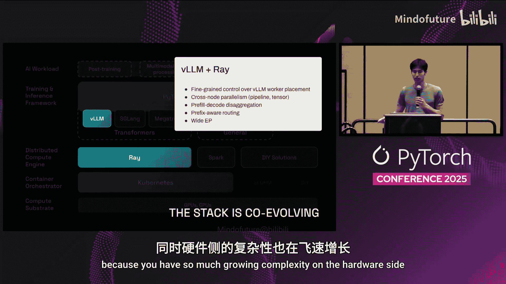

And I wanted to share a little bit about what we're building at any scale。

 right so we started any scale to commercialize Ray and continue developing Ray。

 And just recently you today donated Ray to the Pytorch Foundation。 So at any scale。

 we're investing heavily and developing Ray。 And then we're building our platform。

 which is basically a managed optimized version of Ray with a ton of observability tooling around Ray And so it's basically for companies using Ray it's just the best way to run Ray。

😊。

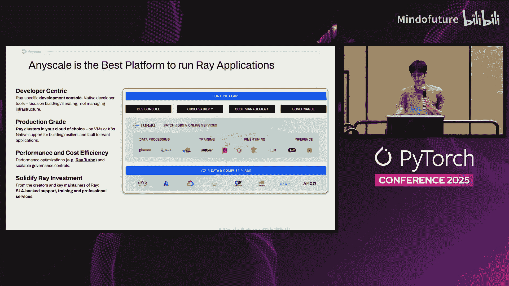

The last thing I want to share is that similar to PyTtororch Conference we have a race summit every year。

 this is our fourth one happening in a couple weeks here in San Francisco。

 so if you're in town this is it's a deeply technical audience and conference of think about if you're interested in reinforcement learning。

 folks from perplexity from cursor from thinking machines will be talking about how they scale reinforcement learning。

 a lot of folks working on robotics， folks working in other fields。

 this is audience of basically like AI and AI infrastructure people and so would encourage you to check it out。

😊，All right， I will stop there， thank you all so much。

 happy to take a few questions or chat with folks afterwards， so thank you。Yeah。

 why don't you shout the question， I can repeat it。Yeah。

 sos a little bit about the story of donating Ray to the Pytorch Foundation， absolutely。

So first of all， I would say most successful open source projects end up in a foundation at some point。

 right look at Pytorch， Kubernetes。 So this is a very normal outcome。 And for us， it's really。😊。

Kind of a signal to the community that we are trying to grow the open source community。

 that we will welcome contributors from every company and that we're really trying to make this a community project。

That's a big part of it。 It's really about growing the contributor community。

 growing the open source community。 I'll also say that。Because。You know。

 Ray is used so closely with Pytorrch， with VLLM and these projects。

 It's just a very natural home for Ray。 And you know。

 because of all these projects focused on really supporting like AI infrastructure。Yeah。

 so it was a a very like good experience with， you know。

 working with the Py Tch Foundation and Linux Foundation。 And it's not like， you know。

 it's not much change in terms of day to day processes。

 It's not like all of a sudden you adopt all these like heavyweight processes。's。

 it's actually been been quite good， yeah。😊，Yes。😊，奥，你。Oh。Spicies。Yeah。😊，Take on my take on monarch。

 so I think Monarch has a lot of really good ideas。

 and I think draws some inspiration from Ray with like the single controller model。

 the actor framework， stuff like that， I think obviously more natively Pytorrch right whereas Ray is designed to be framework agnostic and you have people using Ray with of course with Pytorrch but any different engine really。

 and but it's an interesting project。Yeah。Like， can you repeat that here I got a microphone now here。

Could you share why is it called ray or called ray， it's like a metal gear reference or？😊。

We went through a number of names， actually。 and I think the first name was Hermes because we wanted it's like fast。

 You know， it had a， I think its a Greek God that's really fast or something like that。

 But and then we changed it to orchestra。 actually。

 John Schulman suggested orchestra where because it's like a bunch of distributed system and a lot of things working together I think there was some naming conflict。

 some other project in the lab had a similar name。 And so we changed it。

 I think to photon next because it's fast。 and like you know， light and positive connotation。

 And then I think there was a naming conflict with some other project。

 And then we changed it to Halo， I believe。 And because But。😊。

I don't know if people were concerned about it the game Halo just and so we changed it to Ray and nobody complained since then and so yeah。

 and I think we're thinking about like a ray of light or just something positive and kind of fast or lightweight yeah。

啊， yeah。Are we planning to donate Q ray to the Pytorch Foundation。 So we were discussing this。

 And we you， wanted to do this announcement here at this conference， right。

 And so we were confident that we wanted to donate Ray to the to the Pytor Foundation。

 And we were unsure about the best path for like so there's the Ray project Github org right。

 And then there's a bunch of reos under that。 Ray is the main one。

 And but there are a couple others that are interesting。

 And we weren't sure like about the best path for the others。

 And so we decided to just start with with with Ray。 And then over the next， you know，6 to 12 months。

 we will have a little space to think about what's the best path for the others。 So TD。 Okay。

 I think we'll stop there。 thank you guys so much。😊。

