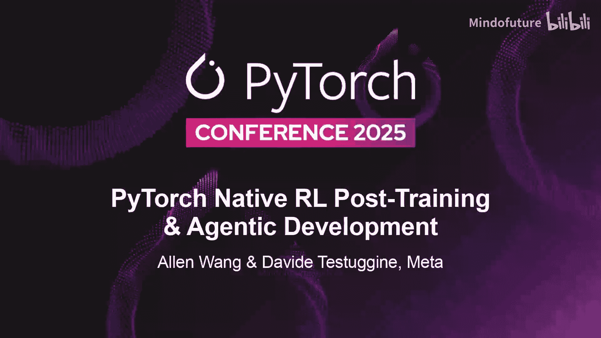
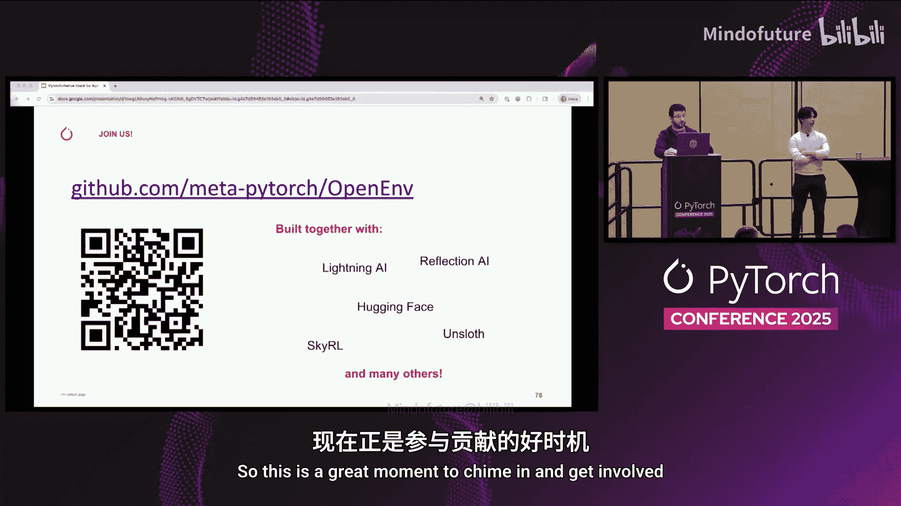
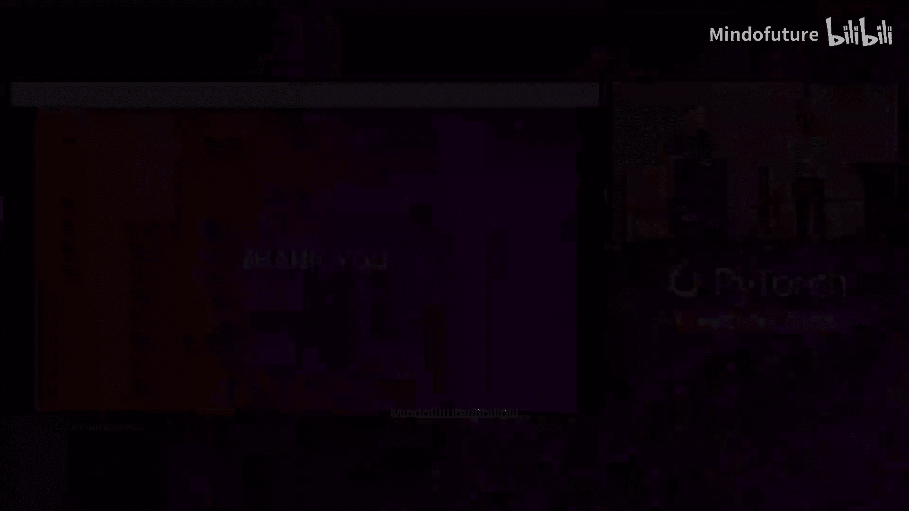

# 2025 Pytorch大会 ｜ Pytorch Conference 2025 p20 P20_面向智能体的PyTorch原生栈-Allen_Wang__Davide_Testuggine__Meta -BV1b8kRB6EJG_p20-

Okay， hello everyone。 My name is Davidvida。 My name is Alan。

 and together we're going to talk about the Pyrogeneity stack for agents that we've been building this year。

 Let's take a look at our agenda today。 I'm going to introduce you to agents and to the basic sound reinforcement learning。

 I'll then talk you through some of the challenges of distributed or at scale and some of the projects we've built to address them。

😊，And then I will then talk about environments and do a final recap。Let's get going。Cool， all right。

 So agents are all the rage these days but what even is an agent， are these just LLMs。

 Well not quite。 So the agents are the either that you see movies pretty much。

 They don't just talk to you， They're capable of making decisions and they're taking actions by themselves。

😊，LLMs are a big parts of these， but you need more than that。

 and know there isn't yet a crystallized definition in the industry。

 but at this point you'll find broad agreement that at a minimum you need memory。

 both long and shorter， you need the ability to plan and you need tools。

Tools in particular are very important because that's how this model can get to do actions。

 So let's talk about them for a second。So LLMs have a very clear interface。

 textint Obviously the first thing that comes to mind is you can chat with them。

 but then you can just use text to simply serialize communication to anything that you want so if you want the LLM to use the browser you will simply send out a request as text and then you're going receive a response as HTML you can even serialize images in there and you're good to go。

 you're off to the races。So we normally think of tools as connected to a problem you want to solve all the tools that make sense to solve a particular problem are normally grouped together into an environment abstraction。

For example， you may want to group together a browser and a compiler into a coding environment。

 while if you were to build a self-driving environment。

 you probably put some sort of game engine in there to simulate your car moving and whatnot。

It wouldn't make a lot of sense to expose a game engine as possible too。

 well you want to write Python code， right， So there's some benefit to kind of insulating things into a prepackaged environment。

And having an environment abstraction gives you also a good way of thinking about agentic loops when training and deploying what allows us to get from normal LM into agent is really building this loop between a model and an environment so you know the model would choose what actions to make and the environment response with what happen as a result we call these observations and these observations can also contain rewards that you can use for training。

So， you know， let's go over a very simple example。 The simplest that I could come up with is Tit toe。

 So you have the environment， hold the board state and you send it to the network。 You know。

 we start with an empty board state and let's say， you know， the network is first。The networks。

 the size where he wants to play， he has an output player with， know。

 the size of all the possible actions that you can take。 in this case， in Tikt toe， there's only9。

 And you know， let's say wants to play in the center。

 we sample the action with the highest probability。 And then， you know。

 the environment will receive that， Comp a new board state and so on。 notice that the environment。

 in this case， we have like an automated Tikt toe that will respond to you。

 So the policy is only playing one player and the environment will respond with the other players move。

So how do you train a model like this。The traditional way of going about this is to imitate a player。

 You can get some people to play Tikto with each other or with another game engine。

 and you simply collect everything that they did。And different players can react differently to the same conditions。

 know， in this case， we have same initial move， but then the moves differ and basically just do crosscenttropy loss over each step。

And， and you're good to go。However， this approach has several issues。It's expensive to get data。

 So how quickly your data， how quickly you get data goes at the speed of people。

 which is not very fast when you have fast machines like we do now。

 And you also lose every ability to explore。 This ultimately dictates your ceiling。

 Your ceiling is really dictated by the people who are playing Tikkto for you。

 And so this is making superhuman performance essentially unreachable。So what's a way out。啊。

The one possible way out is reinforcement learning。 What if you like the model。

 just let the model play and figure out what works and what doesn't work。Then you。

 we could let the model play instead of asking people and see if he wins or loses and train based on his performance。

So this seems enticing。 There's a problem we're getting into rundo。

 The way that we train model is we always do a forward propagation to materialize our computation graph。

 and then we go backward to computer gradients。 And this works as long as everything is differentiable so you can just back propagate through。

😊，Here's the issue with tools。 If you have an environment in the middle。

Forlorral propagation works just fine， but to do backward propagation。

 you have to back propagate through the environment。

 which is generally not differentiable and I't know how many of us can write the derivative of Chrome。

 right？And so。One possible way around it is to can switch paradigm and， you know。

 go to reinforcement learning， which uses a completely different cost function from the ones that were used to in supervised learning。

 And so we instead follow just a simple rule。 If an action was good， make it more often next time。

 And if it was bad， make less often， which was indeed inspired by pavloan reinforcement on dogs。

So this is quite easy to implement basically all you want to do is to nudge log probabilities of a good action upwards and log pros of bad actions downwards。

 so for example let's say that you know the TikTok toe action that we chose was the incorrect then we would just nudge up its grade。

Note that this is less efficient than crosscenttropy loss。

 crosscenttropy loss in this case would actually give you a full then spectral gradients。

 So here it is， for comparison， you can notice that the one that we use in policy gradients is extremist barsse。

And so you instead of doing it manually we don't have to actually go inside the gra accumulator and kind of fi with it。

 you can just let autograd do it if you simply multiply log probes by a factor。

 then the gradients will get alphated to them， the re products are sum and so this gets you the vanilla policy gradients loss which is really the core of methods like PPO and GRPO there's going to be more bells and whistles for those but we're not getting into them today。

You know， this， this is just to show you how we can use reinforcement learning really as a tool to allow us to keep the propagating through nondefferentiable environments。

 And this is big， right， because this allows us to train and to end and to learn how to manipulate tools。

 The price that we pay is efficiency。 We learn far less per sample than we would in supervised learning。

😊，So to recap。We have a general recipe。 The general recipe， you know。

 in LLM land is you pretrinal language and you post triial tools。 And you know。

 we have a way of even generating data and training on it。

 The only negative is that it's worth less than the one that we used to collect from people。

So building for this new paradigm requires a new stack。 We have focused this year on two main areas。

 The first is infrastructure， and the second is data。As we've seen。

 already is inefficient at the cost of sound like a broken record。

 So we don't learn a lot of every for interaction。And so while research looks for more sample efficient methods。

 on the engineering side， we're looking to maximize throughput for the method that we have today。

 and this requires a new type of infrastructure。The second half is data。

 We have a way of generating synthetic data， but we still need to create environments that are ready to go for models。

 and we need to build the proper reward pipelines and evaluation harnesses to kind of guide this development。

 so the work is never done。Alan is going to tell you more about what we've been cooking on the infrar side。

 and I'll be back to tell you more about data。All right， thank you， Dobbie Day。Hi everyone。

 my name is Aen， I'm here to talk about how we're building scalable RL Ifrra and our project named Torch Forge。

So far we've talked about the importance of ourL， and so my goal in the next 15 minutes is to walk you through why this is complex。

 why it's hard to build， and how we solve this step by step。

What you'll see when you try to implement a distributed RL system is that you're going to run into issues around some of these areas。

 orchestration， performance， scaling， and the programming model。

We're going to dive deeper into each one of these areas。

 and I'm going to start by illustrating a concrete example。

What you're looking at here is a diagram of what a reference RL system in production could look like。

There's a lot of moving parts here， but let's kind of walk through what's happening together。

The basic flow is you typically get a sample， you would sample a question from your bank。

You would have your policy generate responses。These responses may interact with environments and a loop until they're done。

Once they're done， they get scored by reward models。

And this information is stored in a replay buffer。This step that I'm talking about here is typically called the rollout phase。

The data that's put in the replay buffer is then used to train better policies。

 And any time we update the weights， these updated weights are sent to a parameter server and propagated back to your inference servers。

 This process is called the training process。After the training step， the loop continues。

 and so all of this is actually pretty simple in concept。

 but there are several challenges that I want to point out。

The first is orchestration between the trainer， generators， environments， reward systems。

 replay buffer。 There are a lot of moving parts that we need to coordinate。

The second is bottleneck management。 So notice that this system actually contains two producer consumer loops。

 We have a rollout phase， generate data for trainer to feed on。

And then we have trainer send updated weights to the rollout workers。

What you'll find is that the rate of our generations can actually affect how idle our trainer is and vice versa。

 So if you don't handle this correctly， you can end up in a silly situation where， you know。

 maybe your trainer is running only 10% of the time and is just waiting for data to， to complete。

 And， you know， maybe vice versa。Note that if you also have your generators execute tools。

 for instance， then that can also have additional latency， right， Some can be fast， Some can be slow。

 You might be building。Py toch， I don't know。 The variability here can impact the system's end to end performance。

On the other side of this， weight synchronization is also challenging。

 It's important to frequently push updated weights from your trainer to your generators。

 But oftentimes， this can be hundreds of gigabytes or even terabytes of data。

If you don't do this quickly， then your entire system can be bottlenecked again。

 And the challenge here is that taking full advantage of your hardware's networking capabilities can be complex。

Another problem you're going to see is scaling Modern M models are typically too large to fit on single GPus。

 meaning that you have to shard your model across multiple devices。

As you are ironing out your bottlenecks， you might find that you might want to shard things in specific ways or that you might want to replicate some particular components for higher throughput。

 so I might want to have multiple generator replicas each with8 GPPUs and you might dedicate like 128 GPUs to my trainer。

 some configuration like that。Additionally， if you have environments。

 then they might also not be using GPUs for resource efficiency。In addition to all these challenges。

 RL can also be difficult to express some code。When you try to implement all of this in standard Pytorrch。

 you end up writing what's called SPMD code or single program， multiple data。

What can end up happening is you can write a program that runs across multiple processes and you'd coordinate them with rank checks and collectives。

 so for instance， if you're ranked zero， you might be the coordinator。

 so your job is to gather trajectories， broadcast weights。If you're a generator。

 you would generate trajectories and send them back to rank zero and receive weights back。

And if you're in the trainer， trainer ranks， you would receive trajectories。

 do a training step and sendway back。Underneath all of this。

 you're also managing collective communications， which can be difficult， like all gathers， scatters。

 all reduces， you'll have to think about what rank is communicating with what other rank。

 and if a single rank fails， then you also have to start thinking about how is that going to affect the rest of the ranks MI program。

In other words， data and control flow can become hard to reason about。

 You're thinking about n ranks simultaneously instead of thinking about what the logical components are actually doing。

But before we move on， we covered a lot pretty quickly。

 so I just want to recap what we've covered so far。 Disbuted RL has several fundamental challenges。

The first is orchestration， you have a lot of components that you need to coordinate。

 and getting these to work together could be complex。The second is performance。

 These components operate in a pipeline fashion， and you need to ensure that you're not blocking other components and leaving them idle。

The third is scaling， you need to manage different sharding strategies， replication。

 and possibly heterogeneous compute， and then finally is programming。

SPMD forces you to think about ranks and collectives instead of logical components。So as a result。

 you can end up spending more time on infrastructure than on your actual algorithms。

So all that being said， I'm really excited to announce Torch Forge。

 Torch Forge consists of several new Pytorrch native components that we've added into the ecosystem。

 and so I'm going to start by talking about monarch and we're going to start from there and work up to Torch Forge。

Torch For is built on top of a new framework that we've also announced today called Monarch。

 so we're going to start with a brief introduction to Monarch。

Monarch is a Pytorch native distributed programming framework based on scalable actor messaging。

There's a lot of information that we could cover。 But for this talk。

 let's just focus on three things。 The first is actor meshes。When I talk about an actor。

 an actor you can essentially think of as like a Python class that lives on a process and this can be local or it can be remote。

Actors can communicate with other actors and are typically organized into meshes or collections of actors。

 members of an actor mesh can be broadcasted to with a single call。

The second is already made transfers。Monarch is built with native RDMA support。

 which enables fast point to point memory transfers。

 which is really important for the weight sync problem that we talked about before。

The third is fault tolerance。 Monarch provides the ability to automatically recover from failures through its implementation of supervision trees。

To give you a sense of its APIs， the typical workflow of monarch is that you would spawn some processes。

 you would define your actor class， You would create a mesh。

 and then you would call the methods on your actor mesh。 It's pretty clean and imperative Python。

Overall， Monarch gives us the ability to write distributed code imperatively rather than with SPMD rank logic。

We actually have an excellent talk tomorrow that goes much deeper into monarchs internals if you want to learn more。

 information is put here， if you want to take a picture of the QR code you can pull that up on your phone as well。

 but for now just know that monarch is the foundation that makes Torge Forge possible。

How does this apply to RL？March， as I mentioned， lets us program at the logical component level rather than the individual ranks and collectives。

 So what we might want to do is create generators， trainers， reward models as actor meshes。

 and I can now start to interact with these pretty naturally， I could say generator。

 I want you to run inference on this particular prompt or I might say trainer。

 here's a batch of data to train on。Thanks to Monarch's single controller， execution model。

 everything， it orchestrates everything， so you can just write everything。

 all of your coordination logic as it it is just basic Python。

I also importantly want to point out that the underlying components themselves that we're running are also often SPMD jobs。

 so for instance we might want to be using something like DLLM for our inference server to Titan for our training server our training implementation both of these are implemented with basic SPMD and so what we're doing here with Monarch is not replacing them but rather just orchestrating them so this gives you the ability to integrate with any existing ecosystem component that you already know works set scale you get the benefits of proven SPMD implementations like performance and scalability with a simpler programming model on top。

As you can see， Monarch gives us a great foundation to build an Ral stack on top of。

 We actually build some other core components on top of monarch， which I'm calling Forge Co。😊。

Forge Corre consists of two components， services and Torch store。

You can think of these as the control in the data plane of torch Forge。

Services here make decisions on how and where data should flow， managing the configuration。

 the routing and the orchestration。Torchdo， on the other hand， actually moves and stores data。

 according to those decisions。Let's start by talking about services。

 Services are a higher level abstraction built on top of monarch meant to handle some of the operational complexity of managing distributed actors。

Service APIs let you specify the shape and scale of each service and provides basic actions or adverbs that operate at the replica level。

 so I might route to load balance requests to a replica and I might fan out to hit all replicas in my service。

Services automatically handle things like load balancing。

 it will automatically restart and route around failed actor meshes and will also let you independently scale individual components。

It's designed in a way to be ephemeral， essentially meaning that you can start and stop services with your job。

 which little can be pretty natural whenever you're working with ML workloads。

Services gives also heterogeneous scaling benefits， so I could， for instance。

 spin up 16 policy replicas and have one trainer。 and if I decide later that I want more policy replicas。

 I can also scale that up in my configuration。But thanks to services。

 you can write your RL algorithm now as if it was pseudocode。

So let's take this example of episode generation in rollouts。With services。

 it's really easy for us to write a function that samples a prompt。Generates a response。

Graades that response， and then stores in the replay buffer for training。

Because these services are handling the operational complexity for you。

 you can actually express this as simply as if it was just the pseudocode you used to and design the algorithm。

Another superpower that torch Forge gives you is composability。

 so you can write your rollout logic once and then compose it to any paradigm that you want。

So if we continue off that rollout generation loop。

 you can use this to easily express a simple synchronous R loop so we could generate batch a full batch of episodes。

 run a training step on that batch， and then update all the weights on our inference server。

If you wanted to parallelze this more， you can easily turn this into a fully async R loop。 You could。

 for instance， do this by creating multiple async rollout tasks and then create one single training task that consumes data as soon as it's ready。

The key point that I want to point out here is that you have full control over the asynchrony of your workload and you can express this all in pure Python。

Okay， so we've covered so far how services handle the control plane problem。 On the flip side。

 let's talk about data movement， which is also really important as we scale。

The first challenge we're going to face is the staleness challenge。 If you go to off policy。

 your policies are going to end up generating outdated rollouts， and this can take your RL training。

So you need to update your weights frequently， but updating weights can be difficult because each training step produces a new checkpoint。

 this could be tens of billions of parameters， and you would need to move this from your trainer to all of your generator replicas。

If you do this too slowly， then weight synchronization could be your bottleneck。

Another challenge is that your trainer and inference servers may be implemented with different sharding strategies。

 so you might want to use FSDP on your trainer， but then tensor parallelism on your inference server。

 therefore our transfers need to be designed with this in mind。Finally。

 if you want to go fully asynchronous， where inference servers can be updated at different times。

 you'll need to be very careful about the overall GPpU memory consumption to go out of memory。

You could， for instance， you might not be able to， for instance。

 keep multiple copies of your model in very scarce GPU memory。

And so this is where Torch store comes in。 Torch Store is a new distributed in memoryory key value store optimized for pitorrch tensors。

 and this is built on top of Monarch and Dtensor。TorchSt allows us to design our workloads that our trainer will put sharded weights into DRA。

 co locatedated with the trainer， and our policy replica can get those weights。Under the hood。

 the weights are actually transferred through RDMA through monarch's implementation。

This helps to solve several issues。Since we can transfer weights over RDMA。

 we can take advantage of the highest bandwidth communication available to our hardware。

Since we're able to offload weights to CPU memory， we reduce the dependence on managing GPU memory。

 And since we're built on top of Dtensor， we have a way to automatically handle the resharding that needs to be done between distributed topologies。

And finally， it preserves the UX of utilizing central storage like NFS with very simple put and get APIs。

All of this allows us to completely decouple the training in generation。

 which is fundamental for if you want to get the maximum throughput out of a system like this。

So with all these components listed out， let's take a step back and take a look at the torch forged stack in its entirety。

At the top level， you have your RL algorithm， which is essentially the code that you write and you own。

Below that， we leveraged VLM and torch Titan， battle tested。

 high performance and highly scalable solutions for inference and training respectively。Below that。

 we have Forge Core， and this is a layer that handles orchestration， coordination。

 data and fault tolerance， and all of this is built on top of monarch。

 which is our Pytorch nativeative distributed programming framework。

I want to thank our collaborators at the Stanford Scaling Intelligence Lab and my friends at Corweve。

For their invaluable support in this project， Stanford's team was able to integrate their weak Verifier project Weaver。

 using Torch Fors to train models that help climb on challenging reasoning benchmarks like math and GPQA。

😊，Their feedback was invaluable ensuring we were building the right framework。

 and we're excited to share our results more broadly when we get to that。

We also really want to extend our thanks to Kweve。 This collaboration would not have been possible without them。

 We were able to use a 512 Ividia H100 GPU cluster with 3。2terabbit per second Infinna band。

 We ran a large scale RO workload to validate towards for disability at production scale。😊。

With their stack， we were able to accelerate our research with sunk or Slurmon Kubernetes。

We all had a great experience using the state of the art infrastructure。

 and this delivered a really smooth and efficient experience that made this level of experimentation and velocity possible。

If you're interested in checking out Torch Forge， Torchdo or Monarch。

 you can get there by looking at the Me PiITrch organization on GitHub to make these easier。

 I have QR codes here if you want to check them out。

 we're excited to see what models you build with Torch Forge and thank you for your time I'm going to be handing it off to Wie data close this out。

Alright， we started a couple of minutes late。 So I'm gonna breeze through this this this part。

 But I'll go quickly。 I promised。 thank you， Alan。 Alright， so we're gonna go back to this slide。

 We said we were gonna invest into infrastructure and data。 So we just thought about infrastructure。

 Let's talk about data real quick。😊，When you train， you know。

 training a powerful agent requires exposing your foundation model to a variety of situations to learn different skills。

 So you creative writing， coding， art， you know， driving a car， doing math， whatever。

 there's many of them。 So as a community， we need to be building thousands and thousands of needs。

And so， you know， when we spoke about how environments group tools together and we mentioned how a component to score。

 how well the agent is doing is necessary。 So let's quickly talk about that。In our coding example。

 we've set a set of coding problems that we send to the agent， which is going to write code。

 How do we score it。It's up to you。 So what we want is to really build a system that provides the scores。

 But how you decide to measure what you decide to reward is entirely up to you。 For example。

 if you wanted to start simple， we could write just a set of rules that says， you know。

 you should pass LinkedIn。 and you know， maybe we have a set of unit tests that you need to pass and if you don't pass then there's a negative score。

 otherwise there's a positive score。Over time， you can make this more and more complex。

 so you can craft more and more incentives。 For example， you can all a you know。

 code style on incentive。 And so you can see how this pipeline becomes more and more complex over time。

 It's really about it's an art。 It's about crafting the right incentives and seeing what works。

We want you to be able to spend time doing these things and expressing your creativity。

 rather than spending time writing infrastructure code。

 So for this reason we're introducing a new initiative called Open Environments。

 We have a launch talk tomorrow， but I'm going give you a quick sneak peek today。

 just don't tell anyone just between us。😊，So most of us in the field have conged approximately the same idea。

 gym like APIs with containers， local tools， MCP tools。

 We're just proposing a standardized way of doing so so that everybody can benefit from each other's work。

😊，We're currently still working on a core environment spec。

 and we will be looking into reward pipelines and evil harnesses， you know， in the next few weeks。

Of course， to do this and to be able to collaborate。

 we need a hub and so we're excited to partner with HagingF to add this into as a hugging phase space into their hub。

 this will allow everyone to create new environments。

 share them with the community and this is going to help on sharing information faster and' going go quicker here and so in general we think that is going to improve reproducibility and allow us to not just share models and not just share the weights themselves but the whole evil harnesses and the whole reward pipeline and everything that goes with it。

It's still early days， so are we are developing this from the open from the get go。

 Please go and check it out。 You're going to find sample code and a set of RFs。

 So this is a great moment to chime in and get involved。😊。

Here's also yourR code， I'd like to quickly thank our team and collaborators。

 I'm honored to represent the work of so many talented people here today。

And I want to thank you for being here with us。Thank。

