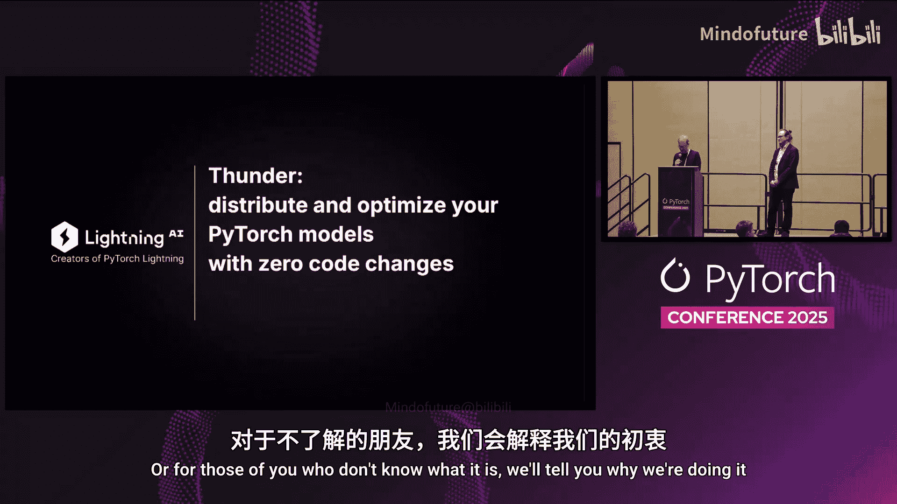
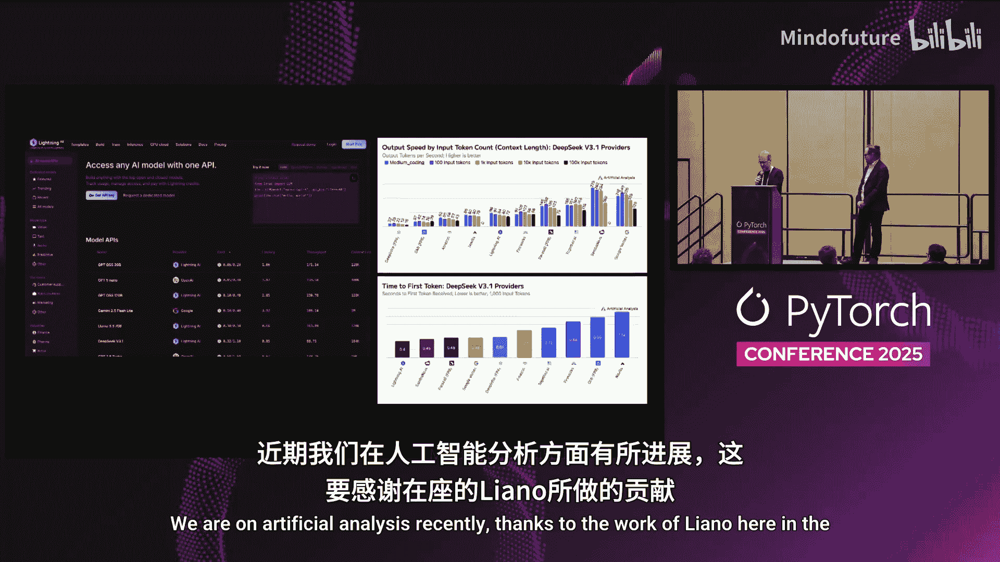
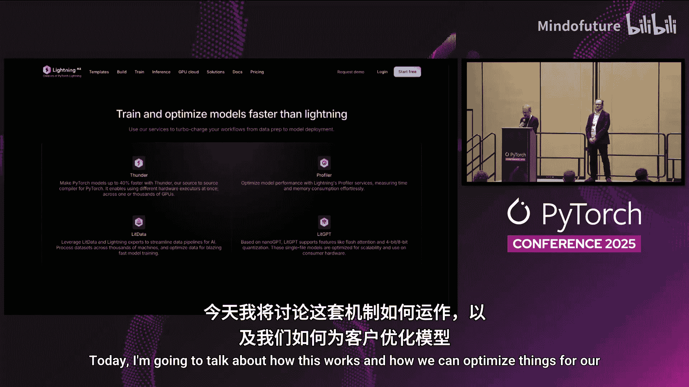
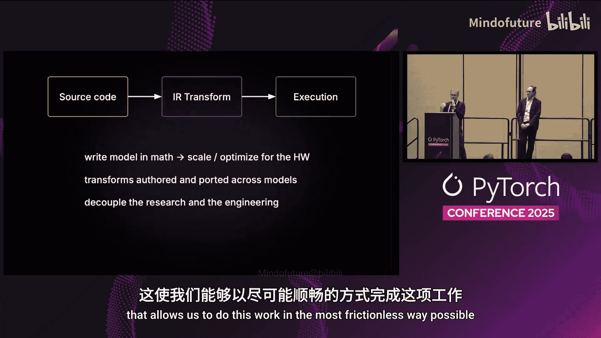
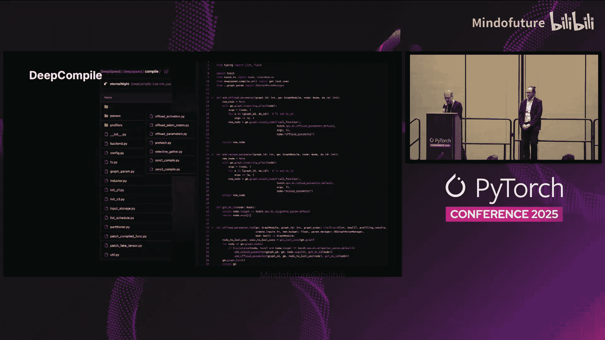
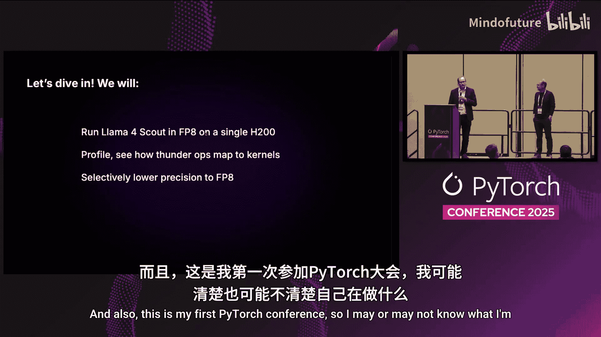
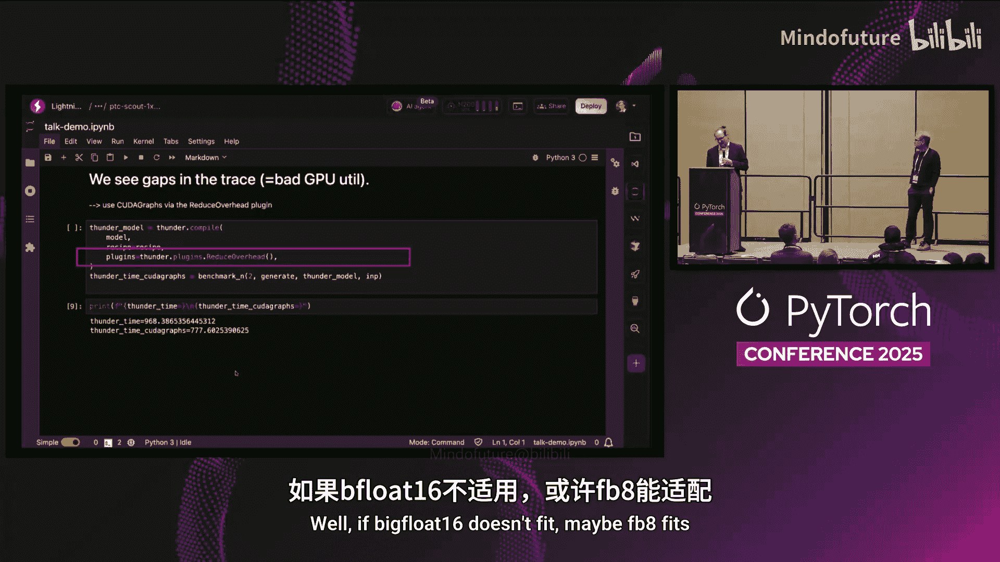
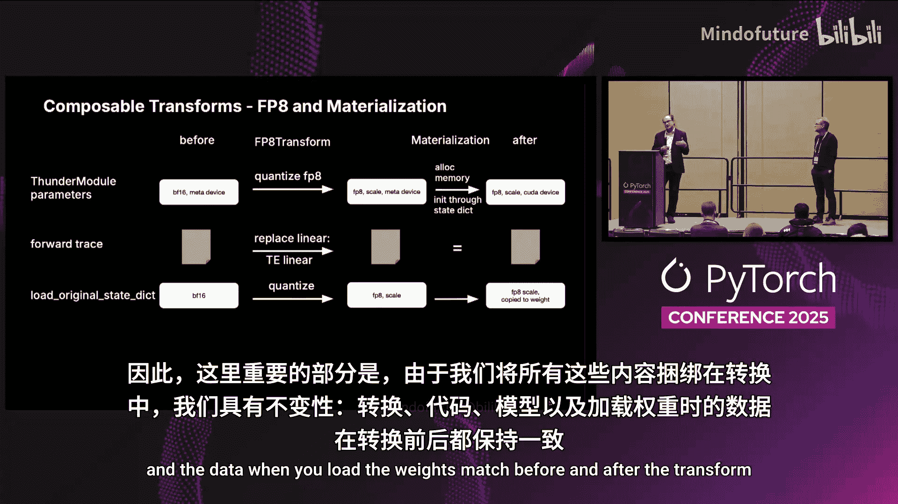
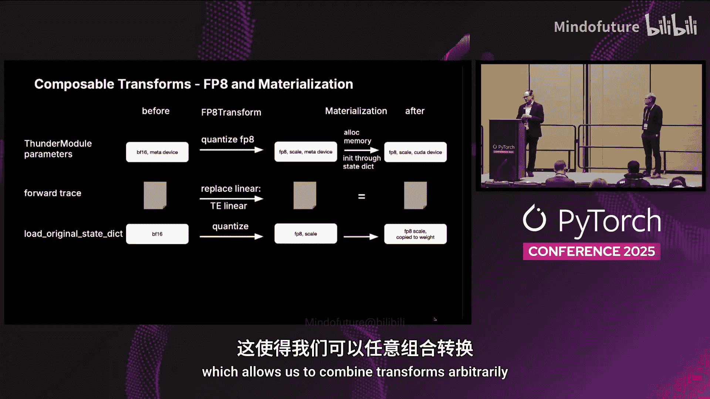
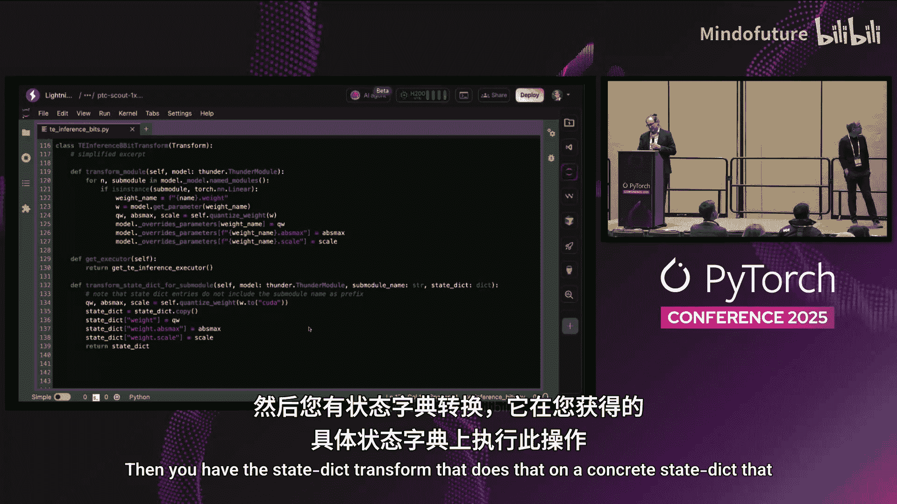

# 2025 Pytorch大会 ｜ Pytorch Conference 2025 p22 P22_Thunder——零成本分布式优化PyTorch模型-Luca_Antiga__Thomas_Viehmann -BV1b8kRB6EJG_p22-

Alright， thank you for being here。 I'm Luke Antiga。 and this is Thomas Piman。

 we work at Lightning AI。 and today we're going to talk about Th。 It's something that we presented。😊。

A while ago， I guess like a year and a half or something。

 and we're going to update you on the developments or for those of you who don't know what it is。

 we'll tell you why we're doing it and what are the principles。

So okay， so we're lightning， we developed the lightning AI platform。

 I don't know how many of you know it， just go on there， lightning。aiI， you get a free account。

 you get free credits to use GPUs， and it's really a cloud platform that is overfit on PyTch you can do whatever on it but Pythtorch works really well on there。

 we just launched a few initiatives with Me organization。

 you can take a look at the new stuff like Monarch， Forge and OpenM。

Just a call out for you guys and then we also deploy models for inference so it's a platform where you can go from training to inference and you can optimize you got optimize inference out of there we are on artificial analysis recently thanks to the work of Lena here in the crowd so that's good and part of what we do is not just provide compute and a platform and development platform for our customers but also help we help them making the most out to the compute。

by optimizing their models on our compute using a stack of open source tools that we have。

 one of them is standard and today I'm going to talk about how this works and how we can optimize things for our customers and our sweet spot is not just to call a compile method and out of the box you get a speedup。

We have a budget of a few days， a few hours， few days to optimize a model。

 so we want to spend the time， for example， to make sure we have a full graph。

 a full trace and everything can be interpreted by our compiler and we can run it， inspect。

 transform and so the ability for us to extend the compiler and to make it capable of understanding the model a bit better and writing custom transforms so that we can take the computation to where we want it to be。

That is our job and so this is the design space that we are operating in is really like a tool rather than out of the box compiler and this is what I mean so suppose you have source code a little more complicated than a sequential with a couple linears but that's a principle there and you want to execute it and now you're unsatisfied with your GPU utilization what you can do can compile so compiler here is not torch compile it's just some for some definition of compile right and and you have some knobs which are usually compiler flags and then you get some performance out and you look at the utilization maybe be good。

 maybe not good so you have some knobs you can turn there and the other opportunity you have is you go back and in the source code you can tweak you can put context managers you can express your computation a bit different。

And then you see the effect that it has on the utilization that you get on the other side when you throw it to the compiler and you iterate in that space and you keep touching your model and you can do it model by model。

 but it's really hard to port whatever you did from own model to next so if you're exploring。

Different variations of your thing， then you get kind of a combberinatorial explosion of the work you're doing to optimize a particular model and how you do part the same things to another model and so on。

And so your model becomes like you need to dress it up a bit。

And we believe that there's a kind of a better way to do it that gives you more control， which is。

And we saw that we saw this for those of you who have been the keynote forrch compile Torch compilers now evolving into a toolkit。

 so we found a common sentiment there， so you have source code， you acquire it， you have an IER。

 and we want to make IR transform， so the operations that compose your computation and the way you transform them programmatically to make it as developer friendly as possible。

Because you shouldn't be a compiler engineer to be able to take a computation and transform it into something else that is more akin to the performance。

 the characteristics that you want or you make a computation distributed so you write your model in math iny Pythtorarch models is a great way to write models and how do you scale and optimize it。

You can do it at the IR level if the IR is expressive enough for you， and I can show you an example。

 we show you example in this talk。And then the transform that you apply to the IR can be made portable across models。

 so you can apply a certain distributed strategy that turns it single GPU modeling into something that runs across GPUs or across machines by placing collective calls at the right place。

 and you can do that in a generic way so that it is composable and you can write it once and apply to many models。

 maybe not to all models， but maybe to the models around the model you're exploring there。

And then you send it to execution so you know， our goal is kind of decouple the research that our customers do and they come at us with a model and maybe some we can tweak it and make it a bit better。

But then our work is the central box there， and so we would like to create a tool that allows us to do this work in the most frictionless way possible。

And there are examples of that out there if you look at Deep speede。

 there is something called Deep compile and I think they have a blog post in there that exempl describes standard really well。

 like and like the existing approaches deep compile automatically applies parameter sharding。

 communication scheduling and memory aware execution at the compiler IR level。

 enabling global analysis and optimization that are difficult to express in traditional frameworks。

This is kind of the space that we're operating and what our hypothesis is is that。

I don't know if Th will be the way if Trch compiled will be the way if deep compile would be the way。

 but there is clearly a gap in the space of program transformations that will be filled by one or more tools that we will use to make our models distributed scalable perform and so whatever it is。

 we describe our experience and design ideas and then I hope we can all come together and build something that has the power and expresssivity of PyTch that researchers like because you shouldn't be a compiler engineer in order to do this kind of work。

That's the gist of it。So if you go into deep speed， deep speed， deep speed compile。

 you can see that they implemented a system of passes。

 passes and transforms are kind of like doing as the same term， but this is not just for training。

 if you go into VLLM for example。😊。

And you go in how theM handles compilation， they also have a system of passes。

But there are many ways where when you can make writing a transformation of IR aware， for example。

Of its surroundings and what is the surrounding of a functional IR is the NN module so in T we built a way to transform to have transforms applied at different life cycles of where transform can be applied at the module level at the you know there many places when Thomas will show a few of them but。

There are many moments and if you are tidy there， you benefit from being able to compose different ones。

 different transforms， for example， I can make a model distributed by sharding the parameters now if I chartard those parameters。

Then my tensors will be smaller， right？ So what I want to do is delay materialization of those tensors to after I applied the transformation。

 right because otherwise I would go out of memory on an individual node。

 So there's a certain sequence of things that will lead me to maybe load weights and the weight loading needs to be aware of the fact that I applied a sharding transform before because otherwise I'm loading the weights that like too large for my model right So there's a certain sequence of things that need to happen。

 and in T， we try to make that easy to manage and keep in your head and develop upon。

So this is thunderhunder。Des principle， decoup model for optimizations， easy IR。

 we have an IR and we'll see it in a second that is just Python and it's easy to inspect for final and run。

 we have a rich full graph transforms with our craft bricks。

 and then we have a way to dispatch different sections。

 different portions of the IR to different executors。😊，This is what the IR looks like actually。

 this is a sub。It's the most high level view of the AR。 and here you have the。

There's a bit of more to it this is the purely functional computation trace and we have then a prologue and an epipilogue that go from NN module land to purely functional back to NN module that you can also transform and it has different functions and then this is an operation a linear and we have HLO like decompositions for those of you who know jus it's very similar to jux internally where you have primitives that we decompose into and then each executor can choose whether to。

Take and execute the high level operation or take the decomposed operation and usually for example decomposed operation。

 the primitives don't have automatic broadcasting so you will see the broadcast operation and then the operation on the broadcaster tensors and so on so there's a bit more detail and our trace is very expressive on that front。

And interestingly， we wrote a Python a C Python interpreter in Python to be able to trace through generic programs。

 and so we understand the bytecode and we can then extend the interpreter。

 so it's really easy if I have a construct that the interpreter doesn't understand。

To bypass that hurdle towards getting a full graph by extending the interpreter in Python to be able to say。

 okay yeah， I know you don't understand this， but trust me do this thing when you encounter this function and then we can more easily go from unoptimized to optimize by obtaining the full graph of the model and this is an example of what we do when we apply a distributed transformation in this case FSDP to the IR and we insert you will see that in this case the best dimension changes in size goes from4 to2 and then we have distributedtributive primitives and you can do it programmatically right and you can do many or more of these things。

Like Auto the autogra AutoDF is a transform for us。

 so we obtain the backward trace and so you can transform the backward trace just as easily as you transform the forward trace。

 and so you have full control of that， you can apply mixed precision， offloading。

 you can decide when to offloading in the lifetime of the trace and so on。

And all these things are composable， this is the different executs that you can dispatch and each check secureor can claim portions of the traces to execute。

So it's very flexible and extensible there and now I'm passing into Thomas。

 he will demonstrate Lama for Sc on a single H200 and how to get it to work on there and then in the you know some of the developer journey so Thomas。

😊，Yeah heい。😊，And。The code that I'm going to show you， it will be a bit dense。

 but it's also available as a studio so you can dive in yourself if you want to to。 And also。

 this is like my first partwa conference。 So I may or may not know what I'm doing。

Okay， so let's take a model， say Lama Scout from Transformers。

 and I want to run it on an H 200 because that's one of my favorite GPUs at the moment for like coolness and availability。

And so Lama Sc comes as a big float 16 modeled by default and it has 109 billion parameters。

 which means it doesn't fit on the GPU as is， but we can take two layers and just run through it。

 it's on aging face transform us so let's grab it from there and run it。

And it's as easy as running thunder compile on it here， and we have a recipe that says。

 well hugging face transformers because they have a few particularities that we want to cover。Okay。

 we do this， we get a timing that's roughly similar to what transformers do anyways。

 so you might ask like what's the point？And whenever I think there might be perf left on the table。

 what do you do， well， if you want to optimize， you have to measure first， if you don't measure。

 it's not optimization that you do。And so we do use the Pythtorch profiler。

 which is really great in producing traces that you can consume。

 and we have a plugin to the compile call， which is a transform style thing that essentially lets us profile in some detail。

And so this might be my favorite slide， what you see is that for each line of the code in the intermediate representation that Lucka showed you。

 we have a block in the profiler， so we really see like what gets executed for what line of code。

 so here you have enVfusion which is from the enVuser from our NVDdia friends。😊。

And you see that also on the bottom line， you see the coer kernels， it traces the stream。

 the bottom line is the coer kernels， and we annotate with the exact line of source code the intermediate representation that this comes from and so it's a simple trick but it's super helpful and what we see is that we have like those gaps in the bottom mouse row。

 and that means that we have bad GPU utilization there。

And so one of the things you can do is you can use kgraphs。

 which we again provide as a reduced overhead plugin。

 and this will know like what operations are cographable。

 what you need to do with the inputs and work with the restrictions that you have and you see that you can get a decent speed up by applying it because you essentially eliminate those gaps。

Okay， so but this is just the two layers we want to run the full thing well if BigFat 16 doesn't fit maybe FB8 fits and indeed it does and what we do is we created a 8 bit transform that uses NVDious transformer engine to to execute the model in 8 bit。

 but we do this without compiling without sorry without modifying the transformers but by compiling it with this extra transform and so what we get is we get a model that actually produces text as it should be。

and the other part that we do is that we add a materialization transform that also Luca mentioned。

 this allows us to instantiate the model on the meta device so it doesn't take any memory。

 then we transform it to8 bit which would fit then on the device and then we actually put it on the device and you can choose whether you want to。

Iitialize the weights from a static tick that has been transformed or from one that hasn't been transformed because what the transforms do this is like one of the key things that the transforms consistently transform the module itself。

 the parameterss you have， the computation， the trace that you have the program and the state tick and if you want to。

 you can also have a backward pass if you want to save the statictic in the original form and so the FB transform will quantize the weights。

 it will replace the linears with quantize linears and also the MOE。

And then it will quantize the state dict when you load the state d and the materialization。

 it will not change the computation， but it will allocate the memory。

 initialize things through the state dt by using the transform mechanism that you see on the bottom row and so the important part here is that because we have all these things bundle and the transform。

 we have like an invariance， the transform and the code and the model and the data when you load the weights match before and after the transform。

 which allows us to combine transforms arbitrarily。

Okay， so when we do this， we get relatively decent GPU perf。 I didn't put out another trace。

 but you can like have a sanitity check by using the lightning platform。

 which will give you a GPU utilization over time and so。

Small spike here is the time where we run the model。Okay， so。This is the transform。

 if you want to see it in more detail， you see that the transforms has a part that works on the module which essentially picks out the linears and then adds the new it。

Quantizes the weight and adds the scale information。

 then you have the state dick transform that does that on a concrete state dict that you get that is really a p watch dictionary just like an ordinary state d。

And then you have the transform of the computation。

 which essentially searches for linear layers and then or for linear operations in the trace and then replaces them with transformer engine powered linear operations and that's all there is to it。

By using this as an interface， we have like relatively powerful transforms when we combine multiple of them。

If you have more fancy hardware。Yeah， this is something that our friends at NVDdias have run on Lama 4 Maverick deployed on B200s。

 there's a lot of experimentation going on there with tensor parallelism and in this case were actually consuming Dtensors so normally our distributed transforms operate on something that has just regular tensors but there's also work undergoing to support D tensor style parallelism and being able to interpret what the tensors want to do to the data so that we can generate a trace that is consistent with that and we have a speedup over eager and there will be more work done around here particularly related to the use of the lower precision like and the FP4 and such that can follow more or less the same approach as what Das showed。

All right， so as I just mentioned， Thunder is developing collaboration with the media and we would be very happy to have you know people join and also tight collaboration with with Pytorch the main Pytorrch project because it's very Pytorory right what we showed kind of embraces the NN module and doesn't play too many tricks is just like pure Pytorrch and pure Pytorch code transformations and even the IR is basically Pytorrch so we hope that some of our ideas will end up kind of blending in more and more with the ecosystem and yeah sometimes that there's a reos sometimes we meet in our little rooms and we chat about Th so there's a bunch of episodes I think 20 sometimes 30 I don't know where Thomas and I can scratch our heads on different problems and you're happy to follow or join in at some。

PointAnd we call it deep learning compilers and how this sausage is made。And it's not always pretty。

 okay， yeah， thank you。Yeah， any questions， of course？No questions。 Okay， oh， there's one there。Yep。

And also well be at the booth。 So if we want to meet us afterwards。'll be happy to。ep hi。

 thanks for the presentation。 I have a bit of a no question。

 But so you you mentioned that there's an interpreter that goes through the the current model and does the various passes。

 So I'm curious I don't think I saw it， But what are the tricks， for example。

 of doing that Like is where the low hanging for is the synchronization is the compute comes overlap like where where like how far have you gotten into doing that compilation and interpretation process and how much more do you think there is。

😊，I mean you get control right so I think well if you want to also address it of course but you get a lot of control find grain control on the for and the backward on where you want to position your communication relative to your computation so ideally you could also combinatorially explore where you want to position them in a very intentional manner if you have a very specific workload that you cannot easily do with other frameworks right because you don't have every operation laid in front of you。

 I don't know if you want to。Okay， so I said it right right yeah。

 but yeah its it's all about control essentially and being able to manually and programmatically do things to your computations that you want。

 that you need and not you know， rely on kind of abstractions being in the way as I yeah。😊，So。Yep。

 another question there。There's a mic coming， sorry。

And it's going to be the last question Y last question so if there are multiple executors supporting a given operation graph is there a way to utter tune in thunder Yeah there is a prioritization that you can decide and then it's based on a claim thing so each executor will have a function that returns whether or not that executor wants to take up that operation or a sequence of operations and so if no one picks it up it will be the fusion operator and if sorry fusion executor and if the fusion executor doesn't pick it up then we have a fallback into Pythtor for example eager。

And you can decide which executor to put in the mix。

 you can customize the claim very easily by specifying a function and then you can put them in a certain sequence where the topmost gets the priority of choosing and if that one doesn't choose them it goes to the second and so on。

 but we can make it even more elaborate like it's all python so it's not very complicated。

