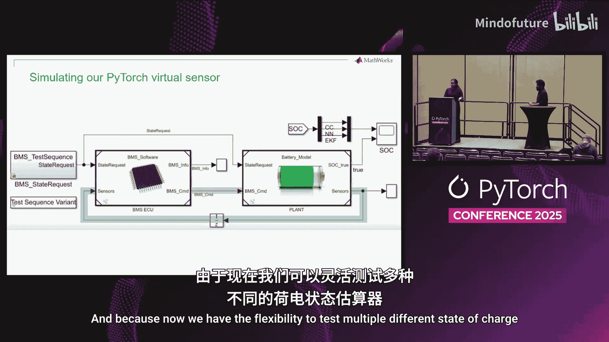
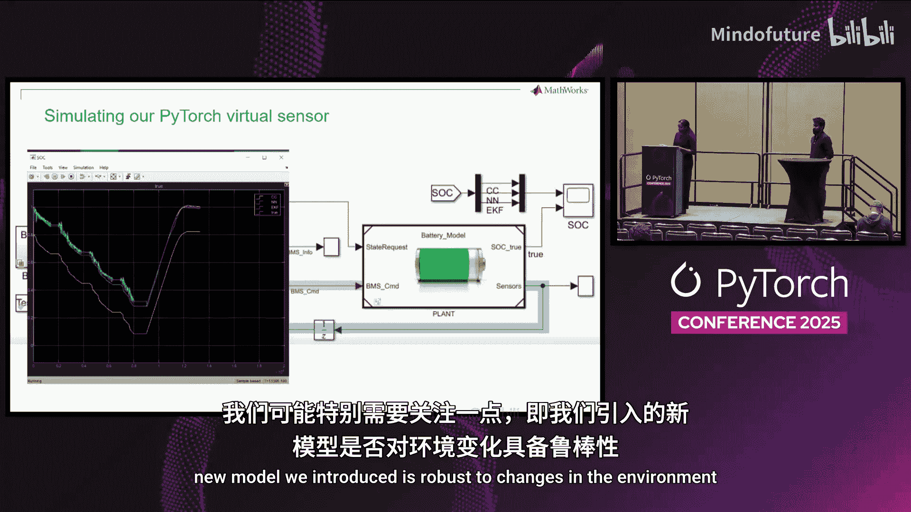
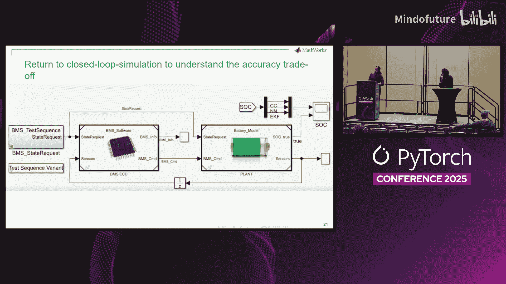
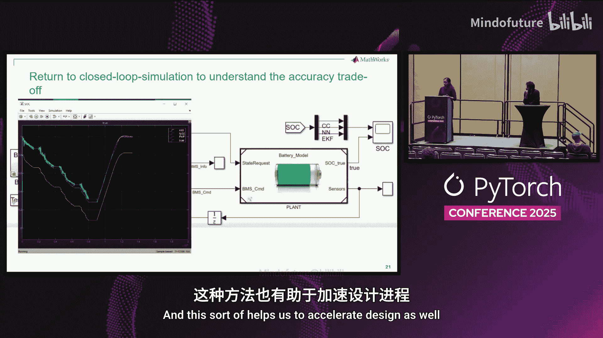
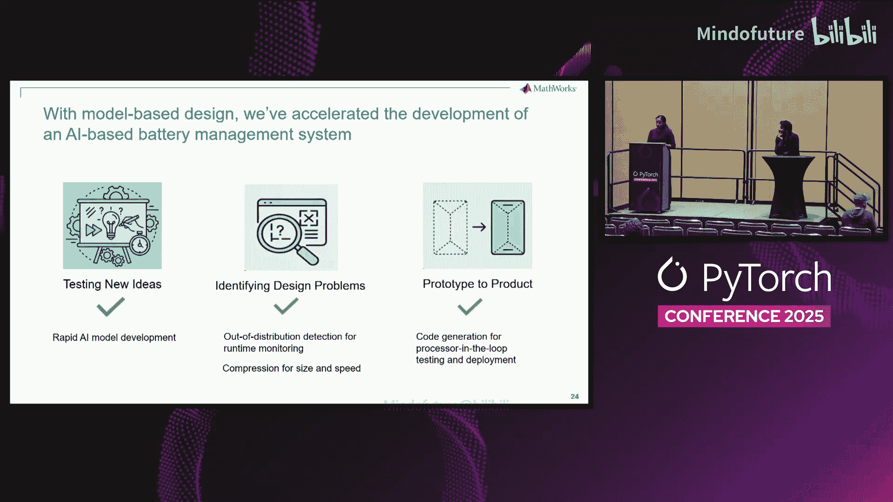

# 2025 Pytorch大会 ｜ Pytorch Conference 2025 p23 P23_弥合鸿沟——在复杂工程系统中嵌入式部署PyTorch深度学习模型 -BV1b8kRB6EJG_p23-

Welcome to our talk。A mush one。 And this is Sarah。 We're engineers at Matworks。Together today。

 we'll walk you through how engineers use model based design for their complex engineering workflows。

And they integrate Pytoch models in those workflows。There is a major shift right now。

AI isn't just in the cloud。It is。And devices around us， making them smarter。

What does this mean for embedded engineers， They need to integrate Pytch models into their existing traditional embedded workflows。

 And for data scientists， it is important to understand how their models get used。

This will reduce friction when it comes to moving from prototype to deployment。

Enabling this integration requires using new tools。Being able to simulate the whole system。

And being able to deploy in resource constrained environments。Today。

 we will use the battery management system as an example to walk you through these workflows。

A battery management system typically consists of a supery control logic and a balancing logic and a state of charge estimator。

The supervisory control logic and the balancing logic， typically。Issue commands to other systems。

That are part of the complex system， right？ So when I say complex system is just not the battery in unison。

 It has other the battery system is part of like， say， a mobile or an electric vehicle of sidess。

The state of charge estimator is more of a sensor that determines the amount of charge available in your battery。

In order to test the state of charge estimator， we'll use a battery module along with the battery management system。

This battery module typically contains a battery plant and a load that systematically discharges this battery。

We will try to integrate a deep learning model into the state of charge estimator today。

When setting out to create or design a system like this。

 there are some major challenges that embedded engineers face。1 is testing new ideas。

2 is identifying design problems。And three is moving from prototype to product。

We need to test new ideas， really quickly。In in a way that does not incur too much cost。

Imagine you are building an anti braking system for a car。

 You don't want to go crash a car every time you come up with a new idea。

So you need to be able to simulate your ideas in a really cost efficient way。

Identifying design problems very early in your development phase requires you to be able to use your modules in a whole system scenario。

That way， you don't。That way， you are able to identify these problems really quickly。

While moving from prototype to product。You need to reduce friction。

This makes your solutions really scalable。So model based design is how engineers tackle these challenges。

Model based design is nothing but using models throughout your development process。

Models here are not your typical Pythage AI models here。

 we're talking about something like a digital twin， for example， an engine or propeller models。

 for example。The other stuff over there is a vehicle body bottle。

So these models mimic behaviors of components。So these models are used throughout the development process。

 starting from defining requirements。Designing your architecture。

And continuously being able to test them first through simulation next slowly。

 by adding a real environment。😊，Sometimes。Adding hardware to the loop。

This enables us to go through the whole process without having to move to physical systems directly。

In coming back to our example， we have a battery plant which models a battery pack。

You will be able to in a model based design tool， you will be able to define properties starting from the most basic component of the battery。

 See， for example， the cell。😊，Properties like geometry， mass and energy。

And you will be able to also build these modules build these cells together to create an actual battery pack。

😊，What this essentially lets you do is able you're able to now test your whole system as close as possible to the real world。

 like being able to tweak all of these properties of the battery lets you make sure you're able to asim the system effectively。

😊，The battery was an example of a physical system that you' are able to model using model based design。

 over here。 These are algorithms。 So you often your physical engineering systems just don't have physical components。

 They also have algorithmic components and you have model based design tools。

Let you choose and pick and choose from different algorithms。Here。

 well focus on the state of charge estimator， which kind of lets you choose between a bunch of kman filters and column counting algorithms。

So in practice， model based design offers you the modularity to develop your system in a model of fashion。

 but also test test it along with the entire system。Over here。

 you have the ability to tweak your battery module with different properties。Kind of。

Change the algorithm that you use for state of charge estimation。 Today， we will also go。

 we go one step further and replace this sensor with with a Pytoch model。

So one way to algorithmically estimate the state of charge of the battery is using an extended kman filter。

But why do we want to replace this with a deep learning model。

An an extended caman filter requires a dynamic model of the battery。

 which may or may not be accurate。But in the case of your deep learning model。

 all you need is the input and output data of a battery。That way。

 you will be able to easily adapt to different battery chemistries。😊。

And if you choose a convenient model， you can even be more efficient than an an extended kman filter。

So。Let's build an AI based virtual sensor， using Pytch。So for you here， it is not。

we're not going to spend time on actually training a model。 If we have a model， if we have the data。

A decent architecture。And a custom training loop， we will end up with a model that will perform decently well for this task。

But is that all we need now？We need to look beyond training。

 and that is where model based design comes in。 It lets you analyze different trade offs and make changes to your models accordingly。

And that is the process that Sarah will be walking you through。 Thank you。Thanks， Ean。

So like E Schant was just saying， we have a lot of work still after we've trained our Pytororch model。

 so going back to our motivation a little bit， we are trying to experiment with a new technique。

 we already have this complex system we have a traditional method that we're already using this extended Kaman filter and we just want to try implementing something new some new modern technology using a newer and more modern framework like Pytororch so over the next few minutes what we're going to do is just walk you through a realistic scenario of some of the challenges that might come up over the course of this process and how we can use strategies from modelbased design to try to help address those challenges and we're going to start with just the task of integrating the Pytororch model into our system。

So this can look pretty straightforward when we already have a system that's modular。For example。

 heres a subsystem that we can introduce into our model and its job is just to alternate what technique we are using behind our state of charge estimator。

So this looks like it would be pretty pardon me， this looks like it should be pretty self-evident right we don't want to just wholesale。

 take a component， remove our Cal filter and then just stick in the Ptorrch model because ideally we also want to test this under different conditions in simulation and we want to make sure the new thing we introduce isn't going to be worse than what we already have。

So let's go ahead and integrate it， so let's say we swap out our model with our new Pytorch convolutional model。

And then once the model is in place， we want to simulate the entire battery system。

 so our battery plant here is going to be feeding voltage。

 current and temperature into the battery management system。

 which under the hood now we're using a ptorrch model to process those values and then return some state of charge value。

Then our BMS is going to communicate back with our battery model and issue some kind of a command。

 right so that could be something like charge the battery， it could be like hold the power study。

And because now we have the flexibility to test multiple different state of charge estimators。

 we can also inspect the values， compare the performance of the Pytorrch model we just introduced to our older traditional method。

 and then just make sure the whole system not just the state of charge estimator is behaving the way that we expect it to。

And one thing in particular we might want to pay attention to is whether or not the new model we introduced is robust to changes in the environment。

Or changes in the data over time。So our model was probably trained using a curated data set。

 so we had temperature， voltage and current readings that were based on real sensor data that we've collected。

 and when we were simulating our battery just now， we were using the same curated data to run the system in a closed loop。

 but just without hardware involved。But when we actually go to deploy this。

 these readings are going to come from physical sensors so there can be problems with physical sensors。

 we can have faulty sensors， the sensors can degrade over time and eventually fail。

 and so we want to make sure the new model is going to be robust to that possibility so how do we account for that in the model。

We're going to introduce a new requirement in the system。

That it needs to be able to detect when one of these variables， temperature。

 voltage or current appear to indicate that one of the sensors has failed and then hopefully alert us so we can do something about it。

So let's see how this fits into our system。Again， in our battery management system。

 we've now added a model selector subsystem that lets us switch out the Kaman filter with the Pytorch network。

And we're going to implement the new requirement by adding another subsystem alongside the state of charge estimator。

An out of distribution data detector。And its responsibility is just to alert us when one of those temperature。

 voltage or current readings appears to be outside of the distribution of the data that we trained our model with。

So we're still testing all of this without real hardware components， right。

 so how do we simulate a sensor failure？So we can simulate it by just adding drift to our variables or adding a little bit of noise to each one of those variables as the simulation is running。

And this can simulate what would happen when a real sensor is failing， so for example。

 if we're looking at the voltage here， you would expect voltage to stay steady over time。

 but if you start to see a downward drift or an upward drift。

 this would indicate that there's something wrong with the sensor。Similarly。

 let's say you see temperature spiking out of nowhere and your other sensor meetings are staying constant。

 you probably want to take a look at either the battery or the sensor to make sure what's going on。

So to detect that noise， we're going to train a new model， we're going to add a discriminator。

And this is just a binary classifier， so its job is just to classify a new sensor of reading as either in distribution or out of distribution from our training set。

And then when you run the system， if you start to see a high frequency of these out of distribution readings over time。

 that would be an indication that there's something wrong with the system and you want to take a look at it。

So everything that we've done so far here has been purely in software。

 but at a certain point we're going to start to want to test these things on the hardware where we're actually going to run the battery management system。

So for now we've met our basic requirements， we validated that it's going to do what we expect it to even under noisy conditions。

 and then we simulated it using our sample set in a closed loop simulation。

So now we want to test it on our microcontroller where the battery management system is actually going to run so let's meet our microcontroller for this example we're going to use a TIC2000 microcontroller and there are a few properties of this microcontroller that we want to be aware of。

The first is that it's going to run C or C++ code， so we can generate C++ code from our system and run it on this device。

Next， there are a couple of limitations in terms of memory and speed that we need to be aware of。

Our microcontroller is only capable of running things on the order of millions of floating point operations per second。

 this is not a laptop， it's not even a phone， so we have to be aware of the space constraint and the performance constraint and make sure that the model is going to be lightweight and not too computationally demanding。

So to make sure that we can run this on the BMS， we're going to test it using something called processor in the loop testing。

 and the process looks like this so first。We automatically generate C++ code from our model。

 and we deploy it onto the microprocessor。Where will be run？

Then we return the output from the microprocessor。Back to the battery module where it communicates with the rest of our system so it's giving the command to the battery for should we charge。

 should we hold power study or whatever comes next and with processor in the loop testing with our hardware here。

 we can do two things one we want to make sure that the autogenerated C++ code produces the same numerical results that our original model produces but the second thing is we want to make sure that it's actually compatible with our hardware we want to make sure the model is compatible with the hardware and if there's a problem we have to go back and fix it。

So this is the phase where we might run into a problem that our model might be too large to fit into the device's memory。

So we need to take some steps to reduce the size of the model， and for this。

 we're going to use compression。There are a few different techniques that we can use for compression that fall into two main categories。

 one of them is structural compression where we're reducing the size or complexity of the model either by doing things like removing neurons or removing connections。

 so changing the structure of the model， and then there's data type compression。

 which is what we're going to use here， so we're going to quantize the network。

 reducing the precision of the learnable parameters or the activations。

 by converting them into a lower precision。And this can help us both decrease the memory usage and also。

Increase or decrease the computational time and hopefully keep the accuracy the same。

So we trained our model in single precision in Pytorch。

 and we might have a few large layers that would be good candidates for quantizing。

So we want to first calibrate it， so calibration， when we're trying to reduce to a lower precision type is we want to make sure that we can represent the possible range of values that our model needs。

 so once we quantize it， we want to make sure that we can still represent all of the possible range of activations from every layer so that we don't end up reducing the accuracy of the model。

And then we go ahead and quantize it and we want to validate it after we've quantized it that the quantized model is not having too significant a loss in accuracy。

 and this is really an iterative process right you might find that after quantizing it you don't get the performance that you need or that you expect you might even have to go back to the beginning phase and rethink the model that you are using if it turns out that there's too big a loss in accuracy。

So after we've quantized it， we're going to go back and integrate the compressed model back into the battery system。

 and this just helps us test again that our state of charge estimator is going to work in closed loop simulation。

Still not going back to the hardware yet。So when we run simulations。

 we can do it now across multiple compression levels as well。

 and this helps understand the tradeoff that we have between the accuracy and the efficiency of the model。

And the nice thing about doing this all with model based design is that we don't have to go back to the hardware quite yet。

 so we can simulate in a closed loop environment and just validate the functionality early before we get to the hardware。

And this sort of helps us to accelerate design as well。

So now we've generated code， we've compressed the model to fit the constraints of our hardware。

 and we can go back now and actually test it with processor in the loop testing on the hardware again。

So let's retest it。Going ahead and replace our model， we generate new code again。

 deploying it onto the microcontroller， and as this now is quite a bit smaller and fits into memory。

 this bit should succeed。And then it returns its results back to the battery module。

 where we can verify again that the results that it produces match what we see in simulation without the hardware as well。

So throughout this entire process we were using model based design as the tool to help us solve some different challenges so we started with a new idea。

 we just wanted to use a new technique， Pitorge based network to build a virtual sensor。

We experimented with this ran simulations and closed loop to compare its performance。

We ran into some problems along the way。We needed to both validate that the model would be robust to changes in the environment over time。

 and we also needed to validate that our model would be able to fit onto our hardware。But ultimately。

 we were able to run portions on the system on actual hardware using processor and the loop testing。

 even while other components were still just simulated。

So this is sort of an iterative process that helped us overcome those challenges。

So zooming out again， returning to the place that we started。

 this battery is just one tiny piece of a much wider system。

 and each component of that system has its own complexities， is interconnected with other systems。

 and we can adapt and test and simulate each of them when we're using model based design。

So that is the end of the talk， we're happy to take any questions。Yeah， go ahead。もば丈ゃかな。

the taste like temperature， current now。Can you tell us something about when you are testing is there any error detection and then error recovery auto detection recovery can you do those Yeah do you mean so the question was you can mention anything in the model so that you can write that model to for example the temperature that goes up or bring down the system after some time you can bring it back at the temperature that goes down is it any such model level？

So were you asking basically at the point where you're creating the model initially if you can your simulation means you're basically injecting errors in the temperature data right' feeding some data in simulation Yeah that' true you are introducing some wrong data so that let's the temperature goes up at that time what your system can your system detect is the error condition basically error detection and error recovery Can you tell us something about that？

So you can do both so both of those things are valid。

 you can both try and inject some of that data at the point where you're creating the model and then you can also try and detect where there's something that your model hasn't seen yet at a later stage in case can your auto discover that and correct itself and again bring it back that's my question yeah so that is also possible so we were just talking about you just want to be alerted to the fact that there's a problem but you're saying well don't we also want to be able to recover the system when we detect something like that happens the failed you can even call automatically call somebody who is in charge and you automatically can detect lower the and control exactly yeah that's a great idea and again model based design was just the principle we were describing you can adapt this system to do anything like what you're describing as well。

 so you are paying attention to data that's coming from your model。

Take some action in response to it and feed that back into the system thing is can you have some kind of plug and callback mechanism so that that mechanism will handle it whatever way I want to do it and keep on changing those projects Yes。

 you can also do that yes。Thank you。I have two questions。

 The first one is what is the motivation of instead of installing a real sensor to sense the battery。

 but using a pie torch model。 And my second question is compared with the traditional hardware。

Idea of based on temperature， current and voltage and doing a maybe a high order tailor fitting curve to predict the battery performance like compare with that traditional method。

 what's the precision or what's in general， the， the advantage of using Pytorch model。Yeah。

 thank you。So can I understand your first question as why are we using a virtual sensor in place of a physical sensor here what the motivation is of course yeah I guess physical sensors can degrade over time like if one is cost saving if youre putting a physical sensor in a vehicle and if it's going to degrade over time you have to replace it and you also incur the cost of creating that many physical sensors so that is that is I'm not sure if that answers your question but that is kind of the motivation and the second is why do we want to move from the algorithm like the caman filter way for example the traditional way that we are describing here in this example is the extended caman filter from there to a deep learning model I think there are multiple motivations the one motivation that we specifically wanted to highlight is that the extended caman filter kind of requires you to have a dynamic model of the battery and that could be accurate could not be accurate。

Instead when you go with a data and the second thing about that battery model is that it you have to have a separate model for depending on every electrochemistry of a battery。

 Instead， when you go on a database method where you're training a deep learning model。

 now it's easier for you to adapt to different battery chemistries。Hope that answers good。

Thanks just a good question it's in the same vein so you passed from you know common theater based estimator to the learning based estimator but with something in the mirror or something that's physics informed maybe help you generalize or have smaller models and then you would not have to compress this as much Yeah of course kind of the motivation behind showing this example is not exactly kind of using a Kman filter or a deep learning model instead。

 it's more of showing you how model based design can kind of help you simulate all of the stuff that Sarah was talking about。

Have hardware in the loop， kind of like see where your tradeoffs are。

 be it a deep learning model or be it something in between， like you say。

 a physics informed neural network of sorts or like the algorithm itself。

 like all of these approaches are what engineers use。

 especially in their embedded workflows to be able to simulate with hardware in the loop and we just want to show how if if you are training a model to kind of。

Use in a scenario like this， then yeah， you want to use modern based design。Awesome， thank you yeah。

 we'll hang out in the back if you have more questions， thank you。

