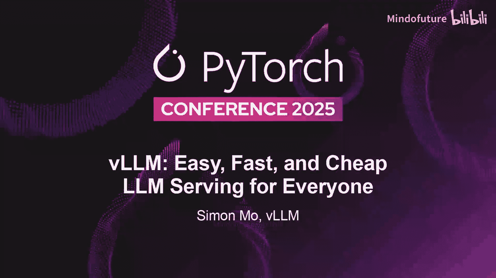
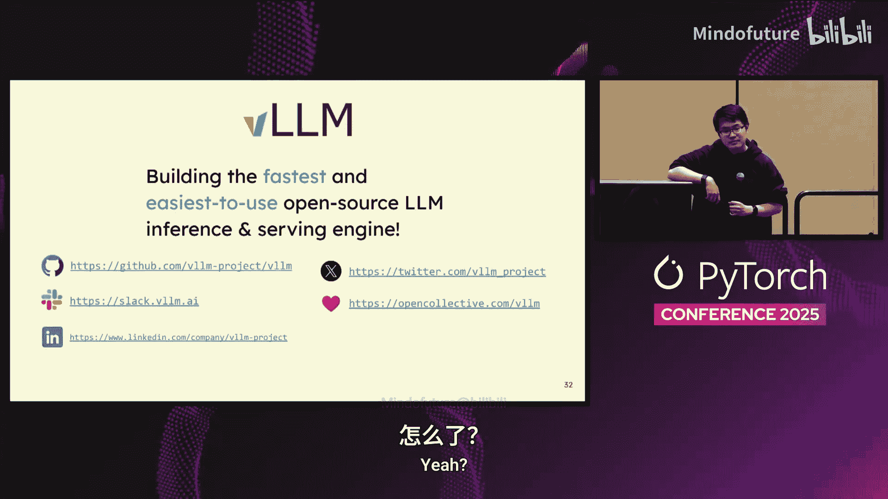

# 2025 Pytorch大会 ｜ Pytorch Conference 2025 p24 P24_vLLM——为所有人提供轻量、快速、经济的LLM服务-Simon_Mo__vLLM -BV1b8kRB6EJG_p24-

All right， hello folks， thank you for coming， I'm Simon， I'm one of the lead of VOM project。

 and today I'll talk to you a little bit about VOM， what we're happening up to， what is happening。

 and then as well as some recent involvement and sort of the way we're thinking about the future of inference from the current point of view。

😊，All right， let's get started。So VOM started as a research project but quickly becoming the engine of choice for large language model inference。

 and our goal is to build the fastest and easiest to use open source LM inference and serving engine and to really look at it VOM as I kind of mentioned as a keynote today。

 we really see it as an ecosystem where you have model。

 you have accelerator and framework all working together That is from the model vendor point of view。

 VM is a trusted place and the engine of choice to implement model in a most efficient way。

 and then from the accer point of view， as soon as they're able to add kernels for new models it will broadcast and any optimization will be able to benefit both the past and future set of 200 model architecture in VOM。

😊，And then on the framework side， Vion has been the GoTo default R engine for a lot of RO framework today。

 as well as being used for reward modeling， synthetic data generation and a lot more。

And just to reiterateerate and dive a little bit deeper。

 the reason why're here today is that VOM started on Pytorch and have a close relationship codeveloping both VOM and Pytorch together and on the one side。

 VOM really help battle test a lot of Pytorch features。

 such as Torch compile power flex attention torch AO and the other side。

 we leverage almost every extent of Pytorch library itself such as plugging in our own memory allocators or adding in a new accelerator plugins and as well as really abusing your way Torch compile to achieve the best inference speed possible。

😊，And the reason we're also here is we're part of the foundation project。

 that is where we directly work with all the members of the Pyrateot Foundation to make sure that VOM is being developed and openly governed by all the members and together to make sure that theres a longevity and share governance of this project。

And if you look at VOM progress so far where fortunate enough as of last week， we have course 60。

000 stars， as well as 800 PRs being merged every month and to manage this project as a scale。

 we cannot do it without a lot of industry partners such as meta， Red Ha， any scale。

 hugging face and a lot more companies that directly focus on working on the open source option VOM。

 supporting different models， supporting different hardware。

 and then making sure that you are getting the best optimization on the newest frontier model。

Let's look at the code a little bit。 So this will help us anchor around the conversation about the newer feature that we're recently introducing in VOM。

 So there's two way to use VOM。 One is to use it as almost a dropping replacement for hugging face transformers inference where instead of running batches at a large batch with padding。

 we offer continuous batching with the LM interface。

 The LM interface allow you to initialize a large language model and directly run through your list of prompts。

 This prompt can be millions of entries if you need to be。😊，The other way is to use it as a server。

 you can use it as a dropping replacement for open AI server of anything that speaks such a protocol。

 And this is where you can directly target your application that's designed to talk to openI protocol today to talk to VM and with that unlock you to all the open source language model。

 and this a piece of news that's so new that we actually didn't get to put on the slide is that as of this morning we just merged support for the anthropic API。

 So now you can point your clock code and related application Ti to anthropic protocol to directly talk to a open source model as well。

 and we're gonna see more and more usage down the line for this。😊，And additionally。

 as I mentioned before， this is the two primary way of directing using VLM。

 but as we build an entering system， we also support a way to break it up apart so that a lot of framework are directly leveraging internals of VLM and or lower level abstraction and construct to directly use it to integrate into their existing framework and applications。

And just to talk a little bit more about the model we're serving。

 a lot of times we directly work with people who are making the model and training the model and opensourcing them directly。

 and a lot of cases you see what we call day zero support。

 and this word day zero support really just means the moment that the model weight went down to be public on Huging F Mo hubub or any other places。

 you are able to download and run it with VL。And of course， this is now magically happening。

 like the moment the model release and will get to work。

 it is a long relationship we're building with all the model vendors across both China。

 U and around the world to make sure this is happening。😊。

And for models that do not have a direct relationship or directly have bandwidth to work on。

 the great news here is we have worked with Hugging F to support what we call transformers backing。😊。

And this allows you to have one flag in VOM Ser that plug into models that do not yet have sub native support in VOM。

 but you can directly run it with transformers implementation。

This also comes with a great benefit that you can have the same piece of code。

 the same model definition to be used between pretrain， R， as well as inference。

 It's the same hug interface model definition code。😊。

And we also have stated our vision visual and language model support。

 we have recently got on a lot of headline with our support for Deepse OCR system。

 as well as Queens ReVO， We're seeing that our design architecture support you to add new modality quite easily and this is just a start so you can use VOM to do OCR task。

 vision understanding， but later on we're quite excited to start supporting like multimodal output such as image generation in the vision transformer style。

And speaking of model support， we prior has accuracy quite a lot。

 If you ask me how much time did I spend， actually， do we spend on supporting GP O SS。

 which is the model from Open AI。When we spend 30 days with this model。

20 or more days are spent on making sure that we get exactly the same bits of log probabilities output directly out of the model so that you are actually getting the model that you are intending to get。

 not some sort of version that will have silent corruption buggo actually the issue。And with that。

 just today， we have announced that the support for batchshing very remote。

 So this is long the making in collaboration with Ski machine Las as well as meta to support that regardless how many requests in the batchsh。

 regardless of the batch structure， the ordering you are able to get exactly the same output over time。

 and this actually has been the case strongly used to verify accuracy。

 especially to make sure your model is exactly what you're getting from the training framework as well。

And accuracy is one part， the other we prioritize performance。

 There's a lot of way to tell you about this， but one way I find liking is instead of showing the performance bar chart is that we actually invest a lot。

 So on the left it is a nightly performance dashboard that we work together with a Pi church developer team that we actually run every single commit to run through an extensive set of test to make sure there's no performance regression and it will only get better。

 and on the right side is really talking about how much this costs in terms of funding and the infrastructure to use to provide performance guarantee。

😊，And just to speak a little bit more on the Py and VOM。

 one thing I think we didn't mention is there is large production use cases running on the nightly of VOM on top of nightly of Pytorch。

 and this really ensures that as the most cutting edge where you can get the most performance possible。

 that is being validated and being run。 And this is why you see a lot of Github issues and PRs popping up on VO I talking about。

 the current main is broken on Pytorch nightly that hasn't been released and will'll be releasing three months because three months before you get a new Pyro treaties were already making sure it's working。

😊，And， of course， this is just the first series of talk that there's a lot more talking about V I'm during the Pyroch conference。

😊，And now I'm gonna spend few slides talking about the new technical insight that we're developing on in account for the new trend that we're seeing today。

 So we're gonna I'm gonna first talk about a little bit a summary of two techniques and then interfaces and then later I'll dive into the work I'm doing on distributed inference。

😊，So the first technique is what we call hybrid allocator。

 So if you are seeing the trend of model going forward。

 we started with just dense transformer like Lama and Q Dense and then gradually move toward MOE like Mil。

 and then later move towards larger MOE like deepse and Lama Street， Sc and Naverick。

 But then that's how the FFN is happening。 but the other side is attention。😊，On the attention side。

 we're actually quite seeing quite a lot of innovations beyond just the typical multi attention。

 We have been seeing MA multiating attention from deepse。

 But then people are actually innovating on the improving the quadratic behavior of attention mechanism。

 So that's why we started building a system called hybrid memory allocator。

 The hybrid memory allocator allow you to efficiently manage the KB cache for model with hybrid memory requirements such as a model with sliding window and full attention or the sliding window full attention and memberba or safe space model blocks。

 and we allow you with different kinds of intricate design to be well managed and efficiently served。

😊，The second part related to kvc is the emerging need of kvc transfer as well as storage。

 So as kvc gets as the context gets bigger and bigger。

 you have a higher need to manage the Kvc to move it around。 Take example of 100 k context window。

 The memory by required to manage that Kvc is quite big。

 and recomputation sometimes is going be slower than just moving that cache in CPU or remote storage and bringing it back on。

 This is why we in collaboration with the team at own cache and other。

 we build interface called Kv connector。 So invi now can support offloading the Kvc compressing the Kvc and as well as transfers in Kvc in multiple ways。

 So for example， you can store the Kvc in your authority storage in wca or you directly move it to CPU Ram for later usage。

😊，And then one more bit on a new innovation we're seeing again related to KV cash attention is as attention is getting more efficient。

 you typically see a stggr effect when you are serving a large scale。

 What does that mean is if every single GPU is running its own request。

 Sometimes there's one request with a lot of input tokens， that would just slow down everybody else。

 And this is why in collaboration with a team that's behindkimi K2。

 the world's sort of first modern transformer1 triion parameter model open source that open they have open source what you call deco context parallel。

 Decode context parallelism is something that allow you to shard and stripe the input context across different ranks。

 and this is a new parallelization degrees compared to tensor parallelism extra parallel and many more。

 This really allow you to resolve the Strr problem， and then you can see that if you use this model。

😊，To use this way to serve deepCB 3。1 with a decoconness parallel。

 you will immediately get a lot more KV cache space as well as better throughput。All right。

 just to recap of the session we just mentioned before。 VOM， make sure we are delivering timely。

 accelerate， accurate and optimize model support。We also have a wide hardware coverage going from latest generation and mediaship to AMD to Intel and lot more。

 as well as flexible API with variety of integration with our framework and deeply integrated Pytorch and frontier of innovation of many techniques。

Now， I'm going to dive a little bit more with distributed inference。

 That is a core focus of us over the last few months that to focus on while VOM can make the job can do the job of serving a single model on a single group of GPU really well。

 What are you doing to scale it up。 And this is where the different ways of thinking about distributor come in。

 one way to think about it is there is from the engine out perspective。That is。

 we can think about different parallelism， think about fault tolerances， Think about elasticity。

 VM does all that。Another way of thinking about it is from the cluster in。

 from the cluster management point of view， especially someone who have been managing thousands of GPUs at large scale。

 or even more， you actually need to worry about routing， caching and operation。

And this is where LMD comes in as a community project to focus on really gluing together the cluster operator perspective。

 as well as the inference engine perspective。 So the way you look at it is， the world of Chates that。

😊，A lot of it is designed for microservices， where it is processing requests that are fast。

 uniform and cheap。But on the other side， LM inference is orders the magnitude more expensive。

 way less uniform and require a lot more acceleration and consideration from the cluster point of view。

😊，And LMD really helps this by deeply integrating with Knetess primitives。

 such as when the request come in， you'll go through the inference gateway and youre able to intelligently choose and route to different LM instances。

 VLM instances on different hardware。And this also provided quite a lot of reproducible samples。

 One challenge we had if you asked me a year ago， is that you really cannot scale VM in a reproducible manner。

 Every cluster behave differently。 everyone have different requirement network top。

 and sometimes when we say， we can get， let's say，2000 tokens per second on this setup per GPU。

 someone else cannot get。 But then LMD by building on top of Knetes and primitives。

 this really help our community with different well path that is directly reproducible and tweakable so that you can directly bring into your setup。

 And this includes intelligent inference scheduling PD disaggregation。

 Kv cache management and wide Ep。😊，I'll quickly illustrate a few of them。

For intelligent inference scheduling， this is a way of framing this problem as a smarter way of routing request and no balancing the request。

 So the way you deploy VM in a distributed manner today is one。

 you can just put it in chromem services and perform runrobin lowbalan。

 And this typically is pretty bad in the sense that because different requests is such a nonun fashion that you don't really get the best balanced approach。

And LMD supports prefix aware routing。 So on the left。

 you can see that you will match to the right prefix tree so that you always have lower time to first token when the request has already been processed。

 On the other side， there' is load aware routing where it will be able to scrape and intelligently analyze VM specific metric to route to the right pod。

On the PD disargregation， LMD， along with the VOM integration itself。

 provides a way to efficiently transfer from GPU to GPU， leveraging Nvidia and N library。

 as well as a counterpart of what will happen in D and TPU to be able to directly transfer the Kvc from the prefield instance to the De instance。

 And by separating preview and De， this allows you to run different parallelization strategy and deployment option and scaling across the two。

😊，And finally， there's wide expert parallelism， the way you typically serve the 1 trillion parameter model today is now getting a GPU has 1 trillion getting a node with 1 trillion vis in memory。

 rather is you actually scale it out into way bigger pool。

 and this allow you to efficiently manage a large batch of requests and distribute it across multiple ranks。

😊，And this is where LMD allow you to have a way to directly easily manage this on top of Katities again。

 so it is more reproducible and easily usable。😊，And along with this。

 we have leveraging optimization from the deeps team。

 where such as performing expert parallel low balancester。

 where you can move the expert within the model， moving around replicism so that you can achieve a great utilization score as well as dual batch overlap。

 this is again， work inspired by what deepsick has been working on to run communication and computation overlap to make sure that in this large distributed fashion every part and the network。

 the memory bandwidth and then the computer are all well utilized。😊，And that's pretty much it。

 So now I have covered VOM a little bit。 I've covered our recent involvement。

 and now I covered our distributive。 And to really think about the roadmap is really much a doubling down on all that。

 But I will a few minutes。 so now I can take questions。 Thank you so much。😊。

I don't think we have a mic runner， so just shout and I'll try to repeat the question。

The question is if you want to integrate。那まにプれた。Yeah。Previously。

更对你百个你没。のびに。Yeah， so the question is about the experience of adding new accelerator how strongly tight it is with Pytorch So VRM does require Pytorch。

 but what we do offer now is a plug mechanism where you can swap out what we call the model runner and the model execution pass So within VM Pytorch is the framework that you're using but outside of it when you're adding your own hardware you don't need really need your hardware runtime and software stack to directly work with every single operator of Pytorch rather you can take the Pytorch graph go through the torch to the compile induct pass and lower it to whatever framework or language you like and this is one of the ways that。

Later， you'll hear about the VRM TPU story when for VRM TPU， initially， they started with Torch X LA。

 But now as a week ago， actually the version they announced is actually lowering Pytorch model definition to JX。

 And then Js will be able to run run it on a higher utilization on TPU。 So for any new hardware。

 you can actually do pretty much exactly the same thing to lower a Pytorrch model definition into whatever language and framework and compiler of your choice。

😊，Thank you。Yeses。My question is most about you。最抗しですて。How do you ensure that the。The first togan。

没前没前的。Somebody you guys in that。しお金。嗯。Yeah so so the question is in different kinds of parallelization paradigm。

 how do we make sure there is correctness where tokens are routed to the right rank as well as I guess performance where this is wellserv and the job of VRM is to ensure that we have a lot of options to scale it out in a different fashion so initially VM only have tensor parallelism and this is when when the token is kind of broadcasted to all ranks and then internally across the intermediate and hidden dimension you are all collected to make sure you continue to run and then this pipeline parallelism where you shard the model layer by layer across different nodes and then later we add a context parallelism as I mentioned that is really sharding token across different rank and making sure that the attention will add up in the end with like zero accuracy loss and then of course expert parallelism and lot more coming down the pipeline to make sure that we are separate。

Pating and sharding the model in a different way。 but correctness is never a sort of a sin sacrifice and trade off。

 rather， distributed way is the way to really make sure that you can run it at a larger scale at a greater efficiency。

Yes。All has blood pres so where well。And the load wear。Great question。

 How does prefixware routing and loader aware routing work together So they don't sometimes they're a choice Sometimes they do in a way that here's what happens under the hood。

 prefix of where routing requires expensive computation and reconstruction of the prefix tree So that requires you essentially understand every string and token that happens there。

 and then load aware routing is where you essentially have staistic averages over like the Kb cache utilization and a lot of cases you actually choose one way or or the other depending on P or D and then whether or not you are working on prefi or you're working on decode but in different cases。

 depending on your production environment， you might actually mix a signal of the two fundamentally the choice of the endpoint picker that's in the LMD construct or the low balancer itself is the one you have to choose the host to send the request to and it is a matter of how do you compose or choose or select the right algorithm to deliver the token over there。

😊，We'll have one more minutes over there， yes。So just to come because I have trouble hearing is about the numerics and bashing variant。

 right， or like training inference consistency， is that？Okay， yeah。

 so the question is about like share more about the training inference consistency and the way we typically approach the problem is given the same number of GPU。

 right given the same distribution set up and given of course the same model weights。

 we want to make sure that you are getting exactly the same under a condition that is if we get to use the same kernel。

 a same distribution strategy， you are gonna get the same output。

 but this is fundamentally difficult because in attention。

 especially in inference engine like V we do what you call page attention and continuous batching。

 and this is different from the training paradigm where you actually pad all the request together and put them in one batch So if you put them in one batch and run and then we want to make sure that in a continuous batching scenario。

 we are getting exactly the same output as well。 So it actually requires a lot of tricks with kernels with tuning distributed computation and again for that I highly recommend the blog。

Sing machine labs to talk about baing imvariance。 And from Horace。

 Horace might be here today as well。 Allright， cool， I think that's where out of time。

 I'm happy to take question off the stage。 Thank you so much。😊。

