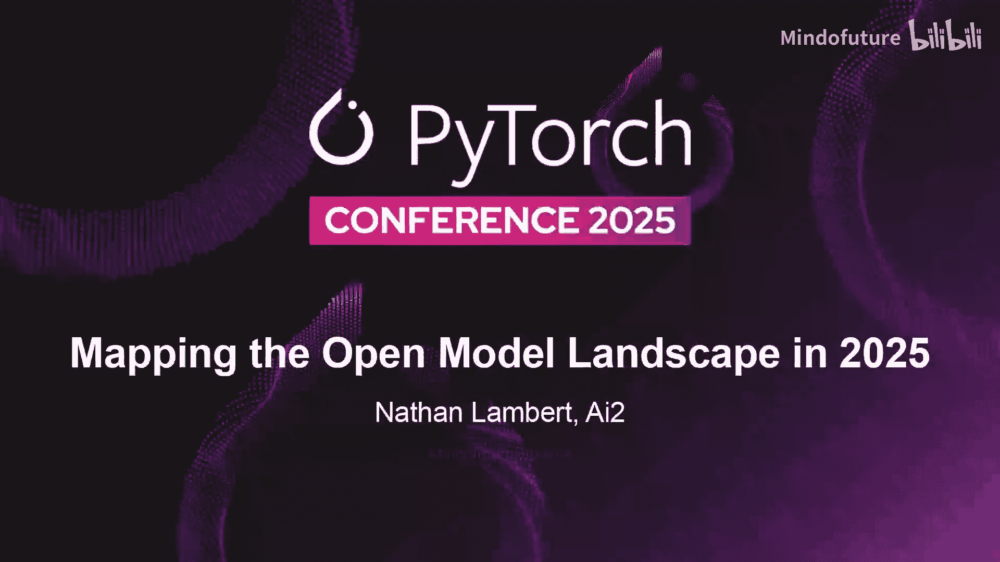
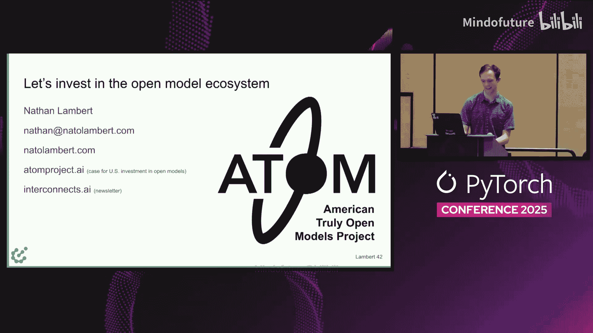

# 2025 Pytorch大会 ｜ Pytorch Conference 2025 p25 P25_2025年开放模型生态图谱-Nathan_Lambert__Ai2 -BV1b8kRB6EJG_p25-

Start with an intro of who I am and why I'm giving this talk as people can keep filling in and I will almost certainly have time for questions at the end I would say so I'm Nathan Lambert my day job is mostly training open models at the Allen Institute for AI and this talk is mostly composed of stuff that I've done in my free time which is built from when I used to work at hugging phase and kind of being seeing firsthand how people are using the platform and tools that they have and then through as open models have become more of a point of interest in the industry of just like what is happening and then obviously today there's a geopolitical context to this with this talk is really just meant to be like what is happening and I'm obviously here because I think that more people should be investing in this field and I think a lot of people here agree with this but it's just kind of like what is the information that we have and what are emerging trends in open models in terms of like especially as a lot of even like political and even。

or big tech investment is coming into the area and we've seen some recent rounds on the west that are a lot of money for open models and I think that through the end of the year we might see more of that。

I think this is a fun talk to kind of cap what has been a。

Very interesting year in this and something that I didn't really expect to be the focus of the industry at this point in time。

So if we start， I'm going to go into like the recent balance of open models and what actually brought us to this point in time So if we go back further before 2025。

 think about what the world looked like before deepseq was super popular and stuff and there was actually like a fairly stable equilibrium in the state of models I think Lama was the dominant default they had great models that sizes that were pretty easy for people to use。

 I think people often forget that dense models are far easier for people in this room to download and work with Mistrel at one point almost had made it so the EU and European companies had more adoption metrics than U companies and it was like almost bigger than Lama at one point and then like deepseq was very interesting before this V3 and R1 moment that we all saw and people that were following the ecosystem had seen this lab producing extraordinary outputs and research already and Glen was seen as a person that's like kind of doing what llma was doing in just a little bit later in the。

Models hadn't quite broken through， but like all of these ingredients were ready to change through the year and then in 2025 we start with Deepse。

 there's a lot of references that I kind of enjoyed in making these slides to just like go back and reread what I thought at the time of these different models and January we obviously had this deepseR one moment and most of the things we talk about are downstream of this and how various companies and communities kind of react to seeing this validation of open models that scale just after reasoning models had become a new thing。

So I don't need to retell the deepse story but as we get going in March there was actually some models in the open ecosystem that I'm probably still more excited about than people talk about which is like GeEma and then our work at AI2 which with OMmo 232B which like GeEA is still very strong model that people don't talk about very much from Google and OMmo 232B is still the best fully open model to date where we released the training data。

 the training code and so on and kind of more than just the weights and then kind of comes on the story of kind of switching theme so we had Lama4 and Quen3 within actually just a few weeks of each other and they feel like extremely distinct events so LaMma before I remember being like sitting it was probably like post run on my laptop and its like why did meta release this on a Saturday afternoon and it was just like what is going on and that didn't turn out super well from them at a technical level I think it's one of those releases in many ways there's a lot of hard things about releasing an open model and getting all the tools right。

And the models that people can actually use。 And then just a few weeks we had Qnt3 come out。

 which kind of immediately got traction in these architectures that worked out of the box。

 and we've only seen from here how they've continued to build on that branded model series and get a lot of usage for it。

And then the summer came and a lot of new Chinese entrants started coming so it's like every week we see a new Chinese technology company of some size。

 either like the biggest companies like Baidu is a very old name in AI or minimax which is one of these so-called AI tis which is a startup with a good amount of funding releasing models and people don't really know where they're going to come so we had some these we had mini Max M1 I was just referencing this paper because they had they're like CiISpo R algorithm which is like a sequence level important sampling was referenced in some prominent metawork recently。

 so a lot of these Chinese labs are doing research that is at the cutting edge and worth looking at。

And then in July we had Kimmi K2 GLM 4。5 from Z。AI。

 some other models which are a little bit less notable。

 I described these as like if deepS had not happened this summer is when that same freakout would have happened over people thinking about model commoditization or really real competition or the gap between open and closed models and then it's really just kept coming from here。

 I think we like have had some positive signs from the US ecosystem that I will revisit later like Open eyesGOSS which is。

A model that was kind of clunky at launch， but has been doing much better。

 And invidia has released some models that also have some open data。

 This Nemeron nanono is a 9 B model， which rivals Quen at that size。 And then another byd model。

 So this is really more of the same。 And then we get into like model updates and many more things from Quinn。

 And like October， there's more things that I could add。

 I have some quin releases later that are more recent。😊，So this was like a very eventful year。

 I think if you look back at any other year of open models， like it's never like this。

 it would be like a few mystral drops， a few llma drops。

 and this is relentless and much more in line with what people feel like when they follow AI generally and open models are like now part of that very rapid discussion。

So I like to describe the two types of model players they become very different in how people use them and the most popular metrics for showing like which models are winning in the ecosystem is something like hugging face downloads or downstream models and a download is any webge or curl request to the repository which is a git repository So download is a really really messy metric and for something like Lama orquin or Gema even and often AI too like downloads are a reasonable thing because it shows across a big family of models how much attention are they getting on the web but for something like Deepseq。

 which was applied into a ton of international technology products。

 all of those serious products are going download deepseq once into their infrastructure and then never showed again。

 So like downloads are deeply imperfect and depending on the type of model you're looking at。

 you need to have kind of a different lens of analysis。

And I kind of described this as like I kept seeing these Chinese model providers becoming more prominent。

 I get direct inbound from them， it's like a very interesting thing where a lot of Chinese companies are interested in talking to me and have never gotten inbound from like a Western lab that's like hey。

 we're at least like our new model like do you want a briefing。

 is there something that is a very interesting experience with how directly they want to engage with people that are like in this room and get them using their models and understanding what the weaknesses are？

So this kind of tsunami really fell over the summer and one of the starting things is like where is Lama in July。

 I think we had this update with。Whatever their superintelligence memo was。

 personal superinence and it had this quote where it's like we have to be careful about what we choose to open source and just a year before when talking about Lama3。

 Zuckerberg had what I described as being like one of the best arguments in open source AI and the Me blog。

 which is like it was like why open source is the path forward and it just shows that individual companies can change really fast as there isn't dramatic lockin in the open space。

😊，This continues to this day where I've heard rumors about Alllma 48B Lama 3。

18 is one of the most used models on huggingb of all time， so I think this would be very。

 very reasonable for them because they can improve on these models very easily like the pace of progress is so high that updating from Lama 3。

18B would be great for a lot of people and Zuckerberg is mentioned Lama 4。1 and 4。

2 on earnings calls in August so there's like there's still noise that there is things happening and interest in the brand。

 but if you talk to people building with these models like trust is a big thing at a technical level you do actually have to fnale a lot of things to make your stack work with an open model you have to get the chat template right and figure out prompts that work for it and you set up your testing So once you move to Quen it's not as obvious to just drop in the nextllma model and test it and switch back So a lot of people are building on Quen most of this isn off the record discussions just the other day the Airbnb。

Airbnb CEO like wildly boasted that he's using Glen more than OpenI。

 I don't know how much of this is just ballet politics between the two。

 but I do think we're going to keep getting more anecdotes from companies that are willing to publicly say that XYZ model from a Chinese lab is the one they're building on because they are so numerous and you're more likely to get this like perfect niche for the application you're working in and sometimes you just need to try a bunch of models before you see what works。

I think this is a fun side where I just wanted to grab。

A subset of the things that Quinn are doing like knowing that it's just a few hundred people at Quinn and they probably have very real resource constraints。

 I've had a conversation with them where I feel like my work at AI too is like on the line of research resource constraints where it's like if we don't get the resource is it'll be hard to be relevant with how fast the model progression is going and the Quin people are like yeahmy too but at the same time they're training so many models and getting so much stuff out the door that it's just very impressive to see and it's like。

Very wholehearted and just like we want to do this for the love of it and I haven't gotten to talk to someone in the strategy and research。

 but it really just feels like they want to train a lot of models。

 they share a lot of infrastructure and data across them and they're trying to get things out into the world and any one of these longtail releases like text to speech or audiope recognition is probably just one or two people at Co they're like I want to make this real which is like a very small thing in the bigger ecosystem but it really adds out than I think more companies can take approaches like this。

With this approach， what we have done for something that called the Adam Project to try to advocate for more investment in the open model ecosystem is that we've looked at every major what we call language model or related family after ChatyBT and we look at the cumulative downloads with some filtering so I mentioned that the download metrics can be broken。

 there's a lot of times where there's clearly that the downloads have been put into something like a C or something and there's like a spike of 10 million downloads in a day。

 so we've removed these and look at the relevant models just in the last few months Quin's cumulative adoption metrics have started to pass llma and this was the long time coming for anyone in the ecosystem but kind of represents the shift of power and what the real default is in terms of what people are using for kind of the long tail of tasks I think a lot of this is information processing rather than something like a ChatyBT direct competitor。

And even if you look at what the Quinn CEO is doing。

 I have a picture on the next slide where it's like。

 I think of Quinn is trying to just be the default and the thing that everybody knows is available and this extends to lots of markets outside of just like this Silicon Valley tech companies but things all over the world where people want to try AI and they have the compute budget that they know and they don't want to sign up for paid services and they just want to download something and try it in their domain。

So if you go， this is a recent photo from the EPSR conference。

 which is one of the big Alibaba cloud conferences。

 kind of like Google Cloud next to something where the CEO literally put this up on the slide which is like LLM。

 the next operating system and they go on and talk about Qui。

 so that's why my analogy on the previous slide like I don't think it is too stretched when the CEO saying something almost exactly that。

😊，And you can get this lagging a little bit when you put these numbers in a different way in terms of performance capabilities。

 theres on the left is artificial analysis analysis is index hard to say。

 which is a composite of somewhere between six and ninevals at any time we took these in August of 2025 it's difficult because they change thevals in their composite so the numbers on the Y axis could change depending on when you look at their website my free advice to them if anyone knows somebody there is that they should just index it so it's the intelligence index V2 so you can look at all the previous ones happy to talk to them about this。

 but you can see the slow march of progress from these Chinese models mostly powered by Qui and deepse and this really numerous and frequent releases kind of surpassing the other models whether the US or Europe on this intelligence benchmark or Ella Marina these are both imp perfect。

But if you could get data for more of things， I would guess you would see the same trends。

And one of the things that's really fun about learning about this is just how many organizations keep start popping up in the Chinese ecosystem。

 this is like a snarky tier list that we put together。

 which mostly was for this blog post on the bottom。

 which is just to say like what are the characteristics of different labs。

 what types of things are they releasing， and what types of different groups are participating in this broader community in the Chinese ecosystem？

So like everybody knows about deepsking Cl， but over the summer I think Moonshot AI and ZDt AI became more kind of household names among the people building with open models and at the same time there was a huge other mix。

 whether it's established companies like Tencent and Huawei starting to release models or even like small labs。

 like Open BMB， internalMBAI， these are releasing like a mix of data and research reports and small models。

 and like for example I worked in reward modeling for a while and some of these groups from like OpenBMB and internalM we're releasing very strong niche models in these research domains。

And then at the same time， you have new entrants of like mediumsd tech companies like Mehuan。

 which is an equivalent of Dodash releasing like a trillion parameters sparse MOE with extremely strong benchmarks。

 which to me is just like I have no idea why they're doing this but I plan on asking them and hope to share that with people soon because I think it'll be really revealing about something that is on this slide which is like a lot of companies seem to have very direct either like community pressure or executive pressure following deepse by a strong open model is how you do AI in China and I think that there's a lot of downstream benefits to having a lot of types of open models that people can figure out how to work with and what are the best practices and it create a much more。

Free flowing environment for information than we see in the US with pretty secretive practices around AI。

If we go back to these analyses on metrics from Hugingface。

 another one that we do that can make this a bit clearer to C relative to cumulative downloads is just per month buckets of fine tunes。

 So if you like take every fine tune on hugging phase of llma orqui or whatever。

 and you filter for all of those that have at least a few downloads so you can upload a to of models that never get seen。

 you can kind of see this constant shift of。Mostly from originally。

 Mistrel and then Mistrel and llma and then Quenn。 And this was kind of constant over time and makes a clear of like。

What people are using on a hugging face？So we call this kind of the flip of when adoption really started to overtake and like the summer of 2025 I think is on track to just be when this changed and I expect this kind of Chinese ecosystem to keep expanding and be more of a norm。

 but I think it should be it's something worth investing in because these models are going to have more and more uses that we learn what they're for over time case in point is like cloud code this year and there will be many more applications like that in my mind。

I often get asked will China continue its open source strategy and I'm not a China scholar so I always find this funny when people are like we need to find the people that have studied economics and how industry works in China for decades and I'm starting to learn about this and it really seems like the deep seek has that this industry norm and people are going to continue there's some longstanding kind of how people describe the technology industry in China and how that has particularly affected physical goods is that Chinese companies often search for market share over profit and open models do fit with this。

 but we need to do deeper research to understand what the motives of why Chinese companies have been pursuing these tactics and material realms to understand if this will translate to AI。

So this is like， I think this will continue unless AI becomes powerful in a way that gets the attention of the government。

 but I have no read on this as somebody that is not deep in the weeds of kind of trying to understand what the PRC thinks。

And depending on the audience， I think this is a highly sympathetic audience to open models。

 There are still a lot of people out there that think a heavyhanded control approach to open models is the right way to do this when I give talks to open models in policy audiences with kind of a mixed distribution of who is there。

 I will often get questions of shouldn't we ban open models so that we can get ahead of risks and I think it's important to be prepared as an advocate for open models that you can't really do this in a place like the United States because of how digital information flows and the cost of training models is plummeting so that there will always be people in other countries that want to train a model for orders of millions or tens of billions of dollars and can upload this to the Internet and there's very little we can do to block this and we need to think about how to design internet protocols and everything where there are going to be people with open models across a variety of domains taking actions that we might not like them。

 but we need to be under。To understand the cutting edge of the technology and think about what they will be doing。

One of the ways that I think about this is with local models。

 I think a lot of people have shown these performance plots with closed models and open models。

 which I think are something that always kind of annoyed me， but this one I find more interesting。

 which is that it's the gap between closed models and local models。

 I think that there's a lot of domains where if anyone could run a certain like multimodal model on their laptop with no restrictions so that could because a lot of。

Like social evolution that we will need to do as a group to get used to this like I don't we had the SOA2 app come out。

 I don't know what happens as these abilities proliferate in ways with much less control and I do expect this to happen in the coming years and this is not really like this is not really a cause to ban open models but to just kind of study what they are doing more and kind of just really think deeply about what this reality will mean to everything from our businesses to our life。

So at the same time this has been a lot of talking kind of showing like China is taking the lead。

 I think this is props to them to doing a lot of very hard good work。

 but also I'm like an American and I think that there's opportunity for technological leadership here and I think that there's ways to invest in this。

 I think like，One of these is that we need open models for a lot of different reasons and I think that it's hard open weights only sell sub audienceiences。

 which is why I work on models that have open data and everything which is really important to research which is a longter engine of innovation and we don't really know how distribution and control of these models will come in different countries over time and I think just kind of like having multiple players there as a lot of resiliency into the ecosystem。

And it's becoming like I think a personal reason is also the reduction in concentration of power。

 if you buy into AI progress continuing for years over years。

 I think this will be one of the most valuable technologies of our time and I think the power of big tech companies already is kind of has very strong market effects and that could become even stronger influence so you should choose what your reason is and kind of think more about these。

But like the likes of GOS S is actually a very positive sign that I like to get out there。

 I think the models were。😊，Got a bad reputation at launch and sensed a lot of minor issues with especially things like the Harmony chat template so they introduced a new whole way of managing。

 interacting with the model at a technical level took a bit for the community to get to work。

 but since then the download numbers and kind of when I ask people that work in these spaces。

 the impression has been very positive for kind of this like agentic core of being able to reason and use tools。

I got one of the DGX spark boxes and I want to give this model another chance because having more players in the ecosystem is good。

 but also just like marketing wise open AI is the most common company associated with AI in the US who gives a lot of cover to executives that are making yes。

 no decisions on open sortcing a model where the biggest name has done it recently。

 and I hope those compounds。And AI too for example we just got an $100 million grant over four years for the NSF to kind of double down on our efforts of making strong language models accessible to the academic community and upskilling more academics with access to compute and tools to do this sort of research I think that like this is the biggest CS award ever given by the NSF which is really a big deal and I'm enough AGI pill just a little bit to think that this is actually not enough I can explain this which is that I told you earlier about Omo 232B is being the best open model to ever exist that is more comparable to like the original JPT4 in terms of performance by kind of the algorithmic efficiency gains have made it so hill climbing benchmarks is much easier but if we want to have people doing research on fully open agents like cloud code and whatever is next I think we need a much deeper like another step change in progress in terms of the modeling abilities so I think that once。

We get there that we'll have more time to see if the kind of big lab fairy tale of scaling models continuing to get more performance comes true and then see if we need to reinvest even more in open models。

 but I think that's kind of deepse scale of 600 B to a trillion parameters has been shown to be really high capabilities in terms of models and getting fully open models to that point so academics and anyone else that wants to understand AI can look is a really important milestone。

So I think that it's like if we don't invest then people could think that they're using models that are relevant and are not and that worries me so I think we just kind of have to keep pushing through these years。

 my estimated cost is this would be about $100 million which is compared to all the VC rounds is not too crazy so if you want to do this I'm happy to talk about it I called this the Adam project which is a bit patriotic for me which is I have to take this。

 but here's all the information if you want to talk about this and we have time for questions on anything I've covered or if you want to ping me on some random open model question I'll try to pull information out of my brain for that too so thanks for listening。

I think there's a mic runner if there are questions。Oh， there are people。Or I can do this too yeah。

Could you briefly recap the difference between open source and open weights？

And related to OSI's definition if you happen to be familiar with yeah。

 so I'll try to do this in layers， I think especially in 2023 and 2024 this was a very big topic of discussion in open models and I think it's meaning that open models are getting better because people are actually using them where definitions is no longer the most popular thing but there's a debate that has been had many times and I was deep in this which is the open weights versus open source models and open weight model is a fairly clear term where the weights are uploaded to huggingface。

 the code to run inference on it or fine tuneit is available but largely the process to getting it is not reproducible and documented。

 especially data is a major thing I can say different things recorded or not on what the data practices are and then training code so something like Lama with just the weights released as open weights and then AI2s Omo models hugging faces small Pytheia is。

AuththeraiIs Pythia are models that came with intermediate training checkpoints， training code， logs。

 and data to try to make it so that anyone can really go deeply at any part into training and change it how they need。

 which goes back to open source software as kind of reproducibility and freedom arguments。

Is that good， I don't know if theres another question in it。Hi， so I know byte dance。

 like Chinese companies in general have gotten like a lot of criticism with like social media and potentially using that to like manipulate like the American people。

 Do you think these open open source openweight models are another avenue potentially for this type of influence across the sea。

I think currently it's not and I think my realistic expectation is depending how much success they have。

 we could see the scenario where government officials are effectively work at these companies。

 so I think it's a real concern that's hard to balance， I think like。

I describe it as something that we cannot actually prove not existing。

 So it's like if deepse can write and run code， it's impossible to prove with 100% reliability that deepse hasn't entered a back door。

 even though I would tell people like like on my word。

 I don't like I'm confident that won't affect you。 So it's kind of like this thing because it's impossible to prove。

 like I don't think we'll be able to get rid of the narrative， even though like the。

Likelihood of control I would put as like super close to zero right now。 And I think that。

The way that algorithms for。Personal social media are designed or much more narrowly engaging in tracking than a model that you download once。

 so I think there are some structural ways where it's better as like tracking is less built in。

 but it's also worse in terms of you can't like prove some things that people want to know。Sorry。

 so hi， thank you for the talk。 I just came from Europe so I know how open source models and open web models are crucial in European ecosystem。

And my question it will be， So sovereignty in Europe is like major topic right now due to the dependence of the clouds of the US and other things。

We have M， which is not very per and they not perform as much as Chinese companies as you illustrate。

 So if I want to build completely sovereignraian solution with LLM like ChagPT for financial service or healthcare What is your tech and approach would your advice to use to build a sovereignra solution and is it possible because open deepse model。

 it's openweight， but how do it cost it， So what are the solution that you can be sovereignraian and。

Is it possible today or not。哎。I think the question is somewhat confusing because we're in a transient stage where like this is getting established。

 The overarching thing is I think the core of it is that sovereign AI is a real thing that a lot of companies or nations and coalitions will feel very strongly。

 So I expect Europe to continue to kind of be a part of this。

 We saw the Swiss models recently in Mial and things like this and then Middle East and then other power planters。

 And then it ends up being that sovereign AI， in my mind is composed of some compute stack and some modeling stack。

 and most people have both of these。 But now it's a bit。

Less unclear because the model progress is so fast。

 So it's like if you're just getting like like Mistrel has certain models that are public and private and it's kind of hard to know about capabilities then you hear like likequin4 came out and you're like。

 wow， it's so good。 But over time， I think some of this will normalize a bit where like sovereignI becomes a thing that a bit more predictable in Europe and anywhere for that matter。

 But it it's also kind of like。a weird world where this technology is very sovereignized by all sorts of geographies everywhere。

So I'm， I'm a bit confused。 I heard you saying that there's all this competition in。

 in developing open models。But then you also said that the open models are kind of limited and lagging behind the bigger models。

In that you said something about GT4， I was wondering if you could explain that limitation further。

Is the limitation in in that there's not enough competition or not enough innovation or what did you mean by that there are three kind of model capabilities that I keep in my mind one is like frontier。

 which is called open AI etc and then other open weights which is like deepea Quen and then the work that I do is like fully open source。

 which is this other question which is like AI2 or Omo and it's like this is the thing that if you're a researcher and you need to understand。

 say pretraining dynamics or like memorization due to data and pretraining where you need to have this data available that none of these open weights or closed models have and if this is this is like a third's like frontier open weights of then fully open and depending on all of these will have very different characteristics So I think we see the frontier models are solving IMO math and the open weight models are very strong on a bunch of benchmarks。

 but I think in practice are mostly used and very。Automation tasks and fine tune to narrow tasks。

 but if it's like these fully open。What I was saying about almost 32 Bs that just it's further behind。

 even though that is like the best fully open model that is out there。

 so I just think it's like depending on the user， there's different requirements and then they're all entering at like different levels of what AI can do for them。

Great talk， so I've seen this talk online and so I was watching mostly from this is mostly from an LLM perspective。

 have you done similar research on other types of foundational models like things that come to mind or clip based models like perception encoder for meta or DOB3 or stuff like that。

 do you have any plans to do anything， any foundational open source models for those modalities or anything like that？

I I think this worth work is worth doing。 I only have so much time。 I would say that generally。

it seems like there's so much over investmentment in standard LMs。

 but also there's still people that break through a lot。

 And then just there's been less investment in fewer players。

 and that results in kind of like a more jagged like the progress jumps and open models can be the best and things like this where it's just kind of makes monitoring a bit more tricky and it can you can have weird inversions。

 I bet in niche domains， you'll see things where I bet the frontier models are really。

 really bad and there's like a tiny model that's really good at it。 And I think that's like。

Probably a more fun place to work if you're trying to do products or small startups or specialization。

 but I don't have a good answer except for you're probably somewhat right。嗯。Hey anything。

 So why do you think the Gema three models didn't get as much adoption as they could？

II won't answer about like there ends up being a lot of small， subtle things。

 some of them are vibes and some of them are implementation level， I think in the past， for example。

 GeEA has supposed to used a different like attention kernel in transformers in libraries so that if you don't do it。

 you get some performance hit and or like a hard error when you try it the first time。

 so I think there's just a very wide distribution between like。Vibbees， license。

 and then like potentially broken at release time and so on。 I think and I'm， I'm getting cut off。

 So we're just gonna end here。 sorry。

