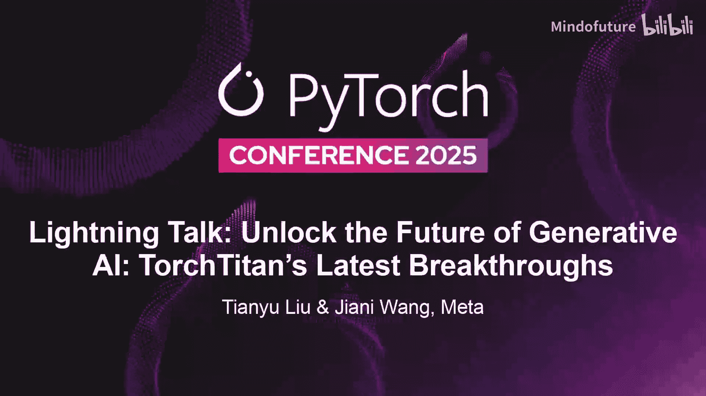
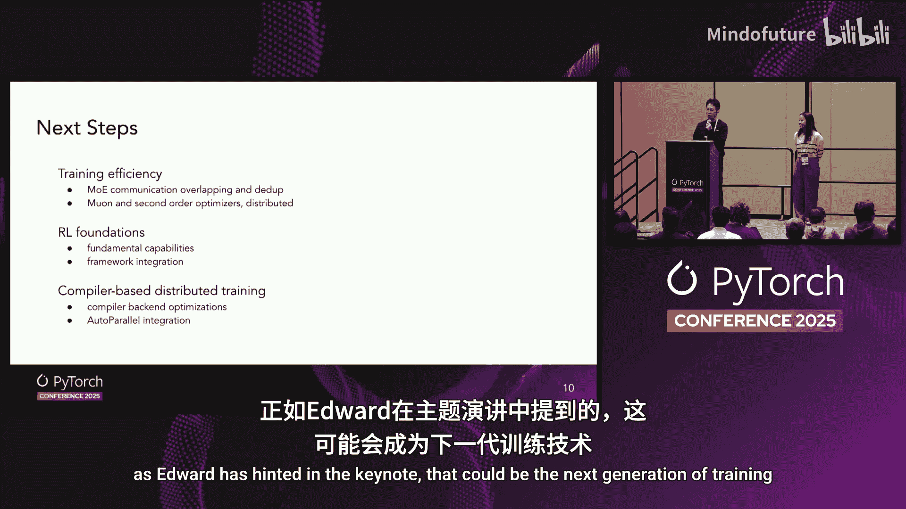

# 2025 Pytorch大会 ｜ Pytorch Conference 2025 p26 P26_闪电演讲-解锁生成式AI的未来——TorchTitan最新进展...-Tianyu_Liu__Jiani_Wang -BV1b8kRB6EJG_p26-

Hello everyone， welcome to Torch Titan Lightning Talk and I'm Janny。 this is Tian Yuu。

 Today we are going to talk about Torch Titan's latest breakthroughs。😊。

So for anyone who is not familiar with Torch Titan。

 Torch Titan is PyTrch native large scale training platform for Genrative AI models。

 and we actually introduced Torch Titan in 2024 PyTrch Conference and we also showcase how to train Lama3 with native PyTorch。

Last year we actually introduced three key components of torch Titan。

 the first one is composable 3D parallelism training， including FSDP。

 tensor parallel and pipelining parallel。Our design philosophy is to decouple model and infrar code as much as possible to make your model code cleaner and efficient。

And the second thing is about efficient training techniques。

 we leverage Ptorrch native activation checkpointing， float aid training。

 and torch compile to make it efficient。😊，And the third thing is we add a lot of production ready training techniques on top of that。

 including distributed checkpointing and flight recorder debugging。

 we also have something like matrix logging and Pytorch profiling。So where do we start this year。

 we started by listening to our community and our users。

 so we hosted a vote on new features at the beginning of this year。

You can see a lot of users actually voted on several different features。

 so this year we came back was following new features the first one is we extended 3D parallelism into 5D this year we supported context parallel which has sharded on sequence lens dimension and also we supported expert parallel for a mix of expert models。

😊，The second thing is compiler based parallelism。 We introduce Thinkpo FDP and auto parallel。

 which is also mention in our keynote session today in Torch Titan。😊，Thirdly。

 we introduce fault tolerance using torchftT in torch Titan。

 now we showcase fault tolerant HSDP and semithink training in torch Titan。Lastly。

 we also supported low precision training using torch AO。

 and there is recipes of MX FPA training and Rowise FPA training in torch Titan today。

So in terms of supporting models and scaling last year we only talk about Lama3。

 but this year we extended that a lot， our goal here is to showcase ND parallelism for Sotime models in each category so as you can see this year we are not only supporting D model but also mix of experts models like Deepse。

 Queen MOE and GPOSS which is launched one over， and also we showcase diffusion model like Fls and vision language model like SigL。

Here we also love to thanks to our collaborators and contributors。

So now let's dive a little bit deeper into the throughput numbers。

 we will talk a little bit more about deepSq victory model here。In today's torch Titan。

 we apply several techniques like Torch。groupmm in group experts and expert parallel。

Something else like select activation checkpointing and NikO Autoto offer token dispatch and combination。

 As you can see in the table for the whole deepS V3 model， we achieved some MFU numbers around 7。

5 with torch compile， but as also you can notice we didn't auto in the activation checkpointing part because we have limited GPU resource if you can save those auto to all and the MFU numbers will grow a little bit。

We also clearly know that in our future， we want to add DPP style communication Ddupe and also Du V pipeline schedule into Torch Titan Deepsek。

 which will also help the community。嗯。Cool， thanks， Johnny， let me take over。 Yeah。

 following what Johnny said GTOSS is merged into Torchteden core about around the noon when we were having lunch and five minutes later we found the original author Rohan Penny who did original contribution tweet this on X and suddenly I got five more followers。

 Yeah it's amazing to work in open source。 Yeah part like I want to mention this because it part of the reason why we're extending Torchteden from a single example to a framework last year was only about you know 3D parallelism on Lama 3 training。

 And this year we want to spur more models and we want to support more innovations around Torcht。

 that's why we have some of the extension points。 but we are quite conservative in doing those because we still want a Torchteden minimal one key abstraction we have is this train back。

 It consists of the model definition。 the in functions to parallelize it and also the training components。

Like。Tokenizer， data loader， optimizer and loss functions。 And besides。

 we host hugging face conversion maps so that your state date can be converted from torchche to hugging face or from huggging face to torchche。

😊，This is just the Coast N showing the contract。We also introduce model converters so that you can do in place runtime model transformations。

 this will be particularly useful for quantization studies or if you want to switch some model layers to yourfuse the implementation which are optimized。

We have D config which serve the purpose that you can reuse the base config and extend it for your own training。

 and we can do it in a very motorized and hierarchical way so that it's simple to use。And finally。

 for contributions and innovations inside Torch Sta。

 we host this experiments folder where we ask like people to contribute and on a project that serve as the middle ground for innovation currently in this folder we have some vision language model。

 we have simple FSDP and auto parallel as a compiler oriented parallelisms。

 and we also have a RL trainer interface， which we just heard from the talk on Torch Forge。

And contribution from the community is welcome to this vote。

I also want to mention our integration with hugging face。

 There are two reasons we integrate with the hugging face。

 The first reason is that people are constantly yelling at us that no one is doing pretraining today。

 people are all doing fine tuning， please support loading ways from hugging face and publish back。

 That's one of the reasons we do it。 So now you get seamless loading from hugging face checkpoint and train torchteden and publish hugging face model back。

 This can help us to do inference eve fine tune even RL So this leads to the other reason why we support this is for framework like Torch Fortwith does RL and use Torchte or trainer now you can use Torchteen to do the training and use VLM use your favorite inference engine to do inference because most of the time they support hugging face model definitions。

We also want to give a spoiler that currently were working on a PR to integrate training of original hugging force hugging phase model definitions natively in Torchcheden。

 this would mean that you no longer need to pay like days to months add a new model in Torchcheden。

 you can get them probably on day zero。Also want to show that we are integrating with RL framework so that people can use sourceshadding as the efficient training backend。

 this is demonstrated in the torch forge， which we publicize today。

But we are also working with other popular RL frameworks such as Verro to make it more。

 friendly to all the frameworks。Speaking of the adoptions， there are three main tech categories。

 the first is frontier labs。 like there are two examples here。

 First is from news research and the other is from Po side。

 which where they probably share in a post that how they are integrating with Torchcheta。

 they are a little bit different in the news research case people are like more their Torch for look very like our Torchche O S S version where they could be theyre able to train a top notch LLM model out of it without too much change。

 but in the post side case， they're building a production grade complicated system around Torch。

 So it's very interesting to see the two cases。 and in the latter case they are training on 10k cluster scale。

😊，And the other case is cloud platforms integration。 Now。

 you can train Torchchedon on pretty much every cloud platform。

 The last and the most important case we have in mind。

 this is important when we design Torchche is for the academia。 this year。

 we have a S ELR 2025 paper in for Torchcheden。 And at Singapore。

 and we have to workshops appearance at S M L。 And finally。

 we have numerous papers published based on Torchchedden as the experiment experiment platform。😊。

Finally， the next steps。 so we have to improve our training efficiency。 as you can see。

 we have a lot of room to improve for the deepse training and we are thinking of integrating with second order optimizers and also more as has been showcased by k do training to be the next generation of optimizes We're building RL foundations。

 We are building fundamental capabilities we think can be useful for RL。

 including better training consistency between you know the model use for training and the model use for inference。

 And lastly， we're building compiler， more compiler based distributeding training。

 we already host the simple FSDP。 as a front end， but we are thinking of you know doing some more compile backend optimizes to improve their training efficiency like in。

😊，In the back end。 and finally， we're thinking of integrating auto parallel， which is。

 as Edward has hinted in the keynote that could be the next generation of training。

And finally， I want to thank you to all the Torrssha and contributors and the audience here。

 Thank you。