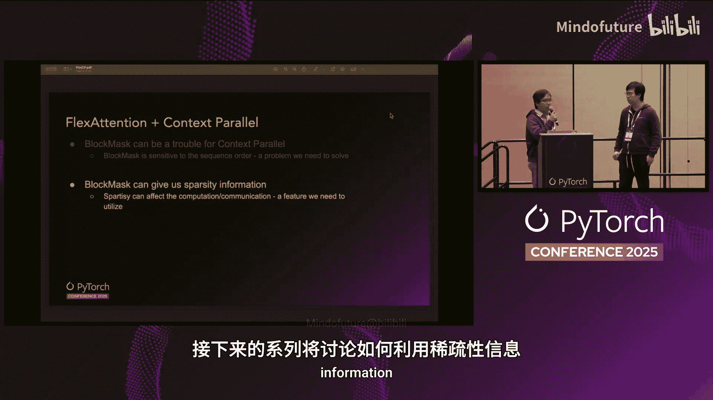

# 2025 Pytorch大会 ｜ Pytorch Conference 2025 p27 P27_闪电演讲-FlexCP——面向长序列训练的FlexAttention...-Xilun_Wu__Chien-Chin_Huang -BV1b8kRB6EJG_p27-

Okay， so hi everyone， my name is Chn Chin and this is Xi Lun， We are from Pyto to Distri team。

Today we are going to talk about how we combine flex attention。

 which in the previous talk just described。And combine flex attention with context per。

So if you are not familiar with flex extension or like you just heard the flex attention from a previous talk and then you can take a rest for one minute。

 otherwise I'm going to do a quick recap of flex attention。

 so how flex attention is a flexible API that allow user to pass in optional score more or mass function to custom my the attention behavior。

So the key takeaway for this slide is these two functions actually take in the QKV indexes as the input to customize the score or to decide whether this QKV pair are going to be computer or not。

 in other words， masked。And the next one is a contest per。

 Con per is one type of di paradigm which divide the sequence into sub。

 and then we can compute to all the compute like embedding or memo without any communication in the full world。

 However， when we need to do attention operations such as flex attention。

 we need to do an allgator to gather the full K information。

 or we can use ring attention to overlap the communication with computation。At this moment。

 we only have our version and still working on the ring attention version for flex C。

So why is this so spatial flexation and combine it with countlesspir。 So one key factor is， again。

 the blood max。B mass， it contains the sequence information and also mass function。

 so we cannot simply divide it or sh it along the sequence dimension， just like any other input。

 which we just sh the sequence dimension along the sequence dimension。

So black mass can be a trouble when we try to apply Qs pero。But in the meantime。

 black masss also give us the sparseity information， which means that the K Q K V pair。

 which are masked over the old Q K V pair。 So higher sparseity mean means that the lower competition。

So this is one。Information we need to utilize when we do context per。

So let's talk about how are we going to solve the issue。So we introduce a counter per shot。

 which takes in the input data like input tensor or label， but it also takes in the black mass。

When the API detects the input are tensor， it will simply shut this tensor along the sequence dimension。

But if it detects the input is actually a block mass。

 it will first again shut along the sequence dimension。

 but it will also rewrite the max function based on the provided device mesh information。

 which tells us the counter parallel information。And we will rewrite such that the local QKV indexes were met back to the global QKV indexes。

And we can also notice that there is a low balance argument for this Congresspir Sha API。

 which will be very useful for the next topic。Os。Okay。

 so next series is going to talk about how we can utilize the sparseity information。

Thanks， Xian Jing。So we did a small benchmark on flex attention with masks of different density。

And we found that the forward and backward time is proportional to the density。 So that means。

in parallel。 If we short Q TVV tensors in an unbalanced way。

 the competition distribution will be uneven， leading to struggle。

So the goal of load balance is to minimize the minimize the highest density on rank。

One way to achieve this is， is to reorder the Q KV sorry， Q KV tensors before sh。

And how we reorder them can be modeled as a moiv number parting problem。So let's take a take a look。

 head tail load balance is a commonly used load balance strategy to， to balance the casual masking。

So if we don't do load balance， you see the density distribution is very uneven。

So what it does is it first splits the Q indices into two times CP size chunks。 Here。

 we use CP size 4。And。It combines Q 0， which has the lowest density with Q 7。

 which has the highest density and assign to GP P0 and combines Q 1， Q 6 for GP PU 1 and so on。

 So this leads to a perfect even density distribution。However。

 steady heuristics such as he tail may not perform may not always perform well because they assume a certain density pattern in the mask。

So。嗯。So therefore， we wanna， so if you apply headtail to this document causal mask。

 the performance will be bad。 and therefore， we provide an automatic load balance。

 which can analyze the mass density and generate a load balancing plan based on it。

So we will use document calls for the， for the further discussion。

We call our new approach process process time round Robbin P T R。

 because we sought Q indexdices based on its process time。

 And we assign the Q index to each GP PU devices in round robin order。

 So the first step is to calculate the road density for each Q index Q index。For flex attention。

 this information is pre computed and stored in blood mask。

And once we sort Q index based by the density， we select in the round roing stage。

 we select the first four Q indexdices with lowest density and assign to GPU 0，1，2，3。

And in the next iteration。We select the next four， but assign to GPU 3，2，1 and 0。 So we keep。

 we keep it in this zigzag order。And this will give us a much more even density distribution。

We also benchmark and compare the performance of these two strategies。

 We use to Titanma Lama model training with a document mask on varying document sites。

 We set a sequence less to 1，28 k。So the first benchmark uses more documents。

Most documents in C4 English dataset have length below 4000。

So the mass density in this case will be very small。 It's only 2%。

And we see head tail shows a very small per regression， because。The load balance。

 the load balance step has a computation overhead。And most importantly， the。

 the actual density is very different from the assumption that Hatail makes。However。

 PR still shows a positive perf gain here。And the next benchmark uses a medium to large document。

 So we synthesize this， the data set from C 4 by merging every 100 documents。

So this amplifies the document size one by 100 times。And increases the density from 2% to 15%。

And we see both are showing a positive perf gain。😊。

And P TR shows a significant more than 20% per gain， in this case。The in the last benchmark。

 we switch from document console to a console mask。This means the whole 1。

28 K sequence will belong to the same document。And both are showing more than a 50% per gain because of the extreme competition imbalance in casual mask。

And we want， we also want to share some， some plan works。

So in the the short term goal is to reduce the load balance algorithm overhead。

 So potential solutions include。诶。Sorry we are running out out of time。 And so。

The potential solutions include， Can we have one more minute。For example。

 we can use a Tosha compile to speed up。And we can offload the load balance algorithm to CPU。

 We can also move load balance to the data loading stage。

The long term goal would be adding re attention and sparsity aware communication。

And the APIs are already in the P nightly， so you can try it on your。

 And thank you for coming to our talk。😊。