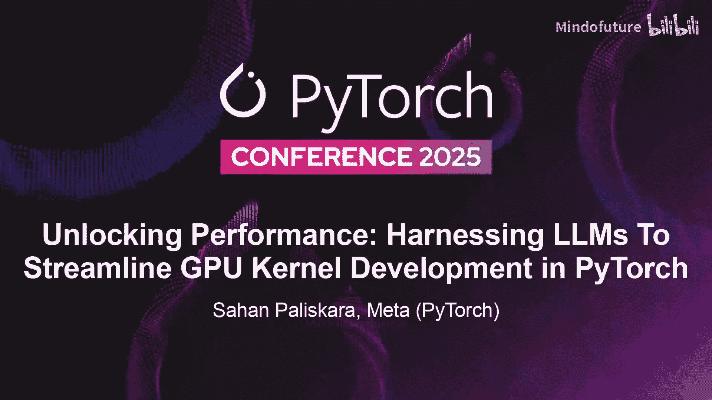
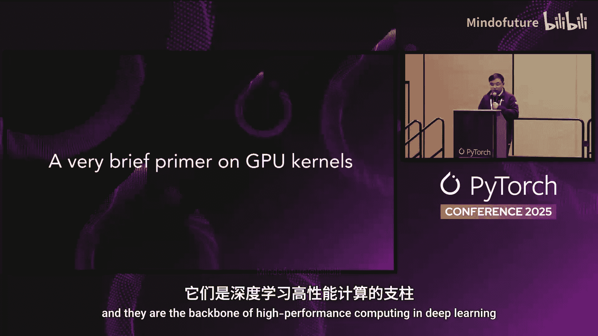
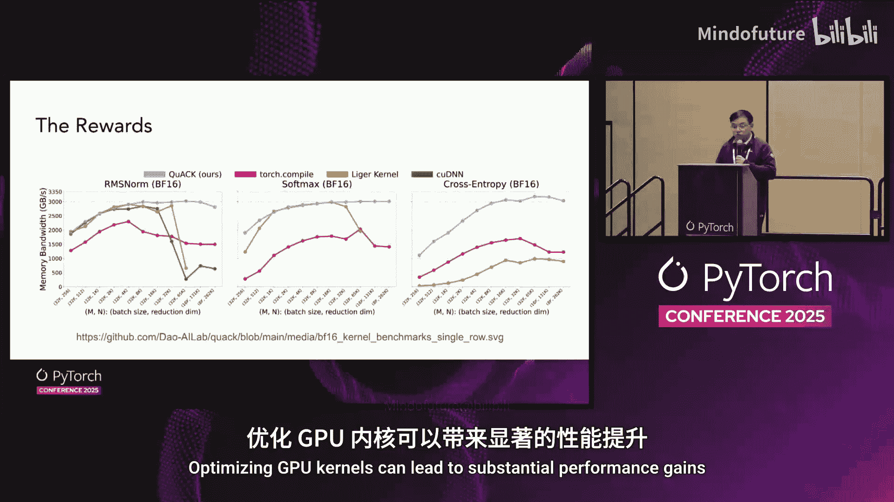
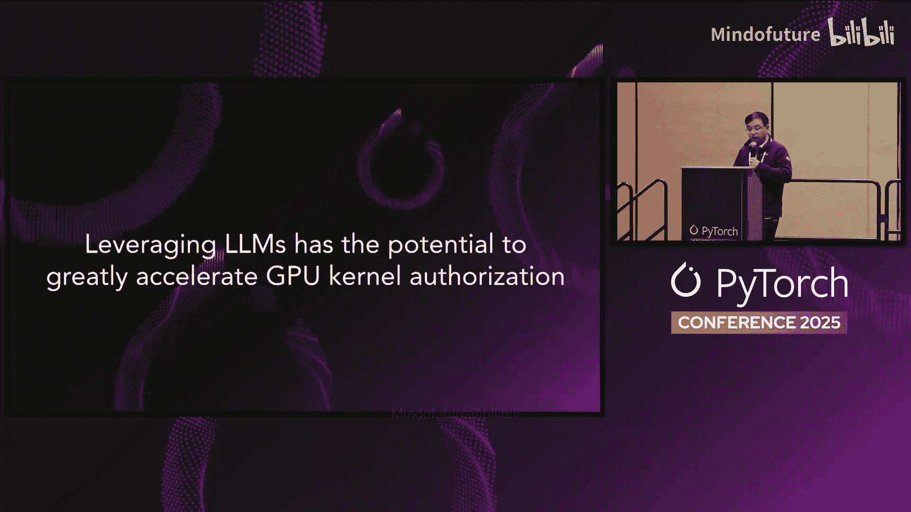
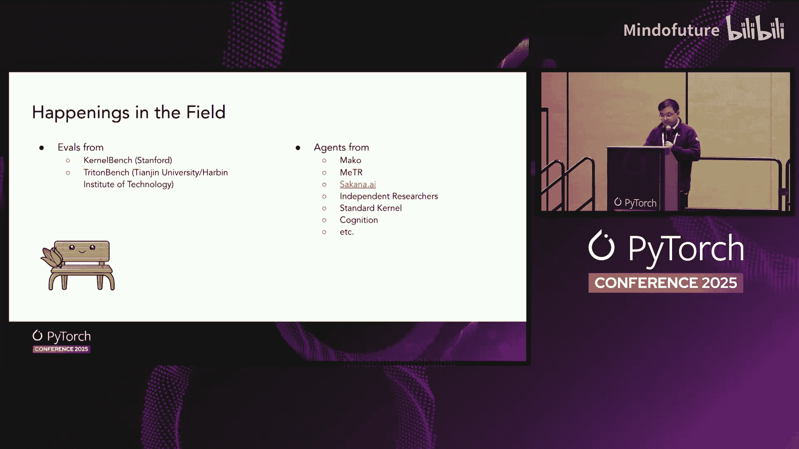
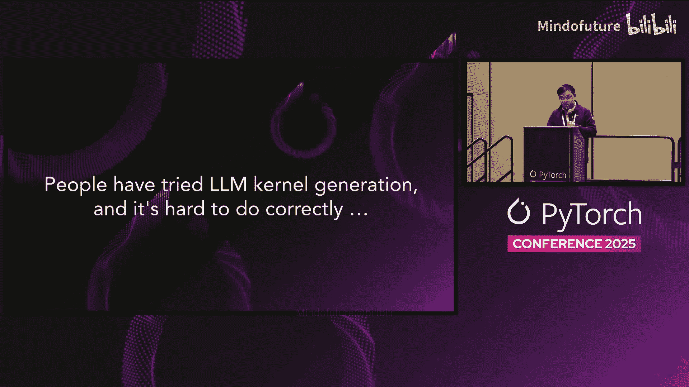
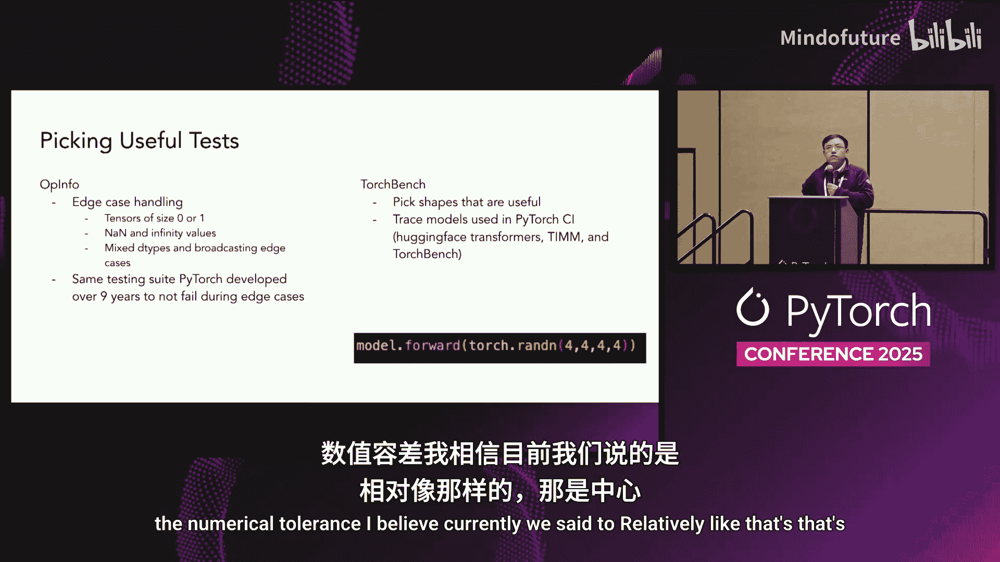

# 2025 Pytorch大会 ｜ Pytorch Conference 2025 p28 P28_释放性能——利用LLM简化GPU内核开发...-Jiannan_Wang -BV1b8kRB6EJG_p28-

Good afternoon， everyone。 My name is Jian Nan Wang。

 and I'm a research scientist on the Pe team at Meta。 Today。

 I'm excited to talk about how we can unlock new levels of performance in Pytorch by leveraging large young models to streamline GPU kernel development。

😊。

Let me start with a very brief primer on GPU kernels。

 GPU kernels are essentially small programs that run on the GP and they are the backbone of high performance computing in deep learning。

 They are responsible for executing the core mathematical operation that power the neural networks。

There are several approaches to GPU kernel development with a natural tradeoff between efficiency and development efforts。

 For example， Kuda gives you fine grain control over memory utilization and hardware hierarchies。

 This means you can squeeze out the highest possible efficiency， but it comes at a cost。

 You often need to tune each operator and sometimes each input tape shape by hand。

 this process can be time consuming and the resulting code is often not portable across different hardware。

😊，On the other end， Torch compile allow for very fast research iteration。

 You can quickly prototype new ideas， and compiler takes care of parallelism and scheduling for you。

😊，The trade off here is that you have less ability to fine twin performance。

 Theres smaller room to improve if you need to optimize for a specific use case。

 Sitting between these are DSLs like Triton and Cu。

 They offer a balance between productivity and performance。

 giving you more control than high level abstractions， but with less complexity than raw codea。

 Each of these DSLs strikes at different balance so you can choose the right tool for your need。

Here's a more concrete example Torch Comp does most optimization for you under the hood it provides high research iteration speed with a relatively low optimization potential Triton gives you users control over the memory layout on GPU through tiling allowing to optimize for specific workloads and hardware Q DSL lets you experience control over threads wars。

 memory hierarchy and epi providing a high optimization potential In summary as you move from Torch compile to Triton to QDSL you gain more control and optimization potential but you also take on more complexity and development work。

😊，Optimizing GPU kernels can lead to substantial performance gainss， for example。

 quack shows how different kernel development approaches impact speed by understanding and exploiting the thread and memory hierarchies of modern accelerators。

 the kernel performance can get close to speed of light。

Given that writing highly optimized GPU kernels offers tremendous performance potential。

 but is also slow and labor intensive。

We asked the following question。Can we leverage large models to automate and accelerate the kernel authoring process？

The idea is to use L Ms to generate GP kernels that are correct and both optimize for modern hardware。

There's a lot of exciting activities happening in the field right now。

 both in Arcademia and industry On the evaluation side。

 we have benchmarks like Colonel Bennch from Stanford and Tment from Cheianjin University and Harbin Institute of Technology。

😊，These benchmarks provide standardized way to measure the correctness and performance of LM generated GPU kernels。

On the agent side， here are a number of research groups and independent contributors building LM powered agents for kernel generation and optimization。

 include Mac， meter。Saana， independent researchers， standard kernel， cognition and many others。

One of the most important lessons we've learned is that benchmarking is the key to empowering LM driven kernel3 benchmarkchmarks provide us with objective。

 standardized measures of both correctness and performance Without them it's nearly impossible to know if an LM generated kernel is actually working as intended。

 or if it's truly delivering the speed up we are aiming for。Yeah。

While there's a lot of effort to use LMs for GPU kernel generation。

 the reality is that doing this correctly is extremely hard。😊。

One common pitfall is forgetting to clear the GPU cache before running your benchmarks。

 If you skip that step， you might end up measuring only the kernel launch overhead rather than the actual runtime performance of your code。

This can lead to misleading results where a kernel appears to be fast。

 simply because the cache was already primed or because the measurement didn't include the full execution pass。

One important takeaway from our experience is that the claims of 10 times speed up from AI generated kernels often signal that something is off in the comparison。

 In many cases， this dramatic speed ups happen because the baseline is not a fair one。 For example。

 you might be comparing a highly optimized kernel against a complete completely unopimized or naive implementation。

 or as we discussed earlier。You might be measuring performance inly。The reality is。

 once you are comparing well optimized kernels on a level playing field。

 to 10 times speed up is extremely rare。😊，So whenever you see the huge speed up numbers。

 it's worth staying deep to understand what's really being compared。

To address these challenges and make the evaluation of AMM generated kernels more reliable。

 we developed back in the bench。😊，嗯。Backckend bench is our evaluation suite for testing how well both LMs and humans can write Py backend。

Here's what backend bench brings to the table。 We leverage pilots of info test suite for comprehensive each case correction testing。

😊，Instead of relying on artificial or toy examples。

 backend bench uses real tensorships from hugging face models。

You can pe install back and bench and use the generated kernels directly in real models。

 This makes it easy for researchers and engineers to try out new kernels and see how they perform in reality。

😊，Right now， backend benchch supports both Tri and Q DSL， and we are working to add even more。

 This flexibility lets you evaluate kernel written in different styles and languages all within the same framework。

😊，One of the core principles behind Beckhamman is our aggressive focus on correctness。

 We focus on Pyth operator set， which has stood the test for nearly 30 years。

 We put a lot of effort into engineering away most correctness issues right in the evaluation process。

We also make it a priority to audio results and present them in a way that makes debugging straightforward。

 And finally， we ensure that the solutions we evaluate are mergeable into Pytorch。

 This is important because if a kernel is good enough to be merged into Pytorch。

 we believe its a strong skill that admits the highest standard for correctness。😊。

I want to emphasize again that correctness in kernel generation is fundamentally hard。

 There are some of the reasons like there are operator variants。

 Each operator in like To a must handle multiple data types。

 and they must support broadcasting in place operators， pre allocate outputs and scaling factors。

The kernels also need to handle each cases， including N A N， infinity。

 zero size tensors and extreme cases。And the difference in hardware。

 like subtle floating point behaviors can vary across different GPUs。

 which must be handled by which brings challenge to the current o screen。

 And it's also important to test with tensor shapes from actual models。

 not just synthetic or toy sizes。Sometimes the kernel produce results that looks plausible。

 but are actually incorrect。 And there are other pet foot guns that can lead to misleading results。

When benchmarking GPU kernels， the foot guns can lead to misleading or inaccurate performance results。

 and here we are sharing some of the common feed gun foot guns first。

Sometimes people forgot to clear the cache or warm up when benchmarking performance。

 That leads to just measuring the launch overhead， not the actual computation time to avoid this pitifall。

 We recommend just use Triton testing to bench for performance benchmarking。😊。

Another foot in benchmark and testing GPU kernels is the use of input distribution that can unintentionally trivialize the testing。

If you benchmark a main kernel using a large vector sampled from a normal distribution with mean 0 and variance  one。

The average will almost always be 0。This opens the door for a super smart but actually incorrect kernel that simply return0 for any input。

 Such a kernel would pass the exertion test。 However。

 it would and it will also would be the fastest possible implementation because it skips all the computation。

 However， it is just wrong。To ensure our kernels are both correct and robust。

 it's crucial to test them with a diverse set of inputs。 We use op In。

 the same comprehensive test suite that petal has developed and refined over the past nine years。😊。

It catches each cases that can break custom kernels， but are handled correctly by patron。

Including terms of size 0，1， N A N and infinite values and mixed data data types and broadcasting each cases。

Most custom kernels will crash or behave incorrectly for those kernels in this situation。

 but Pythtorch standard operators will not， and this is the bar we set for merging new code into Pythtorch。

We also avoid testing shapes that are too small， since they most likely measure launch overhead rather than the actual kernel performance。

Instead， we focus on useful realistic shapes。 We trace the models used in P CI systems。

 like the hugging face models。😊，We record the tensorships from the real models and use them in our testing。

By combining Op info and tracing real models， we've built a diverse set of tests for our GPU kernels。

The last foot gun is that the LM sometimes cheat during kernel generation tasks by simply calling the original p operators instead of generating a new kernel implementation。

This fallback is difficult to detect because outputs appears correct。

 but the Ls are just not producing a new kernel。Our solution is to override the operator by itself。

 if the L tries to fall back to the original operator， it triggers an infinite recursion error。

And here is the structure we use to submit the kernels。

 We use a directly based structure for submitting IM generated kernels implementation。

M M researchers will drop kernel implementation into folders。

 Each file then gets loaded to override a torch operator。

 This is how the evil team of Beck and benchnch interact with metal researchers。😊。

And here are our results。So we have some correctness results by asking cloud n times with a simple agent retry loop with feedback with cloud。

 we can get about 53% of pet operators。😊，implementment in China。

Thanks to Shahein for making this happen。 and thanks to Shaheng for making it easy to use。

We also generated 84 kernel examples all available for you to review in our back wrap。

 What's really interesting is that some of these LM generated kernels are starting to show advanced behaviors like promoting calculation to F P 32。

 in the middle of a computation， which improves numerical accuracy。😊，When we benchmark these kernels。

 most of them perform at 70% to 100% of Pyth space and a few even outperformed Pyth up by up to 20%。

Thanks to Laura， for getting those more kernels with I M。😊。

We also performed an end to end convergence testing on nano GT。

 We use I M generated kernels for the forward pass on several important pet operators。

 But for the backward pass， we had to fall back to Py Eagle mode because the I M generated kernels are just not reliable enough yet。

😊，This demonstrates that LMs can successfully generate kernels for a diverse set of operator operations in real model。

While we see promising results in model convergence testing。

 the performance of these kernels is still not optimal。

There's a clear gap between what Ls can generate today and high and the highly tune human return kernels that we rely on for production workloads。

 There's still a long way to go。And in the end， I want to thank all the contributors to Beckend Bennch。

And thank you to Man Hos for helping the community to be more correct。 Thanks， Annie。

 Simonim and Alex for prompting us how to get LIM generated kernels into Hyytoch。😊。

We are looking for more contributors to support， to add support for more DSLs and add training and distribute operator support and to add more backend extension system。

Please reach out to us if you are interested on the Discord GP mode on the popcorn channel。

 and the QR code is linked to our backend Ben Github Ra。 Thank you very much。😊，是。Yes。啊。

Are basically a set up。Is this a suite of basically tensor shapes or like is this set of benchmarks。

 a specific set of operators？And that's what you evaluate or is it any operator where you generate the most useful set of tensor shapes for an operator。

That's a good question。 So currently， we focus on the Py core operators。

 but we will we plan to add support for example operator fusions。

 The reason we focus on the Py A the core operators is because we believe those operators have been tested for many years。

 Those operators are like coming from nu。 and that's already a very old like project。

 we believe that instead of re reinvent those operators， we can just start from that。

 And that's the operators set we choose for this project。But we are going to add， for example。

 operator fusion in the future。Thank you。Yes。Hi， could you please tell me a little bit about your floating point testing regime in particular testing for NNs and things like that。

 how do you make sure that NNs and other exceptional values are caught properly in the generated test？

Alright， for that， because we are using the op In that so that that's the one reason we we use the op In Op In。

 So it's Py testing with that you used by Py to develop the test for the operators and we reuse that part for to generate input for the operators。

 and and that's one source of our like input generation， the other source of our generation is the。😊。

Sorry， where is it。Another source of our generation is that we traced the real shape from。

From hanging face models so that we use the。Input shapes from the real hanging face models。

 So so that our test will be in a realistic situation。

 So that's the two principle we use to form our input shift taste test， thanks。

I have a few questions as well。 during the performance evaluation。

 do you also account for GPU throttling and effects like that。Oh sorryrry。

 I didn't quite get you a question。 during the performance evaluation。

 do you also account for GPU thling。Like that GPU drops frequency if you benchmark to match stuff like that。

嗯。I， I， sorry， I didn't quite get your question， but currently we are testing operator by operator。

 so。they also evaluate performance， right， You take a look how long a kernelel took to run。 Oh。

 you mean， you mean our kernel agent。sorry what， yep， okay。嗯。嗯。はいですょっかの。

In the cases where the kernels generated were faster than the Pythor chops。

What exactly was the LLM doing that was making it better like what did it find that the handwritten kernels didn't have？

啊。So嗯。Yet。That that's a。Good question。 So I I。哦，OK。嗯。Sorry that I。

 I cannot give you an answer right now。 but if you are interested， we have。

 we have provided the link to the kernels inside。 And if you are interested， I can like talk I can。

 I can review those kernels and like， talk to you later。Thank you。I you。万桂什。

what kind of relative tolerance and etolola are we having for the kernels that we are testing？

The tolerance that we have， how much numerical difference to we allowed？can you hear me sorry， sorry。

 I can hear you， butum I I do not quite get your question are you asking the problem with you with those operators？

The numerical difference， so how much tolerance do we have so is it yeah the numer tolerance。

 I believe currently we sell to relatively like like that's that's the standard we use in Pyth horses。

