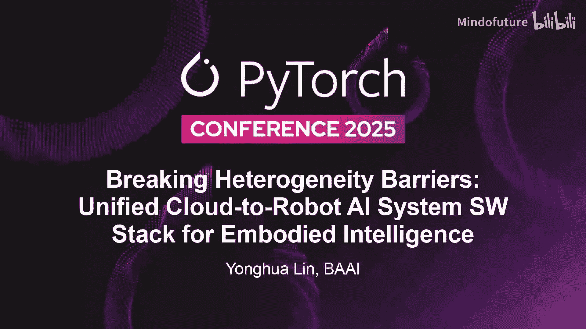
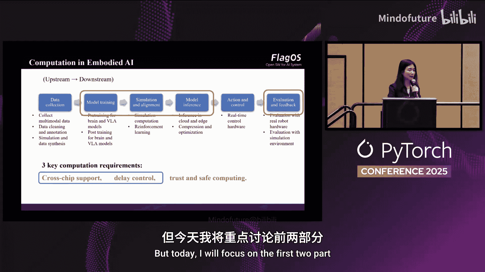
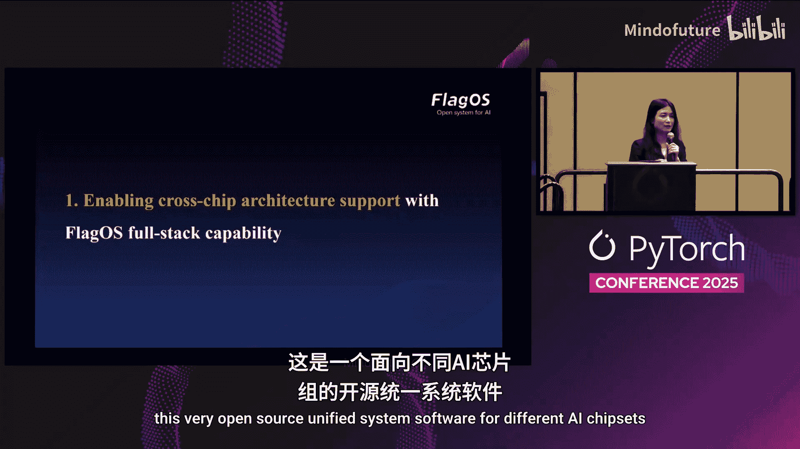
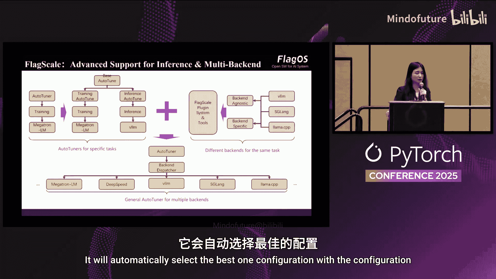
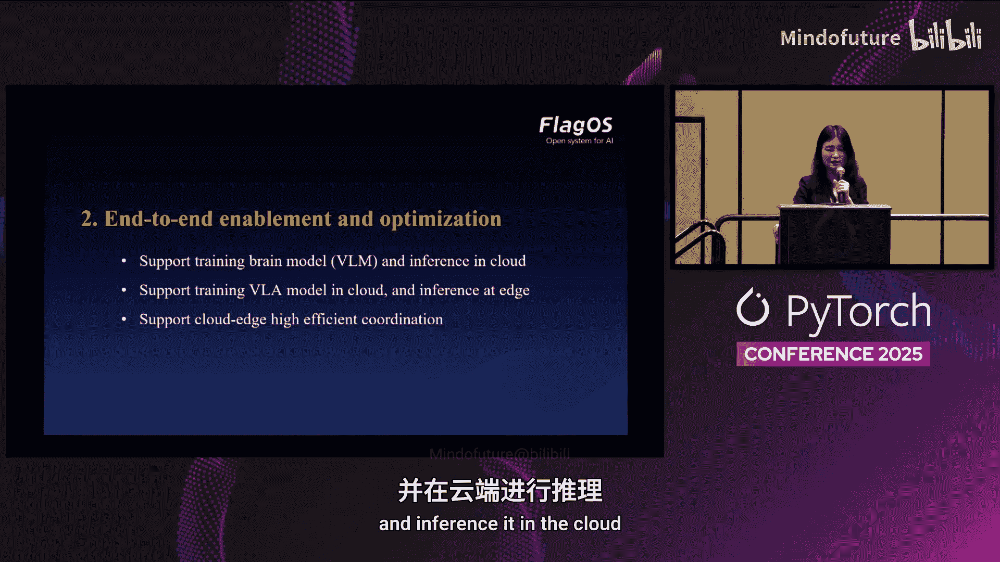
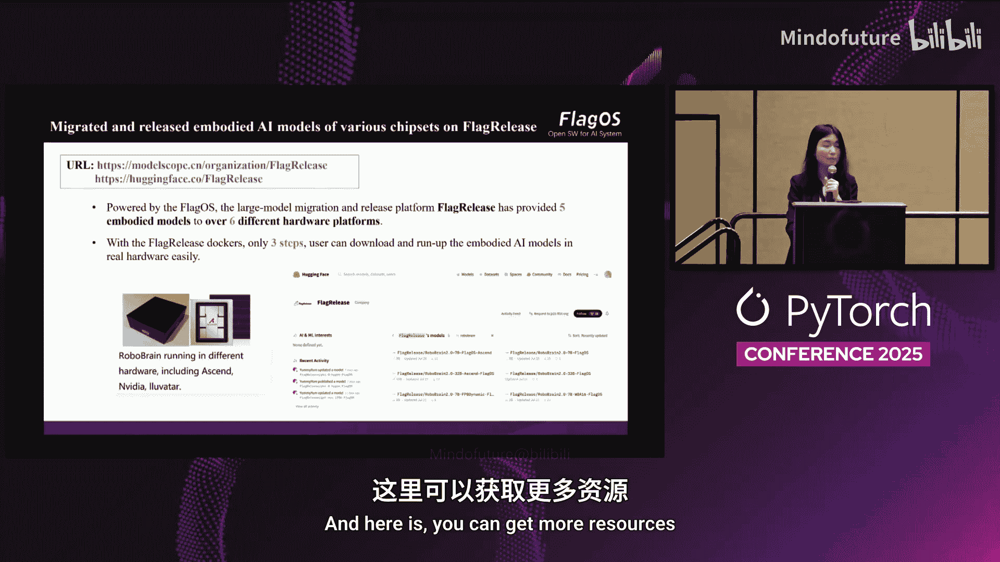
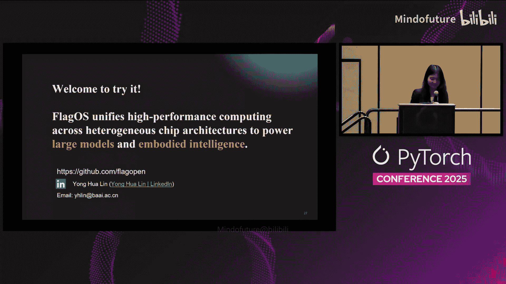

# 2025 Pytorch大会 ｜ Pytorch Conference 2025 p29 P29_突破异构壁垒——面向...的统一云到机器人AI系统软件栈_-Yonghua_Lin -BV1b8kRB6EJG_p29-

Okay， thanks for attending this session。 and I hope you can enjoy the rest of the 30 minutes for this very important topic is around the I think after the large models。

 embody AI will become the very important trend to drive all the system infrastructure requirement。

 especially the system software requirement。 So in this talk， you you will hear the embody AI。

 how we enable that on top of the and also very very important is how we how we handle the issue when we need to cross different hardware architecture。

 different AI chipet architecture。 Okay I came from B AI Beijing Academy of artificial intelligence。

 It is the neutral nonprofit research int have a six or  seven years research cover the large model trend and now have a lot of large model efforts going into。

😊，To the embo AI。 So here when we talk about the embodi AI， actually for the robot end to end。

 usually current stage， we still will break it into two two models。 One is like the human brain。

 usually our human brain， it will responsible for the thinking language learning。

 reasoning those kind of high level things。 and we also have the human surveillance。

 that is the for the action control， that is for the human action control coordination for different part of our body。

 So similar for the human， for the embody the AI， the robot， current stage。

 we also have the the brain model， it will responsible to understand the physical world to to interact with the human intention to do the influence and to do the planning。

 For example， if we give it a complex task， to clean up this room， that it is the human robot。 the。

 the robot model to do this high level the decision。

 to do the high level the planning and divide this planning into the short task。

And the robot civilian model， usually it is the V L A model。

 V L A model means the vision language action model。

 It will get the high level task and break it into the short， short instruction。

 and then the output the action， okay。😊，And usually at the current stage。

 the robot bring it is the V L M model， visual language， this multimod model。

 and it can be deployed in the cloud。 And for the V L A that cereb civilian model and usually we want to deploy in the edge together with the hardware of the robot。

 And for this model again， we will have the data processing， training and evaluation。

 So very similar to our large model part。😊，Okay， and in the past more than two years， actually。

 our lab， we have the very deep research in this area。 and this year we release the two model。

 when is the V L model。 that is the brain model， it has been released in the twice the2 do0 version now。

 and the other one V L A model， it is the robot brain X0 and we just released it last month。 Okay。

 so since we got a lot of experience for this two model we training from the scratch to do the post training for this two models and also the deployment influence for this two model。

 So。😊，Today， the rest of the call， this talk is based on these two models experienced and based on our system software view。

😊，Okay， usually let's see how is the brain model and VA model today Again。

 the brain model will the input usually is the human language instruction and also the structure the scenario data and also it we will input it with the image of video those kind of visual part and and do the encoder for that and the output of the this model usually it is to do the reasoning output planning for task is again the the text output。

😊，On the other part， it is the V L A model。 That's a smaller model， usually smaller model。

 and usually the structure is the V L M plus the action expert。 Okay。

 and input for this model actually is the multimod input。

 It will include the instruction input video input and also the state input from the hardware the state input from hardware like the the joints and and effect for the hardware or on the robot and。

😊，And those are is the very structured the input data and the output， it will be the action。

 The action， usually it is the absolute state or the movement of the joints of the hardware and and effect at different the time slot。

 okay。😊，And the current stage， V L M model， like， for example。

 the robot bring20 belong to the V L M model。 and the V L A model put onto the robot。

 It is like the pi 0 or or or G 3 that's from by dance and B A A I will also just release the X 0 model that is belong to the V L A model。

 Okay， so these are two different model。And if we look at the whole embody AI from the upstream to the downstream。

 we can see that a lot of different step or include a lot of computation requirement。

 staff from the data collection after the data collection， we need to do a lot of data filtering。

 data and notation and we also will do a lot of simulation。

 right this morning videos leader introduce the simulation work omniverse。

 those kind of things So all related to the to the compute。😊，And model training， of course。

 it include the brain model and VL A model， this two model。

Pre training and post training for this two model。 And after the training with this two generic model。

 then we usually will do the simulation and alignments。 The alignments， for example。

 we will do the reinforcement learning。And after those kinds of post training。

 no matter the reinforcement or S F T， then we can deploy the model inference and this deployment can be on the call or on the edge。

 And we also will have the action control。 That's very low level action control。

 near the the real time control on the hardware。 And the final step usually we need to do the evaluation。

 and this real evaluation usually we wanted to be evaluate with the real hardware， okay。😊。

And here since we talk about the models and among these different stage。

 especially for the model training， reinforcement alignment model inference and evaluation on the real hardware。

 we also need to do the inference， right， So all this will relate very。

 very related to the computation with the Py And here I summarize the this computation with very important three key requirement。

 The first one is it will very meet the cross chip support。

 That means that no matter the training or inference。 very happen。

 we need to do the training on one kind of chipet。 then the influence it deployed on the other chipet。

 So that's called the cross chip support。 The second thing is we need to do the delayed control。

 and the last one is trust and safe computing very important since the robot。

 it will very close to our real life， very close to the it will。😊。

Happen all the action in the physical world。 So how to ensure the trust and safe computing to ensure the environment will be safe。

 That's very important。 But today， I will focus on the first two part。😊。

First is the how to enable the cross cheap architecture support。

And that's the very key part is culture support today in our solution is based on the Fl OX。

 this very open source unified system software for different AI chipet。😊。

And and first， I want to share why we see that em body AI today。

 we will need more support for the cross chip architecture。

 because we see that in the close to the edge side。

 we can see there will be more diversity for the chipet architecture。😊，So。Today。

 we will see that a lot of current robot， the hardware， it will run with the media or。

 and we also will already see that those that other chip provider who has already the influence chip sets in the data center side。

 Now they are preparing the downsizing chipet solution and they want to put their chipet in the robots as well。

 So we we can foresee that there will be more and more hardware options on the edge for the robot。😊。

And the second one is very happen we will we will train the model on the cloud with the AMD or with Huawei's chipet or with other chipet。

 but deploy at the edge on a media chipset So this very happen I already can see a lot of different examples and competition have this kinds of scenario。

 So how can we do that right cross chain on one kinds of chipset but deploy on the other chipet。😊。

And the other thing is。Still， so today， we have a lot of already have a lot of。

Different kinds of AI chipet in in industry， but still have huge gap between the human brain and AI chips。

 If you take this view， human brain， no matter the human the brain computation memory。

 we actually have a much larger volume， than that on the single chipet。

 So if we really want to put this high intelligent in the single chipet put into the robot。 today。

 compare with the human brain， we actually human brain。

 we can use much less power and much less data to achieve high intelligent level。

 So that means that we still need the innovation and breakthrough in hardware， okay。

But what is her death barrier？Today's barrier is we currently different AI chipet have their own different hardware architecture。

 different instruction， different compiler and even different version of operator libraries。

 So it make the this our user very difficult to migrate their code from one chipet to the other chipet。

😊，So the problem is very fragmented software ecosystem。So here is flag O。

 flag O is co developed by the including the BAI team。

 co developed by close to 20 teams from global and it already become the widest range support for AI chipet in the world and actually it currently will support the Pych and cover the support on different AI chipet。

 including it support media AMD NP from Huawei GP GPPU discount of very GPU like chipset and those special design hardware and it also can support the risk5 AI chipet and R NP okay and it include very key part include the four very important open source libraries。

 AI operator libraries flag jams unified AI compiler framework flag scale。

And unified communication libraries。 Okay， it support already support different kinds of large model。

 I M， multimod model and the embody AI we talk today。 And it are also the can support the。😊。

The environment run in data center and the edge。So based on this， actually。

 that's how we can do the cross platform support for the embo AI。 and a little a little bit detail。

 The first is since our embody AI， no matter the V L M model or V L A model。

 it will need a lot of operator kernels to support our algorithm。

 So the first thing is the fresh jams in O S that is already become the largest Triton operator library。

 we already have more than 200 operators support a lot of different models。

 and it has been included in Py ecosystem project。😊，And it written in language。 Okay。

 and with this operator library， we also compare the performance with that on media。

 and we found that you already most of the operators written in in this library already can beat the performance of kuda on the same media。

 However， So we first thing is we need to in we need to prepare enough operator kernels and also in the good performance。

 Okay， and here we list those models we supported。 And you can see that I highlight in the green color are those model either is the VL M model or the em body AI robot model。

😊，The second thing very important to support this cross platform。 It is the AI compiler。

 And this morning just now， you might heard about the the Pych compiler team to talk about the compiler how important of compiler in Pych。

And yes， for the Triton， since we use the Triton language。

 which is very open source language to to implement the operators。

 And we also developed enhanced compiler for Triton language。 We call it the flat sheet。

 it today already support a lot of different kinds of hardware AI chipset again， we support a media。

 MP from Huawei and also other chipset。😊，And the very important thing is we extend the language to support the hints to represent the hardware feature so that this。

 this compiler can get the even better performance than the original。

 and we also did a lot of optimization in the run time。 So again， it can provide better performance。

 So here just the very important results is for the Q Q this model we100% replace the implementation with could replace the co implementation with this library。

😊，And we change the underlying compiler into the flat tree and get a very good performance。 Okay。

 very， already very close to the the the best performance in ka。 So it give us the confidence。

 We have the post actually in the downstairs in the exhibition hall。 you can look at that okay。😊。

And the third is actually is the fresh scale。 It can It is the framework for the training and inference。

 Today， we have the quite different architecture of the models， language model。

 multimod model and this embo AI models。 We have different chip set。

 and we have different scale of the clusters。 So we cannot rely on the human experts to do the optimization for the training and inference。

 So that's why we develop the fully automatic strategy so that for any given the this new hardware and we can use fresh scale to deploy and automatically optimize the pair strategy and get the best performance here you can see that compare with the experts result。

 we already achieve the 10 to 20 percentage of the advantage compare with the experts。

 and we also use that for the embo AI。😊，And the other thing is today。

 you also might notice that we we today have the different framework。

 framework or acceleration framework for training and inference， especially for inference today。

 We have the V L M S G Lama CP P， actually， different influence engine will have different advantage。

😊，So for our user again， you will confuse that for a given model， which engine should I choose。

 V L M H G La or Lama CPP。 So Fs scale can support the different chipet and different this backend acceleration engine。

 It will automatically select the best one configuration with the configuration and give you the best performance for the inference。

😊。

And this is another very important one。Unified the communication library since the different chips that have different communication library。

 So we also developed the unified communication library。 Okay。

 based on the all this very core technology。With the flat O S。

 that's how we can do this migration without the human's effort to do the migration across the different chip site。

The second one is the end to end enablement for an optimization。 based on this flat O S。

 we can support the training training for the brain model V L M model and influence it in the cloud。

 we can train the V L A model in the cloud and deploy the influence at the edge and we also can support the cloud edge high efficient coordination。

 Okay， So first is the training the brain model V M in the cloud。 Actually。

 we can see a lot of challenge to do that high if we target for high efficient training。

 the challenge like in the data loading because the currently toch。😊。

Has a high CPU overhead。 if we just use this native the data loader priorization。

 if we just use the common tool like Lama factory， then the it cannot support the high performance training for the multimod model。

 and also the and the other one is memory bottleneck。 So actually with the flat O。

 especially our framework， the flash scale， we solve a lot of different kinds of issue。

 including the low data loader， the and then the the result here is with the flat scale compare with the default。

 the Lama factory。 we can get more than two times speed up for the training。

 So that's the first thing。 the second thing is influence of the this V L M model。 And。😊。

First deployment challenge is the very fragmented hardware ecosystem。 But again。

 since we have the flat O S。 So that's not the problem for us。

 we can deploy the model train in chips cluster a and deploy in another type of hardware。

 And the other thing is multi multi backend selection V or La CP。

 I just now mentioned already mentioned that。 And also the performance optimization。 So here by。😊。

include all the different stuff from supported by the flat O S。

 including the auto tuning backhand and multi chip support。

 And also we will do the hybrid quantization。 you will see that with the， for example。

 the normal the GP 40，9，0。 this very deploy very close to the edge side。

 We can see theres the performance speed up。Okay， and for the V L A model。

 since this is the em V model， the challenge is if you have two stage。

1 is the pre traininging and the other one is fine tuning。 So when we want to train the V L A model。

 But the traininging is usually is the web data set and the fine tuning usually we will have the robot。

 the multimod data set。 these two kinds of data is quite different。

 The web data set actually is normal， the multimod。

 the pair of the video and caption pair of the images and caption usually is this kinds of data。

 but for the robotic data。 it will include the instruction in text。

 it will include the usually three image or three video from different cameras and also it will include the structure data the data of the degree of。

Fe different hardware location， S Y， C location， that kinds of information。

So that's the the training the pretraining and finding these two stage data are different and the training is also different。

 Pretraining， it will need to change on the whole all parametermeter in this case。

 we we use the 3 billion size of the permeter backbone and for the post training usually we will freeze the VM side and we just will change on the action expert。

 It will be much smaller okay。😊，So again， we， we do a lot of different optimization。

 leverage the flat scale。 we can achieve the the， the multi stage data pipeline to handle the both the pre traininging and fine tuning for different kinds of data sets and have the computation reduction。

 those kinds of things。😊，For the inference on the embo AI V L M。

 we found that we cannot only rely on the how on the system levels optimization。

 we need to work very closely with the algorithm team to do the improvement of the how end to end performance and for example。

 we can see that from open V to pi0 or pi pi0 fast。

 there's a couple of different algorithm change and besides we also need to very carefully to do the quantization because the time I will skip this one。

 And we also will do the high efficient cooperation between call and edge model。

 So fresh scale also develop a different。😊，Support to cooperate the closeside and edge sign to support the slave and master this kind of cooperation。

And we also， through the robot scale registration， we also will reduce the the the。

 the tokens so that we， that's how we can shorten the latntency， okay。

And here we also show the framework the how we five stepped very easily to run up these things and currently it support the different kinds of embody AI models。

 including pi0， robotic and robot robot brain different versions。😊。

And also country is all on site on the fresh scale。

 You can see that we already support different kinds of model。 but particular。

 I highlight that those is used in the robot。😊，And we also compare that with robot robot is a very famous framework in Hugen phase and how is that advantage advantage is support both the training influence multi chip support one stop docker image support okay and it support both the V IM V so all the requires for this latest model for the embody AI currently already be supported by the flat scale。

And here is， you can get more resources。 And here is the with this flash flag O S。

 we really can run all our demo and do the experiment and evaluation in our lab， okay。😊。

And this is the final final one is actually based on again， on one hand。

 we need to control the latency。 On the other hand。

 we need to better support the new coming hardware architecture。 So by using the flash scale。

 you can see that we can use our AI compiler to support the new if you have the new chipet。

 we can use our flag AI compiler to support that if you have the new operator for embody AI will use the flag jams。

 this library to support more and more operator from from embody AI and for the flash scale。

 we support both the influence and high efficient training for no matter the brain model or the V model and we have another important thing is release today they don't need to do the migration。

 if they already have the hardware。 they want to use some kinds of embody AI model。

 they just go to the flag。L on hackck F can directly download that。 Okay， and and I。

 I finish here and see any more question。😊，Okay。It kept please。How how， how large V L A model。 Okay。

 currently in our lab， we use the3 around the，3。3 billion that size of the model。

 And if you look at the current also have other lab。

 they also release some new open source model is around the 2 billion to 4 billion usually is this size。

 So that's why we think this size model is already good to fit into those edge AI chip set。

 But those AI chip sets need to be able to support around at least the 100 T ops。😊。

And with the around 20 to 30 the gig in memory。It's around 8 bit。 right。Any more questions。Sorry。

 Pra。哦。Tton language。 Okay， yeah， actually， F。 Yeah， this is the our AI compiler。

 we we it is the enhanced compiler compare with original compiler。 So if you have the language。

 You have the code written in China。 You can use the open As the original version of the compiler or you can use flat。

 So it's fully compatible。😊，But with the flag library compiler。

 we can allow you to support more backhand。 Yeah， because today's open Tri compiler。

 they mainly support media AM M D。 but for us， because we need to support more chipet。 So we。

 we use the flag。 we developed the flag for the ecosystem。Any more questions。Okay， if no the。

 we can have more discussion if you have， you have the interest。

 Just try on the the link and you can find the resource。 Thanks all。😊。

