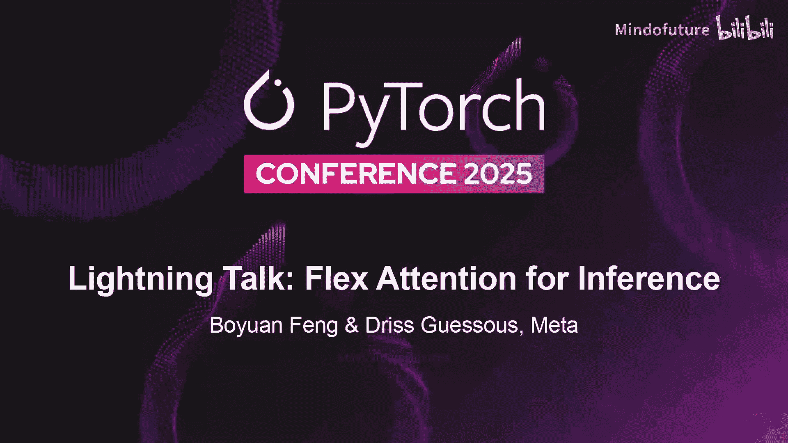
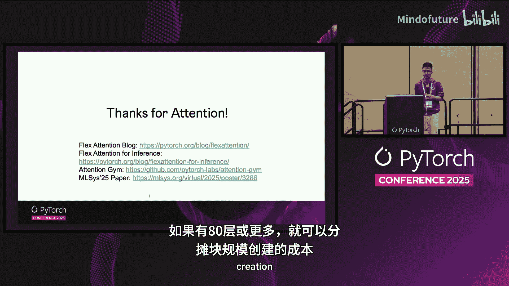

# 2025 Pytorch大会 ｜ Pytorch Conference 2025 p30 P30_闪电演讲-推理版Flex_Attention-Boyuan_Feng__Driss_Guessous__Meta -BV1b8kRB6EJG_p30-

Hi， everyone。 I'm Bo。 Today， I will talk about flex attention for inference。

 This is a joint work from Joy。 Joy is sitting here。 and I'm Bo and Jay is sitting here。

 and we also have Yvo H， who is now here today。 yes。

 so we all know the paper attention is all you need， right？

 This becomes even more true over the recent years。😊。

And flash attention is the most important optimization for attention。 It makes it much faster。

 and many people use it， right。😊，And because attention is very important。

 So we have many different attention variant， like the you know， relative position。

 document attention， sliding window， etc。It's very hard to write a kernelel for every attention variant。

 right， It's very hard to hunting all the variants。That's why we want flex attention。

So for attention， we have the Q KV。 Then we have this computation。

 Q K transport get the score matrix and soft Max， right， So， so this is the attention。

 And for the flex attention， we allow a score mode on the score mode on this score matrix to so you can modify it in whatever way and I mean。

 most of the attention variance can be simply expressed in this score mode。😊。

So this flex attention is basically have a score modification。

 It modifies the score for every indices。 Also， it has a mask modification that skips computation for certain inices。

😊，It supports forward backward means you can use it for training， right。

 we have talked about it last year in last year， PT T C 2024， and I。

 I want to talk about something new we have done over the past year for inference。😊。

Why inference is different because there is a unique attention pattern for inference。

 like the query sentence is usually very short。 like one token attends to a super super long K value cache。

 right， the context lens could be super long because the query sequence lens is short。

 it's hard to use the parallel on this dimension， right。

 But we still want the parallel to make it faster。 That's why we have the split K optimization。

 from the flash decoding。 this is work from tried。 So basically we split on the K lens dimension like split into this five splits and we compute some output for every partition every split。

😊，And then there is a reduction step to get the final output， right。Similarly。

 we have the flex decoding using a using also the with the split key optimization。

 make it very fast for the inference setting， but we still allow the flexibility from flex attention。

 like we can still allow apply is score mode here and compute the result for every split。😊。

And finally， reduce it。Okay， this is a flex decoding。

 So flex decoding shares the same API as flex attention。

 We can automatically switch to flex decoding if it's profitable。 like the cur lens is very short。😊。

A little bit on the kernel benchmark here。 we compare with the flash decoding and also the Pat S DPA is actually on par with the F the flash decoding and it's much faster than the S DPA for this inference setting。

😊，Also， we have some model level benchmark on the GT fast。

 We can see some decent amount of speed up over the SDPA。😊，Okay。

 so now we know that flex attention works for inference and for inference。

 people usually want page attention， right， So code flex attention works with page attention。

 or do we need a new kernel。 actually， actually we can。

 So before I talk about how flex attention works with page attention。

 I want to give a little bit background on the page attention。 So， you know， for， for attention。

 we have the K cache， right， We call it， let's say here， We call it a logical K cache。

 which is a number of requests times the maximum number of token。😊，Actually。

 we see some wasted memory here， which is very bad。😊，That's why for the page attention。

 we have a one array of the physical K cache， right， so we don't have this wasted memory。

 and we can support much larger batch size。😊，And in order to map this logical K cache to the physical K cache。

 we have the page table to say， oh， let's say for the request。 A。

 the first chunk is mapped to the fourth chunk in the physical K cache， etc cetera。 that。

 that's the page table。So。How could， how could flex attention works with page attention， right？

 do we need a new kernel or is there any other way。Actually， we don't need a new kernel。

 We can just do some like a block mass conversion to make it work。😊。

let's say for this logical KV cache， we have the block mask to say， oh， you know， like for。

 for for for， for each query， what should be the K KV block we should compute， right。😊。

And we just need to map to something similar for the physical K cache saying， oh。

 for this cur cur token， what should be the K index in this physical KV cache instead of the logical KV cache。

Yeah， that's why we have this block mass conversion。 I give a very simple example here。

 Let's say for this request。 A， we have let's say for this cur token。 We want to attend to the。

KV block 1，2，4， right？ That's why we have this K index for request a 1，2，4。

 And because we have the pitch table， we can map it converted to the converted K index。

 which is a KV index for the physical K cache， right。

 We we we provide a utility function called convert logical block mask to do that。😊。

And once we have that， we also need to convert the mass mode a little bit。

 So people write mass mode on the logical K cache saying， oh。

 which logical KV cache index we can escape。 So we， we。

 we just need to convert this mass mode in logical mass mode into some physical physical index mass mode。

😊，Like here， again， I have one example here。 So we say， oh， we take this。Mask mode， and we。

 we generate new mask mode。 It takes a batch index head index Q index and physical KV index， right。

 based on this physical QV index， we can do some index computation and map it back to the logical KV index。

 After that， we just call the original user defined mass mode on this logical KV index。😊。

And return this。 Okay， this converted block converted mass mode。Right。

 then it could just work auto box。 Similarlyly， we have the score mode conversion。Yeah。

 so T LDR is flex attention can work with page attention without a new kernel。

And above the performance， we compare the flex attention paged version versus non page version。

 Actually， the performance is on par with very minimal litency overhead。 At the same time。

 we can achieve much higher batch size。 We have an end to end example here in the attention jam。😊。

Yeah， so more adopt， more story on the adoption side。 this has enabled flex attention。

 page attention for the VM V one， which is great。😊，Some I S user Jonathan Chang。

 the he has he she has a flex nano where Im adoption use flex attention to build some small inference engine。

 Yeah， for the I I I。😊，And we， we also see more adoptions recently from different O S S user like Mac show build something for their training。

 and we have the。😊，Like Andrew Carr and For for the nano GPT training speed run。

For the hanging face and Jia Che and na。 So basically we have more and more adoption and some early feedback。

 So， yeah， so thanks for your attention。 We have a flex attention blog and flex attention for inference blog。

 We have more examples in the attention jam and M's 25 paper， yeah。😊，呃 that绍 for my talk。

Any question。okay， so currently we have a create block mass function。

 so you can use it to generate the block mass and it suggested to wrap it with total compile。

 this would make it much better right at the same time you are feel free to write your custom function to generate the block mass by yourself。

 Yeah， so because for theible block。 we cannot make any assumption right on the the block。

 We don't have the semantic knowledge like oh， this is a mass or world。

 So we have to generate you know kind of get the value for each for each index and get the final block。

 right that's the general way。 but you can write your custom to you know。

 make it more efficient for your very special mass use case。😊，Oh， at the same time。

 I want to say that。You know， for transformer， usually we have the same attention for many。

 many layers， right， So you only need to generate block mass ones for all the layers。

 Then you can reuse if it's 80 layers or something。

 you can amize the cost of the block mass creation。

