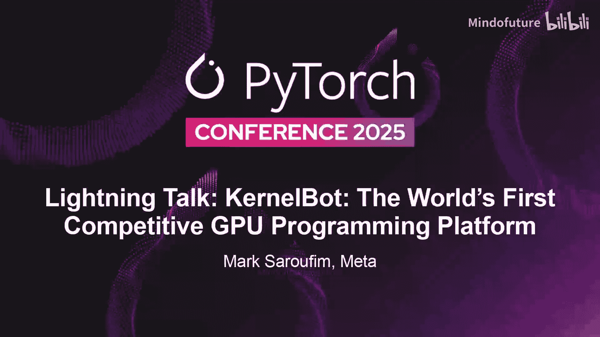
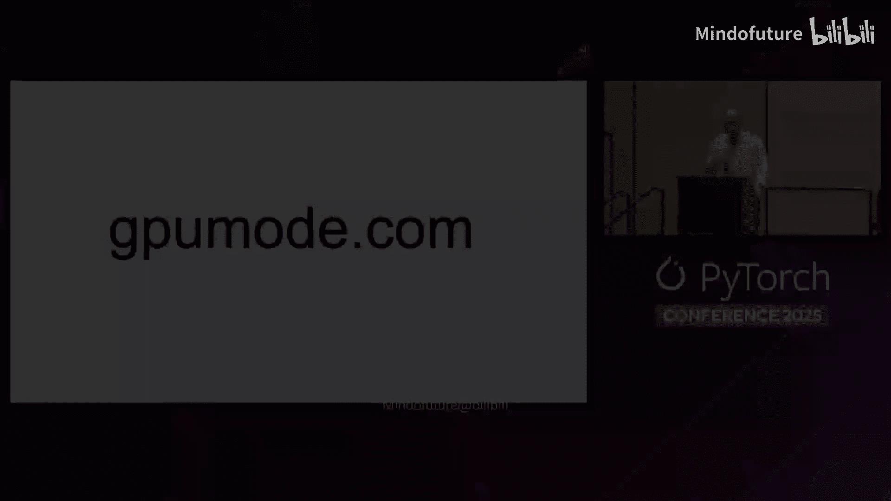

# 2025 Pytorch大会 ｜ Pytorch Conference 2025 p31 P31_闪电演讲-KernelBot——全球首个竞技式GPU编程平台-Mark_Saroufim -BV1b8kRB6EJG_p31-

Hey folks， this is like if you're around like for the earlier talk。

 this is like very much in the same theme I want to talk today about like Colonelbot which is a competitive platform for writing like fast GPU code and this was like a sort of very much like an open source collaboration that I worked on with like a whole bunch of people like was like Alex was in the room like Matt who's here I won't make you wave your hand again Eric like Elaine and myself so yes okay see they all wave Matt it's not a big deal you can wave。

All right， so the sort of like core motivation behind building a competitive GPU programming platform was that we noticed like there was hardly any interesting kernel data on GitHub。

The data that's interesting is either you know under a license where you can't train a model with it or if it it does have a permissive license。

 then it's like SloP and so we basically had been interested in like taking we had some early work for example。

 with this project called Colonnel LM。Or what we did was we used like compiler generated data to train an LLM。

 This works really well， but then the data looks like it was compiler generated。

 it doesn't look like a human actually wrote it， So again。

 how can we like flood the internet with like more high quality GPU kernels and get like LLMs to be like a bit better at solving this problem。

All right。So basically here like the sort of benefit we had with GPU mode is like GPU mode is a fairly active discord community with like over 20。

000 people at this point people nerd out on all sorts of topics related to GPU programming from like weekly lectures like working groups and so what we wanted to do is like we wanted to convince like more of these smart people on the server to donate to us like data for free and the way the right way to do this is like we give them like money with price bulls and they give us their expertise back so it's a nice it's a nice and even exchange。

So the problem now is like， okay， well you know we have 20，000 people， how do we give them all a GPU。

 It's very expensive， Even H 100s are cheap， they're at all or 90 an hour， but we can't give 20。

000 GPUs to people。So we wanted something that's like a timesha like basically we have like one pool of GPUs and then whenever you submit a job you get access to a GPU。

 you run your kernel and you get results back the problem with most traditional setups for this is that it takes a long time to queuee a job like on the order of 12 two minutes to three minutes for like most serverless startups and so our solution was like to have a workflow that takes closer to like 15 seconds or so where you don't even have access to the hardware but you submit like your code like in this case you would attach a file within Discord directly and you get like a result back like within 15 seconds so we want it to be like fast and interactive in the same way that like good video games are developed。

Right so like I said， we had this like existing community that we could use， it was like fun。

 like for instance there was like an earlier question from George on Thermal Thrrottling。

 well you know what one person figured out was they could like basically submit the kernel at the right time of day or depending on load and use that to get a slightly different kernel so this is great like we love the creativity。

😊，And yeah， and although like this code was quite nice in the beginning because we had this storage community like it is a bit clunky because every time you want to submit a new kernel。

 you have to attach another file and refill a bunch of like arguments like which leaderboard was this。

 which GPU was this and so this was like all quite clunky。

So what matete built is like something really neat。

 it's basically a CLI where you can just say like popcorn CLI submit with your file and then you can just submit a kernel。

 so at the top half of your monitor you'll have via code and the bottom half you'll have your terminal。

 you know we use rust that doesn't matter because I don't think rusts is the bottleneck here but like Rus is cool。

The main problem is like there's like less community interaction here。

 but it is eventually what like most of our advanced users ended up picking up。

We also have like a very nice website that like Elaine here in the audience like built for us so it's like very similar。

 you can come， you can see the leaderboard， you can see who's like a very top entry and similarly you can click on a specific problem and then like submit stuff like directly like within the website so this is like over the long term what we expect to be the primary experience people to have on the server。

😊，So all of these make it nice like people can just use whatever they want and we're quite fortunate that a lot of our smartest hackers would make write ups describing how good their solutions are so we have an architecture diagram but like you know doesn't it's bit boring let's skip it。

😊，Right， so the sort of quick things we learn here is that like designing hard interesting problems is tricky。

 like you want a problem that's interesting。😊，You have to pick like meaningful problems and shapes as well you can't like pick very small ones because then you just like measure overhead we also notice that like sometimes the data distribution could be gamed for example if you wanted to produce the world's fact fastest vector mean kernel and you're doing like random inputs with mean zero well the result is almost always zero and so that's the world's fastest vector mean kernel that's bad so we want like basically our problem distributions to avoid these kinds of problems so we have like a whole bunch of tests you know of course the tradeoff here is that this increases the time and it reflectss the interactability a bit。

The other thing was like security like we're basically distributing like very valuable assets to the rest of the world you know and people can submit Python files and like Python is an interesting language like for instance in Python you can within a Python file Pip and install stuff and it works you can start an SS server like you can start a server that also works so we have to do a lot of work to avoid hackey submissions like one source of hackey submissions is also people figuring out how to game our Eval Su but like this is the kind of thing where we like to see because we like patch the EvalL and for now most of our community has been very nice about like escalating like sort of these tricky issues to us。

All right， there were some issues though like for instance。

 one of the earliest design decisions I made turned out to be one of the most questionable ones which is that we use GiHub actions as a scheduling mechanism so basically hardware vendors will give us compute will hook it up as a Gitthub runner and then you can like basically we have the artifacts stored on the Github action and so this is like we're basically using it as a replacement for Kubernetes or SLRm you know it's okay like it works but you know it's not my proudest design choice。

😊，The other problem is that like most， okay， but the reason why we need to use this and we can't purely rely on serverless stuff is the vast majority of neoclouds。

Don't enable NCU access to them so you can't get access to like a real profiler， although you can。

 it's like a flag that's like this flag and you can enable it。

 it's not by default because allegedly Enviia's security model doesn't make this easy。

 but like I said I think this should be a default if any person here is that works at a Necloud and you'd like me to tweet about you。

 please enable NCU access and I'll give you a free advertisement and I mean。

All right the other thing was like this sc start time right I talked about how we wanted things to be interactive and just queuing a simple job on GitHub actions takes about like a minute and a half because you need to spin up a container。

 install Pytororch， install PyTch with Kuta， run the job this takes forever and you know our budget was closer to like 15 seconds。

 you know a lot of this is solved by using modal where we tend to see these likess sub 10 second times the other thing is like for people that are using native code。

Well， it turns out if you're using load in line and Pytorch。

 load in line by default will like read about 7，000 like C++ files before like it can actually like buy by a kernel。

 this is very bad and like you know the overhead here doesn't matter how fast your machine is like that has high overhead so we just don't do that and now the compile times go from  90 seconds to5 seconds。

The other thing we're quite excited about has been like leveraging NVRRTC a bit more。

 so VRRTC is like a very fast， slightly more restrictive library compiler that you can use。

 but it just like makes compile times here go to like 0。1 seconds and 0。

01 seconds and it's like absolutely fantastic and more people should know about and use NVRTC。

So yeah I mean how do we convince people to participate though well you know a big part of it is we want to partner with companies to optimize their problems so we've had two different100k kernel competitions that we've worked on with AMD so this range from like first like doing deepse inspired kernels to like now doing more like comps kernels and you know we're also really thrilled like we're going to be launching another competition with NVIDdia starting roughly this Friday I believe if everything goes well but that's going to be like more focused on like Ge and little bit kernels so if you're interested in technologies like Q DSL and Q tile and a lot of that fun stuff you should check that out as well。

All， so the main way we design a competition is that we assume basically a Pytoch reference。

 I guess then Pytoch determines like what is correct？😊。

We pick a bunch of relevant input put shapes by looking at real models。

We have some sort of ranking formula like， is it like the mean or the geo mean and which problems might have different scores。

 you know， you give some prize money and great。 And this is like much cheaper than hiring a grumpy ka hacker for a million dollars a year。

 So like I think more companies should do this。Right。

 so we've done like a bunch of smaller competitions， like for example。

 Alex who isn't here like designed this kind of nasty problem called trimol where you have like two mammals with an on nonlinearity and then another Mamal。

 a lot of compilers fall flat on their face here， but like with David Barhar who's like now unfortunately at Antropic。

 like also figured out like a very clever solution for this by like changing like memory layouts in a Triden curl。

So yeah， I mean， yeah， I guess I was trying to vague boost here， but like I said。

 we have another NVDdia competition coming soon， so I hope you'll enjoy that and I think we'll make it very interesting。

So yeah， I mean the outcome now is that like we have a community of people that are interested in GPU programming that want like Well scopepe problems。

 it went fairly viral at this point we've aggregated over like 60。

000 like high quality kernels from about like 600 users and by default we make it so that all the kernels that are submitted are open source so basically just by submitting it。

 you know it's not ours， it's yours， you can train a model。

 you can study the kernels you can do whatever you want like life is good。So yeah， I mean。

 if you're interested getting started as simple as this， you can install the popcorn CLI。😊。

With this like sorry for installing a shell command from the internet but this is what we do these days。

 and then you can register authenticate via either GiHub or Discord and then when you want to make a submission you just pick a problem。

 you pick a GPU and you know you should try it doing well on the grayscale problem that's like one of our most popular like beginner problems。

So yeah， if you're interested in learning more， just check out GPpUMo。

com you'll see all the instructions for it and I'd love to take questions， thank you。

I'm surprised Georgie doesn't have a hard question for me，Okay， you are solve， okay sorry。

Could you talk a bit more about the AMD like back in platform and like how did you manage that Because like for like Nvidia。

 there's modelal and you can probably do much faster like institution with that。

 but with AMD in my experience with the computer sometimes it took like5 to 10 minutes to just get a GPU So how did you manage that was there cluster that you got or something Yeah it's a great question you're right like so Moal doesn't support like AMD So the way we made this work is this is why like Github actions work we basically tell cloud vendors with bare metal access。

Please run the script， it'll connect the infrastructure to us。

And then we can basically cue GiHub action jobs to it and like things just work。

 it is a bit clunky because you have to maintain the machines， they might hang。

 some dependency might happen， but like barring a good serverless solution。

 I think we've settled on a fairly good design。嗯。Thats。Sort of sporadic。

or do you have like some clusters already like reserved yeah。

 so I'll repeat the question so the question is like basically well what's our collaboration like with Neclos do we rent it do they give us the compute yeah so generally like I would love it if we could just like host our own compute but like it's a bit tricky to host some of this bigger compute like in something like an apartment so you do actually need a professional to house it。

And so for neooclos I think for a lot of them they want to engage more with GPU hackers and so like as long as we give them like good enough publicity and as like they get like enough users to their platform。

 they effectively just like compas the compute and so for context like all of the hardware costs for GPU mode I've paid for out of pocket and it's cost me like around like $80 or so to manage like the entire service over the last year so I'm' pretty proud of that so and a lot of the work from people here as well。

