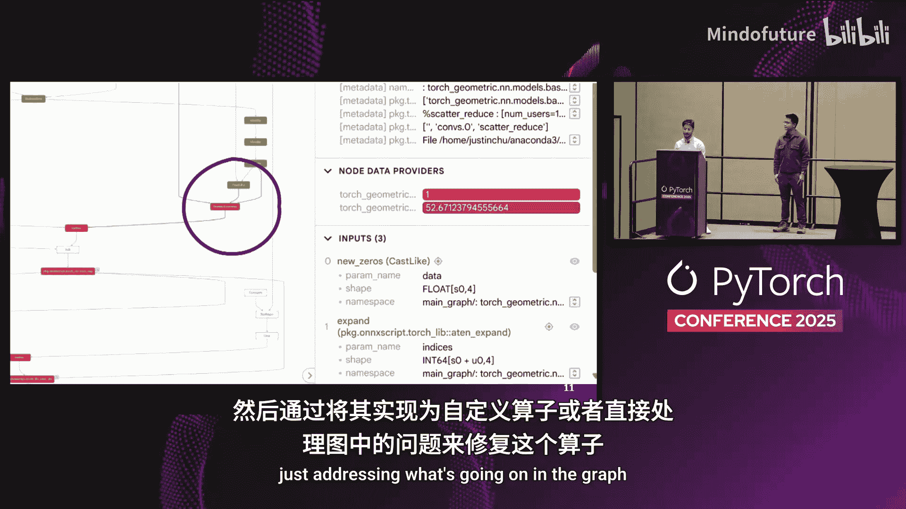
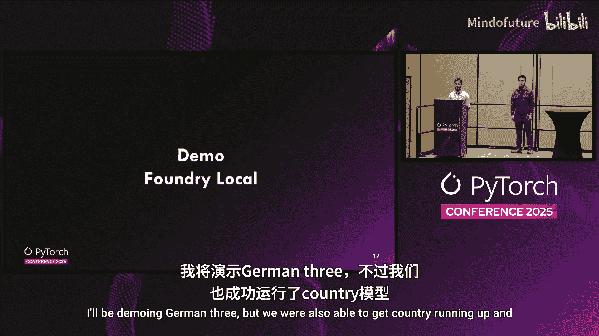
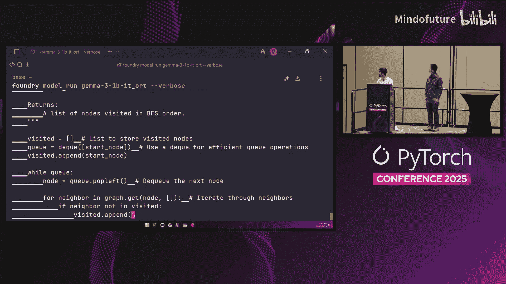
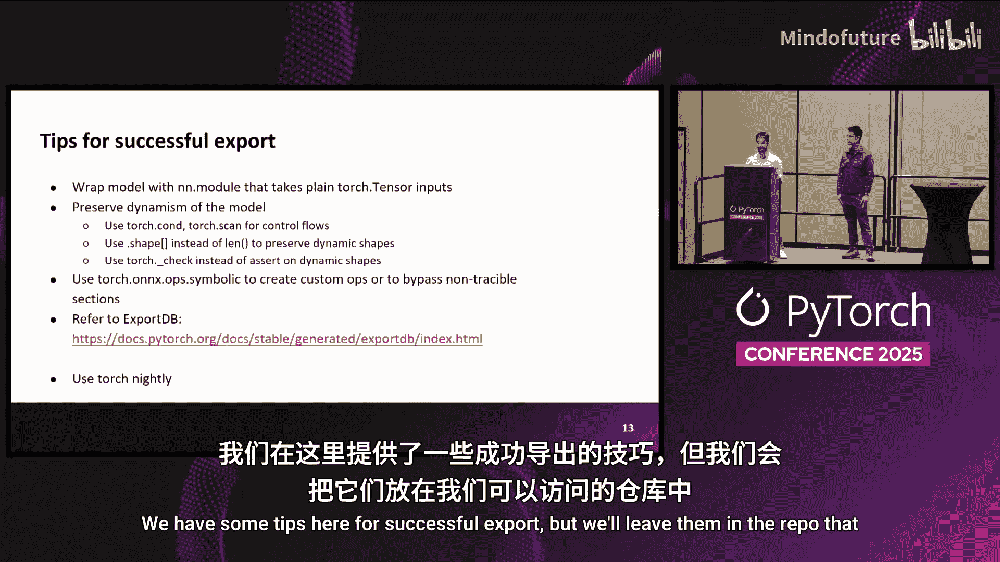

# 2025 Pytorch大会 ｜ Pytorch Conference 2025 p32 P32_闪电演讲-Torch.onnx新特性解读-Maanav_Dalal__Justin_Chu__Microsoft -BV1b8kRB6EJG_p32-

Hi everyone， please take a seat if you have not already， and thank you so much。

Okay， so hi， I'm on。 And with me， I have Justin。 And we're both engineer or like he's an engineer。

 I'm a PM on the Onyx team at Microsoft。 We're going to talk about what's new in towards to Onyx。

 We've given this talk like three years in a row because things keep changing。

 and that's so different today。 So let's jump into it。😊，So quick agenda。

 we're going to be talking about what Onyx and Torsha Onyx is。

 we'll do a quick what's new because there's so much to cover about what's new。

 and then we'll jump into examples and demos that are worked so that you can see how to use all these new features in your workflows we'll have time for tips at the end and maybe Q&A if we're lucky。

What's happened。Okay so if you don't know already， Onyx is a wonderful precious gemstone。

 but it is also the open neural network exchange and sp a little differently。

 it's an open standard for AI models and so it's open source and we have committee meetings every month or even more frequently actually and the idea is we take models that are ptorch models and productionize them for the purpose of running them on device recent efforts we've been really focused on GenAI as the space has exploded over the last couple years。

 especially the last two， so it's really important to us to make sure that we are supporting these LLM workflows as well as everything that comes alongside it to make sure that these models are running well fast and the way that you want them to in production environments and Tors to Onyx is a module within PTch that enables conversion from PiTch to Onyx to make sure that we can get these models production ready。

😊，So I'll hand it off to Justin now to talk a little bit about the features Thanks Manov。😊，To start。

 the Onyx exporter has a new architecture。 Its built on top of torch export and exported program。

 We leverage torch export and torch Fx to be the graph capturing mechanism。

 This replaces torch script to give us a clean， functionalized F X graph for conversion to Onyx。😊。

To ensure the translation is correct and efficient。

 we have also implemented a brand new conversion logic library using Onxcr。That we caught torch Li。

 which has full support for dynamic shapes and for the latest onyx offsets from 18 to 24。

Starting from Upet 23， we introduced attention， Roor embedding。

 and RMS normalization operators in Onyx。This will help you get a very clean and clean graphs when you export large language models。

The converted graph is represented as an onxIR model object。

Onyx IR is a library released earlier this year for inmemory representation phys。

 with this representation， you can create a path in Onx IR and further rank graph transformation on converted onyx model if you so desired。

How do I use the new exporter？To help you migrate， we kept the API largely the same。

 The option that tells the exporter to take the new path is called dynamo。

 We default it to true start starting from Pytorch 2。9。

 One thing that has changed is how you supply dynamic shapes。

 You can supply the dynamic shapes arc the same way with torch export。

 or you can still supply dynamic axes in the transition period。

 and we' do a best effort conversion for you in the API。 But that's not guarantee to be successful。

 So we suggest migrating to dynamic shapes when you can。😊，Yeah。With our migration to torch export。

 we gain the ability to work with code that is designed for Pytorch 2。😊。

One example is the ability to export control flows， whereas in the torch script era。

 you use a torchcht script decorator to capture a control flow expression。

 Ptorrch 2 introduce higher auto operators like torch K and torch while to represent conditionals。

 Torchcon for conditionals。Torch Onyx exporter has full support for that whenever there is a need for representing control flow logic that depends on the tensor data。

 you should use torchcon。 For example， when you have a model that takes different forward passes based on the input data。

 you should use torchcon to ensure both logic paths are captured。

Another feature we introduced to help you create clean onyx graphs is what we call native onyx operators。

 We implemented some onyx operators using Pytorch 810 ops。

 These native operators work and feel like any other  A10 operators。

 you can use them directly in your model forward function And because the torch onyx exporter understands these ops。

 They get mapped directly onto the corresponding single onyx op at conversion。

 here an example I'm using the onyx attention operator in my forward function。

 and I'm able to get the attention op in the graph on the right。

 This can save you the hassle for running fusion down the row because they're already fused We only implemented this for larger onyx ops like attention and rotary embedding and they're available to you in Pytorch 2。

9。😊，Now， you may be wondering what happens if I want to use a custom op that is not implemented already。

 that would be a great question。 we have made it easy for you。

You can first use the Is in Onyx exportport API to detect whether it's inside Onyx export。

Then use the Torch Onyx ops symbolic API to create any operator you want in the Onyx graph。

This helps you maintain an Onyx compatible model with logic that sits right next to your normal forward logic。

 and the section can also be interleaved with the normal A10 operators so you can create very modular and Onyx compatible code this way。

Yeah。Now let's talk about the return value of the Torchx export call。The Onyx program。First。

 the object shares tensors with existing pytorrch stay di。

 we optimize we store the return onx model inside onxia format in this object and in a very efficient way so that it shares all the tensors with the pytorrch model which makes it very memory efficient it's also optimized。

 we run pattern based fusion， constant propagation and all out optimize to give you a very clean and pre optimizetimd graph it can be run directly on torch tensors so you can verify the model with your existing torch eager module and beneath it。

 it runs onx run time on torch tensors so you can do validation very easily。

If you want to do photograph manipulation， you can do so with Onx IR by accessing the model with Onx program do model。

And when you're done， you can simply call on its program。 save。

 which will do efficient serialerilization。 It also takes care of the best practices like aligning tensor data so that they can be memory mapped when inferencing。

Now I'll hand it off to Manaf to talk it through the validation tools and give us a demo。

 thanks so much。 So we worked very hard to get this model working and you know exported。

 and that's wonderful。 And then the model didn't really go output that we were expecting。

 That's weird。 that's what validation tools are for。

 So Torch Onx verification can run on a model and then we can diagnose whether the model was accurately exported or not。

 So that is a great way to start， but we've also built a plugin that we use for model Exper that we have used to pinpoint numer discrepancies。

 So if anything happens， we can see that。 So in this case we can see that we have a different color than green。

 which obviously doesn't mean great and there's a discrepancy numerically so we know that this is kind of where in the graph we started to have problems and so we can look into that specific operator to figure out where the problem is and then move forward to fix that either by implementing it as a custom op or just addressing what's going on in the graph Co So after that we were able to successfully export a model。

 And we went ahead and did that。 thanks to Justin and we export。😊。

Couple models I'll be demoing Ge3， but we were also able to get Quen3 running up and easy and we'll do3 just because it's really small and easy to run。

 So I hope you can see this okay。 Yeah， so at Microsoft。

 we've been working on a consumer first solution to an ondevice inference and we've worked with lots of partners to get the best on-device inference experience So we've worked with M Intel Qcom and video to make sure that we're shipping models that are locally really really powerful so that you know when you're shipping to consumers on device you have options anyway that's besides the point we're going to export or demo this exported model using it So I have a prereles version foundry。

 but all of them were will run5ji model list and hopefully it'll spit up this large of models we have etc。

 but what we don't have right now quite yet is is orquin so we can look at this large cache that I have models set up for and we'll go ahead and run browser this terminal is great it's doing everything for me but yeah I'll go ahead and run Ge3 that just exported for me in a reverse。

😊。

And we'll load the model into memory one thing that I want to mention is this is not fully optimized we got it exported and did baseline work so we'll go ahead and ask some questions we'll have it write me a poem about pie torch and onyx I hope my spellings okay。

It's about poem wrong， but it seems to have understood great work， Gema。And。

It's called the neural streams。 Okay， we're gonna debate whether we like that or not。

 but it's gonna go ahead and do its thing。 And it's working very well on device。

 So we' using a flow 32 model， It's not quantized at all。 And this is also an 11th gen Intel CPU。

 So it's quite old。 but we can see that we're doing a great job and getting wonderful tokens per second。

 And as we scale up to GP and NP inference for also， we can get great results。

 But it's an example of taking an onx model that you know。

 we were able to take from a base Pytorch model， We exported it And as an note。

 we got a running model that we can productionize and you know， ship and apps if we want。

 I'm glad that it's doing a great job there。 We'll maybe do one more query。

 I'll go ahead and control C out。 And we'll have it。😊，Recurse。Recursive。B fs。And。

and we'll see how that goes and yes again it's just off to the races we have Jama Quin and like and the beauty of learning these ways of exporting that Justin talked about earlier is that we can take whatever model we want and hopefully get it exported so that we're good to run in any case。

😊，We have some text here for oh。

We have some tips here for successful export， but we'll leave them in the repo that we have access to so feel free to look into those and yeah we just wanted to thank you so much for the time there's QR codes there and so we'll leave them up for a while。

再走。Thank you。