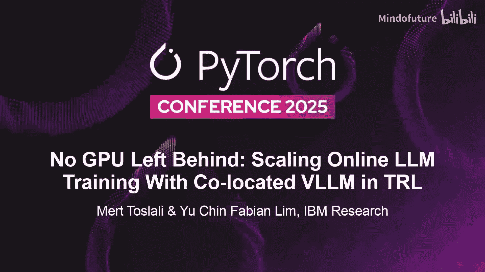
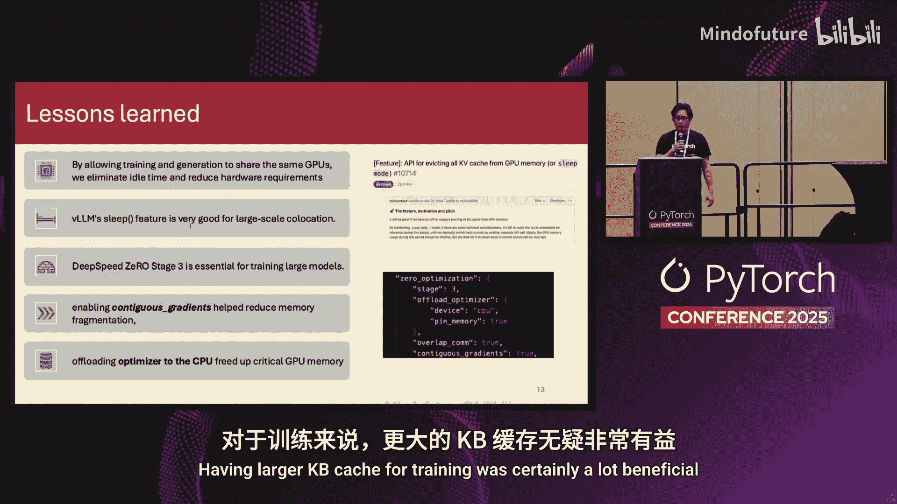
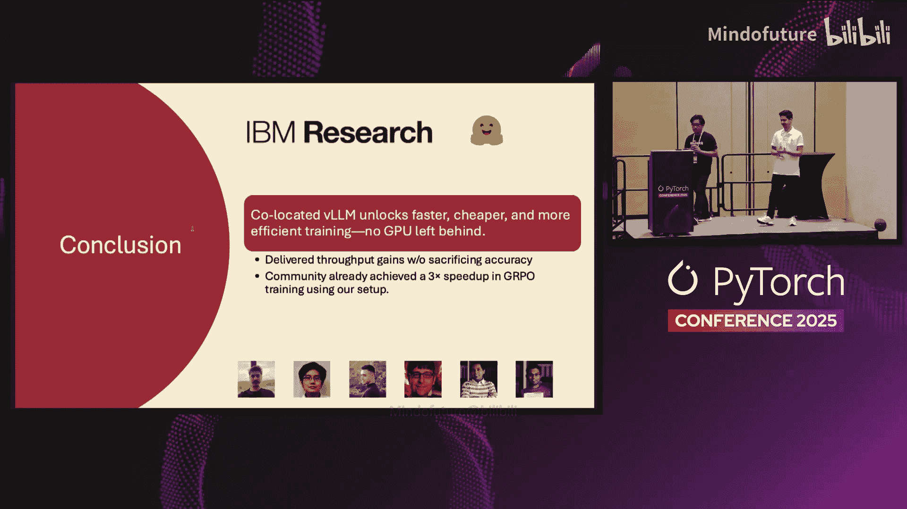

# 2025 Pytorch大会 ｜ Pytorch Conference 2025 p33 P33_不放弃任何GPU——基于...的在线LLM训练扩展-Mert_Toslali__Yu_Chin_Fabian_Lim -BV1b8kRB6EJG_p33-

Hello everyone， first of all， welcome to our session， thank you very much for coming。

 my name is Mer and my teammate here is Fabian。Today。

 we will present our talk titled No GPU Left Behind。

And this has been a collaboration work between IBM research and hugging F。So， let's go。

So I would like to first start by summarizing this whole talk in months slide so you know what you're into。

In this talk， we will present how we enable Torch native training and the LLM inference on the same GPUs。

By doing so， we were able to achieve three times faster GRPO training。

And we enabled seamless GPU share between training and inference processes。

 hence we were able to maximize the GPU memory utilization。

And our feature works across tensor or data parallel workflows as well as distributed to training framework deep speed。

 along with its optimization techniques such as03， CPUO loading and so on。

So first I want to do a quick recap on the GRPO group Re policy optimization。

 GRPO was first introduced in Deepse math paper where they use GRPO to teach LLMs how to reason。

So the GRPO has two main phases， training and the inference。

 during the inference we sample a batch of prompts and we generate completions using the current model。

 and then these completions are fed into reward model。

 and here the reward models are actually you can think them as like simple python functions。

 for example， the higher the length of completions， the higher the rewards。

And these rewards are used to calculate advantages and the advantages are just about relative advantage of the completions regarding each other。

 so each of the completion is better than others。And in the training part。

 you'll use these advantage signals to compute the loss and you update the moral weights。

 just like in a typical training setup。So there are various open source libraries to conduct GRPO。

 one of them is Hugingface CRL library and it's very popular。

 it has over 15K stars on Gitthub and nice thing about it is that it's torch native and it's very easy to use if you take a look at the figure on the right。

 not sure if it's clear but it's very easy to load your data set。

 define your reward functions such as the length function I mentioned。

 and then you configure your GRPO trainer with your model and your bed size etc and then you are able to boostt a GRPO trainer in a few minutes。

So we said as part of the ArL post training there is now inference and which comes with a cost when we study the magnitude of the inference cost。

 we realized that the inference can actually take up to five times longer than the training steps and when we investigate the TRL Gi issues we see that actually consistently complain about inference by all the users。

 the first one is talking about majority of the time in the generation a majority of the time of training is spent on the generation。

 the second month cost is a bottleneck in the GRPO and the third one is asking about multi deviceevice viaLM inference so that they can scale and reduce the cost。

So the message is clear， the inference part of the GRPO has to improve。So to help with this。

 TRL has VLM integration， but in a server mode， meaning that you have to deploy VLLM server to its own isolated GPU。

To do the inference and training processes on the different GPU。

 So you do remote calls between inference and training over and over again。

And then while the VLLM does the generations， the training GPUs have to sit idle and wait for the VLLM and while the training processes are happening。

 the VLLM GPUs again have to sit idle and wait for the training。

 so we call this ping pong game between training and the generation。

 which results in basedted GPU time。As well as the extra GPs just for the VLLM servers。

 And as a result， you get reduced overall throughput and higher cost。

So on the top I show a picture about typical T setup， say you have four GPUs。

 three of them are allocated to training already and you just deploy a VLM server on the fourth one into its own isolated GPU。

 so there is an opportunity here to end the ping pong game which is essentially collocating the training and the inference processes on the same GPUs。

If you could do that， not only you maximize the GPU me utilizationization。

 but also you have a chance to do GRPO even on a single GPU， which wasn't possible before。

So now you can actually do that today in Huging pastste T library。

 so we enable training and inference collocation building on the VLLM external launcher feature。

 so with this feature the training processes now launches VLLM in process using the external launcher following the SPM Dis。

 which is a single program multiple data。And this respects the Torch distributed process group。

 as well as the rank structure。And you don't have to rely on the rest APIs cinema because VLLM is running in memory and the VLLM and the training processes communicate via。

Native Torcos。As you can see in the figure called in the pet ball。And it's easy to enable this。

 actually you just set the VLLM mode in your GRPO convict to colcate and you're ready to go。

 you can share your GPUs between training and the inference。

 and actually we learned today that this actually became the default option for TRL today。

 so you don't even have to set this parameter。And there is one side note that I would like to mention which is about the GPU memory utilization so if you ever used VLLM before you may be familiar with this parameter。

 so now you are using the same GPU for non VLM processes as well。

 so you need to actually go ahead and set this GPU memory utilization not only use the default value and this is a bit tricky and cumbersome so to help with this we actually released an automation。

 you simply put your model as well as your training conflicts such as the bed size along with your hardware information。

 what kind of GPU have what is available。Capacity of it。 And then you。

 you get the GP memory utilization as a result。 so you can simply set that value。Thanks， but。

So I'm gonna go into a little bit more deep dive into how this is all implemented。

 how the parallelization works。 And then I'll talk a bit about the experiment， the results。

 experimental results in terms of the the tro metrics that we are able to obtain。

 and Ill also share a little bit about like the user feedback that we got from the community on how this has helped them with their GPO training。

So essentially， as Mer has mentioned， this is a pure torch native way of distributing your GP workloads across multiple GPUs。

So if you see the figure on the top， essentially VL M instances are running in parallel。

And they are basically run by Toch run Toch native。

 There is no additional framework that you need to install。

 and how many in VRM instances that you are running depends on， of course。

 how many GPs that you are currently running in parallel and essentially the batch。

 the train batch will get paralleled across all the GPs。

 So all the G all the VR instances are running in parallel to complete all the generations in a much shorter time as they would in a single server。

And that's the first point。 The second point is also like that for the reward calculations as well。

 as Mer has mentioned before that for GPO， we need to score the generations that are generated by the VLM。

 So the reward calculations are also done in parallel。

 Also thanks to torch run that's running all these processes in parallel and they are done only on that particular data chart。

And on top of this， we also support tensor parallel。

 So I will show later some of the instances that we that we run on like models up to 72 B。

 which obviously we cannot fit in a single GPU so we would actually have to run like tensor parallel8 ways for 72 billion model and the tensor parallels again。

 the tensor parallel instances of the VM will be running in tensor parallel cross data parallel as well。

 So if you say you have 32 gs， you would be running8 Tp with four times data parallel。

 And this would be again serve to scale up as you have more GP。

 you can scale up the larger data parallel and you can you can improve your。

And for those of you who are familiar with V， actually included a twin picture at the bottom。

 which goes to show how you would V would actually run the VLMs also in parallel。 But again。

 what we're doing here is torch native and you don't need to install any additional packages。

T L L currently supports FSDP and deep speed trainers。 and it's also easy to configure。

 it's got the similarnobs as you would with like if you are familiar with standard reinforcement learning settings like mini and micro batches T has the similar switches as you can also set these things。

 and another thing that we also included thanks to is that he implemented he also integrated VLM sleep mode。

 which is also important for colocation。 So as we mentioned for colocation would be running the model and the inference in the same machine sleep mode is important because then we can flush out the GPO memory and load the training weights that way you can have you can run higher batches for training can also improve your throughput level1 basically means that the crash is not safe onto the the machine but it doesn't really matter for GP。

 because anyway， every step you update。Faiing weight。

 So you don't really need to save the K the K B cash。 So sleep mode one is kind of sufficient。

And you can use colocation mode in TLL with all the seminal features from recent GPO papers。

 such as Dr。 GLPO Dpo， which has the overland control。

 the clip hire different kinds of reward scaling and averaging and also like things like important sampling。

 which are have come out to be very important for stable GPO training。

 all of these features are available in T， and we just learn today from the maintenance that they even have a page which shows you according to like the different papers that that they have how do you configure TLL to replicate some of the results in these papers as well。

Right， so to summarize we have so this P basically skips enables the following things。

 We are able to skip HttP communication between the server， the VRM server and the trainer。

 because both models are now living the same machine。

 we support DP and tensor parallel for improving your throughput and large models thanks to this SMD execution pattern。

 completely torch run only enabled by toch run， no additional packages needed。

 which turns out to be simplified deployment。 hence therefore we found out today from the maintenance that now this is the default mode。

 and everything is more robust because they are less pieces that's moving parts。

And for some of the experimental results that I'll show here。

 just focus your attention to the top left。 So here we have a smaller model， the 1。5 billion model。

 what we have a the vertical axis is the iterations per iterations per second。 so higher is better。

 and the horizontal is the batch size。 So what we can see is that for core location mode。

 as we improve the batch size and prove and push the throughput。

 we are able to get larger improvements all the way from batch size of two， which is 1。

2 x up to when we increase the batch size to 32 where we can do roughly 1。3 act of improvements。

And as we go to the larger models， we actually see bigger improvements。

 If you focus your attention to the figure on the upper right。

 you can see that for the larger model of 70 B， we can push the improvement all the way to 1。7 x。

And the two figures on the bottom essentially show equivalentence with the server mode。

 which is standalone VRM。 So we have the train loss curves on the those are the reward curves on the bottom left。

 which essentially shows that the curves on top of each other。

 So they are kind they are essentially algorithmically equivalent。

And the one on the bottom right which shows the evaluation scores for map 500。

 So for both training modes， we able get equivalent evaluation scores。

 proving that the the training is the same， just that with collocation。

 it runs a lot faster and it completes a lot sooner。

 And I should mention that the two figures on the bottom were done using 72 B models。

 which proves that our method is able to scale up to larger models and you're able to train bigger models and get and see better results。

And some of some of our key highlights。 So the coer of T advertised this new feature and in his in his LinkedIn。

 and we also had a blog that Ill encourage everybody to check out as well。

 which contains some of the details of this talk as well as more details。

 And we also got some pleasant feedback from the community which this particular user mentioned that ever since he switched to collocation。

 he was able to get a3 x improvement in his workloads and he was really happy with it on his 32 B model。

 So relatively large size model。Okay， so kind of going to start wrapping up now。 Yep。 so again。

 the key takeaways for today if you can train and generate on the same GPU。

 then you you reduce your idle time and you essentially improve the your resource usage videos your hardware requirements sleep is very important for colocation so you want to be able to flush out your weights when you're switching between training and infferencing so that you can train with larger batch sizes and you can infer with larger cabV catches。

We worked， we tried a lot with deep speed。 we tried with stage 2 and stage3。

 one of the things that we actually found was that while using stage 3。

 you want to you want to activate contiguous gradients and we found that this actually reduces the memory fragmentation。

 which was very good when we are flushing weights with sleep So so basically it's able to allow us to push larger batch sizes because there's less memory fragmentation and offloading all the weights and optimizer to the CPU really help during the training phase because the inference was just taking so much time having larger Kb cash for training was certainly a lot beneficial。

Right， and that's it for the presentation。 I'll be happy to take any questions， if they are。Okay。

 okay， then oh what's the question。Did you try on any larger models like。Multiple hundred。

Billion parameters。Like the yeah， the largest we tried so far was the 72 B。 Yeah。

 but do you think the trends will continue for larger models or。

That's something that we think it should， But we can't really say for sure because we've not tried it。

 but。Intuitively， it should， it should scale for it should the trend should continue for larger models and。

like up to two times faster GO training， but then in the comments we found out that like somebody used our technology and just able to get three times faster GRPO with the larger model 32 B so we don't like I don't see why with even larger models you will be able to scale well。

Cool， thanks。So to get the colocated VLM functionality。

 the only requirement is to have VLM installed and to set the flag to co locatedated。 Yeah， exactly。

 Yeah and but like we just learned that you don't even have to select the flag anymore。

 It's already set for you by default。So just if you're already。

 if you're running GPR and you have VLM installed， you'll automatically automatically benefit。

 But one thing you have to be a bit careful is you will need to set your utilization depending on your model size。

And we have a tool for that in the other slides。 You can put in your model parameters and it will give you a suggested value for that。

 So that will depend on。The models。 and that goes into the GP config Yeah， right yeah。

 it's just like a single parameter that says GPU utilization is a float value。

 and you want to set that to。To a a reasonable value。 Okay， and if you don't set that。

 then it won't used coloc。 It， it will it was still called co locate。

 but you might get O ms because then you would have basically the。

 the inference engine take up too much memory。 and it would if you don't offload the training weights。

 then you might O and during the inference phase。right， Thank you。Okay， thank you。

 Thank you very much。 Thank you for listening。

